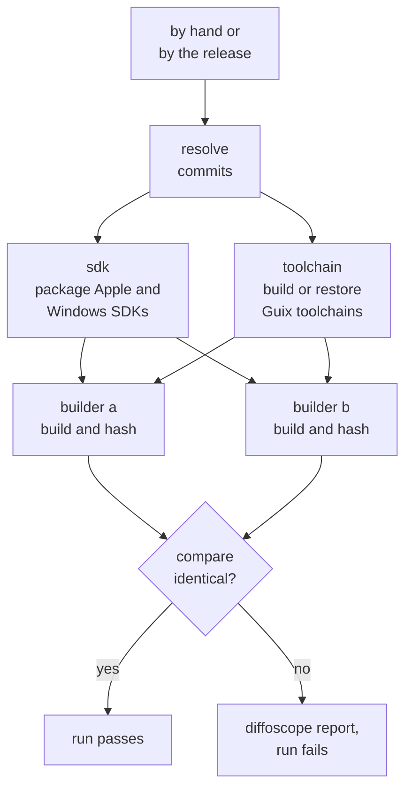

# Deterministic builds

Every published `bs` and `selector` binary is built in a
[Guix](https://guix.gnu.org/) container from a pinned, bootstrappable
toolchain. Each release build is made twice, by two builders on separate
runners, and the release continues only if the two are bit-identical.
Anyone with a Linux machine and Guix can rebuild a release from its tags
and compare the result with the published files.

## 1. Double Build

`double-build.yml`, in libbitcoin-server, is run by hand or by
[Build to Release](release#2-build-to-release). Run by hand, it takes a
branch or tag (`ref`) for all five repositories, by default the branch it
runs on. Called by the release, it takes the release's tag for each.



| Job | Does |
| --- | ---- |
| resolve | Resolves each `ref` to one commit in each repository (`git ls-remote`, the tagged commit of an annotated tag), so that both builders build the same commits |
| sdk | Packages the macOS SDK from Xcode on `macos-latest`, and the MSVC headers and libraries and the Windows SDK on `windows-latest`, as deterministic tar archives, and records their versions and hashes |
| toolchain | Builds each Guix toolchain from the pinned Guix commit, on each runner architecture, and caches its store closure under a hash of the Guix definitions |
| guix | Two builders per build. Each restores the toolchain, checks out the five repositories, builds in the Guix container and hashes its output |
| compare | Tabulates the hashes of both builders for every build; if any differ or any is missing, writes a diffoscope report per file and fails |

The two builders of a Linux build run on different architectures:
builder a on `ubuntu-24.04` (x64) and builder b on `ubuntu-24.04-arm`
(arm64), each cross-compiling for its target. The macOS and Windows builds
run both builders on `ubuntu-24.04`.

## 2. Build environment

The build definition is in `.github/guix` of libbitcoin-server:

| File | Defines |
| ---- | ------- |
| `channels.scm` | The Guix commit that pins every package |
| `manifest.scm` | The packages in the container for each host |
| `toolchains.scm` | The Linux cross toolchains, GCC 14 and binutils 2.46 against glibc 2.31 |
| `patches/` | Patches to GCC and glibc for reproducible output |
| `guix-build.sh` | Starts the container for one build |
| `build.sh` | Configures, builds and packages one build inside the container |
| `package-sdk.sh` | Packages the Apple or Windows SDK |

| Host | Compiler | Linker | Platform files |
| ---- | -------- | ------ | -------------- |
| `x86_64-linux-gnu`, `aarch64-linux-gnu` | GCC 14 (Guix cross) | binutils 2.46 | glibc 2.31 |
| `x86_64-apple-darwin`, `arm64-apple-darwin` | clang 19 | lld 19 | Apple SDK from Xcode, macOS 13.3 minimum |
| `x86_64-pc-windows-msvc`, `aarch64-pc-windows-msvc` | clang-cl 21 | lld-link 21 | MSVC headers and libraries, Windows SDK |

`guix-build.sh` runs `guix time-machine` at the pinned commit, then
`guix shell --container --pure --no-cwd`, so that nothing from the host
reaches the build except the sources (shared at `/distsrc`), the output
directory and the SDK. Inside, `build.sh`:

- sets `LC_ALL=C.UTF-8`, `TZ=UTC`, `HOME=/tmp` and umask `0022`,
- maps the source and every Guix store path out of the debug information
  (`-ffile-prefix-map`), and omits the compiler command line
  (`-gno-record-gcc-switches`),
- builds with `builds/cmake/install-cmake.sh` of the project, from the
  local sources, `release` and `static`, without tests and without an
  install RPATH,
- separates and packages the debug symbols, with fixed timestamps, and
  strips the binary,
- writes `SHA256SUMS` for the binary and its symbols.

Windows builds link with `-Brepro`. The Windows SDK is spelled for a
case-insensitive filesystem, so the compiler and linker read it through a
case-insensitive overlay.

## 3. Reproducing a release

A release names the tag of each of the five repositories it was built
from. Rebuilding it needs a Linux machine, x64 or arm64, that allows
unprivileged user namespaces.

First, install Guix 1.5.0 with its
[binary installer](https://guix.gnu.org/manual/en/html_node/Binary-Installation.html).

Clone the five repositories side by side in one directory, each at its
release tag:

```
$ git clone --branch <system tag> https://github.com/libbitcoin/libbitcoin-system src/libbitcoin-system
$ git clone --branch <database tag> https://github.com/libbitcoin/libbitcoin-database src/libbitcoin-database
$ git clone --branch <network tag> https://github.com/libbitcoin/libbitcoin-network src/libbitcoin-network
$ git clone --branch <node tag> https://github.com/libbitcoin/libbitcoin-node src/libbitcoin-node
$ git clone --branch <server tag> https://github.com/libbitcoin/libbitcoin-server src/libbitcoin-server
```

Set the variables of the build, from its entry in the `guix` matrix of
`.github/workflows/double-build.yml` at the server tag, and run
`guix-build.sh` with the source and output directories. For
`bs-linux-x64`:

```
$ HOST=x86_64-linux-gnu BASENAME=bs-linux-x64 \
  OPTIONS="-Denable-avx2=ON -Denable-sse41=ON" \
  FLAGS="-march=x86-64-v3 -mtune=generic" \
  LINKFLAGS="-static-libstdc++ -static-libgcc" \
  bash src/libbitcoin-server/.github/guix/guix-build.sh src build
```

A `selector` build also sets `PROJECT=libbitcoin-system` and
`PROGRAM=selector`. The first run builds the toolchain from source, which
can take hours; later runs reuse it from the Guix store.

Then compare `build/SHA256SUMS` with the hashes of the published files:

```
$ sha256sum bs-linux-x64 bs-linux-x64.debug
```

The checkout directory and the build machine do not affect the output.

The macOS and Windows builds also need the SDK the release was built
with: set `SDK` to the directory unpacked from the archive that
`package-sdk.sh` writes, and `DEPLOYMENT_TARGET=13.3` for macOS. The
archive is identical only from the same Xcode, or the same MSVC and
Windows SDK versions. Each build's `toolchain.txt`, in the artifacts of
the Double Build run, records those versions and the archive's hash.
