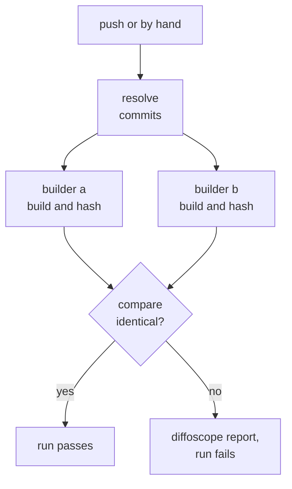

# Deterministic builds

How release builds of `bs` are made reproducible, so that anyone building
the same source gets the same files as those released.

The first step is the Double Build: two independent builders on GitHub's
hosted runners build the same commits, and the run passes only if their
output is bit-identical. Guix, a pinned and bootstrappable toolchain, is
the later step.

## 1. Double Build

`double-build.yml`, in libbitcoin-server, runs on push and by hand. Run by
hand, it takes a branch or tag (`ref`) for all five repositories, by
default the branch it runs on.

| Job | Does |
| --- | ---- |
| resolve | Resolves `ref` to one commit in each repository (`git ls-remote`, the tagged commit of an annotated tag), so that both builders build the same commits |
| build | Two builders, each on its own `ubuntu-24.04` runner, differing in checkout path, time zone, umask, machine and start time |
| compare | Tabulates the hashes of both builds; if any differ, writes a diffoscope report per file and fails |

Each builder builds as the release does: CMake, clang 18, static release,
`-march=x86-64-v3 -mtune=generic -g` with AVX2 and SSE4.1, static C++ and
GCC runtimes and a build ID. It then removes RPATH, separates the debug
symbols into a compressed `.debug` file, strips the binary and adds a debug
link. Its artifact holds `bs-linux-x64`, `selector-linux-x64`, their
`.debug` files, `SHA256SUMS` and `toolchain.txt` (the runner image, clang,
ld and cmake versions, path, time zone and umask).

The Double Build compares its two builders with each other, not with a
published release.
