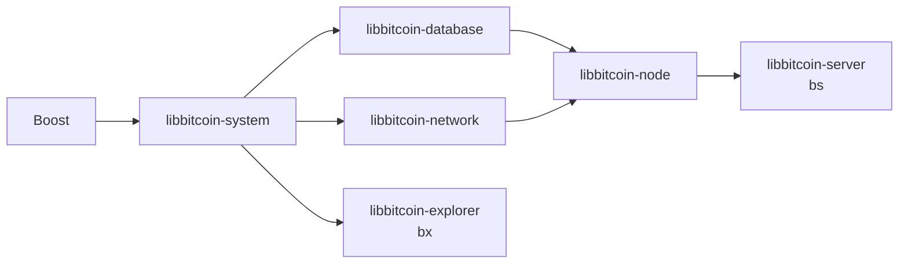
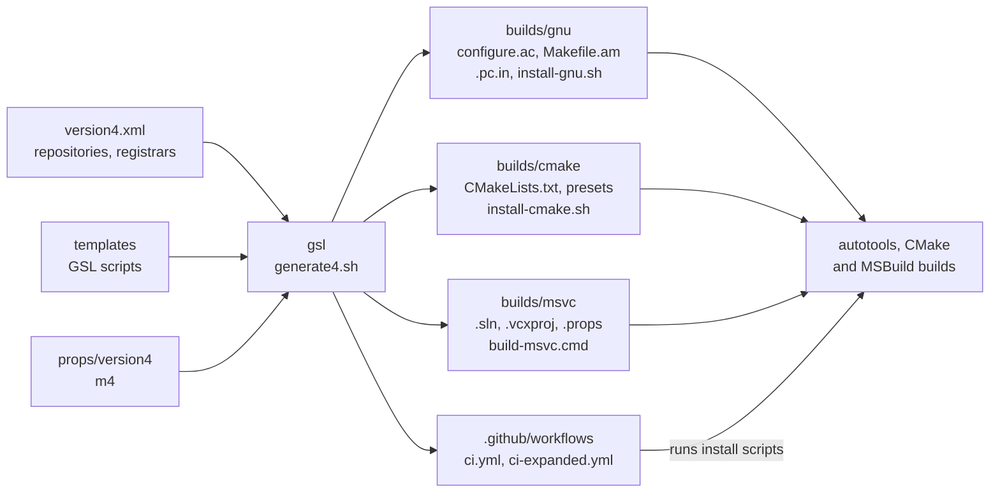

# Build Architecture

Every libbitcoin repository carries three build systems (autotools, CMake
and Visual Studio), install scripts for each, CI workflows and editor
settings. None of these files is written by hand. They are generated by
[libbitcoin-build](../../building/libbitcoin-build) from one XML model of the
repositories, processed through a set of GSL templates, and committed to
each repository. This page describes the model, the generator, and what the
generated files do; instructions for building are in
[Building](../../building/index) and [Build options](../../building/options).
Paths are relative to the root of
[libbitcoin-build](https://github.com/libbitcoin/libbitcoin-build) at master
`c045b17` (2026-10-26), and of
[libbitcoin-system](https://github.com/libbitcoin/libbitcoin-system) at
master `2d560dc1` (2026-10-28) for generated files.

## 1. The model

`version4.xml` is the one description of everything that is built. It has
three parts: a `repository` element per libbitcoin repository, `registrar`
elements holding definitions shared by all repositories, and a `templates`
element that lists the templates and where their output goes.

### 1.1 Repositories and targets

A repository declares its version, languages and targets. A target is the
`library`, its `test` executable, or a `binary` (a console application or
examples). Each target names its source and header directories, its
dependencies, its options and its compiler settings. Simplified, from
libbitcoin-system:

```xml
<repository name="libbitcoin-system">
  <version major="4" minor="0" />
  <library name="libbitcoin-system">
    <sources path="src" recursive="true" />
    <headers path="include" recursive="true" root="true" />
    <option name="avx2" type="enable" default="no" msvc="/p:Option-avx2=true" />
    <dependency name="boost" version="1.86.0" />
    <compiler standard="20">
      <flag option="avx2" environmental="true" type="public">
        <symbol value="-mavx" />
        <symbol value="-mavx2" />
      </flag>
    </compiler>
  </library>
  <test name="libbitcoin-system-test" option="tests" type="with" default="yes" />
</repository>
```

The library dependencies form the chain that every install script and CI
job follows. libbitcoin-server adds the `bs` binary and libbitcoin-explorer
the `bx` binary; tests depend on their library and Boost. Other
libraries can optionally be linked, each in place of the library's own
implementation, which is the default:

| Library | Can link | Effect |
| ------- | -------- | ----------- |
| libbitcoin-system | libsecp256k1, UltrafastSecp256k1 (compatibility layer) | Replaces the internal secp256k1 compatibility header (`src/crypto/secp256k1/interface.hpp`) |
| libbitcoin-network | OpenSSL, wolfSSL (compatibility layer) | Replaces the internal OpenSSL compatibility headers (`ssl/openssl/`) |



### 1.2 Registrars

The registrars hold what would otherwise be repeated in every repository.
A repository refers to a dependency or an option by name, and the
generator resolves it against the registrar.

| Registrar | Contents |
| --------- | -------- |
| `dependency` | For each library and external dependency: its source (GitHub owner and tag, archive URL, NuGet package), its build methods (`gnu`, `cmake`, `preset`, `msbuild`, `boost_build`, `nuget`), the options used when it is built as a dependency, and its CMake package and target (`bitcoin::system`, `Boost::headers`) |
| `build-options` | The install script options (`--build-config`, `--build-link`, `--prefix`, `--build-limit`, `--hardware-optimized` and others), with variable names, types and help text |
| `presets` | The CMake presets (`nix-gnu-debug-static` and so on), composed from base, debug, release, static and shared settings |
| `actions` | The GitHub actions used by the workflows, pinned by commit hash |

Boost is defined once, as version `1.86.0` for source builds and as the
`libbitcoin-boost` NuGet package `1.91.0.1` for Visual Studio. A
`toolchain` element defines the Visual Studio toolset (`v145`), the
solution configurations (`StaticDebug`, `StaticRelease`, and hidden
dynamic and LTCG variants) and the platforms (`Win32`, `x64`, `ARM64`).

## 2. The generator

The generator is the iMatix GSL code generator: a GSL template is a script
that walks an XML tree and writes text. `generate4.sh` (or `generate4.cmd`)
clears `output/` and calls `generate.sh version4.xml`, which runs three
stages:

| Stage | Script | Effect |
| ----- | ------ | ------ |
| Generate | `process/generate_artifacts.sh.gsl` | Runs `gsl` once per template listed in `version4.xml`, writing every repository's files under `output/version4/` |
| Copy statics | `process/copy_statics.sh.gsl` | Adds the fixed files (property sheets from `props/version4/`, `nuget.config`, `build_base.bat`), substituting repository, dependency and target names in their paths |
| Copy projects | `process/copy_projects.sh.gsl` | Copies each repository's output into the sibling repository clone; arguments restrict the copy to matching repositories |

The process scripts are themselves generated from the model, so the list
of templates exists only in `version4.xml`.



### 2.1 Templates and artifacts

Each template writes one kind of file into each repository. Templates are
under `templates/`; `[library]` is the repository name and `[suffix]` the
name without `libbitcoin-`.

| Templates | Artifacts |
| --------- | --------- |
| `gnu/configure.ac.gsl`, `Makefile.am.gsl`, `pc.in.gsl`, `shell/runner.sh.gsl` | `builds/gnu/configure.ac`, `Makefile.am`, `[library].pc.in` (pkg-config), `test_runner.sh` |
| `cmake/CMakeLists.txt.gsl`, `CMakePresets.json.gsl`, `config.cmake.in.gsl` | `builds/cmake/CMakeLists.txt`, `CMakePresets.json`, `[library]-config.cmake.in` |
| `msbuild/sln.gsl`, `vcxproj.gsl`, `vcxproj.filters.gsl`, `packages.config.gsl`, `debug.natvis.gsl` | `builds/msvc/vs2026/`: the solution, and per target a project, its filters and NuGet `packages.config`; `builds/msvc/debug.natvis` |
| `shell/install-gnu.sh.gsl`, `install-cmake.sh.gsl`, `install-presets.sh.gsl`, `build-msvc.cmd.gsl` | `builds/gnu/install-gnu.sh`, `builds/cmake/install-cmake.sh`, `install-presets.sh`, `builds/msvc/build-msvc.cmd` |
| `yml/ci.yml.gsl`, `ci-expanded.yml.gsl`, `version-tag.yml.gsl` | `.github/workflows/` |
| `vscode/code-workspace.gsl`, `settings.json.gsl` | `builds/vscode/[suffix].code-workspace`, `.vscode/settings.json` |
| `src/include.hpp.gsl`, `version.hpp.in.gsl` | `include/bitcoin/[suffix].hpp`, `version.hpp.in` |
| `git/gitignore.gsl`, `CODEOWNERS.gsl` | `.gitignore`, `.github/CODEOWNERS` |

The Visual Studio property sheets are maintained as files under
`props/version4/`, not generated: shared sheets per platform and
configuration (`x64.props`, `ReleaseLIB.props`, `DebugSEXE.props`), an
import sheet per library, and a project sheet per target. The project sheet
maps the target's options to preprocessor definitions. The import sheet of
a library adds its include path, its `.lib`, and the path to its build
output in the sibling repository, for any project that depends on it.

## 3. File lists

The model names source directories, not files. The autotools and Visual
Studio templates read those directories in the sibling repository clones at
generation time (`lib/filesystem.gsl`), and write every matching file into
`Makefile.am` and the `.vcxproj` explicitly: `.h`, `.hpp` and `.ipp`
headers, `.c` and `.cpp` sources, and for Visual Studio `.rc` resources. A
file added to a repository is therefore not part of those builds until the
generator runs again. `CMakeLists.txt` lists directories instead
(`file( GLOB_RECURSE ... CONFIGURE_DEPENDS )`), and collects the files when
CMake configures.

The aggregate header `include/bitcoin/[suffix].hpp` is generated from the
same discovery of the header directories.

## 4. Build options

An `option` in the model becomes a `configure` argument (`--enable-avx2`),
a CMake option (`enable-avx2`), an install script argument passed to both,
and, through its `msvc` attribute, a `build-msvc.cmd` argument mapped to an
MSBuild property (`/p:Option-avx2=true`). Its `define` elements become
preprocessor definitions and its `flag` elements compiler flags.

### 4.1 Intrinsics

The x86 intrinsics options of libbitcoin-system add compiler flags. Each
flag in the model carries a short test program, which the generated
`configure.ac` and `CMakeLists.txt` compile with the flags to verify that
the compiler supports them.

| Option | GNU and Clang flags | Visual Studio |
| ------ | ------------------- | ------------- |
| `sse41` | `-msse4.1` | `/arch:AVX` |
| `avx2` | `-mavx -mavx2` | `/arch:AVX2` |
| `avx512` | `-mavx512f -mavx512bw -mavx512vl` | `/arch:AVX512` |
| `avx512ifma` | `-mavx512ifma -mavx512vl` | `WITH_AVX512IFMA` |
| `avxifma` | `-mavxifma` | `/arch:AVX2`, `WITH_AVXIFMA` |
| `shani` | `-msse4 -msha` | `WITH_SHA` |
| `sha512` | `-mavx2 -msha512` | `/arch:AVX2`, `WITH_SHA512` |
| `aesni` | `-msse4.1 -maes -mpclmul` | `WITH_AESNI` |
| `vaes` | `-mavx2 -maes -mpclmul -mvaes -mvpclmulqdq` | `/arch:AVX2`, `WITH_VAES` |

The flags are public. `configure.ac` substitutes them into the pkg-config
`Cflags`, and `CMakeLists.txt` attaches them to the library target with
`PUBLIC` visibility, so dependents compile with the same instruction sets.
In Visual Studio the width options raise an `Option-arch` property (highest
wins), which `x64.props` and `Win32.props` map to
`EnableEnhancedInstructionSet`, defaulting to `AdvancedVectorExtensions2`.

When an x86 option is off, the build still compiles its test program
without the flags, and reports an environmental override if it compiles
(as when `CFLAGS` already enables the instruction set). The ARM options
(`sha`, `sha3`, `aes`) add no flags: the build tests whether the compiler
environment provides the intrinsics, and fails if an option is enabled and
they are not available.

### 4.2 Other options

| Option | Scope | Effect |
| ------ | ----- | ------ |
| `--with-valgrind` | libbitcoin-system | defines `WITH_VALGRIND` (valgrind memcheck client requests) |
| `--enable-cuda` | libbitcoin-system | defines `WITH_CUDA` (default on) |
| `--with-ssl` | libbitcoin-network | defines `WITH_SSL` and adds the `src/ssl` sources (default on) |
| `--with-embedded` | `bs` | defines `WITH_EMBEDDED`, compiling web pages into the console application |
| `--enable-ndebug`, `--enable-isystem` | autotools | define `NDEBUG` (default on); use `-isystem` for dependency includes |
| `--with-tests`, `--with-examples`, `--with-console`, `--with-tools` | per target | whether the target is built |

Every target also compiles as C++20 with the warning and hardening flags
of its `compiler` element (`-Wall`, `-Wextra`, `-fstack-protector-all` and
others). The install scripts set `-Og -g1` or `-O3` from `--build-config`,
and with it `--hardware-optimized` adds `-march=native -mtune=native`.
`--build-valgrind=<filter>` runs the libbitcoin-system tests matching the
filter under valgrind after the normal test run.

## 5. Install scripts

An install script builds its repository together with everything below it
in the dependency chain, in order. For libbitcoin-server, `install-gnu.sh`
runs:

```sh
build_boost "boost" ...                  # with --build-boost
build_gnu "libbitcoin-system"   ... --without-tests --without-examples
build_gnu "libbitcoin-database" ... --without-tests --without-tools
build_gnu "libbitcoin-network"  ... --without-tests
build_gnu "libbitcoin-node"     ... --without-tests
build_gnu "libbitcoin-server"   ...
test_gnu  "libbitcoin-server"   ...
```

Each libbitcoin dependency is cloned at the tag in the `dependency`
registrar (or taken from `--build-src-dir` with `--build-use-local-src`),
built with the registrar's dependency options, and installed to `--prefix`
before the next starts. Only the target repository runs its tests.
`--build-limit` stops after external dependencies or after libbitcoin
dependencies, or builds the target alone. The libraries find each other
through pkg-config (`PKG_CHECK_MODULES`) or through `find_package` and the
exported CMake targets. `install-cmake.sh` and `install-presets.sh` follow
the same sequence with CMake.

Boost is built only when requested. The script downloads the source
archive named in the registrar, bootstraps `b2`, and installs Boost with
`cxxstd=20` and the link mode of the build. `build-msvc.cmd` instead
restores each solution's NuGet packages, Boost among them, and builds the
library projects of the chain in order, then the target's binaries and
tests. The test project runs its tests as a post-build step in release
configurations.

## 6. Continuous integration

The `ci` element of each repository lists entries, each a runner image with
a compiler, packages and options, and its jobs. A job names a build method
(`gnu`, `cmake`, `presets` or `msvc`), a configuration and a link mode. For
libbitcoin-system:

| Image | Compiler | Jobs |
| ----- | -------- | ---- |
| `windows-latest`, `windows-2025-vs2026` | MSVC (vs2026, x64) | `StaticDebug`, `StaticRelease` |
| `macos-latest` | Clang | gnu and cmake, debug and release, static and dynamic |
| `ubuntu-24.04` | Clang 18, 19; GCC 13, 14, 15, 16 | gnu, cmake and presets |
| `ubuntu-24.04` | GCC 13 | one gnu job with lcov coverage |
| `ubuntu-24.04` | GCC 14 with valgrind | gnu debug static, `--with-valgrind --build-valgrind=secp256k1_ctime_tests` |

Each job checks out the repository and runs its install script with
`--build-use-local-src`, the job's `--build-config` and `--build-link`, and
`--build-boost`. The script builds the dependency chain, the repository and
its tests, and prints the test logs.

Two workflows are generated from the same entries. Jobs marked
`gate="true"` in the model form `ci.yml`, which runs on push and pull
request when source, test or build paths change. `ci-expanded.yml` holds
every job and runs on manual dispatch. The coverage job sends lcov output
to Coveralls, excluding the paths in the entry's `coverage` element.
`version-tag.yml` creates a version tag on manual dispatch.

libbitcoin-build has its own CI, which clones all six repositories and runs
`generate4.sh` on Ubuntu and macOS.
