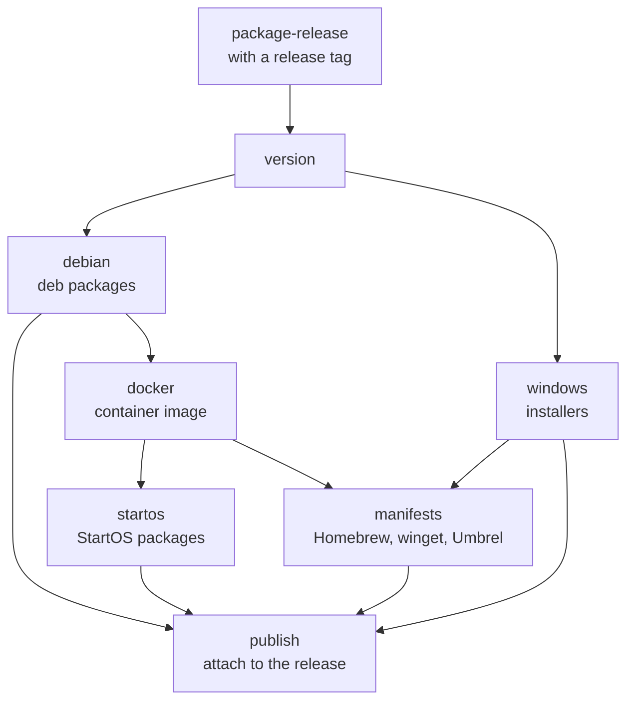

# Packaging

How release builds of Bitcoin Server (`bs`) are packaged for package
managers, as a container image, and as apps for node platforms. Packages
contain the signed builds of a release ([Release builds](release)).

## 1. Packages

| Manager | Platform | Architectures | Package | Installs |
| ------- | -------- | ------------- | ------- | -------- |
| apt (deb) | Linux | x64, arm64 | `libbitcoin-server_<version>_<arch>.deb` (`amd64`, `arm64`) | The best variant the processor supports, linked as `/usr/bin/bs` |
| Homebrew | macOS | x64, arm64 | Formula `libbitcoin-server.rb` | `bs-macos-arm64` or `bs-macos-x64`, as `bs` |
| winget | Windows | x64, arm64 | `Libbitcoin.Server`, an Inno Setup installer (`libbitcoin-server-<version>-windows-<arch>-setup.exe`) | The best variant the processor supports, as `bs.exe`, with its directory added to the system `PATH` unless that installer task is unchecked |
| Docker | Linux | x64, arm64 | Image `ghcr.io/libbitcoin/libbitcoin-server:<version>` (`linux/amd64`, `linux/arm64`) | Runs the best variant the processor supports ([§5](#5-containers)) |
| Umbrel | umbrelOS | x64, arm64 | App `bitcoin-server` (`libbitcoin-server-<version>-umbrel.tar.gz`), on the Docker image | As Docker ([§5.2](#52-umbrel)) |
| StartOS | StartOS 0.4 | x64, arm64 | Package `bitcoin-server` (`.s9pk`), on the Docker image | As Docker ([§5.3](#53-startos)) |

## 2. Variants

The deb packages, the Windows installers and the Docker image each hold
two variants of `bs` and the `selector`, which reports the processor's
features. The first variant whose required features the processor has is
used, at install for a deb or an installer, and at each start for the
image; the install or start fails if neither is supported.

| Platform | Architecture | Baseline | Requires | Optimized | Requires |
| -------- | ------------ | -------- | -------- | --------- | -------- |
| Linux, Docker | x64 | `bs-linux-x64` | avx2 | `bs-linux-x64-shani` | shani, avx2, sse41 |
| Linux, Docker | arm64 | `bs-linux-arm64` | neon | `bs-linux-arm64-sha2` | neon, aes, sha2 |
| Windows | x64 | `bs-windows-x64.exe` | avx2 | `bs-windows-x64-shani.exe` | shani, avx2, sse41 |
| Windows | arm64 | `bs-windows-arm64.exe` | neon | `bs-windows-arm64-sha2.exe` | neon, aes, sha2 |
| macOS | x64 | `bs-macos-x64` | aesni, avx2, sse41 | | |
| macOS | arm64 | `bs-macos-arm64` | neon, aes, sha2, sha3 | | |

Every arm64 processor has NEON (Advanced SIMD is required by
ARMv8-A), so the arm64 baseline is not checked.

The Homebrew formula holds one build per architecture, with no selector.
Both builds require macOS 13.3, and every Mac that runs it has the
features of its build: every Apple silicon processor, and every Intel
processor of a Mac supported by macOS 13 (2017 and later).

## 3. Package Release

`package-release.yml`, in libbitcoin-server, is run by hand with a release
tag. Each job that takes builds from the release downloads them with their
signatures, and fails unless every signature verifies. Its jobs:



| Job | Does |
| --- | ---- |
| version | Takes the version from the tag (without its `v`) |
| debian | Builds a deb per architecture (`dpkg-deb`), and assembles the variants of each architecture for the image |
| docker | Builds the image for both architectures and pushes it to the GitHub container registry |
| windows | Builds an installer per architecture (Inno Setup) |
| manifests | Writes the Homebrew formula, the winget manifests and the Umbrel app |
| startos | Builds a StartOS package per architecture, with the image pinned by digest |
| publish | Attaches the packages, formula, manifests and apps to the release, with their SHA-256 checksums (`packages-sha256.txt`) |

## 4. Distribution

The container image is pushed to the GitHub container registry by the
`docker` job. Every other package is published as an asset of the release,
and reaches its distribution repository from there:

| Package | Repository | Submission |
| ------- | ---------- | ---------- |
| deb | A libbitcoin apt repository | The deb is added, the index regenerated and its `Release` file signed with the repository key |
| Homebrew formula | A libbitcoin tap (`libbitcoin/homebrew-tap`) | The formula is committed to the tap |
| winget manifests | `microsoft/winget-pkgs` | A pull request with the manifests, validated and merged by Microsoft |
| Docker image | `ghcr.io/libbitcoin/libbitcoin-server` | Pushed by `package-release`; the package is public |
| Umbrel app | A libbitcoin community app store, or `getumbrel/umbrel-apps` | The app is committed to the store, or submitted to Umbrel by pull request |
| StartOS package | A StartOS registry | The package is submitted to the registry |

The formula, manifests and Umbrel app refer to the release's download
URLs, so each is submitted once the release is published.

| Package | Users install with |
| ------- | ------------------ |
| deb | `apt install libbitcoin-server`, once the repository and its key are added |
| Homebrew formula | `brew install libbitcoin/tap/libbitcoin-server` |
| winget manifests | `winget install Libbitcoin.Server` |
| Docker image | `docker pull ghcr.io/libbitcoin/libbitcoin-server:<version>` |
| Umbrel app | The app store in umbrelOS |
| StartOS package | The registry in StartOS |

## 5. Containers

### 5.1 Docker

The image runs `bs` as user and group 1000, with its data in the `/data`
volume and its configuration in `/data/bs.cfg`. On first start, when
`/data/bs.cfg` does not exist, the image copies its default configuration
there:

```ini
[database]
path = bitcoin

[log]
path = log

[admin]
bind = 0.0.0.0:8080
connections = 10

[native]
bind = 0.0.0.0:8180
connections = 10
```

| Port | Service |
| ---- | ------- |
| 8333 | P2P |
| 8080 | Admin (management console) |
| 8180 | Native (block explorer, REST and WebSocket) |

`docker stop` sends SIGTERM, which closes the store.

### 5.2 Umbrel

The app runs the image, pinned by digest, with its data under the app's
`data/bs` directory.

| Port | Service |
| ---- | ------- |
| 8186 | Admin, through Umbrel's app proxy (the app's Open button, behind the Umbrel login) |
| 8187 | Native (block explorer) |
| 8334 | P2P (`inbound.bind`), since Umbrel's Bitcoin Node app holds 8333 |

Backups exclude the store (`bitcoin/`) and the logs (`log/`). The stop
grace period is 5 minutes 30 seconds, for the store to close.

### 5.3 StartOS

The package runs the image, pinned by digest, on x86_64 and aarch64.

| Interface | Port | Service |
| --------- | ---- | ------- |
| Web UI | 8080 | Admin (management console) |
| Block Explorer | 8180 | Native (block explorer) |
| Peer | 8333 | P2P |

StartOS serves the web interfaces over HTTPS, with its own certificate
authority. Its health check is that the admin port is listening. The stop
timeout is 5 minutes, and backups exclude `bitcoin/` and `log/`.

The package requires 15 GiB of RAM as StartOS reports it, which admits a
16 GB machine (StartOS compares against the total the kernel reports,
about 2.3% under the installed RAM). StartOS does not offer the package on
a smaller machine.
