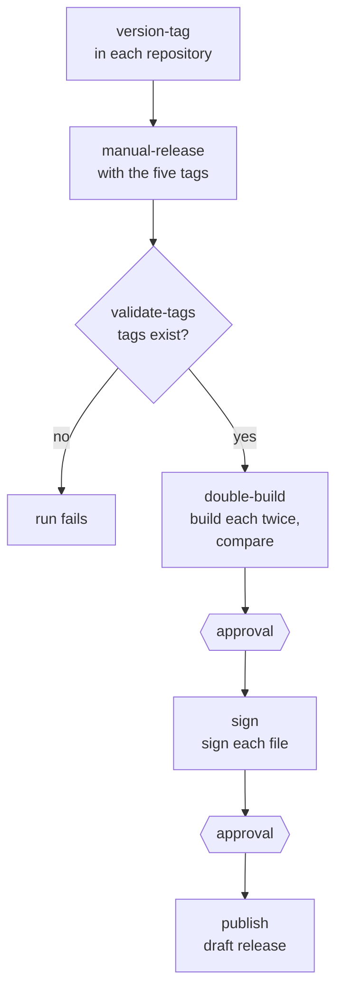

# Release builds

The published builds of `bs` are made by two GitHub Actions workflows,
both run by hand: one tags each repository with a version, and one
builds, signs and publishes the server from those tags.

## 1. Version tags

Each of libbitcoin-system, -database, -network, -node and -server has a
`version-tag.yml` workflow. Its inputs are a branch (`master` by default),
a tag description and a tag suffix. It computes the version from the
branch:

| Part | Source |
| ---- | ------ |
| Major | `LIBBITCOIN_VERSION_MAJOR` in `builds/cmake/CMakeLists.txt` |
| Minor | `LIBBITCOIN_VERSION_MINOR` in `builds/cmake/CMakeLists.txt` |
| Patch | The number of commits on the branch (`git rev-list --count HEAD`) |

The tag is `v<major>.<minor>.<patch>` followed by the suffix, and is
created as an annotated tag and pushed. The workflow fails if the tag
already exists.

## 2. Build to Release

`manual-release.yml`, in libbitcoin-server, takes a tag for each of the
five repositories, and an optional suffix for the release title. Its four
jobs run in order.

### 2.1 validate-tags

Checks out each repository at its tag, and fails unless each tag exists
as a tag (not a branch or commit).

### 2.2 double-build

Runs the [Double Build](deterministic) with the five tags. Each build is
made twice in a pinned Guix container, cross-compiled on Linux runners,
and the job fails unless both builders produce bit-identical files
([Deterministic builds](deterministic)):

| Build | Host | Compiler | Target | Compiles in |
| ----- | ---- | -------- | ------ | ----------- |
| `bs-linux-x64` | `x86_64-linux-gnu` | GCC 14 | `x86-64` |  |
| `bs-linux-x64-sse41` | `x86_64-linux-gnu` | GCC 14 | `x86-64` | sse41 |
| `bs-linux-x64-shani` | `x86_64-linux-gnu` | GCC 14 | `x86-64-v2` | shani, aesni |
| `bs-linux-x64-avx2` | `x86_64-linux-gnu` | GCC 14 | `x86-64-v3` | avx2, aesni |
| `bs-linux-x64-avx2-shani` | `x86_64-linux-gnu` | GCC 14 | `x86-64-v3` | avx2, shani, aesni |
| `bs-linux-x64-avxifma` | `x86_64-linux-gnu` | GCC 14 | `x86-64-v3` | avxifma, avx2, shani, aesni |
| `bs-linux-x64-avx512` | `x86_64-linux-gnu` | GCC 14 | `x86-64-v4` | avx512, avx2, aesni |
| `bs-linux-x64-avx512-shani` | `x86_64-linux-gnu` | GCC 14 | `x86-64-v4` | avx512, avx2, shani, aesni |
| `bs-linux-x64-avx512-avxifma` | `x86_64-linux-gnu` | GCC 14 | `x86-64-v4` | avx512, avx2, avxifma, shani, aesni |
| `bs-linux-x64-avx512ifma` | `x86_64-linux-gnu` | GCC 14 | `x86-64-v4` | avx512ifma, avx512, avx2, shani, aesni |
| `bs-linux-arm64` | `aarch64-linux-gnu` | GCC 14 | `armv8-a` |  |
| `bs-linux-arm64-sha2` | `aarch64-linux-gnu` | GCC 14 | `armv8-a+aes+sha2` | sha2, aes |
| `bs-linux-arm64-sha3` | `aarch64-linux-gnu` | GCC 14 | `armv8.2-a+aes+sha2+sha3` | sha3, sha2, aes |
| `bs-macos-x64` | `x86_64-apple-darwin` | clang 19 | `x86-64`, macOS 13.3 |  |
| `bs-macos-x64-sse41` | `x86_64-apple-darwin` | clang 19 | `x86-64`, macOS 13.3 | sse41 |
| `bs-macos-x64-shani` | `x86_64-apple-darwin` | clang 19 | `x86-64-v2`, macOS 13.3 | shani, aesni |
| `bs-macos-x64-avx2` | `x86_64-apple-darwin` | clang 19 | `x86-64-v3`, macOS 13.3 | avx2, aesni |
| `bs-macos-x64-avx2-shani` | `x86_64-apple-darwin` | clang 19 | `x86-64-v3`, macOS 13.3 | avx2, shani, aesni |
| `bs-macos-x64-avxifma` | `x86_64-apple-darwin` | clang 19 | `x86-64-v3`, macOS 13.3 | avxifma, avx2, shani, aesni |
| `bs-macos-x64-avx512` | `x86_64-apple-darwin` | clang 19 | `x86-64-v4`, macOS 13.3 | avx512, avx2, aesni |
| `bs-macos-x64-avx512-shani` | `x86_64-apple-darwin` | clang 19 | `x86-64-v4`, macOS 13.3 | avx512, avx2, shani, aesni |
| `bs-macos-x64-avx512-avxifma` | `x86_64-apple-darwin` | clang 19 | `x86-64-v4`, macOS 13.3 | avx512, avx2, avxifma, shani, aesni |
| `bs-macos-x64-avx512ifma` | `x86_64-apple-darwin` | clang 19 | `x86-64-v4`, macOS 13.3 | avx512ifma, avx512, avx2, shani, aesni |
| `bs-macos-arm64` | `arm64-apple-darwin` | clang 19 | `armv8-a`, tuned for Apple M1, macOS 13.3 |  |
| `bs-macos-arm64-sha2` | `arm64-apple-darwin` | clang 19 | `armv8-a+aes+sha2`, tuned for Apple M1, macOS 13.3 | sha2, aes |
| `bs-macos-arm64-sha3` | `arm64-apple-darwin` | clang 19 | `armv8.2-a+aes+sha2+sha3`, tuned for Apple M1, macOS 13.3 | sha3, sha2, aes |
| `bs-windows-x64` | `x86_64-pc-windows-msvc` | clang-cl 21 | `x86-64` |  |
| `bs-windows-x64-sse41` | `x86_64-pc-windows-msvc` | clang-cl 21 | `x86-64` | sse41 |
| `bs-windows-x64-shani` | `x86_64-pc-windows-msvc` | clang-cl 21 | `x86-64-v2` | shani, aesni |
| `bs-windows-x64-avx2` | `x86_64-pc-windows-msvc` | clang-cl 21 | `x86-64-v3` | avx2, aesni |
| `bs-windows-x64-avx2-shani` | `x86_64-pc-windows-msvc` | clang-cl 21 | `x86-64-v3` | avx2, shani, aesni |
| `bs-windows-x64-avxifma` | `x86_64-pc-windows-msvc` | clang-cl 21 | `x86-64-v3` | avxifma, avx2, shani, aesni |
| `bs-windows-x64-avx512` | `x86_64-pc-windows-msvc` | clang-cl 21 | `x86-64-v4` | avx512, avx2, aesni |
| `bs-windows-x64-avx512-shani` | `x86_64-pc-windows-msvc` | clang-cl 21 | `x86-64-v4` | avx512, avx2, shani, aesni |
| `bs-windows-x64-avx512-avxifma` | `x86_64-pc-windows-msvc` | clang-cl 21 | `x86-64-v4` | avx512, avx2, avxifma, shani, aesni |
| `bs-windows-x64-avx512ifma` | `x86_64-pc-windows-msvc` | clang-cl 21 | `x86-64-v4` | avx512ifma, avx512, avx2, shani, aesni |
| `bs-windows-arm64` | `aarch64-pc-windows-msvc` | clang-cl 21 | `armv8-a` |  |
| `bs-windows-arm64-sha2` | `aarch64-pc-windows-msvc` | clang-cl 21 | `armv8-a+aes+sha2` | sha2, aes |
| `bs-windows-arm64-sha3` | `aarch64-pc-windows-msvc` | clang-cl 21 | `armv8.2-a+aes+sha2+sha3` | sha3, sha2, aes |

Each build is named for the hardware extensions it requires, and runs on
every processor that has them ([Build selection](selection)).

The same job also builds the `selector` of libbitcoin-system, which
reports the build for the processor, for the packages that choose a
variant at install ([Packaging](packaging)). It is built for each of the
six hosts with no instruction set options: `selector-linux-x64`,
`selector-linux-arm64`, `selector-macos-x64`, `selector-macos-arm64`,
`selector-windows-x64` and `selector-windows-arm64`.

Linux builds link the C++ and GCC runtimes statically
(`-static-libstdc++ -static-libgcc`) and require glibc 2.31 or later.
Windows builds end in `.exe`.

After the build, each builder:

1. separates the debug symbols from the binary and strips it,
2. runs `--version` and `--hardware` where the runner can execute the
   build, and shows the linkage (`file`, and `readelf` for Linux),
3. records the runner image, the Guix commit and any SDK versions in
   `toolchain.txt`, and hashes its files,
4. uploads its files for the comparison. Builder a also uploads the build
   and its symbols for signing, kept for one day.

Every build is compiled with debug information, and its symbols are
published beside it:

| Platform | Symbols | Linked to the binary by |
| -------- | ------- | ----------------------- |
| Linux | `<build>.debug` (compressed) | GNU build ID and `.gnu_debuglink` |
| macOS | `<build>.dSYM.zip` | UUID |
| Windows | `<build>.pdb.zip` | PDB signature |

### 2.3 sign

Runs in the `release` environment, which holds the signing key and its
passphrase as secrets, and does not start until a maintainer approves it.
It downloads every build, imports the key into a temporary keyring, and
writes a detached, armored signature beside each build and symbols file
(`<file>.asc`). It then deletes the key and the keyring, imports the
public key, and fails unless every signature verifies as a good
signature. The builds, symbols and signatures are uploaded as one artifact.

### 2.4 publish

Also in the `release` environment, and also waits for approval. It
creates a release at the server tag (with the suffix, if any), as a draft
prerelease, with the builds, their symbols and the signatures as its
assets. Existing assets are not overwritten. The release notes link the tag of each of the five repositories it was built
from, and show the public key that signed it.

The draft is public once a maintainer publishes it.
