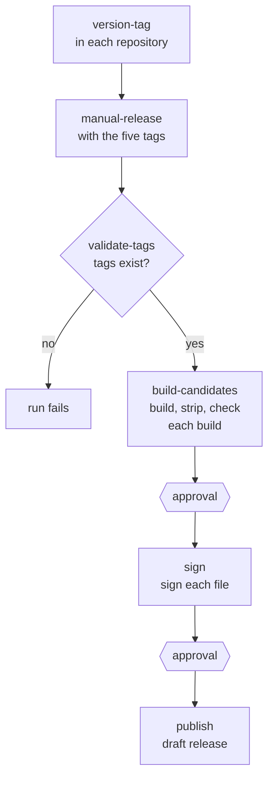

# Release builds

The published builds of `bs` are made by two GitHub Actions workflows,
both run by hand: one tags each repository with a version, and one
builds, signs and publishes the server from those tags.

## 1. Version tags

Each of libbitcoin-system, -database, -network, -node and -server has a
`version-tag.yml` workflow. Its inputs are a branch (`master` by default),
a tag description and a tag suffix. It computes the version from the
branch:

| Part | Source |
| ---- | ------ |
| Major | `LIBBITCOIN_VERSION_MAJOR` in `builds/cmake/CMakeLists.txt` |
| Minor | `LIBBITCOIN_VERSION_MINOR` in `builds/cmake/CMakeLists.txt` |
| Patch | The number of commits on the branch (`git rev-list --count HEAD`) |

The tag is `v<major>.<minor>.<patch>` followed by the suffix, and is
created as an annotated tag and pushed. The workflow fails if the tag
already exists.

## 2. Build to Release

`manual-release.yml`, in libbitcoin-server, takes a tag for each of the
five repositories, and an optional suffix for the release title. Its four
jobs run in order.

### 2.1 validate-tags

Checks out each repository at its tag, and fails unless each tag exists
as a tag (not a branch or commit).

### 2.2 build-candidates

One job for each build, all from the same tags. Each checks out the five
repositories side by side and builds `bs` with the server's install
script, using the local sources (`--build-use-local-src`) and skipping
the tests (`--build-skip-tests`):

| Toolchain | Script | Configuration |
| --------- | ------ | ------------- |
| CMake (Linux, macOS) | `builds/cmake/install-cmake.sh` | `release`, `static` |
| Visual Studio (Windows) | `builds/msvc/build-msvc.cmd` | `StaticRelease`, toolset `v145`, `vs2026` |

| Build | Runner | Compiler | Target | Options |
| ----- | ------ | -------- | ------ | ------- |
| `bs-linux-x64` | `ubuntu-24.04` | clang 18 | `x86-64-v3` | avx2, sse41 |
| `bs-linux-x64-shani` | `ubuntu-24.04` | clang 18 | `x86-64-v3` | shani, avx2, sse41 |
| `bs-linux-x64-avxifma` | `ubuntu-24.04` | clang 18 | `x86-64-v3` | avxifma, shani, avx2, sse41 |
| `bs-linux-x64-avx512ifma` | `ubuntu-24.04` | clang 18 | `x86-64-v3` | avx512ifma, shani, avx2, sse41 |
| `bs-linux-arm64` | `ubuntu-24.04-arm` | gcc 14 | `armv8-a` | |
| `bs-linux-arm64-sha2` | `ubuntu-24.04-arm` | gcc 14 | `armv8-a+sha2+aes` | sha2, aes |
| `bs-linux-arm64-sha3` | `ubuntu-24.04-arm` | gcc 14 | `armv8.2-a+sha2+aes+sha3` | sha2, sha3, aes |
| `bs-macos-arm64` | `macos-latest` | Apple Clang | `armv8.2-a+sha2+aes+sha3`, macOS 13.3 | sha2, sha3, aes |
| `bs-macos-x64` | `macos-26-intel` | Apple Clang | `x86-64-v3`, macOS 13.3 | avx2, sse41, aesni |
| `bs-windows-x64` | `windows-latest` | MSVC | x64 | avx2, sse41 |
| `bs-windows-x64-shani` | `windows-latest` | MSVC | x64 | shani, avx2, sse41 |
| `bs-windows-x64-avxifma` | `windows-latest` | MSVC | x64 | avxifma, shani, avx2, sse41 |
| `bs-windows-x64-avx512ifma` | `windows-latest` | MSVC | x64 | avx512ifma, shani, avx2, sse41 |
| `bs-windows-arm64` | `windows-11-vs2026-arm` | MSVC | ARM64 | |
| `bs-windows-arm64-sha2` | `windows-11-vs2026-arm` | MSVC | ARM64 | sha2, aes |
| `bs-windows-arm64-sha3` | `windows-11-vs2026-arm` | MSVC | ARM64 | sha2, sha3, aes |

The same job also builds the `selector` of libbitcoin-system, which reports
the processor's features, for the packages that choose a variant at install
([Packaging](packaging)):

| Build | Runner | Compiler |
| ----- | ------ | -------- |
| `selector-linux-x64` | `ubuntu-24.04` | clang 18 |
| `selector-linux-arm64` | `ubuntu-24.04-arm` | gcc 14 |
| `selector-windows-x64` | `windows-latest` | MSVC (SSE2) |
| `selector-windows-arm64` | `windows-11-vs2026-arm` | MSVC |

Every x64 build assumes AVX2 and SSE4.1 (`x86-64-v3`) as the baseline of
its architecture.

Linux builds link the C++ and GCC runtimes statically
(`-static-libstdc++ -static-libgcc`). Windows builds end in `.exe`.

After the build, each job:

1. copies the program to its build name,
2. removes any embedded RPATH/RUNPATH (`patchelf`, glibc Linux builds),
3. separates its debug symbols from the binary and strips it,
4. runs `--version` and `--hardware`, and shows the linkage (`ldd`,
   `readelf -d`, `otool -L`),
5. uploads the build and its symbols as artifacts, kept for one day.

Every build is compiled with debug information (`-g`, and a PDB with
MSVC), and its symbols are published beside it:

| Platform | Symbols | Linked to the binary by |
| -------- | ------- | ----------------------- |
| Linux | `<build>.debug` (compressed) | GNU build ID and `.gnu_debuglink` |
| macOS | `<build>.dSYM.zip` | UUID, which the job fails unless it matches |
| Windows | `<build>.pdb.zip` | PDB signature |

### 2.3 sign

Runs in the `release` environment, which holds the signing key and its
passphrase as secrets, and does not start until a maintainer approves it.
It downloads every build, imports the key into a temporary keyring, and
writes a detached, armored signature beside each build and symbols file
(`<file>.asc`). It then deletes the key and the keyring, imports the
public key, and fails unless every signature verifies as a good
signature. The builds, symbols and signatures are uploaded as one artifact.

### 2.4 publish

Also in the `release` environment, and also waits for approval. It
creates a release at the server tag (with the suffix, if any), as a draft
prerelease, with the builds, their symbols and the signatures as its
assets. Existing assets are not overwritten. The release notes link the tag of each of the five repositories it was built
from, and show the public key that signed it.

The draft is public once a maintainer publishes it.
