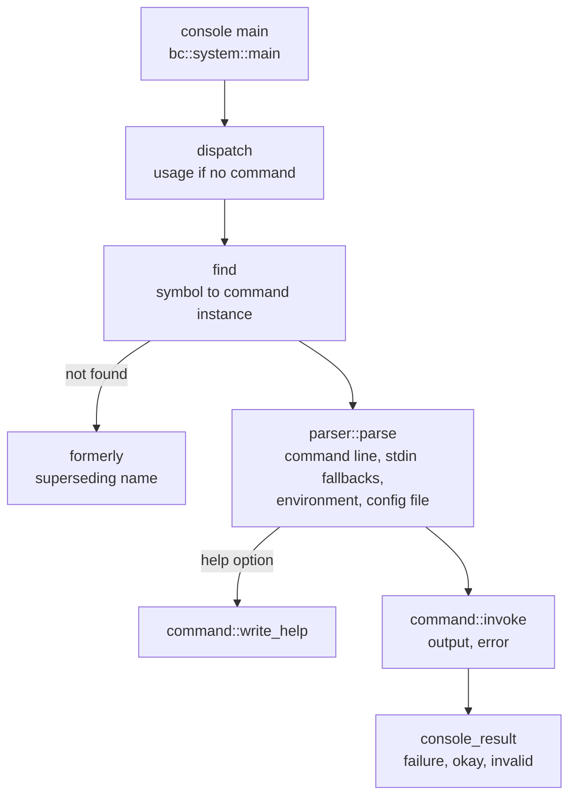

# Explorer Architecture

Bitcoin Explorer (`bx`) is a command line tool built on libbitcoin-system.
Each of its [commands](../../client/commands) is a class derived from a common
base, generated from one XML model that declares the command's name,
category, options, positional arguments, configuration settings and help
text. The `bx` executable finds the command named by its first argument,
parses the rest of the command line, the environment and a configuration
file into that command's bound members, and invokes it with an output and an
error stream. Paths are relative to `include/bitcoin/explorer/` in
[libbitcoin-explorer](https://github.com/libbitcoin/libbitcoin-explorer), at
master `78ccbab8` (2026-10-27).

## 1. Execution flow

The console entry point forwards its arguments and the three standard
streams to `dispatch` (`console/main.cpp`). `BC_USE_LIBBITCOIN_MAIN` is the
libbitcoin-system macro that defines the platform `main` and supplies UTF-8
streams on Windows.

```cpp
BC_USE_LIBBITCOIN_MAIN

int bc::system::main(int argc, char* argv[])
{
    return bc::explorer::dispatch(argc, const_cast<const char**>(argv),
        bc::system::cin, bc::system::cout, bc::system::cerr);
}
```



`dispatch` (`src/dispatch.cpp`) displays usage and the command list when
there are no arguments. Otherwise it drops the program name and calls
`dispatch_command`, which treats the first remaining argument as the
command symbol. An unknown symbol is reported as an invalid command, naming
the command that replaced it if `formerly` returns one. A found command is
parsed, then helped or invoked. An exception escaping the command is
reported as an invalid parameter and returns `console_result::failure`.

```cpp
parser metadata(*command);
std::string error_message;

if (!metadata.parse(error_message, in, argc, argv))
{
    display_invalid_parameter(error, error_message);
    return console_result::failure;
}

if (metadata.help())
{
    command->write_help(output);
    return console_result::okay;
}

return command->invoke(out, err);
```

In Windows builds the input and output streams are swapped for binary
`std::cin` and `std::cout` when the command declares `requires_raw_input()`
or `requires_raw_output()`, and set to UTF-8 otherwise. The error stream is
always UTF-8.

The return value is a `console_result` (`define.hpp`): `failure` (-1),
`okay` (0) or `invalid` (1). Positive values are domain specific, such as a
validation command reporting an invalid result.

## 2. The command model

### 2.1 Base class

`command` (`command.hpp`) is the base of every command. It cannot be
constructed directly, and each virtual has a default, so a derived class
overrides only what applies to it.

| Member | Purpose |
| ------ | ------- |
| `symbol()` | Static, lower case command name, such as `tx-decode` |
| `name()`, `category()`, `description()` | Name, category (such as `WALLET`) and help text |
| `obsolete()` | Excludes the command from the listed command names |
| `requires_raw_input()`, `requires_raw_output()` | Binary standard input or output |
| `load_options()`, `load_arguments()` | Named options and positional arguments |
| `load_environment()`, `load_settings()` | Environment variables and configuration file settings |
| `load_fallbacks()` | Reads unset arguments from standard input |
| `set_defaults_from_config()` | Applies configuration settings to defaulted options |
| `write_help()` | Writes command line help from the option and argument metadata |
| `invoke(output, error)` | Executes the command |

The base also holds the configuration settings shared by all commands, in
`[wallet]` and `[server]` sections, each with a typed getter and setter
(`get_wallet_wif_version_setting()` and so on). Help is produced by the
libbitcoin-system `config::printer`, from the same metadata that the
parser consumes.

### 2.2 Command classes

Each command is a class in `commands/`, named for its symbol, that derives
from `command`. Its options and arguments are bound to private `option_`
and `argument_` structures, and exposed through typed accessors such as
`get_transaction_argument()` and `get_version_option()`. Every command
accepts `--help` (`-h`) and `--config` (`-c`). Each argument is declared
both as a named option and as a positional argument with an instance limit,
so it may be given either way (`commands/tx-decode.hpp`):

```cpp
virtual arguments_metadata& load_arguments()
{
    return get_argument_metadata()
        .add("TRANSACTION", 1);
}

virtual void load_fallbacks(std::istream& input,
    po::variables_map& variables)
{
    load_input(get_transaction_argument(), "TRANSACTION", variables, input);
}
```

The class declares `invoke`, and its definition in `src/commands/` reads
the bound values through the accessors and writes the result
(`src/commands/address-embed.cpp`, simplified):

```cpp
console_result address_embed::invoke(std::ostream& output,
    std::ostream&)
{
    const data_chunk& data = get_data_argument();
    const auto version = get_version_option();

    const auto ops = script::to_pay_key_hash_pattern(rmd160_hash(data));
    const script script(ops);
    const auto hash = rmd160_hash(script.to_data(false));

    output << payment_address(hash, version) << std::endl;
    return console_result::okay;
}
```

### 2.3 Command table

`generated.hpp` includes every command header and declares three free
functions over the full set of commands, defined in `src/generated.cpp`:

| Function | Result |
| -------- | ------ |
| `find(symbol)` | A new instance of the command with that symbol, or null |
| `formerly(former)` | The symbol of the command that replaced a former name, or empty |
| `broadcast(func)` | Calls `func` with an instance of every command |

`find` compares the symbol against each class's static `symbol()`, so
commands are constructed only on demand. `broadcast` lists the commands
for usage (`display_command_names`), skipping obsolete ones. The `help`
command uses `find` to load and write the help of another command.

## 3. Generation

The command headers are generated from `model/generate.xml` by the iMatix
GSL templates in `model/templates/` (`model/generate.gsl`). Implementations
in `src/commands/` are written by hand.

| Template | Output |
| -------- | ------ |
| `gsl.command.hpp` | `command.hpp`, with the configuration settings |
| `gsl.commands.hpp` | `commands/<symbol>.hpp`, one per command |
| `gsl.generated.hpp`, `gsl.generated.cpp` | `generated.hpp`, `src/generated.cpp` |
| `data/gsl.bx` | `data/bx`, a bash command completion script |
| `test/gsl.generated__*.cpp` | Tests of `broadcast`, `find`, `formerly` and `symbol` |

The model declares each command with its arguments and options, the
configuration sections, and the localizable resource strings that become
the `BX_*` macros in `generated.hpp`:

```xml
<command symbol="address-embed" formerly="embed-addr" output="payment_address" category="WALLET" description="...">
  <option name="version" type="byte" configuration="wallet.pay_to_public_key_hash_version" description="..." />
  <argument name="DATA" stdin="true" type="bytes" description="..." />
</command>
```

Model types map to C++ types in `model/primitives.gsl`, either a
libbitcoin-system type (`system::config::hash256`,
`system::wallet::hd_private`) or one of the explorer config types
(section 4.3). An option without a type is a `bool` switch. The `stdin`
attribute generates the `load_input` fallback, an argument of type
`bytes` read from standard input makes the command raw input, and an
`output` of `bytes` makes it raw output. The `configuration` attribute
generates `set_defaults_from_config`, and `obsolete` and `formerly`
generate `obsolete()` and the `formerly` entry.

## 4. Parsing

### 4.1 Sources

`parser` (`parser.hpp`) derives from the libbitcoin-system
`config::parser` and supplies its metadata from the command instance. The
sources are loaded into one `variables_map`, with the first stored value of
a variable taking precedence (`src/parser.cpp`):

| Order | Source | Detail |
| ----- | ------ | ------ |
| First | Command line | Named options and positional arguments |
| Second | Standard input | `load_fallbacks`, for arguments not given on the command line |
| Third | Environment | Variables prefixed `BX_`, declaring `BX_CONFIG` |
| Fourth | Configuration file | The file named by `--config` or `BX_CONFIG` |

If `--help` is present only the command line is loaded, and `help()`
returns true. Otherwise the parser notifies the bound variables and calls
`set_defaults_from_config`, which replaces a defaulted option with its
configured setting when that setting was not defaulted
(`commands/address-embed.hpp`):

```cpp
const auto& option_version = variables["version"];
const auto& option_version_config = variables["wallet.pay_to_public_key_hash_version"];

if (option_version.defaulted() && !option_version_config.defaulted())
{
    option_.version = option_version_config.as<explorer::config::byte>();
}
```

A `program_options` error is returned as the error text and reported by
`display_invalid_parameter`.

### 4.2 Standard input and files

`utility.hpp` provides the fallback readers. `load_input` deserializes a
parameter from the input stream when its variable was not set, and throws
on failure. `load_path` reads a parameter from the file named by its
variable, where `-` (`BX_STDIO_PATH_SENTINEL`) leaves the variable unset
for standard input. `write_file` writes to the named file, or to the
output stream when the path is empty or `-`.

### 4.3 Config types

Arguments and options are typed by config objects that round-trip through
stream operators, as described in [Config](../system/config). Most are
libbitcoin-system types. The types in `config/` cover values specific to
`bx`, each with a native value type and a pair of stream operators:

| Type | Value | Text form |
| ---- | ----- | --------- |
| `address` | `std::string` | A valid payment address |
| `algorithm` | `points_value::selection` | `greedy` or `individual` |
| `btc` | `uint64_t` | Bitcoin decimal, read as satoshis |
| `byte` | `uint8_t` | Decimal, not a character |
| `bytes` | `data_chunk` | The entire stream, unencoded |
| `ec_private` | `ec_secret` | Base16 |
| `electrum` | `electrum::seed_prefix` | Seed prefix name |
| `endorsement` | `data_chunk` | Base16, up to `max_endorsement_size` |
| `hd_key` | `wallet::hd_key` | Base58 of `hd_key_size` bytes |
| `language` | `system::language` | Word list language name |
| `sighash` | `chain::coverage` | Signature hash type name |
| `signature` | `message_signature` | Base64 of `message_signature_size` bytes |
| `witness` | `witness_address::program_type` | Witness program name |

## 5. Output

A command writes its result to the output stream passed to `invoke`, and
diagnostics to the error stream. Most commands write a single value in its
text form through the value's `operator<<`, followed by a newline, such as
`base16(data)` or a `payment_address`. A raw output command writes bytes
to binary standard output.

Structured results are JSON. `write_stream` (`utility.hpp`) serializes a
`system::json::value` followed by a newline. Chain objects convert through
the libbitcoin-system JSON conversions, and `json.hpp` adds conversions for
the settings list and for a `bitcoin_uri` (`src/commands/tx-decode.cpp`):

```cpp
console_result tx_decode::invoke(std::ostream& output, std::ostream&)
{
    write_stream(output, value_from(chain::transaction{ get_transaction_argument() }));
    return console_result::okay;
}
```

`to_json(settings_list)` nests the dot-delimited setting names into
section objects under a `settings` key, as written by the `settings`
command. `display.hpp` holds the fixed messages of the dispatcher: usage
with version and command list, invalid command (naming the superseding
command where one exists), invalid parameter, and connection failure.
