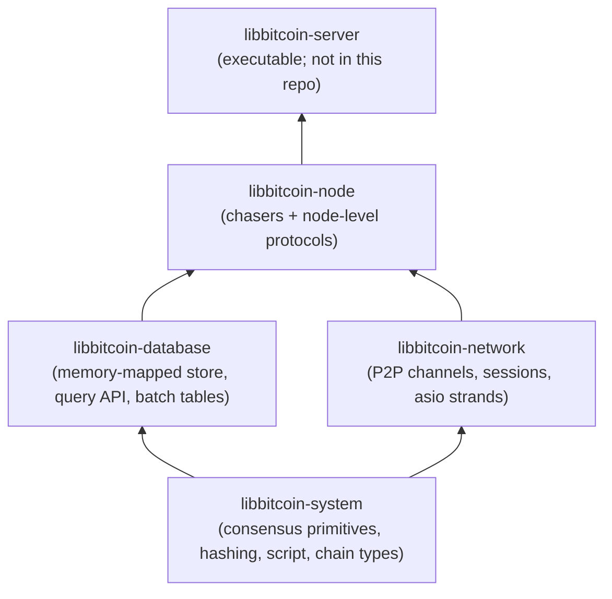
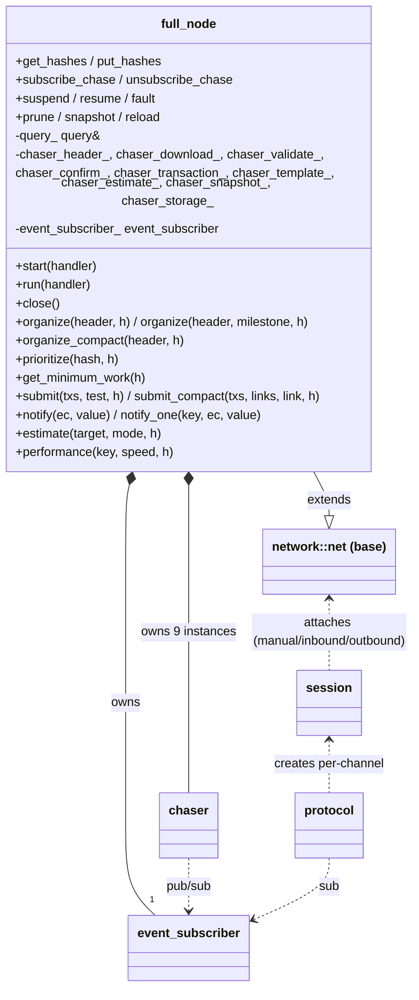
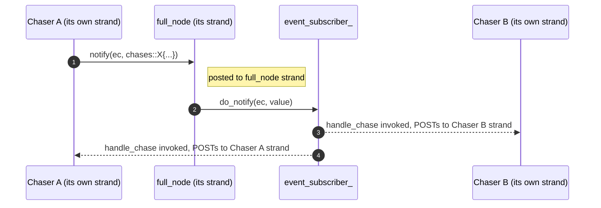
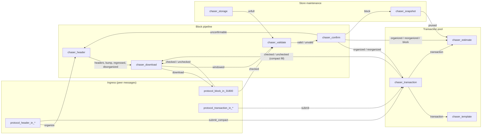
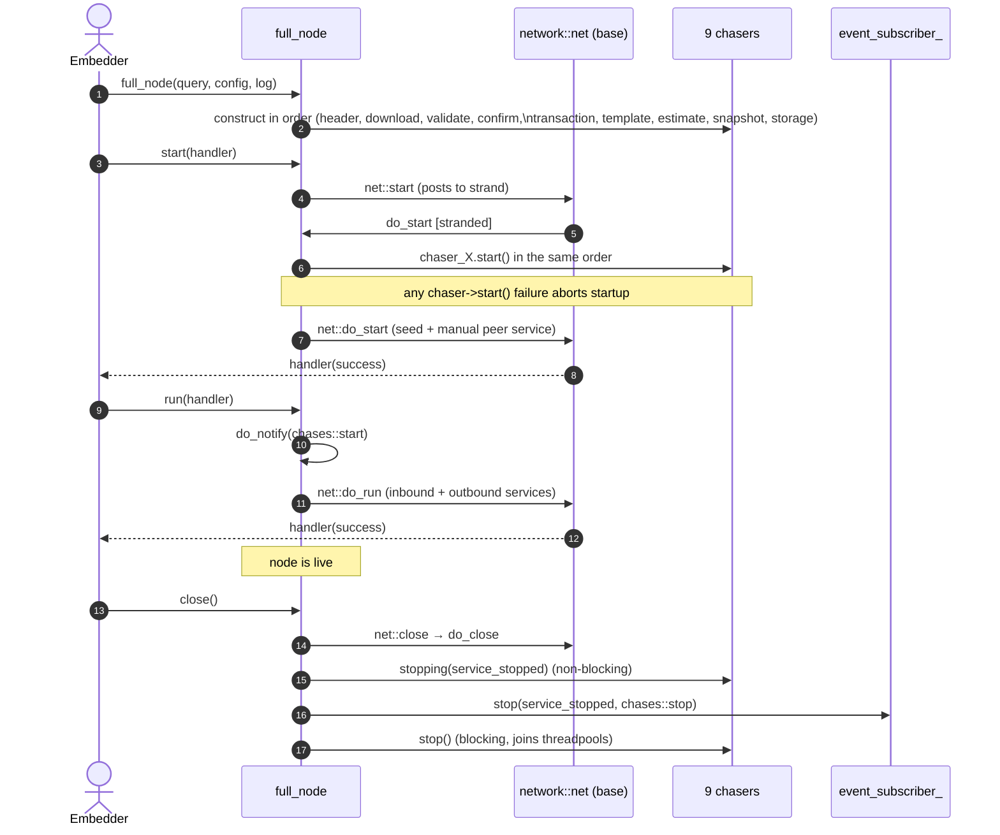

# 00 — Architectural Overview

> **Purpose.** This document is the top-down map of the node and the entry
> point for the deeper subsystem docs. It also serves a formal-verification
> effort, which needs explicit state machines, invariants, and concurrency
> boundaries.
>
> All non-trivial claims are anchored with `path/to/file.ext:line` citations
> into the C++ so they can be re-derived if the source drifts. Citations are
> against libbitcoin-node master at `a5173475`.

---

## 1. Layer stack

libbitcoin is a stack of cooperating libraries. The node sits at the top and
composes the lower layers; it adds no new I/O primitives — only the chain
state machine, the transaction pool, and the orchestration of validation
across many threads.

The node owns no executable. Embedders construct one `full_node`
(`include/bitcoin/node/full_node.hpp:32`) against an externally-owned
`query&` (the database handle) and a `configuration&`, then call
`start() → run() → close()`.

---

## 2. Top-level object graph

Key facts:

- `full_node` is a `network::net` subclass
  (`include/bitcoin/node/full_node.hpp:32-33`). Networking (peer discovery,
  channels, message framing) is inherited unchanged from
  libbitcoin-network. The node only *adds* chasers and *overrides* session
  attachment to use node-specific sessions.
- `full_node` owns the **nine chasers as direct members**
  (`include/bitcoin/node/full_node.hpp:210-218`). They are constructed in
  order at `full_node` construction (`src/full_node.cpp:44-52`) and live
  exactly as long as the node.
- All chasers share a single `event_subscriber_`
  (`include/bitcoin/node/full_node.hpp:219`) — this is the central event bus.
- The store is **not owned** by `full_node`; only a reference to a `query` is
  held (`src/full_node.cpp:43`). Lifetime is the embedder's responsibility.
- `full_node` is a pure forwarder for the chaser entry points: organize
  variants and `prioritize`/`get_minimum_work` go to `chaser_header_`
  (`src/full_node.cpp:161-188`), `submit`/`submit_compact` to
  `chaser_transaction_` (`:190-201`), `get_hashes`/`put_hashes` and
  `performance` to `chaser_download_` (`:203-212`, `:486-490`), and `estimate`
  to `chaser_estimate_` (`:480-484`).

---

## 3. Concurrency model

### 3.1 Execution contexts

| Context                     | Scope                                          | Where defined                                              |
| --------------------------- | ---------------------------------------------- | ---------------------------------------------------------- |
| `full_node` strand          | Event-bus mutation; chaser start               | inherited from `network::net`                              |
| Per-chaser strand           | One strand per chaser, on the network pool     | `src/chasers/chaser.cpp:35` (`strand_(node.service()...)`) |
| Validation threadpool       | `chaser_validate` only: own pool + own strand  | `src/chasers/chaser_validate.cpp:39-41`, `:393-401`        |
| Scan threadpool             | `chaser_transaction` only: one thread          | `src/chasers/chaser_transaction.cpp:39`                    |
| Per-channel strand          | One strand per peer channel/protocol           | inherited from `network::channel`                          |

> **Invariant (Concurrency-1).** Every chaser method that mutates chaser state
> must be on that chaser's own strand. The base provides `strand()`,
> `stranded()`, and the `BIND`/`POST` templates to enforce this
> (`include/bitcoin/node/chasers/chaser.hpp:58-70`, `:110-117`).

> **Invariant (Concurrency-2).** All `event_subscriber_` mutation (subscribe,
> notify, notify_one, stop) happens on the `full_node` strand
> (`src/full_node.cpp:217-270`). Calls from chasers/protocols are posted into
> that strand by `full_node::notify` / `notify_one` (`:217-222`, `:231-237`).

### 3.2 Notification flow

Implementation: `full_node::notify` posts to `strand()`, then
`do_notify` calls `event_subscriber_.notify(...)`
(`src/full_node.cpp:217-229`). Each subscriber's `handle_chase` runs on
the node strand and immediately `POST`s the real work to its own strand,
so chaser state is only touched stranded.

> **Invariant (Concurrency-3).** A chaser subscription is created via
> `subscribe_chase` from the chaser's `start()`
> (`include/bitcoin/node/chasers/chaser.hpp:100-101`), which runs on the node
> strand (`src/full_node.cpp:75-95`). Protocols subscribe via the async
> variant (`include/bitcoin/node/full_node.hpp:111-113`) which posts to the
> strand and uses a completer.

### 3.3 Why per-chaser strands

Chasers do consensus-critical, often expensive work (script execution,
database writes, snapshotting). Each strand allows the chaser to serialize
its *own* mutations while still running in parallel with the other chasers
(`include/bitcoin/node/chasers/chaser.hpp:30-35`).

This is one of the two main axes of parallelism in the node. The chasers
form a pipeline; each stage runs on its own strand and they communicate
by publishing events. The other axis, equally important, is **per-channel
strands**: every peer connection also runs on its own strand. Peers and
chasers therefore execute concurrently with each other, bounded only by
the shared threadpool size. `chaser_validate` additionally fans block
validation out over its own pool (doc 04).

### 3.4 Lock-free

The node, with the network and system layers beneath it and the server
above it, is lock-free: at every point some thread completes its step,
whatever the scheduling of the others, because no thread ever waits on
another.

- **Strands order work, they do not block threads.** Posting to a busy
  strand queues the handler and returns. The posting thread continues with
  other work; a strand serializes handlers, not threads.
- **Cross-thread state is atomic.** State shared outside a strand is
  `std::atomic`: latches and counters such as `chaser_validate`'s
  `validate_backlog_` and bank flags (doc 04), `chaser_snapshot::pruned_`
  (doc 12), `protocol_block_out_70012::superseded_` (doc 08), and the
  network's suspend flags and channel counts (`network/net.hpp:381-388`).
- **Results cross strands by posting.** A broadcast that gathers a result
  from many channels (diagnostics) has each channel post its row to the
  collector's strand, and the collector reads them after the round
  completes (network `broadcast/diagnostics.hpp`, server
  `protocol_bitcoind::to_collector`, branch `lockfree`).
- **System code waits on no other thread.** A parallel algorithm
  (`std::for_each` under `execution::par`) fans a loop out over the pool
  and joins it, which is the caller's own work. Batch signature capture
  registers each thread's rows once, on first use, as a static initializer
  does (`chain/signatures.cpp`). GPU verification queues
  callers for the device (`crypto/secp256k1/cuda/turns.hpp`), which is
  arbitration of hardware, not of shared state.

> **Invariant (Concurrency-4).** No node, network, server or system code
> waits on another thread for shared state. State is owned by one strand,
> handed between strands by `post`, or held in an atomic.

Store locking ([database 03 §8](../database/03-storage.html#8-locking)) is internal to
the database and hidden from the network stack.

---

## 4. The event bus

The bus carries a `code` (error) and an `event_value`, which is a
`std::variant` of one payload struct per `chase` enumerator
(`include/bitcoin/node/chase.hpp`). The variant alternative index *is* the
`chase` value (`static_assert(is_chase_ordered(...))`), so an event carries
its own type: `to_chase(value)` recovers the enumerator and
`to_payload<chase::X>(value)` the typed payload. Payload fields are
`height`, `branch_point`, `link` (`header_t` or `transaction_t`),
`channel` (`object_t`), `count` or `sequence` (`count_t`), or nothing.

The enum **is the specification** of inter-chaser coupling. The summary
below is the *source-verified* mapping (issuer/handler columns reflect
actual `notify(... chases::X{...})` and `case chase::X:` sites). For every
site citation and the discrepancy list against the inline `chase.hpp`
comments, see [`01-event-bus`](01-event-bus).

⚠ marks a divergence from the chase.hpp comment; *dormant* means the
handler exists in source but has no live issuer.

| Event             | Payload           | Issuer(s)                                        | Handler(s)                                                       |
| ----------------- | ----------------- | ------------------------------------------------ | ---------------------------------------------------------------- |
| **Work shuffling**                                                                                                                                           |
| `start`           | —                 | `full_node` (`do_run`)                           | `download`, `validate`, `confirm`                                   |
| `space`           | —                 | `full_node::fault` when `is_full`                | `storage`                                                        |
| `snap`            | `height`          | *dormant — no live issuer* ⚠                     | `snapshot`                                                       |
| `bump`            | `height`          | `header`, `validate` (silent drain) ⚠            | `download`, `validate`, `confirm`                                   |
| `suspend`         | —                 | `full_node::suspend` **+** `header` (disorganize) ⚠ | `observer`                                                    |
| `resume`          | —                 | `full_node::resume`                              | `download`, `validate`, `confirm`                                   |
| `unfull`          | —                 | `storage` (reload from disk full)                | `validate`                                                       |
| `starved`         | `channel`         | `protocol_block_in_31800`                        | `download`                                                          |
| `split`           | `channel`         | `download` (`notify_one`)                           | `protocol_block_in_31800`                                        |
| `stall`           | `channel`         | `download`                                          | `protocol_block_in_31800`                                        |
| `purge`           | `branch_point`    | `download`                                          | `protocol_block_in_31800`                                        |
| `report`          | `sequence`        | *external* (server executor)                     | `protocol_block_in_31800`                                        |
| **Candidate chain**                                                                                                                                          |
| `headers`         | `branch_point`    | `header`                                         | `download`                                                          |
| `download`        | `count`           | `download`                                          | `protocol_block_in_31800`                                        |
| `regressed`       | `branch_point`    | `header`                                         | `download`, `validate`, `confirm`                                   |
| `disorganized`    | `branch_point`    | `header`                                         | `download`, `validate`, `confirm`                                   |
| **Check / Identify**                                                                                                                                         |
| `checked`         | `height`          | `protocol_block_in_31800`, `transaction` (compact fill) | `download`, `validate`                                       |
| `unchecked`       | `link`            | `protocol_block_in_31800`, `transaction`         | `header`                                                         |
| `windowed`        | `height`          | `download`                                          | `validate`                                                       |
| **Accept / Connect**                                                                                                                                         |
| `valid`           | `height`          | `validate`                                       | `download`, `confirm`                                               |
| `unvalid`         | `link`            | `validate`                                       | `header`                                                         |
| **Confirm (block)**                                                                                                                                          |
| `confirmable`     | `link`            | `confirm`                                        | *none*                                                           |
| `unconfirmable`   | `link`            | `confirm`                                        | `header`                                                         |
| **Confirm (chain)**                                                                                                                                          |
| `block`           | `link`            | `confirm` (when confirmed chain current)         | `snapshot`, `estimate`, `session_outbound`, `protocol_block_out_106`, `protocol_header_out_70012`, `protocol_transaction_out_70013` ⚠ |
| `pruned`          | `link`            | `snapshot`                                       | `estimate`                                                       |
| `stale`           | —                 | `confirm` (stale timer)                          | `session_outbound`, `protocol_transaction_out_70013` ⚠           |
| `organized`       | `link`            | `confirm`                                        | `transaction`, `estimate`                                        |
| `reorganized`     | `link`            | `confirm`                                        | `transaction`, `estimate`                                        |
| **Mining**                                                                                                                                                   |
| `transaction`     | `link`            | `transaction`                                    | `template`, `estimate`, `protocol_transaction_out_106`           |
| `template_`       | `height`          | *dormant — no live issuer* ⚠                     | (miners, external)                                               |
| **Stop**                                                                                                                                                     |
| `stop`            | —                 | `full_node` (`do_close`, `unsubscribe_chase`)    | all (chasers + subscribing protocols)                            |

> **Note for the spec.** Treat this table as the **interface boundary**
> between chasers. A formal model can represent each chaser as a process
> with a single inbox typed `(code, event_value)`; the C++ implementation
> just happens to use asio strands.

There is also a parallel, lower-volume `events` enum
(`include/bitcoin/node/events.hpp:28-71`) — these are *reporting* events
(metrics: archived/validated/confirmed/organized counts, batch and filter
timespans), surfaced via `reporter::fire` and `network::net::span<...>`.
They are **not** part of the inter-chaser protocol; they exist only for
telemetry and should not be modelled in the spec.

---

## 5. Chaser pipeline (logical view)

The nine chasers form a directed pipeline. The diagram below is a
*conceptual* sketch; the **authoritative, source-verified** issuer/handler
graph is in [`01-event-bus §3`](01-event-bus#3-verified-issuer--handler-diagram).

Synchronization is **headers-first only**. Headers are synced by the
header protocols, which validate and prove each peer's branch before
archiving it (doc 07); the header chaser organizes proven headers into
the candidate chain (doc 02); `chaser_download` partitions unassociated
candidates into download windows (doc 03); blocks are identified and
archived by `protocol_block_in_31800` (doc 06) or filled from the pool by
compact blocks (docs 07, 11); `chaser_validate` validates (doc 04) and
`chaser_confirm` confirms (doc 05). The blocks-first mode and its
`chaser_block` organizer were removed in September 2026.

---

## 6. Lifecycle

### 6.1 Construction → start → run → close

Citations:
`src/full_node.cpp:63-73` (`start`),
`src/full_node.cpp:75-95` (`do_start`),
`src/full_node.cpp:97-119` (`run` / `do_run`),
`src/full_node.cpp:121-156` (`close` / `do_close`).

> **Invariant (Lifecycle-1).** The store must be initialised before `start`:
> `full_node::start` short-circuits with `error::store_uninitialized` if
> `query_.is_initialized()` is false (`src/full_node.cpp:65-69`).

> **Invariant (Lifecycle-2).** `do_close` initiates non-blocking
> `stopping(...)` on every chaser first, then `event_subscriber_.stop(...)`,
> then `net::do_close`; `close()` then blocks on per-chaser `stop()`, which
> joins the validation and scan threadpools. Order matters: chasers must
> observe stop before the bus is torn down (`src/full_node.cpp:121-156`).

> **Invariant (Lifecycle-3).** `chaser_snapshot::start` may prune the store
> *before* the network starts, when the confirmed top is above genesis and
> the store is coalesced (`src/chasers/chaser_snapshot.cpp:68-92`). This is
> the only chaser whose `start()` performs a store write.

### 6.2 Suspend / resume / fault

`suspend(ec)` calls `net::suspend` and emits `chases::suspend` with
`error::suspended_channel` (`src/full_node.cpp:301-306`). `resume()`
**refuses** when the store is full or faulted, otherwise calls
`net::resume` and then emits `chases::resume` (`:280-298`).

`fault(ec)` is the unified "something terminal happened" entry; it
dispatches by store state — `is_full` → `chases::space`; `is_fault` → log
the unrecoverable store fault; otherwise log a resumable node fault — and
always calls `suspend(ec)` (`:308-330`).

`prune` / `snapshot` / `reload` (`:333-397`) share a pattern: suspend the
network, run the store operation, leave the network suspended (caller
resumes on success). Each emits a metrics event (`events::prune_msecs`,
`events::snapshot_secs`, `events::reload_msecs`). `reload` returns
immediately when the store is not full (`:377-378`).

> **Invariant (Store-1).** During a store maintenance operation, all peer
> connections are suspended; the caller is responsible for `resume()` after
> success. A `wait_lock` event during the op causes a *renewed* `suspend`
> (`src/full_node.cpp:343-344`, `:364-365`, `:389-390`) — racy connections
> that missed the first suspend are caught here.

### 6.3 Currency

Four predicates on `full_node` gate most behaviour (`src/full_node.cpp:432-470`):

| Predicate                    | Meaning                                                                                  |
| ---------------------------- | ---------------------------------------------------------------------------------------- |
| `is_current_time(ts)`        | `ts` is within `node.currency_window_minutes` of now; a zero window is always current   |
| `is_current_chain(confirmed)`| the candidate (`false`) or confirmed (`true`) top timestamp is current                   |
| `is_current_header(link)`    | the header's stored timestamp is current                                                 |
| `is_recent()`                | confirmed top reached `node.maximum_height`, *or* the confirmed chain is current         |

"Recent" is weaker than "current": a node deliberately limited to a fixed
height can activate inbound service and block serving at that ceiling.

---

## 7. Network layer at a glance

`full_node` overrides three session-attachment hooks
(`src/full_node.cpp:495-508`):

- `attach_manual_session` → `node::session_manual`
- `attach_inbound_session` → `node::session_inbound`
- `attach_outbound_session` → `node::session_outbound`

Each `node::session_*` adds a `node::session` mixin
(`include/bitcoin/node/sessions/session.hpp`) which forwards to
`full_node` (organize, submit, get/put_hashes, notify, subscribe,
estimate, performance). The mixin's job is to give every protocol
instance on every channel a reference to the node's event bus and
organizers. `session_outbound` additionally subscribes to the bus to
reduce outbound connections while recent (doc 06 §1.4).

Protocols are versioned by Bitcoin P2P protocol number:

| Family    | Versions                               | Direction |
| --------- | -------------------------------------- | --------- |
| header    | 31800, 70012 (BIP130), 70014 (BIP152)  | in        |
| header    | 31800, 70012, 70014                    | out       |
| block     | 31800                                  | in        |
| block     | 106, 70001 (BIP37 `not_found`), 70012, 70014 | out |
| tx        | 106, 70001, 70013 (BIP133), 70016 (BIP339) | in    |
| tx        | 106, 60002 (BIP35), 70001, 70013, 70016 | out      |
| filter    | 70015 (BIP157/158)                     | out       |
| meta      | observer, peer, performer              | —         |

Each protocol class lives in `include/bitcoin/node/protocols/` and is
implemented in `src/protocols/`. `protocol_block_in_31800` is the central
performance-sensitive class — it's the only protocol referenced from many
`chase` event handlers (download, starved, split, stall, purge, report,
checked, unchecked). See [`06`](06-sessions-and-protocols) §5.

---

## 8. Memory model

`block_arena` / `block_memory` (`include/bitcoin/node/block_arena.hpp`,
`block_memory.hpp`, `src/block_arena.cpp`) implement an arena allocator
for block-shaped objects. In the current source the arena is **not wired
into channel construction**: `session_peer::create_channel` passes no
memory controller (`include/bitcoin/node/impl/sessions/session_peer.ipp:42-52`)
and `full_node` holds no `block_memory` member. Blocks received by
`protocol_block_in_31800` are `chain::view::block` instances over the wire
buffer, identified and written to the store without materializing the
full block object (`src/protocols/protocol_block_in_31800.cpp:263-365`).

> **Implementation note.** A formal model can abstract block contents as
> immutable values; the allocator is below the spec layer.

---

## 9. Failure model

Errors flow as `std::error_code` values. The node-specific category is
defined in `include/bitcoin/node/error.hpp`. Categories:

- **store**: `store_uninitialized`, `store_reload`, `store_prune`, `store_snapshot`
- **network**: `slow_channel`, `stalled_channel`, `exhausted_channel`,
  `sacrificed_channel`, `suspended_channel`, `suspended_service`
- **blockchain**: `orphan_block`, `orphan_header`, `duplicate_block`,
  `duplicate_header`, `unexpected_header`
- **transaction pool**: `pooling_disabled`, `insufficient_fee`,
  `empty_package`, `duplicate_transaction`, `excessive_backlog`
- **fee estimation**: `estimate_disabled`, `estimate_premature`, `estimate_false`
- **faults (terminal)**: `protocol1-2`, `header1`, `organize1-15`,
  `validate1-12`, `confirm1-12`, `transaction1-9`, `estimates_initialize`,
  `estimates_push1-2`, `estimates_pop1-2`, `estimates_pool`, `batch1-8`
- **configuration**: `silent_unwitnessed`, `silent_pruned`, `filter_pruned`
  (returned by `configuration::initialize`, `src/configuration.cpp:38-69`)

> **Note for the spec.** The numbered codes are *terminal* error markers
> (`error.hpp` — *"faults (terminal, code error and store corruption
> assumed)"*). Each represents an internal invariant violation. Each
> numbered code corresponds to a specific site in the relevant chaser;
> the per-chaser docs map every one.

---

## 10. Settings

The `[node]` settings (`include/bitcoin/node/settings.hpp:37-65`) that
the architecture docs refer to:

| Setting                    | Used by                                                            |
| -------------------------- | ------------------------------------------------------------------ |
| `threads`, `thread_priority` | validation threadpool (04), scan threadpool priority (11)        |
| `delay_inbound`            | inbound gate and `blocks_out` (06)                                 |
| `provide_blocks` / `require_blocks` | `node_network` service bit; attach tree (06)              |
| `provide_witness` / `require_witness` | witness service bits; block/tx serving and requests (06, 08, 10) |
| `provide_filters`          | `node_client_filters`; attaches filter serving (09)                |
| `provide_privacy`          | silent payment service bit                                         |
| `limited_blocks`           | pruned node: bypassed blocks stored without input scripts (06, 08) |
| `use_gpu`, `cpu_batch_verify`, `cpu_batch_silent`, `batch_verify`, `batch_silent` | batching (04) |
| `allowed_deviation`        | slow-peer detection (03)                                           |
| `minimum_fee_rate`, `minimum_bump_rate` | pool admission and fee filter (10, 11)                |
| `current_connections`      | outbound reduction when recent (06)                                |
| `announcement_cache`       | per-channel anti-echo cache size (07)                              |
| `fee_estimate_horizon`     | estimator (12)                                                     |
| `maximum_height`           | stop height for check and validate (03, 04); `is_recent`           |
| `maximum_concurrency`      | download window and validation backlog (03, 04)                    |
| `silent_start_height`      | silent payment indexing start (04, 11)                             |
| `sample_period_seconds`    | performance timer (06)                                             |
| `compact_timeout_seconds`, `compact_missing_percent` | compact block fill (03, 07)              |
| `currency_window_minutes`  | all currency predicates (§6.3); header tree window (02); stale timer (05) |

---

## Appendix A — Glossary

- **Chaser**: a long-running strand-confined state machine that owns one
  responsibility in the blockchain pipeline (header organization,
  validation, the transaction pool, etc.).
- **Organize**: the act of attaching a header to the candidate chain.
- **Candidate chain**: the chain of headers the node *prefers* but
  has not yet fully confirmed.
- **Confirmed chain**: the chain of blocks that have passed all consensus
  checks and been committed.
- **Proven header**: a header whose branch the header protocol has
  validated end to end to a checkpoint or to a current top at minimum
  work; organized without re-validation.
- **Milestone / checkpoint**: configured `(hash, height)` pairs. A
  checkpoint fixes the chain; a milestone only permits validation bypass
  of blocks at or under it when it is on the candidate branch.
- **Bypass**: a block under the top checkpoint or the active milestone;
  identified and archived but not script-validated.
- **Strand**: an asio primitive that serializes execution of posted
  callbacks; the node uses one per chaser and one per channel.
- **Event bus**: `event_subscriber_` on `full_node`; carries typed
  `chases::*` payloads between chasers and protocols.
- **Window**: the download window of `chaser_download` (`maximum_concurrency`
  blocks above the position); `chase::windowed` marks its completion.
- **Bank**: one of two store-side batch tables (signatures, silent
  payments); commits fill one bank while the other drains.
