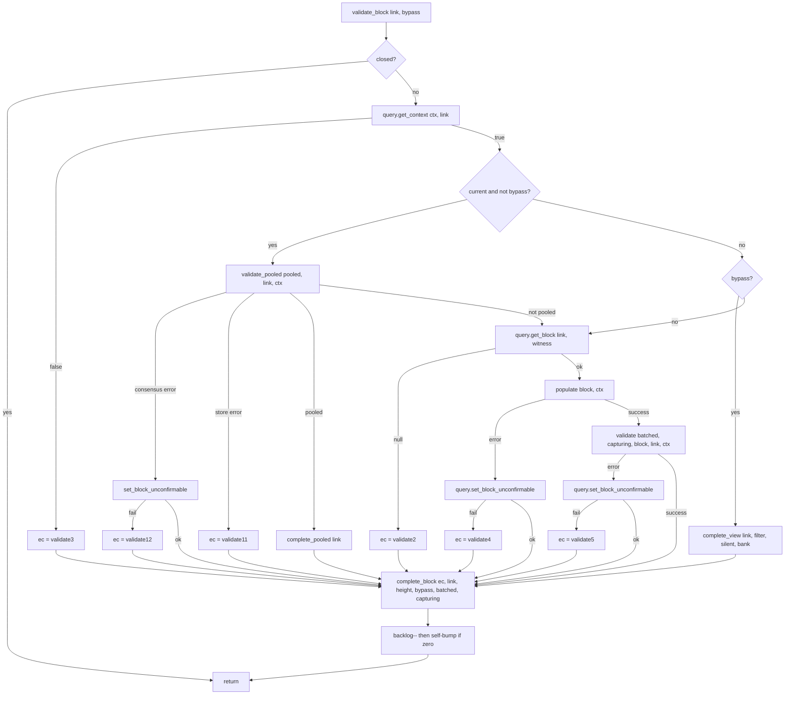
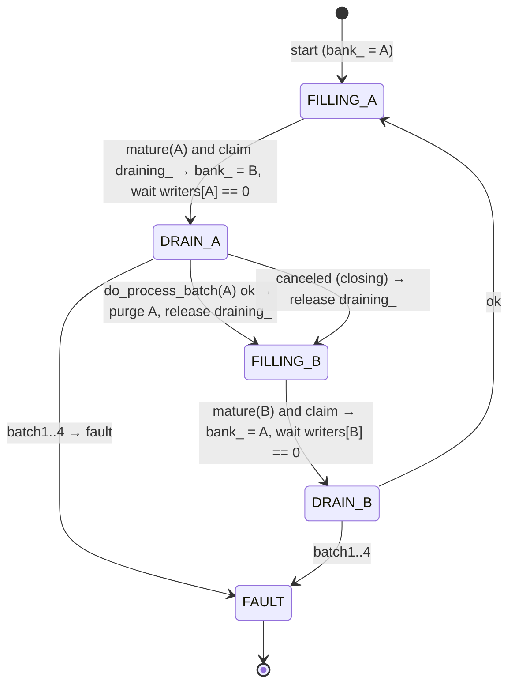
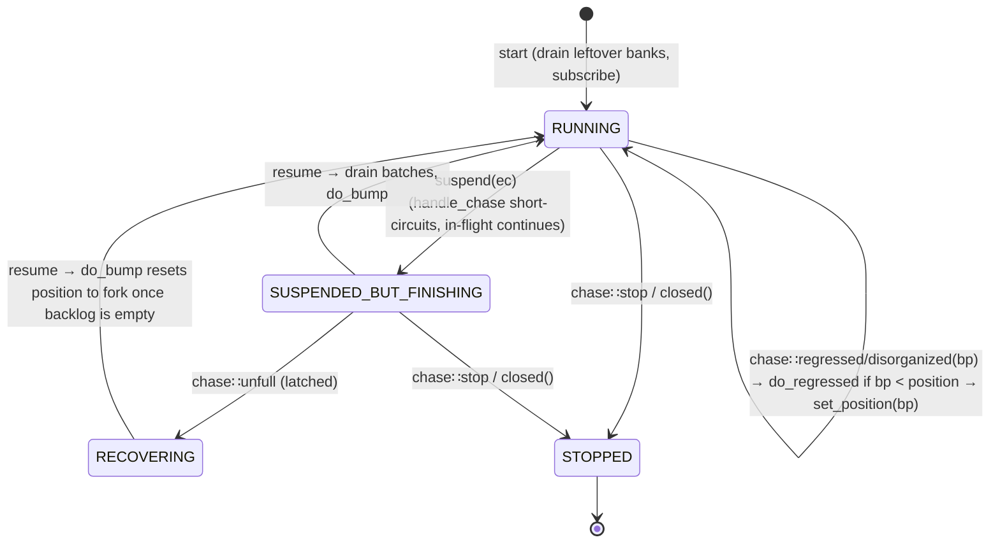
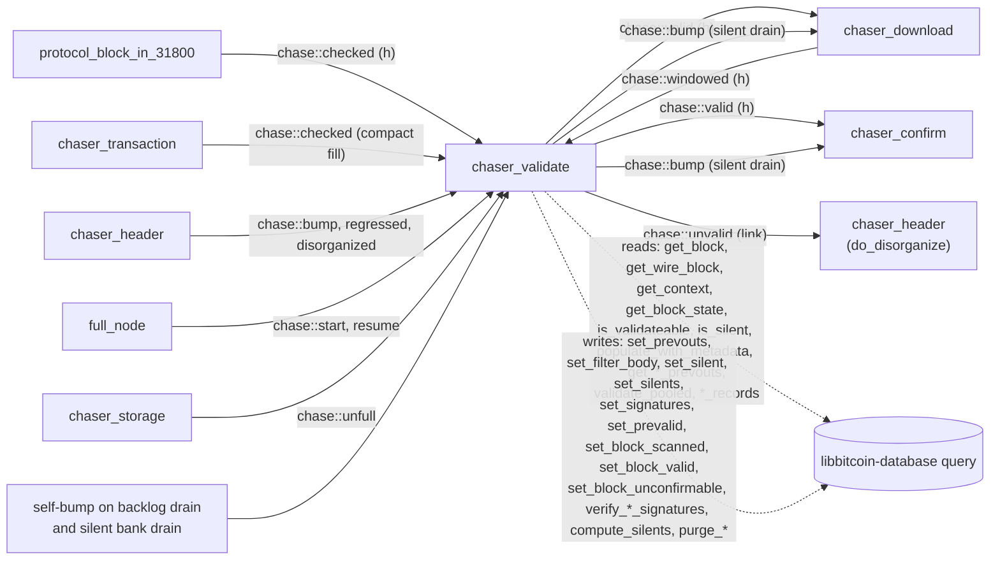

# 04 — `chaser_validate` (consensus validation)

> Companion to [`00-overview`](00-overview),
> [`01-event-bus`](01-event-bus),
> [`02-chaser-header`](02-chaser-header),
> [`03-chaser-download`](03-chaser-download).
>
> `chaser_validate` is the **consensus pre-check stage**. For each block
> on the candidate chain (in heights-first order):
>
> - it ensures the block is downloaded (`chase::checked` already received)
> - it chooses one of three paths: **pooled** (every tx already validated
>   in the pool, only block checks run), **bypass** (under checkpoint or
>   milestone: only the optional filter / silent-payment indexes are
>   produced from a read-only view), or **full** (populate, `block.check`,
>   `block.accept`, `block.connect`)
> - signatures captured during `connect` may be committed to a store-side
>   **batch bank** and verified later in bulk (CPU or GPU); the block is
>   marked valid only when its bank drains
> - silent-payment rows may likewise be banked and computed in bulk
> - it emits `chase::valid(height)` on success or `chase::unvalid(link)`
>   on failure
>
> This is the chaser most directly relevant to **formal verification**:
> it is where script execution and prevout (UTXO availability) checks
> happen before confirmation. Consensus is **not** confined to this
> chaser however — it is split across several stages:
>
> - **Headers** (`chaser_header::validate`, run by the header protocols) —
>   context-free header consensus plus limited-context checks.
> - **Blocks at receive time** (`protocol_block_in_31800::identify`) —
>   only identity: merkle and witness commitments, malleation.
> - **This chaser** — block checks and full block consensus with prevouts
>   populated: `block.check`, `block.accept(ctx, …)` (block-wide rules) and
>   `block.connect(ctx)` (script execution per input), or the pooled
>   equivalent in the store.
> - **`chaser_confirm`** — block-relative order-based consensus checks
>   via `query.block_confirmable(link)` (see
>   [`05 §11.4`](05-chaser-confirm#114-what-queryblock_confirmablelink-actually-checks)).
> - **Transactions** (`chaser_transaction::validate`) — tx consensus and
>   policy for pooled transactions, which the pooled block path relies on.

| File                                                                  | Role                                                                                  |
| --------------------------------------------------------------------- | ------------------------------------------------------------------------------------- |
| `include/bitcoin/node/chasers/chaser_validate.hpp`                    | Class declaration; atomic batch state; `parallel<>` helper                            |
| `src/chasers/chaser_validate.cpp`                                     | Strand side: events, iteration, completion, lifecycle                                 |
| `src/chasers/chaser_validate_parallel.cpp`                            | Pool side: per-block validation paths                                                 |
| `src/chasers/chaser_validate_batch.cpp`                               | Signature and silent-payment banks: maturity, drain, turnstile                        |
| `src/chasers/chaser_validate_capture.cpp`                             | Signature capture commit, counters and logging                                        |

---

## 1. Configuration

```cpp
// chaser_validate.hpp:181-192, chaser_validate.cpp:37-54
const uint32_t subsidy_interval_;        // bitcoin: 210000 (halving interval)
const uint64_t initial_subsidy_;         // bitcoin: 50 * 10^8 sat
const size_t   maximum_backlog_;         // = node.maximum_concurrency (in-flight cap)
const size_t   maximum_height_;          // stop height (0 → none)
const uint64_t verify_target_;           // node.batch_verify: signatures per bank before drain
const uint64_t silent_target_;           // node.batch_silent: rows per bank before drain
const bool     gpu_;                     // node.use_gpu and a device is present
const bool     verify_enabled_;          // batch_verify > 0 and (gpu or cpu_batch_verify)
const bool     silent_enabled_;          // batch_silent > 0 and (gpu or cpu_batch_silent)
const bool     node_witness_;            // node.require_witness: fetch witness data
const bool     filter_;                  // archive.filter_enabled(): produce BIP158 bodies
```

`start()` logs why batching is disabled or on the CPU (`chaser_validate.cpp:56-72`),
sets the position to the fork point, **drains any banks left from a
previous run** (`start_batch`, `start_silent_batch`, `:73-78`) and
subscribes. There is no longer a defer-validation setting and the chaser
is always active.

### 1.1 Bypass conditions per block

Bypass is a stored header property, read as `database::is_bypass(state)`
(`:230`): the block is under the top checkpoint or was archived under the
active milestone (doc 07 §2.3).

> **Invariant (Validate-Bypass-1).** Under bypass:
> - `block.check`, `block.accept`, `block.connect` are *not* run.
> - `query.set_prevouts(link, block)` is *not* called.
> - the block is read as a `chain::view::block` and only its optional
>   indexes are produced (`validate_view`, §4.2).
>
> `set_block_valid` **is** written on the bypass path (`complete_view`,
> `chaser_validate_parallel.cpp:197-210`), after `set_filter_body`. This
> is the only place where consensus checks can be elided; it is gated on
> checkpoint/milestone — the rest of the system must trust that these
> gates are sound.

A bypassed block that needs **no** index at all (no filters and not
silent-eligible) is completed on the strand without posting
(`chaser_validate.cpp:250-253`).

---

## 2. Concurrency model — unique among the chasers

`chaser_validate` is the only chaser with its **own thread pool**.

```cpp
// chaser_validate.hpp:163-166, chaser_validate.cpp:39-41, :393-401
network::threadpool        validation_threadpool_;   // node.threads, node.thread_priority
network::asio::strand      validation_strand_;       // on validation_threadpool_
strand()    → validation_strand_     // overrides base
stranded()  → validation_strand_.running_in_this_thread()
```

| Method                                                   | Runs on                                                               |
| -------------------------------------------------------- | --------------------------------------------------------------------- |
| `handle_chase` (bus callback)                            | node strand (POSTs to the validation strand; `windowed` and `resume` drain inline) |
| `do_bump`, `do_bumped`, `do_checked`, `do_regressed`, `post_block`, `post_scan`, `do_purge_capture` | validation strand           |
| `validate_block`, `scan_block`, `populate`, `validate`, `validate_view`, `validate_pooled` | **validation threadpool (any worker)** — one job per block in flight |
| `complete_block`, `notify_block`                         | whichever thread finished the block, or the strand                    |
| `process_batch`, `process_silent_batch`                  | **any thread** that observes a mature bank; at most one drains at a time |

The strand serialises *admission*; the pool parallelises *execution*;
batch drains are *self-serviced* by whichever thread completes the work
that matured the bank. `maximum_backlog_` caps in-flight parallelism.

### 2.1 Lifecycle override

```cpp
// chaser_validate.cpp:374-391
void stopping(const code& ec) { stopping_.store(true); validation_threadpool_.stop(); chaser::stopping(ec); }
void stop()                   { if (!validation_threadpool_.join()) std::abort(); }
```

`stopping_` is a `stopper` observed by the batch kernels so long-running
GPU/CPU verification cancels (`do_process_batch`, `:103`, `:111`).

> **Invariant (Validate-Lifecycle-1).** All posted `validate_block` jobs
> and any running batch drain must complete or cancel before `stop()`
> returns. The threadpool's `join` enforces the former; the `stopping_`
> cancel token and the `closed()` checks in the drain loops the latter.

### 2.2 Backlog control

```cpp
// chaser_validate.cpp:206-264 (do_bumped, on strand)
while ((validate_backlog_ < maximum_backlog_) && !closed() && !suspended()) {
    ... pick next height, decide path, post_block/post_scan or complete inline ...
    set_position(height++);
}

// chaser_validate_parallel.cpp:127-128 (validate_block, off-strand, at the END)
--validate_backlog_;
complete_block(ec, link, ctx.height, bypass, batched, capturing);

// chaser_validate.cpp:284-289 (complete_block)
if (is_zero(validate_backlog_.load()) && !stranded())
    handle_chase({}, chases::bump{});      // self-bump, not through the bus
```

Two important details:

1. The strand loop **does not block** for any validation to complete; it
   pre-fills the backlog and exits. New iterations come from later
   events.
2. The completing worker that drains the backlog to zero **calls
   `handle_chase` directly**, *not* through the bus. This is a
   stall-prevention optimisation: re-bumps the strand without paying the
   bus round-trip cost.

> **Invariant (Validate-Backlog-1).** The number of concurrently running
> `validate_block`/`scan_block` tasks is always ≤ `maximum_backlog_`.
> Enforced by the loop guard at `chaser_validate.cpp:213`.

> **Invariant (Validate-Backlog-2).** Self-bump on backlog drain
> (`chaser_validate.cpp:284-289`) prevents validation from stalling when
> the loop guard would otherwise sit idle. From a spec standpoint it is
> equivalent to a bus-mediated `chase::bump`; treat it as such.

---

## 3. Bus integration (verified)

Inputs (`chaser_validate.cpp:84-165`):

| Event              | Source                          | Reaction                                                                     |
| ------------------ | ------------------------------- | ---------------------------------------------------------------------------- |
| `chase::unfull`    | `chaser_storage`                | latch `disk_recovering_` **before** the suspension gate                      |
| `chase::windowed`  | `chaser_download`                  | latch `window_archived_` before the gate; then drain both batches **inline** |
| `chase::checked`   | `protocol_block_in_31800`, `chaser_transaction` | clear `window_archived_` before the gate; `do_checked(height)` |
| `chase::start`/`bump` | `full_node`, `chaser_header`, self, `chaser_validate` (silent drain) | `do_bump`                          |
| `chase::resume`    | `full_node`                     | drain both batches inline (a windowed drain may have been elided during suspension), then `do_bump` |
| `chase::regressed`/`disorganized` | `chaser_header`  | `do_regressed(branch_point)` — rewind position if affected                   |
| `chase::stop`      | service                         | unsubscribe                                                                   |

Suspension gate: `handle_chase` short-circuits with `return true`
(remain subscribed) if `suspended()` (`:108-109`), after the three
latches above. Already-posted validations keep running (`:260-262`).

> **Invariant (Validate-Drain-1).** The `windowed` drain is called
> directly, never posted: saturated validations can exhaust the strand for
> an entire window, so release-side control must not depend on scheduling
> (`:132-141`).

Outputs:

| Event           | Site                                   | Payload                  | Trigger                                        |
| --------------- | -------------------------------------- | ------------------------ | ---------------------------------------------- |
| `chase::valid`  | `notify_block` `:366`                  | `height`                 | block valid (any path), or batch drain marked it valid |
| `chase::unvalid`| `notify_block` `:358`                  | `link`                   | validation produced a consensus error, or batch verification failed |
| `chase::bump`   | `do_process_silent_batch` (`chaser_validate_batch.cpp:416`) | —   | a silent bank drained; its blocks may now be confirmable |

Both `valid` and `unvalid` are suppressed with `startup = true` when a
bank left over from a previous run is drained in `start()`; the next
`chase::start` iteration will find the stored states.

Reporting: `events::block_validated` / `block_unconfirmable`
(`:359`, `:367`), `validate_usecs` for current blocks
(`chaser_validate_parallel.cpp:107-125`), `ecdsa_secs`, `schnorr_secs`,
`silent_secs` per drain.

---

## 4. The validation pipeline (per block)

### 4.1 Path selection (`validate_block`, pool thread)



Source: `chaser_validate_parallel.cpp:54-129`.

### 4.2 The three paths

**Pooled** (`validate_pooled` / `complete_pooled`, `:212-248`). Only for
*current* non-bypass blocks. `query.validate_pooled(link, ctx, subsidy…)`
runs the block-level checks in the store over txs that are all already
pooled under a sufficient context (doc 11 §4). `database::error::unvalidated`
means "not all pooled, fall through to full"; other store codes are
`validate11` faults; consensus codes mark the block unconfirmable. On
success the block is marked scanned (pooled txs were silent-indexed on
entry) and valid, producing a filter body first if filters are enabled.

**Bypass** (`validate_view` / `complete_view`, `:164-210`). The block is
read as a `chain::view::block` over the wire bytes, with witness only
when the node requires witness and the block is silent-eligible. Prevouts
are populated for all inputs when a filter is produced, otherwise only
for silent-payment eligible txs. `set_filter_body` (when enabled) and the
silent index (direct, or banked) are written, then `set_block_valid`.
`missing_previous_output` marks the block unconfirmable.

**Full** (`populate` + `validate`, `:134-147`, `:250-304`):

```cpp
// populate
block.populate(ctx)                       // internal prevouts, maturity and time locks
query.populate_with_metadata(block)       // external prevouts + spent-coin metadata, else missing_previous_output

// validate
block.check(false); block.check(ctx, false)                    // (a) block checks (deferred from download)
block.accept(ctx, subsidy_interval_, initial_subsidy_)         // (b) block-wide consensus
capture = get_capture(link); capturing = capture.enabled       // signature capture when batching and not current
ec = block.connect(ctx, capture)                               // (c) script execution; batched = capture.batched
if capturing: batched ? commit_capture(batched, link) : clear_capture()
query.set_prevouts(link, block)        → validate7              // (d) persist prevout metadata for confirmation
query.set_filter_body(link, block)     → validate8              // (e) BIP158 body
if silent-eligible: commit_silent_batch or set_silent → validate9
if !batched: query.set_block_valid(link) → validate10           // (f) deferred when batched
```

> **Invariant (Validate-Populate-1).** Every input not satisfied by
> internal-block prevouts must be satisfied by the store, otherwise
> `populate` returns `missing_previous_output`. This is the *UTXO
> availability* check.

> **Invariant (Validate-Ordering-1).** `set_prevouts` precedes
> `set_filter_body`, and `set_block_valid` follows both
> (`chaser_validate_parallel.cpp:286-302`). The store represents block
> state as monotone flags; setting valid before metadata is complete would
> expose confirmation to an incomplete record. Under batching, the valid
> flag is written by the drain (`mark_valids`), after the signatures
> verified.

### 4.3 `complete_block` (any thread)

Three terminal cases plus the batch hooks (`chaser_validate.cpp:281-348`):

```
if backlog == 0 and not stranded: self-bump
node-category error                → fault(ec)                         // validate1..12, batch*
other error                        → notify_block(ec) → chase::unvalid
success and not batched            → notify_block(success) → chase::valid
success and batched                → nothing yet; the drain will notify
then: silent drain when recent or residual; signature drain when batched/current/residual;
      POST(do_purge_capture) once current (release accumulator slabs)
```

> **Invariant (Validate-Complete-1).** Each `validate_block` invocation
> produces exactly one of: a `fault`, a `chase::unvalid`, a `chase::valid`
> now, or a `chase::valid`/`unvalid` later from the drain of its bank
> (`mark_valids`/`mark_invalids`). Node-category errors are always
> faults; a signature failure found at drain time is reported as
> `system::error::invalid_signature`.

---

## 5. Batched verification

### 5.1 Why

Script execution dominates validation cost, and most of it is ECDSA and
Schnorr verification. During catch-up (non-current headers) the node
*captures* each signature check instead of performing it, commits the
rows to a store-side table, and verifies them later in bulk — on a GPU
when present, otherwise on the CPU when `cpu_batch_verify` is set.
Silent-payment index rows are banked the same way (`cpu_batch_silent`,
`batch_silent`), independent of signatures.

Capturing is disabled for current headers (`get_capture`,
`chaser_validate_capture.cpp:68-80`), so a current block always completes
by the direct path.

### 5.2 Banks and the turnstile

Each batch has **two banks** in the store. Commits (`commit_capture`,
`commit_silent_batch`) enter the bank selected by an atomic `bank_` and
count themselves in `writers_[bank]`; a drain flips `bank_` so new commits
go to the other bank, then spins until `writers_[old]` is zero before
reading it (`enter_capture`/`exit_capture`, `process_batch`,
`chaser_validate_batch.cpp:58-115`, `:459-494`).



> **Invariant (Validate-Bank-1).** A writer admitted to a bank that is
> then switched retries on the other bank (`enter_capture` loop), so a
> drain observes every writer of its bank and never reads a partially
> written commit.

> **Invariant (Validate-Bank-2).** At most one drain runs at a time per
> batch (`draining_.exchange(true)`); losers return and rely on the
> winner, which retests maturity after each drain so commits that lost
> the claim are drained too.

### 5.3 Maturity and residuals

A bank drains when **mature** — its row count reached `batch_verify` /
`batch_silent` — or when a **residual** drain is forced
(`is_mature`, `is_silent_mature`, `chaser_validate_batch.cpp:238-273`,
`:281-293`). A residual drain is allowed whenever the backlog is empty
and either the download window is fully archived (`window_archived_`,
set by `chase::windowed`) or the maximum height has been posted
(`is_residual`, `:250-255`); `complete_block` also forces one for the
first current block so that nothing is left banked when the chain
becomes current.

### 5.4 Draining a signature bank

`do_process_batch(bank, startup)` (`:118-176`):

1. `query.verify_ecdsa_signatures(cancel, use_gpu, fails, bank)` and
   `query.verify_schnorr_signatures(...)`; each returns the links of
   blocks with a failed signature; cancellation returns
   `operation_canceled`.
2. `mark_invalids`: each failed block is set unconfirmable and reported
   with `chase::unvalid(invalid_signature)` (`:189-214`).
3. `mark_valids`: every remaining prevalid block is set valid in
   parallel (`poolstl par`) and reported with `chase::valid` (`:218-244`).
4. `purge_batch`: prevalids before signatures (`:178-187`).

A silent bank drains with `query.compute_silents(cancel, use_gpu, bank)`,
purges presilents then silents, and emits `chase::bump` because the
bank's blocks may now be confirmable (`:386-418`). Confirmation gates on
the scanned flag, so a block whose silent rows are still banked is not
yet in the validated fork (doc 05 §4).

> **Invariant (Validate-Batch-1).** A block is marked valid under
> batching only after every signature it captured has been verified, and
> a block with any failed signature is marked unconfirmable and never
> valid (`mark_invalids` replaces its link with terminal before
> `mark_valids`).

> **Invariant (Validate-Batch-2).** A store decline on commit (e.g. disk
> full) never loses validity: the captured rows are verified in place by
> `commit_capture` (`chaser_validate_capture.cpp:102-127`) and the block
> completes by the non-batched path; the decline is faulted as `batch5`
> (recoverable). The same holds for silent rows (`batch6`,
> `commit_silent_`).

### 5.5 Restart durability

Batch state is the store, so a crash or shutdown mid-bank loses nothing:
`start_batch` / `start_silent_batch` drain any non-empty bank before the
chaser subscribes (`chaser_validate_batch.cpp:41-56`, `:315-329`). A
validated block whose silent bank was dropped by a store restore is
re-scanned by `post_scan` (`chaser_validate.cpp:231-248`).

---

## 6. The strand-level state machine (`do_*` methods)



### 6.1 `do_bumped` height iteration

`do_bumped` (`chaser_validate.cpp:206-264`) is the inner work-finder.
For each iteration:

1. Compute `link = to_candidate(height)`; fetch `get_block_state(link)`.
2. If not associated → return (the gap; nothing more to do).
3. If `height == maximum_height_` latch `maximum_posted_`.
4. If unconfirmable → return (chain top is bad; halt).
5. Branch on the flags:
   - validated and scanned → complete inline with `success` (advances
     position; happens after restart or regression)
   - validated, not scanned, banks non-empty → `process_silent_batch(true)`
     and return (its bank will scan it and bump)
   - validated, not scanned, banks empty → `post_scan` (bank dropped by
     restore)
   - bypass and no index needed → complete inline with `success`
   - otherwise → `post_block(link, bypass)`
6. `set_position(height++)`.

> **Invariant (Validate-Iter-1).** `position_` increases monotonically
> in `do_bumped`, regardless of path. Each iteration that doesn't
> early-exit advances by one.

> **Invariant (Validate-Iter-2).** Encountering an unassociated state
> aborts the loop (`:220-221`). This guarantees that **no block is
> bypassed-as-valid without being downloaded first** — there's no path
> through the loop that writes a valid flag on an unassociated link.

### 6.2 `do_checked`, `do_bump` and `do_regressed`

`do_checked(h)` (`:179-186`): if `h == position+1`, call `do_bumped(h)`.
This is the *fast path* for when a block arrives right at the head —
skip waiting for the next `chase::bump`.

`do_bump` (`:188-201`): if recovering from disk full and the backlog is
empty, reset the position to the fork point (in-flight blocks were lost
to the full disk); then `do_bumped` if the next height is validateable.

`do_regressed(bp)` (`:170-177`): if `bp < position`, set position to
`bp`. The next bump re-walks from there. Crucially, **there is no purge**
like in `chaser_download`: in-flight validations on heights above `bp` keep
running. Their results either find the block still on the candidate
chain (rare) or not (typical); either way the work itself is correct and
the only "wasted" output is bus traffic.

> **Invariant (Validate-Regress-1).** A regression does not invalidate
> in-flight validations. Their results are persisted via
> `set_block_valid(link)` only if validation succeeds; the store
> reconciles correctness via the link/state map.

---

## 7. Error inventory

| Code         | Site                                              | Origin                                                                          |
| ------------ | ------------------------------------------------- | ------------------------------------------------------------------------------- |
| `validate1`  | (unused in current source)                        |                                                                                 |
| `validate2`  | `chaser_validate_parallel.cpp:93`, `:176`         | `get_block` returned null, or the wire view is invalid                          |
| `validate3`  | `chaser_validate_parallel.cpp:70`, `:158`         | `get_context` / `get_height` failed                                             |
| `validate4`  | `chaser_validate_parallel.cpp:98`, `:203`         | `set_block_unconfirmable` failed after a populate failure                       |
| `validate5`  | `chaser_validate_parallel.cpp:103`                | `set_block_unconfirmable` failed after a validate failure                       |
| `validate6`  | (unused in current source)                        |                                                                                 |
| `validate7`  | `chaser_validate_parallel.cpp:288`                | `set_prevouts` failed                                                           |
| `validate8`  | `chaser_validate_parallel.cpp:187`, `:291`        | `set_filter_body` failed                                                        |
| `validate9`  | `chaser_validate_parallel.cpp:192`, `:245`, `:296`| silent index write (`set_silent`, bank commit, `set_block_scanned`) failed      |
| `validate10` | `chaser_validate_parallel.cpp:209`, `:247`, `:301`| `set_block_valid` failed                                                        |
| `validate11` | `chaser_validate_parallel.cpp:226`, `:237`        | store error from `validate_pooled`, or filter body of a pooled block missing a prevout |
| `validate12` | `chaser_validate_parallel.cpp:75`                 | `set_block_unconfirmable` failed after a pooled consensus failure               |
| `batch1`     | `chaser_validate_batch.cpp:126`                   | `mark_invalids` failed after ecdsa verification                                 |
| `batch2`     | `chaser_validate_batch.cpp:150`                   | `mark_invalids` failed after schnorr verification                               |
| `batch3`     | `chaser_validate_batch.cpp:154`                   | `mark_valids` failed                                                            |
| `batch4`     | `chaser_validate_batch.cpp:167`                   | purge of a signature bank failed                                                |
| `batch5`     | `chaser_validate_capture.cpp:104`                 | signature commit declined (recoverable; rows verified in place)                 |
| `batch6`     | `chaser_validate_batch.cpp:433`                   | silent commit declined (recoverable; rows written directly)                     |
| `batch7`     | `chaser_validate_batch.cpp:402`                   | `compute_silents` failed                                                        |
| `batch8`     | `chaser_validate_batch.cpp:413`                   | purge of a silent bank failed                                                   |

All node-category codes are terminal: `complete_block` and the drains
route them to `fault(ec)` which suspends the network (disk full is the
recoverable sub-case, handled by `chaser_storage`). The remaining errors
(libbitcoin-system consensus failures, `missing_previous_output`, and
`invalid_signature` from a drain) are **not** node-category — they flow
to `chase::unvalid`, which routes to `chaser_header::do_disorganize`.

> **Spec obligation list.** Each `validateN`/`batchN` should be proved
> unreachable under the store-consistency invariants supplied by
> libbitcoin-database, combined with the strand and bank discipline:
> - `validate2`, `validate3`: a block whose state was read as associated
>   has a context and a body.
> - `validate4`, `validate5`, `validate12`: `set_block_unconfirmable`
>   failure implies store I/O failure.
> - `validate7`–`validate10`: each is a store-write that "should not fail
>   given previous reads succeeded".
> - `validate11`: the pooled query is consistent with the pool state.
> - `batch1`–`batch4`, `batch7`, `batch8`: bank reads and purges are
>   consistent under the turnstile (Validate-Bank-1).
> - `batch5`, `batch6`: declines are recoverable by construction
>   (Validate-Batch-2).

---

## 8. Coupling diagram



---

## 9. Spec view

### 9.1 Process abstraction

`chaser_validate` is a process with:
- **inputs**: bus events listed in §3
- **outputs**: bus events `chase::valid`, `chase::unvalid`, `chase::bump`;
  store mutations
- **state**: `position_ ∈ ℕ`, `backlog ∈ [0, maximum_backlog_]`, the
  latches `disk_recovering`, `window_archived`, `maximum_posted`, and
  per batch: `bank ∈ {A, B}`, `writers[A|B] ∈ ℕ`, `draining ∈ 𝔹`
- **internal jobs**: bounded number (≤ `maximum_backlog_`) of pending
  per-block tasks, plus at most one drain per batch

### 9.2 Properties

**Safety**
1. **No validation without download** (Validate-Iter-2): for every
   `chase::valid(h)`, the block at link `to_candidate(h)` has previously
   been associated.
2. **Bypass discipline** (Validate-Bypass-1): no script execution and no
   prevout metadata under bypass; the store distinguishes "validated" from
   "bypassed" by the bypass flag.
3. **Ordering** (Validate-Ordering-1): `set_block_valid` after
   `set_prevouts` and `set_filter_body`, and after batch verification.
4. **Exactly one outcome per block** (Validate-Complete-1).
5. **Batch soundness** (Validate-Batch-1): valid implies every captured
   signature verified.

**Liveness**
- Provided `chaser_download` keeps issuing downloads and the store responds,
  every height on the candidate chain eventually receives a
  `complete_block` call.
- Backlog drain self-bump (Validate-Backlog-2) and the inline `windowed`
  drain (Validate-Drain-1) prevent stalls when the strand is saturated or
  the last blocks of a window are banked.

### 9.3 The consensus surface

```
validate : (block, ctx, bypass, current) → {valid, unvalid(reason), fault(code)}

if current ∧ all txs pooled under sufficient context:
    store.validate_pooled(link, ctx) > ok           -- block checks only
    [filter body]; set scanned; set valid; succeed
elif bypass:
    view.populate(selected prevouts) > ok
    [filter body]; [silent index]; set valid; succeed
else:
    block.populate(ctx) > ok
    query.populate_with_metadata(block) > ok
    block.check; block.check(ctx) > ok
    block.accept(ctx, subsidy_interval, initial_subsidy) > ok
    block.connect(ctx, capture) > ok                -- signatures captured when batching
    set_prevouts; set_filter_body; [silent index]
    batched ? (valid when the bank verifies) : set valid; succeed
```

The libbitcoin-system functions (`block.accept`, `block.connect`, the
signature kernels) and the store queries (`validate_pooled`,
`verify_*_signatures`, `compute_silents`) are the actual consensus rules.
They are *external* to this chaser and deserve their own specification;
this chaser only sequences and persists their outcomes.

---

## 10. Implementation notes

- The strand/loop pattern (one strand, many workers, atomic backlog) maps
  to a typed actor with a bounded mailbox and a worker pool.
- Batching is a performance feature; `validate_block` with capturing
  disabled is the reference behaviour, and a store decline on commit
  falls back to exactly that.
- The bank/turnstile protocol is lock-free: two atomics per batch
  (`bank_`, `draining_`) and two writer counters. A model can use a
  ticket lock or epoch counter.
- The store interface used by validate is wide; see the coupling diagram.

---

## 11. Notes for the formal model

- Off-strand parallelism makes this the **only chaser that needs more
  than single-threaded reasoning**. The shared variables are the atomic
  `validate_backlog_`, the three latches, and the batch state; the strand
  serialises everything else.
- A proof outline: treat each posted `validate_block` as an independent
  process that does not read or write `position_` except for the final
  `fetch_sub` and the batch commit under the turnstile. Then the strand
  and the workers commute except at those points.
- The hard part of a *consensus* proof is in libbitcoin-system and the
  store kernels; this chaser only proves that their outputs are
  persisted in the right order and the right state transitions emitted,
  including across a bank drain and across a restart.

---

## Cross-references

- [`01-event-bus`](01-event-bus) §2.3, §2.4 (`checked`, `windowed`,
  `valid`, `unvalid`)
- [`02-chaser-header`](02-chaser-header) §5 (`chase::unvalid` triggers
  `do_disorganize`)
- [`03-chaser-download`](03-chaser-download) §1.3, §5 (consumer of
  `chase::valid`; issuer of `windowed`)
- [`05-chaser-confirm`](05-chaser-confirm) (consumer of `chase::valid`;
  the scanned/filtered gate on the validated fork)
- [`11-chaser-transaction`](11-chaser-transaction) (the pool that the
  pooled path relies on)
- [`12-periphery-chasers`](12-periphery-chasers) §2 (`chaser_storage`
  issues `unfull`)
- libbitcoin-system docs (external): `block.accept` and `block.connect`
  consensus rules; signature capture
