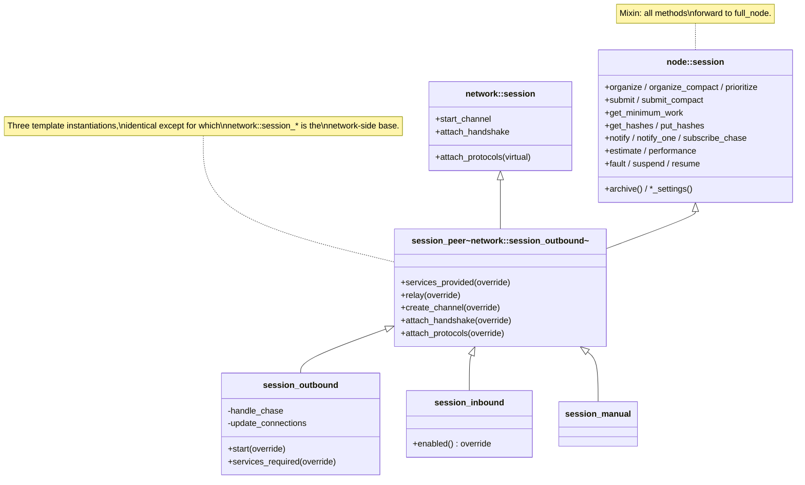
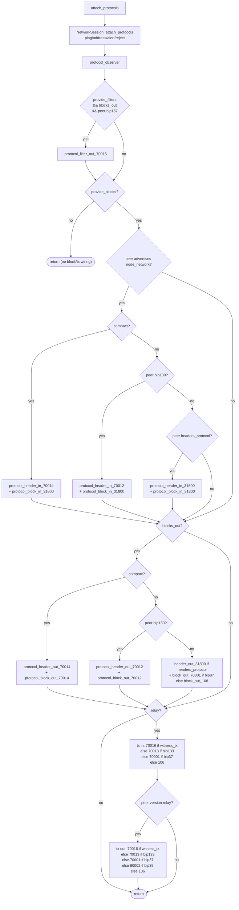
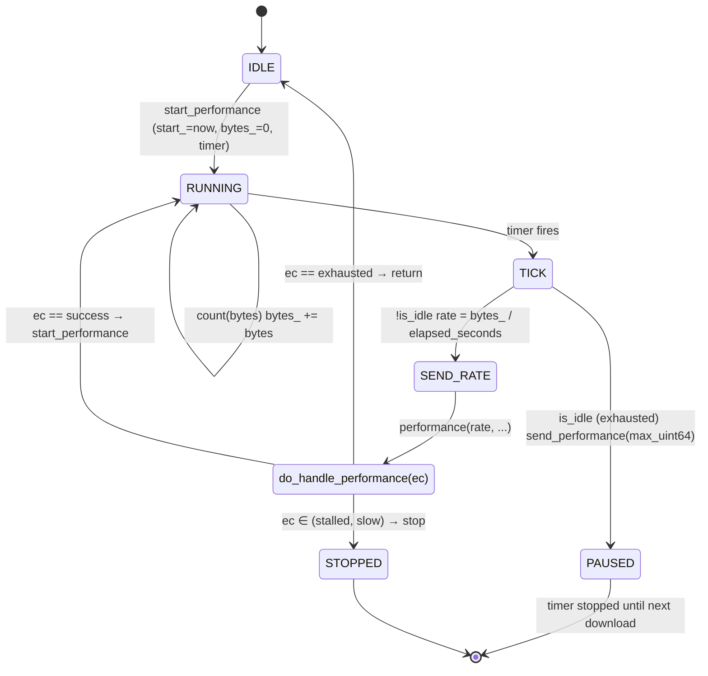
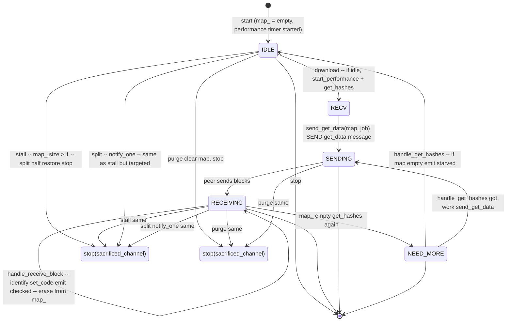
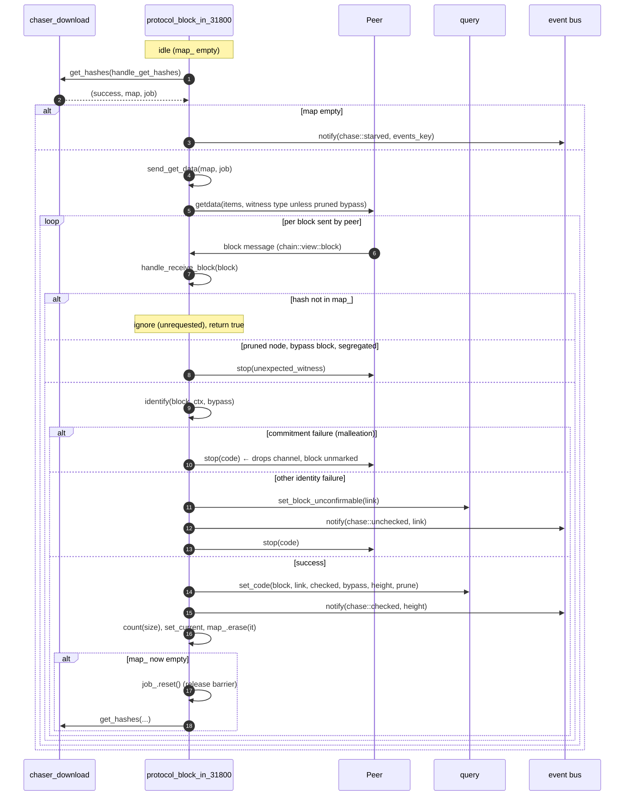
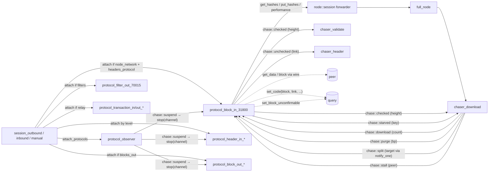

# 06 — Sessions and the block-in protocol

> Companion to [`00-overview`](00-overview),
> [`01-event-bus`](01-event-bus), and the chaser docs
> [`02`](02-chaser-header)–[`05`](05-chaser-confirm).
>
> This doc covers:
>
> 1. **Session layer** — how `full_node` wires the node's chasers into
>    libbitcoin-network's session machinery via a thin mixin, and the
>    decision tree that determines which P2P protocols attach to a new
>    channel.
> 2. **`protocol_block_in_31800`** — the heaviest peer-side class. It
>    is the counterpart of `chaser_download` on the wire side: pulls
>    download maps from `chaser_download`, sends `getdata`, receives
>    blocks, identifies and archives them, and emits `chase::checked` per
>    block.
>
> The supporting bases `protocol`, `protocol_peer`, `protocol_observer`,
> `protocol_performer` are described where they matter.

| File                                                                    | Role                                                              |
| ----------------------------------------------------------------------- | ----------------------------------------------------------------- |
| `include/bitcoin/node/sessions/session.hpp` + `src/sessions/session.cpp`| `node::session` mixin (sibling to `network::session`)              |
| `include/bitcoin/node/sessions/session_peer.hpp` + `.../impl/...ipp`    | CRTP template combining mixin with `network::session_*`            |
| `include/bitcoin/node/sessions/session_{inbound,outbound,manual}.hpp`   | Concrete sessions                                                  |
| `include/bitcoin/node/channels/channel_peer.hpp` + `src/channels/channel_peer.cpp` | node channel: announcement cache, witness frame context |
| `include/bitcoin/node/protocols/protocol.hpp` + `src/protocols/protocol.cpp` | `node::protocol` base — sibling of `network::protocol`        |
| `src/protocols/protocol_peer.cpp`                                       | `node::protocol_peer`: organizers, performance, announcements, compact blocks |
| `src/protocols/protocol_observer.cpp`                                   | Universal channel observer (suspend, diagnostics, terminator)     |
| `src/protocols/protocol_performer.cpp`                                  | Mixin providing the speed-reporting loop                          |
| `src/protocols/protocol_block_in_31800.cpp`                             | Block download workhorse                                          |

---

## 1. The class hierarchy

libbitcoin-node deliberately avoids diamond inheritance: `node::session`
is **a sibling**, not a parent, of `network::session`. The same applies
to protocols.

### 1.1 Session hierarchy

`session_peer<NetworkSession>` is a class template whose
`NetworkSession` parameter is instantiated separately for each
concrete session: `network::session_outbound`,
`network::session_inbound`, and `network::session_manual`
(`include/bitcoin/node/sessions/session_peer.hpp:33-62`). The
template inherits *from its parameter* (the network base) and *also*
from `node::session` (the mixin).



The `node::session` mixin (`src/sessions/session.cpp:34-240`) is **pure
forwarding**: every method delegates to the held `full_node&`. So at the
session layer, there is *no node-specific state*; the mixin's only role
is to give protocols a typed handle on the node.

### 1.2 Per-session overrides in `session_peer`

- `services_provided()` ORs the node's configured service bits
  (`provide_blocks`, `provide_witness`, `provide_filters`,
  `provide_privacy`) into the network's (`session_peer.ipp:28-33`).
- `relay()` requests tx relay in the version handshake **only when the
  confirmed chain is current** (`:35-39`).
- `create_channel` constructs a `node::channel_peer` (`:41-52`).
- `attach_handshake` sets the channel's start height from the confirmed
  top before the version exchange (`:54-68`).
- `attach_protocols` is the attach tree (§2.3).

### 1.3 Inbound `enabled()` gate

```cpp
// src/sessions/session_inbound.cpp:26-29
bool session_inbound::enabled() const NOEXCEPT
{
    return !node_settings().delay_inbound || is_recent();
}
```

> **Invariant (Session-Inbound-1).** Inbound connection attempts are
> rejected (the network layer disables the listener) until either
> `delay_inbound == false` *or* the confirmed chain is "recent"
> (`full_node::is_recent`: top equals configured maximum height *or*
> the confirmed top timestamp is within the currency window, doc 00
> §6.3). This prevents a not-yet-caught-up node from serving stale data
> while still allowing bounded-height test deployments.

This is implemented via `enabled()` rather than the bus
`suspend`/`resume` mechanism so that the listener has independent
control flow.

### 1.4 Outbound connection reduction

`session_outbound` (`src/sessions/session_outbound.cpp:37-100`) requires
the configured node services of its peers (`services_required`), and
subscribes to the bus after start when `node.current_connections` is
nonzero. On `chase::block` and `chase::stale` it calls
`update_connections`, which sets the outbound target to
`current_connections` while `is_recent()` and to the configured
`network.outbound.connections` otherwise.

> **Invariant (Session-Outbound-1).** While the confirmed chain is
> recent and `current_connections` is nonzero, the outbound session
> maintains at most `current_connections` peers; the full configured
> count is restored when the chain goes stale.

---

## 2. Channel construction and protocol attach

### 2.1 `create_channel(socket)` — `session_peer.ipp:41-52`

Returns a `node::channel_peer` upcast to `network::channel`. The node
channel adds the per-channel announcement cache (`announcement_cache`
hashes, `src/channels/channel_peer.cpp:32-49`) and stamps the witness
parse context on every inbound frame
(`include/bitcoin/node/channels/channel_peer.hpp:54-61`), so messages
are deserialized with witness data iff the node requires witness.

### 2.2 `attach_handshake(channel, handler)` — `session_peer.ipp:54-68`

Runs *before* the version handshake. Sets the channel's `start_height`
from `query.get_top_confirmed()` so the outgoing `version` message
carries the right height to the peer. The base then runs the standard
version exchange from libbitcoin-network.

### 2.3 `attach_protocols(channel)` — `session_peer.ipp:71-190`

After handshake succeeds, this method decides **which P2P protocols run
on the channel** based on negotiated peer features and node
configuration. This is the central network-layer decision tree.



### 2.4 Predicate definitions

| Predicate                  | Definition (file:line)                                                                |
| -------------------------- | ------------------------------------------------------------------------------------- |
| `relay`                    | `network_settings.enable_relay` (`session_peer.ipp:82`)                                |
| `delay`                    | `node_settings.delay_inbound` (`:83`)                                                  |
| `node_network`             | `node_settings.provide_blocks` (`:84`)                                                 |
| `node_client_filters`      | `node_settings.provide_filters` (`:85`)                                                |
| `blocks_out`               | `!delay || is_recent()` (`:94`)                                                        |
| `txs_in_out`               | `relay` (`:107`) — currency is signalled by fee filter, not by attachment              |
| `compact`                  | `network_settings.enable_compact && peer.is_negotiated(bip152)` (`:110-111`)           |
| `witness_tx`               | `network_settings.enable_witness_tx && peer.wants_witness_tx() && peer.is_negotiated(bip339)` (`:162-163`) |

`peer.is_negotiated(level)` consults the handshake-negotiated protocol
level. `peer.is_peer_service(service::node_network)` checks the peer's
advertised service bits.

> **Invariant (Attach-1).** Every channel receives `protocol_observer`
> (`session_peer.ipp:91`), so every channel is subject to
> `chase::suspend` (and stop). Without this, suspend would not reach
> all channels.

> **Invariant (Attach-2).** `protocol_block_in_31800` is attached
> exactly when the node provides blocks, the peer advertises
> `node_network`, and at least `headers_protocol` is negotiated
> (`:114-131`). There is no blocks-first fallback: a peer below 31800
> gets no block-in protocol.

> **Invariant (Attach-3).** Each direction gets exactly one header and
> one block protocol: the `if/else if` ladders are strict, and the
> compact (70014) level supersedes 70012, which supersedes 31800.

> **Note for the spec.** A spec can model the result as a *static* set
> of protocols per channel decided at handshake; the set never changes
> during the channel's lifetime.

---

## 3. `node::protocol` base — sibling pattern

`include/bitcoin/node/protocols/protocol.hpp:33-52`:

`node::protocol` does **not** inherit from `network::protocol`. Instead,
concrete protocols multiply-inherit from `network::protocol_peer` (the
wire-level base) *and* `node::protocol` (via `node::protocol_peer`,
`protocol_peer.hpp:33-54`). The `subscribe_chase` machinery uses
`shared_from_sibling` to get a `shared_ptr<node::protocol>` out of a
`network::protocol&` (`protocol.cpp:183-195`).

The base forwards the node surface to the session: organizers
(`organize`, `organize_compact`, `prioritize`, `get_minimum_work`,
`submit`, `submit_compact`), currency predicates, `minimum_fee_rate()`
(the configured rate when current, `max_money` otherwise, `:74-78`),
`estimate`, connection and suspension passthroughs, and channel/address
counts (`protocol.cpp:34-181`).

### 3.1 Event subscription protocol

```cpp
// src/protocols/protocol.cpp:183-195
void protocol::subscribe_chase(event_notifier&& handler) NOEXCEPT {
    const auto self = dynamic_cast<network::protocol&>(*this)
        .shared_from_sibling<node::protocol, network::protocol>();
    event_completer completer = std::bind(&protocol::handle_subscribed, self, _1, _2);
    session_->subscribe_chase(std::move(handler),
        std::bind(&protocol::handle_subscribe, self, _1, _2, std::move(completer)));
}
```

The chain: protocol → session → full_node → posts to node strand →
subscribes → completer fires → `handle_subscribe` stores the `key_` →
`handle_subscribed` posts back to channel strand → calls the override
`subscribed(ec, key)` for any protocol-specific init (`:197-232`).

> **Invariant (Protocol-Sub-1).** Each protocol may have *at most one
> active subscription*. Enforced by `BC_ASSERT_MSG(is_zero(key_),
> "unsafe access")` in `handle_subscribe` (`protocol.cpp:202`).

> **Invariant (Protocol-Sub-2).** `unsubscribe_chase` must be called
> from the protocol's `stopping(...)` override. The base `subscribed`
> calls it on early failure or if the channel already stopped
> (`protocol.cpp:225-232`).

### 3.2 `protocol_peer`

`node::protocol_peer` (`src/protocols/protocol_peer.cpp`) adds the
download-map RPCs (`get_hashes`/`put_hashes`), `performance`, `fault`
(self-stop plus session fault, `:53-61`), the announcement cache
accessors `set_announced`/`was_announced` (per channel, `:66-79`),
`set_current` (channel buffer policy, `:71-74`), event notification, and
`make_compact_block` (BIP152 v2 compact block of an associated block with
the coinbase prefilled and short ids over wtxids, `:98-134`).

### 3.3 `protocol_observer` — channel-suspend listener

Every channel has one. Its jobs (`src/protocols/protocol_observer.cpp`):

1. **Translate `chase::suspend` to channel stop.** When the bus
   broadcasts `suspend`, every observer calls `stop(ec)` with the event's
   code (`:69-94`). Result: a `suspend` event tears down every peer
   connection.
2. **Hygiene: drop peers that send unrequested tx inventories** when
   relay is disallowed (`:100-119`).
3. **Diagnostics**: answers `network::diagnostics` broadcasts with a
   per-channel row (peer version, services, fee, bytes by message, ping
   times, `:129-189`) and `network::terminator` broadcasts by stopping
   the targeted channel (`:192-210`).

> **Invariant (Observer-Suspend-1).** A single `chase::suspend`
> emission drops *all* channels via the per-channel observer. The base
> `network::net` also suspends its listeners (doc 00 §6.2), so the
> combined effect is "stop all current and refuse new".

---

## 4. `protocol_performer` — speed reporting loop

`src/protocols/protocol_performer.cpp`. A mixin used by
`protocol_block_in_31800` to drive the speed-reporting cycle.



Key code paths:

- `start_performance()` (`:35-46`): start clock, reset byte counter, arm
  the timer (period `node.sample_period_seconds`).
- `handle_performance_timer(ec)` (`:48-76`): on tick, if idle ⇒
  `pause_performance` (sends `max_uint64`); else compute rate in bytes/s
  and `send_performance`.
- `send_performance(rate)` (`:90-113`): if `deviation_` is enabled, send
  via the `performance(rate, handler)` RPC → chaser_download → maybe
  `slow_channel`; else only stalled/exhausted detection locally.
- `do_handle_performance(ec)` (`:123-152`):

| Reply code         | Reaction                                                        |
| ------------------ | --------------------------------------------------------------- |
| `exhausted_channel`| Stop the timer; wait for `chase::download` to restart           |
| `stalled_channel`, `slow_channel` | `stop(ec)` — drop the channel                    |
| other error        | `stop(ec)`                                                      |
| `success`          | `start_performance()` — go again                                 |

> **Invariant (Performer-1).** `bytes_` is reset at every
> `start_performance`, so `rate = bytes_/elapsed` is bytes/sec since
> the last tick boundary.

> **Invariant (Performer-2).** A channel that returns
> `exhausted_channel` is NOT dropped; only the timer is paused. It
> resumes on the next `chase::download` event.

---

## 5. `protocol_block_in_31800` — the block-download protocol

This class is the on-the-wire counterpart of `chaser_download`. The
chaser holds the *queue of pending downloads* (doc 03); this protocol
holds *one map of in-flight items per channel* and shuttles between
them.

### 5.1 Per-channel state

```cpp
// protocol_block_in_31800.hpp:92-99
const size_t top_checkpoint_height_;   // checkpoint gate for "checked"
const type_id block_type_;             // witness_block iff node.require_witness
const bool node_pruned_;               // node.limited_blocks
map_ptr     map_;        // current download map; empty ⇒ idle
job::ptr    job_;        // shared race_all barrier (held while in flight)
```

### 5.2 Lifecycle

```cpp
// protocol_block_in_31800.cpp:44-55
void start() { subscribe_chase(...); SUBSCRIBE_CHANNEL(block, ...); protocol_performer::start(); }

// :58-76 — subscribed (after event subscription completes)
if (stopped(ec)) { unsubscribe_chase(); return; }
if (is_current_chain(false)) { start_performance(); get_hashes(...); }

// :79-87 — stopping
restore(map_); map_ = empty_map(); stop_performance(); unsubscribe_chase(); ...
```

> **Invariant (BlockIn-Lifecycle-1).** On stop, the protocol *returns
> its current map* via `put_hashes`, so the chaser can re-queue the
> work for another channel. `restore` is a no-op if the map is empty
> (`:389-393`).

> **Invariant (BlockIn-Lifecycle-2).** Initial download only starts if
> the candidate chain is *current* at subscription time (`:71-75`).
> Otherwise the protocol waits for `chase::download` events.

### 5.3 Bus event handling



The mapping of bus events → handlers (`protocol_block_in_31800.cpp:98-153`):

| Event              | Handler           | Effect                                                                                          |
| ------------------ | ----------------- | ----------------------------------------------------------------------------------------------- |
| `chase::download`  | `do_get_downloads`| If idle: `start_performance` + `get_hashes`                                                      |
| `chase::split`     | `do_split`        | If map_ > 1 item: split half, return both halves, stop with `sacrificed_channel`               |
| `chase::stall`     | `do_stall`        | Same as split (split if divisible work, else no-op)                                              |
| `chase::purge`     | `do_purge`        | If map_ non-empty: clear it, stop with `sacrificed_channel`                                      |
| `chase::report`    | `do_report`       | LOG only — current map size                                                                      |
| `chase::stop`      | (return false)    | Unsubscribe                                                                                      |

### 5.4 The download cycle



### 5.5 The `identify` function and bypass

```cpp
// protocol_block_in_31800.cpp:370-384
code identify(const chain::view::block& block, const chain::context& ctx, bool bypass) const {
    if ((ec = block.identify())) return ec;          // merkle root, malleation
    if (bypass && node_pruned_) return success;      // stripped block: no witness commitment
    if ((ec = block.identify(ctx))) return ec;       // witness commitment
    return success;
}
```

`bypass = query.is_bypass(link)` (`:289`); `checked = is_under_checkpoint(height)`
(`:288`). Only identity is checked at receive time; block checks are
deferred to validation, which allows the simplified `view::block` here.

> **Invariant (BlockIn-Check-1).** Identity failure
> (`invalid_transaction_commitment`, `invalid_witness_commitment`) is
> interpreted as **malleation** — stop the peer but do *not* mark the
> block unconfirmable (`:306-315`). A different peer may yet deliver the
> canonical block.

> **Invariant (BlockIn-Check-2).** Any other identity failure ⇒
> `set_block_unconfirmable(link)` is called AND `chase::unchecked` is
> emitted (`:317-328`). `chaser_header` will then disorganize down to
> this link (when `mark_unconfirmable` is set).

> **Invariant (BlockIn-Pruned-1).** A pruned node (`limited_blocks`)
> requests bypassed blocks without witness (`to_block_type`, `:441-446`),
> rejects a segregated bypassed block (`:290-295`), skips the witness
> commitment, and archives bypassed blocks without input scripts
> (`prune = bypass && node_pruned_`, `:335`).

### 5.6 Storage write

```cpp
// :336-344
if (const auto code = query.set_code(block, link, checked, bypass, height, prune)) {
    stop(fault(code)); return false;
}
```

`query.set_code` associates the block body with its header link in the
store. Failure here is a node fault (suspends the network via
`fault(code)`).

> **Invariant (BlockIn-Store-1).** A `chase::checked(height)` event is
> emitted *only after* `set_code` succeeded (`:336-352`). Consumers
> of `chase::checked` can rely on the block being durably associated.

### 5.7 Self-stall detection

```cpp
// :424-428 in handle_get_hashes
if (map->empty()) { notify(error::success, chases::starved{ events_key() }); return; }
```

If the chaser hands the protocol an empty map, this protocol is *out of
work*. Emitting `chase::starved` causes `chaser_download::do_starved` to
either pick the slowest channel and signal a `split` or — if no channels
are tracked — broadcast `stall`.

> **Invariant (BlockIn-Starve-1).** `chase::starved` is emitted with
> the protocol's own subscription key (`events_key()`). The chaser
> uses this key to *avoid* asking the starved peer to split its own
> (empty) work.

---

## 6. Coupling diagram



---

## 7. Error / outcome inventory for `protocol_block_in_31800`

| Code                                  | Site                                       | Trigger                                                                        |
| ------------------------------------- | ------------------------------------------ | ------------------------------------------------------------------------------ |
| `system::error::unexpected_witness`   | `:290-295`                                 | Pruned node received a segregated bypassed block — peer dropped                |
| `system::error::invalid_transaction_commitment` / `invalid_witness_commitment` | `:306-315` | Malleation — peer dropped; block left unmarked                         |
| any other identity error              | `:317-328`                                 | `set_block_unconfirmable`; emit `chase::unchecked`; stop peer                  |
| `node::error::protocol1`              | `:319`                                     | `set_block_unconfirmable` itself failed — node fault                            |
| `network::error::sacrificed_channel`  | `:185, :199, :213`                         | Self-sacrifice on `purge`/`stall`/`split`                                       |
| any database error code               | `:336-344`                                 | `set_code` failure — node fault                                                 |

---

## 8. Spec view

### 8.1 Sessions as protocol selectors

The session layer's only consensus-relevant action is the **attach
tree** (§2.3). A spec can model:

```
attach(channel, peer, settings) : Set Protocol =
    { observer } ∪ filters(...) ∪ block_in_set(...) ∪ block_out_set(...) ∪ tx_set(...)
```

Once `start_channel` succeeds and `attach_protocols` runs, the set is
fixed for that channel's lifetime.

### 8.2 `protocol_block_in_31800` as a process

- **State**: `map ∈ MaybeQueue (HashPair)`, `job ∈ MaybeJobBarrier`,
  `bytes ∈ ℕ`.
- **Inputs** (channel strand): peer `block` messages; bus events listed
  in §5.3; performance timer ticks.
- **Inputs** (chaser strand, via RPC results): `handle_get_hashes(ec,
  map, job)`, `handle_put_hashes(ec, count)`.
- **Outputs**: peer `getdata` messages; bus events `chase::checked`,
  `chase::unchecked`, `chase::starved`; store mutations `set_code`,
  `set_block_unconfirmable`.

### 8.3 Safety properties

1. **Store-precedes-bus** (BlockIn-Store-1): `chase::checked(h)` ⇒
   the block is durably stored at the link `to_candidate(h)`.
2. **No silent invalidation**: every `chase::unchecked(link)` is
   preceded by a successful `set_block_unconfirmable(link)`. Failure
   path goes to fault, not silent drop (BlockIn-Check-2).
3. **Map ownership**: at any time, a given map entry is in exactly
   one place: in `chaser_download.maps_`, in some channel's `map_`, or
   in flight as a returned `restore` to the chaser.
4. **Job barrier completeness**: while any channel holds `job_`, the
   chaser's `race_all` is not complete.

### 8.4 Liveness

- Each channel either keeps progressing (`chase::checked` per block) or
  emits `chase::starved` when its map drains, prompting the chaser to
  rebalance.
- A persistently slow channel is dropped via `slow_channel`; a
  persistently stuck channel via `stalled_channel`.

---

## 9. Implementation notes

- **Sessions**: the three session subclasses differ only in that
  `enabled` is customised for inbound and the connection count for
  outbound; the attach tree (§2.3) is the only behavioural component.
- **`node::protocol` sibling pattern**: a workaround for C++ multiple
  inheritance — without that constraint a wire protocol can simply hold
  a reference to the node.
- **`protocol_block_in_31800`**: an actor with one mailbox for peer
  messages and one for chaser events. The interleaving on the channel
  strand makes it inherently single-threaded per channel.
- **`protocol_performer`**: a recurring scheduled task that snapshots
  `bytes_` and computes a rate.

---

## 10. Notes for the formal model

- The session layer adds no shared state — it is a static dispatch
  from configuration + handshake state to a finite protocol set, plus
  one integer (the outbound target) driven by currency.
- `protocol_block_in_31800` is strand-confined; its only off-strand
  interactions are `get_hashes`/`put_hashes`/`performance` RPCs which
  post to the chaser strand. The full system can be modelled as one
  chaser strand + N independent channel strands communicating only by
  the bus and these three RPCs.
- The **map-ownership** property (§8.3-3) is the non-trivial
  correctness obligation here; an exchange protocol proof can be
  modelled with a token-passing semantics.

---

## Cross-references

- [`00-overview`](00-overview) §7 (network layer at a glance)
- [`01-event-bus`](01-event-bus) §2.1 (work-shuffling events
  emitted/consumed here), §2.3 (`checked`/`unchecked`)
- [`03-chaser-download`](03-chaser-download) §6 (the chaser side of
  performance and starved/split/stall), §9 (coupling diagram)
- [`07-header-protocols`](07-header-protocols) (header sync and compact
  blocks)
- [`08-block-out-protocols`](08-block-out-protocols) (block-serving
  counterpart)
- [`09-filter-out-70015`](09-filter-out-70015) (BIP158 filter serving)
- [`10-tx-protocols`](10-tx-protocols) (transaction ladder)
