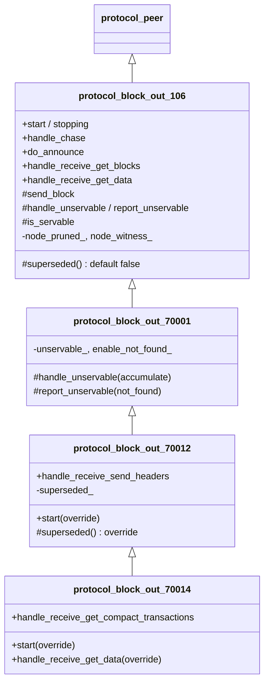
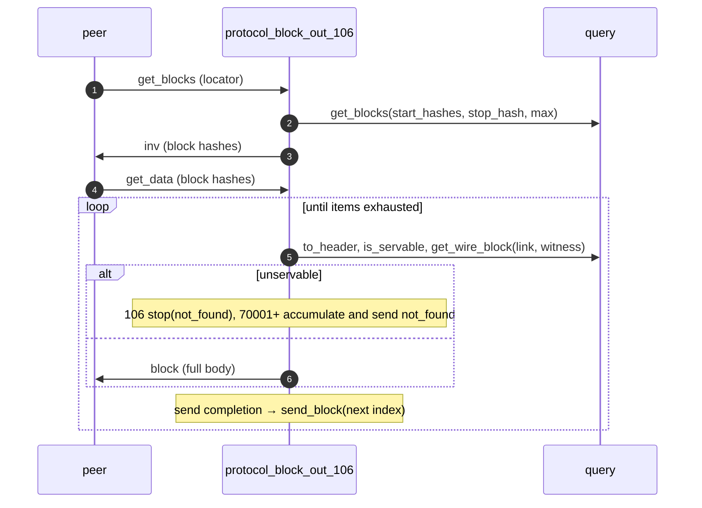
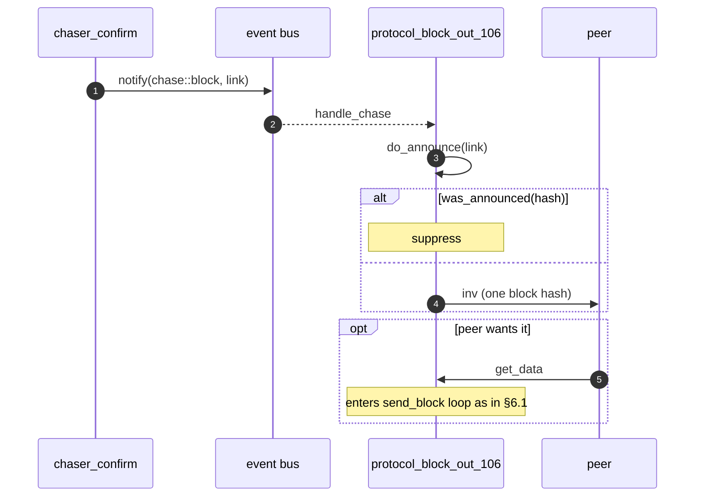
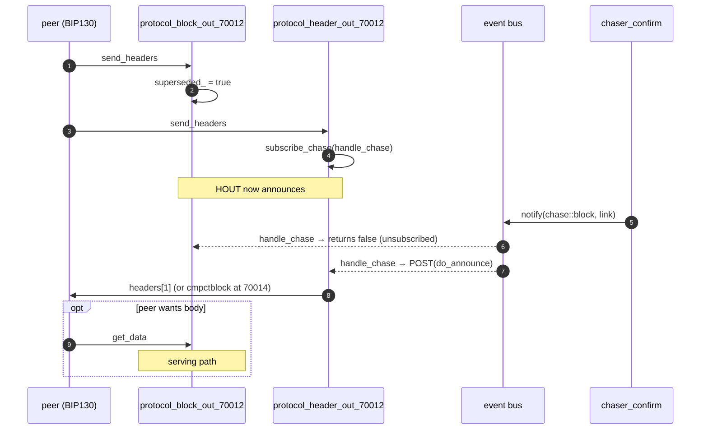

# 08 — Block-out protocols (106 / 70001 / 70012 / 70014)

> Companion to [`06-sessions-and-protocols`](06-sessions-and-protocols)
> and [`07-header-protocols`](07-header-protocols).
>
> Block-out is the **block-serving** side: respond to peer requests
> (`get_blocks`, `get_data`) with inventory / block bodies, and announce
> newly-confirmed blocks via `inv` so peers know to come ask. Four
> levels:
>
> - **106** (`protocol_block_out_106`) — full implementation: serves
>   `get_blocks`/`get_data`, announces new blocks via `inv`; an
>   unservable request stops the channel.
> - **70001** (`protocol_block_out_70001`) — BIP37: unservable items are
>   accumulated and reported with one `not_found` instead of a stop.
> - **70012** (`protocol_block_out_70012`) — *suppresses* inv-based
>   announcement when the peer has opted into `sendheaders` (BIP130).
> - **70014** (`protocol_block_out_70014`) — BIP152: serves compact
>   blocks for compact `get_data` items and `getblocktxn`.

| File                                          | Lines | Role                                                            |
| --------------------------------------------- | ----- | --------------------------------------------------------------- |
| `src/protocols/protocol_block_out_106.cpp`    | 313   | Block serving + inv announcement; stop on unservable             |
| `src/protocols/protocol_block_out_70001.cpp`  |  74   | `not_found` accumulation                                         |
| `src/protocols/protocol_block_out_70012.cpp`  |  75   | `sendheaders` handler → sets `superseded_`                       |
| `src/protocols/protocol_block_out_70014.cpp`  | 140   | compact block and `getblocktxn` serving                          |

---

## 1. Inheritance and override surface



> **Invariant (BlockOut-Inherit-1).** Each level is a strict superset of
> the one below. All 106 behaviour remains in effect; higher levels only
> change the unservable report, the announcement gate, and add compact
> serving.

---

## 2. `protocol_block_out_106` — the workhorse

### 2.1 Subscriptions

```cpp
// :46-66
void start() { subscribe_chase(...); SUBSCRIBE_CHANNEL(get_data, ...); SUBSCRIBE_CHANNEL(get_blocks, ...); protocol_peer::start(); }
void stopping(ec) { unsubscribe_chase(); protocol_peer::stopping(ec); }
```

The protocol does *three* things:
1. Listens for `chase::block` from the bus → emit `inv` to peer.
2. Listens for `get_blocks` from peer → reply with `inv`.
3. Listens for `get_data` from peer → start a streaming send of blocks.

### 2.2 Outbound announcement (`do_announce`)

```cpp
// :102-124
bool do_announce(header_t link) {
    const auto hash = archive().get_header_key(link);
    if (was_announced(hash)) return true;          // anti-echo
    if (hash == null_hash) return true;            // store inconsistency; logged only
    NOTIFY(inventory{ { { type_id::block, hash } } }, handle_send, _1);
    return true;
}
```

> **Invariant (BlockOut-Announce-1).** A block is announced only if
> (a) it wasn't received from this peer (`was_announced` false), and
> (b) `get_header_key(link)` returned a non-null hash. Anti-echo
> discipline matches the header and tx out protocols.

> **Invariant (BlockOut-Announce-2).** Announcement is via a single
> `inv` containing `{ type_id::block, hash }`. The peer then sends
> `get_data` to retrieve the block body if it wants it.

### 2.3 Inbound `get_blocks` (peer asks for hashes)

```cpp
// :129-141, :294-306
inventory create_inventory(const get_blocks& locator) {
    if (!is_current_chain(true)) return {};
    return inventory::factory(archive().get_blocks(start_hashes, stop_hash, max_get_blocks), type_id::block);
}
```

> **Invariant (BlockOut-Serve-1).** Like header-out, block-out is
> gated on `is_current_chain(true)` — non-current nodes reply empty.

### 2.4 Inbound `get_data` (peer asks for block bodies)

```cpp
// :146-166
bool handle_receive_get_data(ec, message) {
    if (!node_witness_ && message->any_witness()) { stop(protocol_violation); return false; }   // A
    if (is_zero(message->count(blocks))) return true;
    send_block(error::success, zero, message, gate());
    return true;
}
```

The old per-channel backlog and `allow_overlapped` setting are gone: each
`get_data` starts its own send loop over the message's items, and the
channel's **gate** (`gate()`, a libbitcoin-network read gate held across
the out-of-line work) serialises outbound messages so concurrent requests
cannot interleave or run unbounded.

### 2.5 The send loop (`send_block`)

```cpp
// :171-234
void send_block(ec, index, message, gate) {
    if (stopped(ec)) return;
    // drain unservable items, skipping non-block inventory
    for (; index < items.size(); ++index) {
        if (!item.is_block()) continue;
        if (item.is_witness_type() && !node_witness_) { stop(protocol_violation); return; }
        link = query.to_header(item.hash);
        if (is_servable(item.hash, link)) break;
        if (!handle_unservable(item)) return;            // 106: stop(not_found); 70001: accumulate
    }
    if (report_unservable(index, message, gate)) return; // 70001: SEND(not_found) then resume here
    if (index >= items.size()) return;
    block out{ { query.get_wire_block(link, witness), witness } };
    if (!out.block.is_valid()) { if (handle_unservable(item)) report_unservable(add1(index), ...); return; }
    span<microseconds>(events::block_usecs, start);
    SEND(std::move(out), send_block, _1, add1(index), message, gate);
}
```

The continuation is `send_block` itself: each completed `SEND` triggers
the next item. The loop terminates when the items are exhausted or on
error / stop.

> **Invariant (BlockOut-Stream-1).** At any time, at most one
> `SEND(block, ...)` is in flight per request; the next is started
> only from the previous's completion callback. This is the natural
> back-pressure: a slow peer slows the send rate.

> **Invariant (BlockOut-Servable-1).** A block is servable iff its hash
> resolves to a stored header, it is associated, and it is not a pruned
> bypass block on a limited node (`is_servable`, `:237-267`). An
> unservable item at 106 stops the channel with `not_found` ("this block
> could not have been advertised to the peer", `:270-280`); at 70001 and
> above it is reported.

### 2.6 Witness-mode gate

Two separate witness-gating sites: `handle_receive_get_data`
(request-time) and `send_block` (per item). `node_witness_ =
node.provide_witness` (`protocol_block_out_106.hpp:39`).

> **Invariant (BlockOut-Witness-1).** A node that does not provide
> witness drops any peer that requests witness data, at either the
> batch level or the per-item level. There is no path that serves
> non-witness data in response to a witness request.

---

## 3. `protocol_block_out_70001` — `not_found`

`handle_unservable` accumulates the item instead of stopping (`:41-51`,
when `enable_not_found_`), and `report_unservable` sends the accumulated
run as one `not_found` message whose completion resumes `send_block` at
the next index (`:55-68`).

> **Invariant (BlockOut-NotFound-1).** Unservable items are answered in
> request order, as a run preceding the next servable block, and nothing
> is produced until the prior write completes.

---

## 4. `protocol_block_out_70012` — the supersede gate

```cpp
// :39-48 start: SUBSCRIBE_CHANNEL(send_headers, ...)
// :53-63 handle_receive_send_headers: superseded_ = true; return false (one-shot)
// :66-69 superseded(): return superseded_
```

The base `handle_chase` checks `superseded()` first
(`protocol_block_out_106.cpp:75-76`): once true, the very next
`chase::block` makes `handle_chase` return false, and the bus
desubscriber removes this protocol from the event list.

> **Invariant (BlockOut-Supersede-1).** After the peer sends
> `sendheaders`, this protocol no longer emits `inv`-based block
> announcements. Header-based (or compact) announcement via
> `protocol_header_out_70012`/`70014` takes over.

> **Invariant (BlockOut-Supersede-2).** Supersede is one-way: once
> true, never reset.

`superseded_` is a `std::atomic_bool` because the base reads it from its
bus handler on the node strand while the derived class writes it from
its channel handler.

---

## 5. `protocol_block_out_70014` — compact serving

- `handle_receive_get_data` (`:56-86`) runs the base loop for block
  items, then answers every `compact` / `witness_compact` item that is
  servable with a compact block from `make_compact_block` (doc 06 §3.2).
- `handle_receive_get_compact_transactions` (`:91-134`) answers
  `getblocktxn` with the requested txs by differentially encoded index;
  an index past the block's tx count is a protocol violation, a missing
  tx body is a `protocol2` fault.

---

## 6. End-to-end flows

### 6.1 Peer requests blocks



### 6.2 New block confirmed, announce to peer (pre-BIP130)



### 6.3 BIP130 peer opts into headers



---

## 7. Bus integration summary

| Protocol                       | Subscribes to        | Reaction                                                                                          |
| ------------------------------ | -------------------- | ------------------------------------------------------------------------------------------------- |
| `protocol_block_out_106`       | `chase::block`        | `do_announce(link)` ⇒ send `inv`                                                                  |
| `protocol_block_out_70001`     | (inherited)          | same                                                                                              |
| `protocol_block_out_70012/70014` | (inherited)        | Same until `superseded_ == true`; then `handle_chase` returns false → unsubscribed                 |

---

## 8. Error / outcome inventory

| Code                                  | Site                                       | Trigger                                                       |
| ------------------------------------- | ------------------------------------------ | ------------------------------------------------------------- |
| `network::error::protocol_violation`  | `106.cpp:153-158`, `:190-195`; `70014.cpp:116-120` | witness request on a non-witness node; bad `getblocktxn` index |
| `system::error::not_found`            | `106.cpp:270-280`                          | unservable block at 106 (no `not_found` message below bip37)  |
| `node::error::protocol2`              | `70014.cpp:123-127`                        | tx body of an associated block missing — node fault           |

---

## 9. Configuration knobs

| Setting (file)                          | Effect                                                                                 |
| --------------------------------------- | -------------------------------------------------------------------------------------- |
| `node.provide_witness`                  | Whether to serve witness data. If false: drop peers requesting witness                  |
| `node.limited_blocks`                   | Pruned node: bypassed blocks are unservable                                              |
| `network.enable_not_found`              | 70001+: report unservable items with `not_found` instead of stopping                     |
| `network.enable_compact`                | attach 70014 (with peer bip152)                                                          |

---

## 10. Spec view

```
protocol_block_out_106 : Process
  state:  (none beyond the in-flight send continuation)
  inputs:
    bus chase::block(link)              → emit inv to peer (filtered by was_announced)
    peer get_blocks(locator)            → emit inv (from get_blocks query)
    peer get_data(items)                → send loop over items
    send completion                     → SEND next servable item; loop
  outputs:
    peer inv | block | not_found (70001+) | cmpctblock | blocktxn (70014)

70012 adds:
  state:  superseded : Atomic Bool          (one-way latch)
  inputs: peer send_headers                 → superseded := true
  gating: handle_chase(chase::block) returns false if superseded
```

### 10.1 Safety properties

1. **Anti-echo** (BlockOut-Announce-1).
2. **One in-flight send** per request (BlockOut-Stream-1).
3. **Servability** (BlockOut-Servable-1): only associated, unpruned
   blocks are served.
4. **Supersede monotone** (BlockOut-Supersede-2).

### 10.2 Liveness

- The send loop drains the request as long as the peer accepts data
  and the store yields block bodies.
- Stop is non-blocking; an in-flight send completes through the
  channel's stop machinery (libbitcoin-network).

---

## 11. Notes for the formal model

- The protocol is strand-confined except for the `superseded_` atomic.
  Single-threaded reasoning suffices per channel.
- The combined "announce via compact block OR headers OR inv, never
  more than one" property needs joint reasoning across
  `protocol_block_out_70012`, `protocol_header_out_70012` and
  `protocol_header_out_70014`: they consume the same `chase::block`
  event, and the supersede flag plus the header-out fallback chain
  ensure at most one announcement per block per channel.
- A peer's behaviour (deciding to send `sendheaders`/`sendcmpct`, when to
  issue `get_data`, etc.) is an oracle in the model.

---

## Cross-references

- [`05-chaser-confirm`](05-chaser-confirm) §7 — issues `chase::block`
- [`06-sessions-and-protocols`](06-sessions-and-protocols) §2.3 — attach
  tree; §3.2 — `make_compact_block`
- [`07-header-protocols`](07-header-protocols) §6, §7 — the header-out
  counterparts that take over announcement when this one is superseded
- [`09-filter-out-70015`](09-filter-out-70015) (BIP157/158 client filters)
- [`10-tx-protocols`](10-tx-protocols) (transaction in/out)
