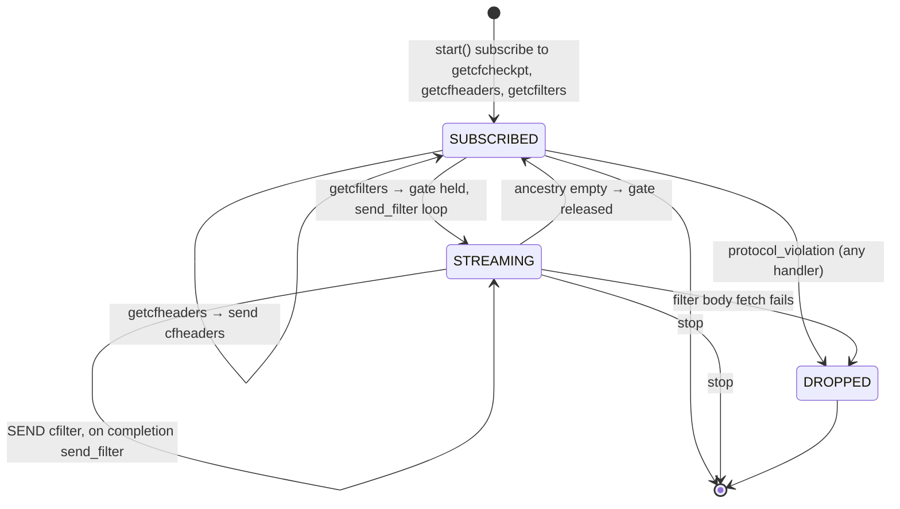

# 09 — `protocol_filter_out_70015` (BIP157/158 client filters)

> Companion to [`06-sessions-and-protocols`](06-sessions-and-protocols).
>
> `protocol_filter_out_70015` is the **light-client compact-block-filter
> serving protocol**, implementing BIP157 (`getcfcheckpt` /
> `getcfheaders` / `getcfilters`) over the Neutrino filter type
> (BIP158). It handles three peer requests and replies with data
> derived from the filter records persisted by `chaser_validate`
> (`set_filter_body`) and `chaser_confirm` (`set_filter_head`).
>
> The protocol is **stateless** per channel — pure request/response.
> Filter bodies are streamed one message per block under the channel's
> gate.

| File                                              | Lines | Role                                              |
| ------------------------------------------------- | ----- | ------------------------------------------------- |
| `src/protocols/protocol_filter_out_70015.cpp`     | 261   | All three BIP157 request handlers                  |

---

## 1. BIP157/158 in one paragraph

A *client filter* is a compact, deterministic summary of the
scripts in a block (BIP158: Golomb-Rice encoded set of
scriptPubKeys + spent prevout scripts). Light clients can ask any
full node for these filters, scan them locally to find blocks
relevant to their wallet, then fetch only those blocks. BIP157 is the
P2P protocol for serving them:

- **Filter checkpoint** (`getcfcheckpt`): every 1000 blocks (the
  `client_filter_checkpoint_interval`), the *filter header* (a hash
  chain over filter bodies). Used by clients to anchor trust quickly.
- **Filter headers** (`getcfheaders`): a range of filter hashes from
  `start_height` to `stop_hash` inclusive, plus the filter header at
  `start_height - 1`. Up to `max_client_filter_headers` (2000) per
  request.
- **Filters** (`getcfilters`): the actual filter bodies for a range,
  up to `max_client_filters` (1000) per request.

Only one filter type is recognised: `client_filter::type_id::neutrino`
(BIP158). Anything else is a protocol violation.

> **Invariant (Filter-Type-1).** All three request handlers reject
> any `filter_type != neutrino` with `protocol_violation`. The node
> serves Neutrino filters or nothing.

---

## 2. Where the data comes from

| Persisted by                          | Method                       | What it stores                  |
| ------------------------------------- | ---------------------------- | ------------------------------- |
| `chaser_validate` (full, bypass and pooled paths) | `query.set_filter_body(link, block)` | Filter body for each validated block when filters are enabled |
| `chaser_confirm::confirm_block` and bypass path | `query.set_filter_head(link)` | Filter header (running hash) for each confirmed block |

Read methods used here:

| Method                                              | Used by                                          |
| --------------------------------------------------- | ------------------------------------------------ |
| `query.to_header(hash) → header_link`               | All three request handlers (resolve stop hash)   |
| `query.get_height(out h, link) → bool`              | All three (validate stop_hash; get range bound)  |
| `query.get_filter_heads(out, stop_h, interval)`     | `getcfcheckpt` handler                            |
| `query.get_filter_hashes(out, prev_hdr, stop_link, count)` | `getcfheaders` handler                     |
| `query.get_ancestry(out, stop_link, count)`         | `getcfilters` handler — header_link list        |
| `query.get_filter_body(out, link)`                  | Streamed per ancestry entry                       |
| `query.get_header_key(link)`                        | Per filter body — peer expects `block_hash`       |

> **Invariant (Filter-Data-1).** All filter data is derived from
> already-persisted store records. The protocol performs **no
> computation** other than serialization; it can be modelled as a
> pure read transformer.

---

## 3. Subscriptions

```cpp
// :43-53
void start() {
    SUBSCRIBE_CHANNEL(get_client_filter_checkpoint, handle_receive_get_filter_checkpoint, _1, _2);
    SUBSCRIBE_CHANNEL(get_client_filter_headers,    handle_receive_get_filter_headers,    _1, _2);
    SUBSCRIBE_CHANNEL(get_client_filters,           handle_receive_get_filters,           _1, _2);
    protocol_peer::start();
}
```

No bus subscription. No `stopping` override.

---

## 4. `getcfcheckpt` handler

```cpp
// :58-102
if (filter_type != neutrino)                                  → protocol_violation  // A
if (!query.get_height(stop_height, query.to_header(stop_hash))) → protocol_violation  // B
if (!query.get_filter_heads(out.filter_headers, stop_height, interval)) → protocol_violation  // C
SEND(client_filter_checkpoint{ headers, stop_hash, neutrino })
```

Three drop conditions: wrong filter type; unknown stop hash; filter
head fetch failed (typically because the branch has never been
confirmed).

> **Invariant (Filter-Checkpoint-1).** From the comment block (`:86-88`):
> *"There is no guarantee that this set will be consistent across
> reorgs. However for it to be inconsistent there must be a >= 1000
> block reorg."* Do not treat `client_filter_checkpoint` as canonical
> across a 1000-block reorg window.

Reporting: `events::filterchecks_msecs` per response.

---

## 5. `getcfheaders` handler

```cpp
// :107-166
type check; stop_hash check (as above)
if (is_subtract_overflow(stop_height, start_height))     → protocol_violation   // stop ≥ start
const auto count = add1(subtract(stop_height, start_height));                  // inclusive
if (count > max_client_filter_headers)                   → protocol_violation   // ≤ 2000
if (!query.get_filter_hashes(out.filter_hashes, out.previous_filter_header, stop_link, count)) → protocol_violation
SEND(client_filter_headers{ ... })
```

> **Invariant (Filter-Headers-1).** The response covers the inclusive
> range `[start_height, stop_height]` (`count = stop − start + 1`,
> `:144`) and is assured to represent a consistent branch: the store
> returns either the complete range from `stop_link` back `count`
> entries, or false. No partial returns.

> **Invariant (Filter-Headers-2).** `previous_filter_header` is the
> filter header at `start_height − 1` (or all-zero at genesis), set by
> the store query together with the hashes.

Reporting: `events::filterhashes_msecs`.

---

## 6. `getcfilters` handler and the streaming pattern

```cpp
// :171-226
type, stop_hash, range checks as for cfheaders, with count ≤ max_client_filters (1000)
const auto ancestry = std::make_shared<database::header_links>();
if (!query.get_ancestry(*ancestry, stop_link, count)) → protocol_violation
span<milliseconds>(events::ancestry_msecs, start);
send_filter(error::success, ancestry, gate());
return true;

// :228-254
void send_filter(ec, ancestry, gate) {
    if (stopped(ec) || ancestry->empty()) return;
    const auto link = system::pop(*ancestry);
    if (!query.get_filter_body(out.filter, link)) { stop(protocol_violation); return; }
    out.block_hash = query.get_header_key(link);
    span<milliseconds>(events::filter_msecs, start);
    SEND(out, send_filter, _1, ancestry, gate);
}
```

This is a self-recursive async loop, identical in structure to
`protocol_block_out_106::send_block`. The completion handler of each
`SEND` is `send_filter` itself, with the same `ancestry_ptr` shared
across iterations. The channel's **gate** is held across the loop so
that another `getcfilters` arriving mid-stream cannot interleave with
it; the handler stays subscribed (the earlier one-shot resubscribe
trick is gone).

> **Invariant (Filter-Stream-1).** The ancestry list is consumed
> back-to-front (`system::pop`), so the wire order is
> `start_height`, `start_height + 1`, …, `stop_height`. This matches
> BIP157 expected ordering (low height first).

> **Invariant (Filter-Stream-2).** A failure to fetch any filter body
> mid-stream drops the peer (`protocol_violation`). The ancestry is
> abandoned when `send_filter` returns.

---

## 7. State machine view



---

## 8. Bus integration

**None.** This protocol does not subscribe to or emit any `chase`
events. Its sole inputs are peer messages; its sole outputs are peer
messages and metrics events (`events::filter_msecs`,
`events::filterhashes_msecs`, `events::filterchecks_msecs`,
`events::ancestry_msecs`).

---

## 9. Error / outcome inventory

All errors result in dropping the peer; none are node-faults.

| Site                                                          | Code                                  | Reason                                  |
| ------------------------------------------------------------- | ------------------------------------- | --------------------------------------- |
| `:67-71` (cfcheckpt), `:116-120` (cfheaders), `:180-184` (cfilters) | `protocol_violation`               | `filter_type != neutrino`                |
| `:80-84`, `:129-133`, `:193-197`                              | `protocol_violation`                  | `stop_hash` not in store                 |
| `:137-141`, `:201-205`                                        | `protocol_violation`                  | `stop_height < start_height`             |
| `:145-149`                                                    | `protocol_violation`                  | cfheaders count > 2000                    |
| `:209-213`                                                    | `protocol_violation`                  | cfilters count > 1000                     |
| `:90-95`                                                      | `protocol_violation`                  | `get_filter_heads` returned false        |
| `:154-159`                                                    | `protocol_violation`                  | `get_filter_hashes` returned false       |
| `:217-221`                                                    | `protocol_violation`                  | `get_ancestry` returned false            |
| `:244-248`                                                    | `protocol_violation`                  | `get_filter_body` returned false mid-stream |

> **Note for the spec.** Every `protocol_violation` here represents
> either (a) a misbehaving peer or (b) a store inconsistency. The
> protocol does not distinguish; both produce a channel drop.

---

## 10. Configuration

Attachment gate (`session_peer.ipp:97-100`):

```
if (provide_filters && blocks_out && peer.is_negotiated(bip157))
    channel->attach<protocol_filter_out_70015>(self)->start();
```

Plus the store-level toggle `filter_enabled()` consumed by
`chaser_validate` (`filter_ = archive.filter_enabled()`). Client filters
are rejected at configuration time on a pruned node
(`error::filter_pruned`, `src/configuration.cpp:53`).

> **Invariant (Filter-Deploy-1).** For `protocol_filter_out_70015` to
> serve usefully: `archive.filter_enabled()` is true, the node provides
> filters and blocks, and peers advertise BIP157. Otherwise either
> filters aren't computed (store returns false, peers are dropped) or no
> peers attach the protocol.

---

## 11. Spec view

```
protocol_filter_out_70015 : Process
  state:  (none; the gate is a channel property)
  inputs: peer get_client_filter_checkpoint | get_client_filter_headers | get_client_filters,
          send_filter continuation
  outputs: peer client_filter_checkpoint | client_filter_headers | client_filter (zero or more, streamed),
           drop_channel(protocol_violation)
  store reads: get_filter_heads, get_filter_hashes, get_ancestry, get_filter_body, get_header_key, to_header, get_height

F(getcfcheckpt(neutrino, stop_hash), store) =
    if known(stop_hash) ∧ ∃filter_heads(stop_height, interval=1000) then cfcheckpt(filter_heads) else Violation
F(getcfheaders(neutrino, start, stop_hash), store) =
    if known(stop_hash) ∧ stop_h ≥ start ∧ (stop_h − start + 1) ≤ 2000 ∧ ∃filter_hashes then cfheaders(prev_hdr, hashes) else Violation
F(getcfilters(neutrino, start, stop_hash), store) =
    if known(stop_hash) ∧ stop_h ≥ start ∧ (stop_h − start + 1) ≤ 1000 ∧ ∃ancestry then stream(cfilter[start..stop]) else Violation
```

Safety: no data without persistence (Filter-Data-1); type uniformity
(Filter-Type-1); no interleaving across requests (the gate); no state
shared across channels. Liveness: O(1) sends for cfcheckpt/cfheaders and
O(count) for cfilters, back-pressured by the send callback chain.

---

## Cross-references

- [`04-chaser-validate`](04-chaser-validate) §4.2 (writes
  `set_filter_body`)
- [`05-chaser-confirm`](05-chaser-confirm) §6 (writes
  `set_filter_head`)
- [`06-sessions-and-protocols`](06-sessions-and-protocols) §2.3
  — `provide_filters` attach predicate
- BIP157, BIP158 (external)
