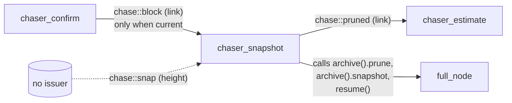
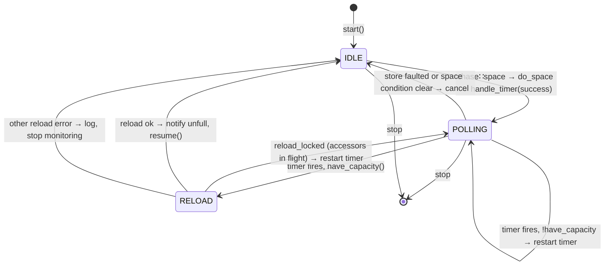
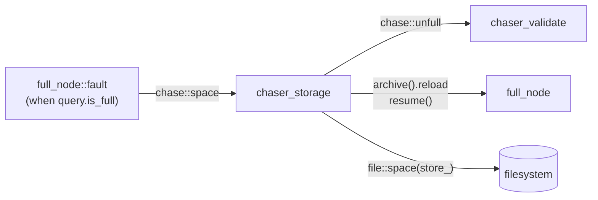
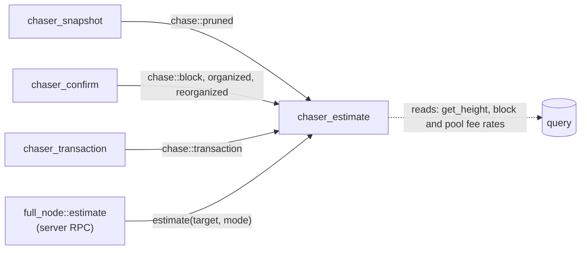

# 12 — Periphery chasers (snapshot, storage, template, estimate)

> Companion to the core-pipeline chaser docs
> [`02`](02-chaser-header)–[`05`](05-chaser-confirm) and
> [`11`](11-chaser-transaction).
>
> The four chasers covered here are operationally peripheral to consensus.
>
> | Chaser              | Role                                        | Current state                     | Bus events                                                |
> | ------------------- | ------------------------------------------- | --------------------------------- | --------------------------------------------------------- |
> | `chaser_snapshot`   | Startup prune, one-shot prune on first current block, explicit snapshot | Live (snapshot trigger dormant) | Consumes `block`, `snap`; emits `pruned`   |
> | `chaser_storage`    | Disk-space recovery + reload after full      | Fully live                         | Consumes `space`; emits `unfull`                           |
> | `chaser_template`   | Mining template construction                 | Stub                                | Consumes `transaction`                                     |
> | `chaser_estimate`   | Fee estimation accumulator                   | Live when `fee_estimate_horizon` is nonzero | Consumes `pruned`, `block`, `organized`, `reorganized`, `transaction` |

| File                                          | Lines |
| --------------------------------------------- | ----- |
| `src/chasers/chaser_snapshot.cpp`             | 315   |
| `src/chasers/chaser_storage.cpp`              | 189   |
| `src/chasers/chaser_template.cpp`             |  93   |
| `src/chasers/chaser_estimate.cpp`             | 275   |
| `include/bitcoin/node/estimator.hpp`          | 190   |

All four inherit from the base `chaser`, run on their own strand on the
network pool, and subscribe to the bus in `start()`.

---

## 1. `chaser_snapshot`

### 1.1 Role

Three triggers:

- **Startup prune**: in `start()`, before the network starts, when the
  confirmed top is above genesis and the store is coalesced, prune the
  prevout cache and emit `chases::pruned{ top }` (`chaser_snapshot.cpp:68-92`).
- **One-shot prune on announce**: when the confirmed chain first
  announces a current block (`chase::block`), prune once if coalesced;
  latched by `pruned_` (`:141-148`, `:166-202`).
- **Explicit snapshot**: on `chase::snap(height)`, take a full store
  snapshot. *No issuer of `chase::snap` exists in this repo* — dormant
  (doc 01 §2.1).

### 1.2 State

```cpp
// chaser_snapshot.hpp:43
std::atomic_bool pruned_{};   // one-shot latch for prune
```

The periodic-snapshot thresholds (`snapshot_bytes/valid/confirm`) remain
commented out in source and settings.

> **Invariant (Snapshot-State-1).** `pruned_` is set at most once per
> process lifetime, either by the startup prune or by the first
> successful announce-time prune. After it is set, `chase::block`
> events are dropped at the handler (`:143-144`).

### 1.3 Live event handlers

```cpp
// :141-153
case chase::block: if (!pruned_) POST(do_prune, link);
case chase::snap:  POST(do_snap, height);
```

#### `do_prune(link)` — `:166-202`

Returns silently if already pruned, closed, or not coalesced. Calls the
base `chaser::prune` (a wrapper around `full_node::prune`, doc 00 §6.2),
which suspends the network, runs `query.prune`, and leaves the network
suspended. On success: latch `pruned_`, emit `chases::pruned{ link }`,
and `resume()` if the chaser was running before and the store is not
full. On failure (typically not coalesced following a suspend) the prune
is retried on the next announce.

> **Invariant (Snapshot-Prune-1).** `pruned_` is latched and
> `chase::pruned` emitted *before* `resume()`, because the resumption
> is observable (the fee estimator initializes on `pruned`, and
> organization resumes with it).

> **Invariant (Snapshot-Prune-2).** Prune is gated on
> `archive().is_coalesced()`. If the store isn't ready, the handler
> returns silently; the next `chase::block` re-triggers it.

#### `do_snap(height)` — `:204-212`

Calls `take_snapshot(height)` (`:229-288`), which calls the base
`chaser::snapshot(handler)`: same suspend/resume dance as prune.
Currently unreachable — no `chase::snap` issuer in source.

### 1.4 Coupling



---

## 2. `chaser_storage`

### 2.1 Role

When the node faults with a **full disk** (`chase::space`), monitor free
space on the store volume and **reload + resume** once space becomes
available. It owns a one-second `network::deadline` on its own strand
(`chaser_storage.cpp:51`).

### 2.2 Lifecycle and events

```cpp
// :48-55 start: create timer; subscribe
// :57-71 stopping: stop and reset the timer on the strand
// :76-99 handle_chase: chase::space → POST(do_space); stop → false
```

### 2.3 The polling loop



```cpp
// :116-141 handle_timer
if (archive().is_fault() || !to_bool(archive().get_space())) return;   // monitor the space condition, not suspension
if (!have_capacity()) { disk_timer_->start(...); return; }
do_reload();

// :143-174 do_reload
ec = reload(...);
if (ec == database::error::reload_locked) { disk_timer_->start(...); return; }   // in-flight accessors: wait
if (ec) { LOGF(...); return; }
notify(error::success, chases::unfull{});   // before resume, so validate latches recovery
resume();
```

> **Invariant (Storage-Loop-1).** The polling loop exits exactly when:
> the store is faulted, the space condition has cleared (`get_space()`
> is zero), or a reload succeeded. Suspension state is not consulted,
> because other suspensions start and stop independently.

> **Invariant (Storage-Reload-1).** `archive().reload(handler)` is
> called only after `file::space` reports at least `get_space()` bytes
> free. A locked reload (accessors still holding the map) is a wait, not
> a failure; any other reload error ends monitoring.

> **Invariant (Storage-Unfull-1).** `chase::unfull` precedes
> `chase::resume` (emitted inside `resume()`), so `chaser_validate` can
> latch recovery before the suspension gate lifts and reset its position
> once its backlog clears (doc 04 §6.2).

### 2.4 Coupling



---

## 3. `chaser_template`

**Stub** for mining-template construction (`chaser_template.cpp`).
Subscribes to `chase::transaction` and posts an empty `do_transaction`
(`:53-88`). The TODOs note the intended behaviour: recompute the block
template on chain top change and on transaction graph change, and emit
`chase::template_(height)` to wake an external miner. `chase::template_`
has no live issuer. A spec can treat this chaser as identity until it is
implemented.

---

## 4. `chaser_estimate`

### 4.1 Role

Maintains a running **fee estimate** over the confirmed chain and the
pool, answering `full_node::estimate(target, mode)` (exposed to the
server's RPC surface). Enabled when `node.fee_estimate_horizon` is
nonzero (`fee_estimate_enabled()`); otherwise `estimate` returns
`estimate_disabled` without subscribing (`chaser_estimate.cpp:45-53`,
`:64-74`).

### 4.2 State

```cpp
// chaser_estimate.hpp:67-73
std::atomic_bool stopping_{};      // cancels initialization
std::atomic_bool initialized_{};   // estimator ready (thread safe)
estimator::ptr estimator_{};       // heap allocated (large accumulator), strand-only
bool pruned_{};                    // initialization waits for the prune
```

### 4.3 Events and initialization

| Event                | When not initialized                              | When initialized                                  |
| -------------------- | ------------------------------------------------- | ------------------------------------------------- |
| `chase::pruned`      | `do_pruned`: set `pruned_`, try `do_initialize`   | ignored                                           |
| `chase::block`       | `do_initialize` (retry each current block)        | ignored                                           |
| `chase::organized`   | ignored                                           | `do_organized`: push the block's fee rates (skipping backlogged heights at or under the accumulator top) |
| `chase::reorganized` | ignored                                           | `do_reorganized`: pop the block's rates (skipping heights above the top) |
| `chase::transaction` | ignored                                           | `do_transaction`: pool the tx's rate              |

`do_initialize` (`:192-214`) requires the prune (which rewrites the pool)
and a chain at least `horizon` blocks long, then builds the estimator from
the last `horizon` confirmed blocks and the pooled transactions
(`estimator::initialize`, cancellable by `stopping_`).

> **Invariant (Estimate-Init-1).** The accumulator is initialized once,
> after the first prune and only when the confirmed chain reaches the
> horizon; organization events that arrive during initialization are
> reconciled by height against the accumulator top (`:231-233`,
> `:255-257`).

> **Invariant (Estimate-Consistency-1).** Only txs that were pooled
> before confirmation contribute (by blocks waited from pool entry to
> confirmation); a conflict unpends the displaced txs. Push and pop are
> exact inverses on the decayed buckets, so a reorganization leaves the
> accumulator as if the popped block had never been organized.

### 4.4 The estimator (interface only)

`include/bitcoin/node/estimator.hpp` defines modes (`basic`, `geometric`,
`economical`, `conservative`), three horizons (12, 48 and 1008 blocks),
283 geometric fee-rate bins from 0.1 to 100,000 sat/vB with step 1.05,
decay-weighted per-bucket confirmation counters, and pending/aged slots
for unconfirmed pooled txs. `estimate(target, mode)` returns satoshis per
virtual byte, or `estimate_failed` (`max_uint64`), which the chaser maps
to `error::estimate_false`; a call before initialization returns
`estimate_premature`. The algorithm itself is out of scope here.

### 4.5 Error inventory

| Code                   | Site         | Cause                                               |
| ---------------------- | ------------ | --------------------------------------------------- |
| `estimates_initialize` | `:206-210`   | `estimator::initialize` failed (estimator reset)    |
| `estimates_push1/2`    | `:225-236`   | organized block height unknown / push failed         |
| `estimates_pop1/2`     | `:249-260`   | reorganized block height unknown / pop failed        |
| `estimates_pool`       | `:268-269`   | pooling a tx's rate failed                           |
| `estimate_disabled`, `estimate_premature`, `estimate_false` | `:67-70`, `:83-86`, `:90-91` | returned to the caller, not faults |

### 4.6 Coupling



---

## 5. Summary table of bus interactions for the periphery

| Chaser              | Subscribes to (live)                                           | Emits (live)         |
| ------------------- | -------------------------------------------------------------- | -------------------- |
| `chaser_snapshot`   | `chase::block`, `chase::snap` (dormant)                         | `chase::pruned`      |
| `chaser_storage`    | `chase::space`, `chase::stop`                                   | `chase::unfull`      |
| `chaser_template`   | `chase::transaction`, `chase::stop`                             | (none; `template_` planned) |
| `chaser_estimate`   | `chase::pruned`, `block`, `organized`, `reorganized`, `transaction`, `stop` | (none)      |

> **Invariant (Periphery-Bus-1).** The periphery emits exactly two
> events, both recovery/initialization signals (`pruned`, `unfull`); it
> never writes chain order and never affects validation outcomes.

---

## 6. Spec view (combined)

```
chaser_snapshot : Process
  state: pruned : Bool                      -- one-way latch
  inputs:  chase::block(link) — fires do_prune unless pruned
           chase::snap(height) — fires do_snap (dormant; no issuer)
  effects: archive.prune (network suspend → resume), archive.snapshot; emits pruned

chaser_storage : Process
  state: in {IDLE, POLLING}
  inputs:  chase::space — switch IDLE → POLLING
           timer tick — re-check capacity; if ok do_reload → IDLE
  effects: archive.reload (clears the full condition), emits unfull, resume()

chaser_template : Process
  state: ∅ (stub)

chaser_estimate : Process
  state: pruned : Bool, initialized : Bool, accumulator
  inputs:  chase::pruned, block, organized, reorganized, transaction; estimate RPC
  effects: none on the store
```

---

## 7. Notes for the formal model

- These four chasers contribute little to the global proof obligation
  set; the one obligation that touches the pipeline is
  Storage-Unfull-1 (ordering of `unfull` before `resume`).
- `chaser_snapshot`'s `pruned_` latch is a standard monotone Boolean;
  Snapshot-Prune-1 orders the latch and `pruned` before the resumption.
- `chaser_storage`'s polling loop is a classic "wait until precondition
  holds" pattern; formally a liveness property "if `chase::space` is
  emitted and disk eventually has capacity, the system eventually
  resumes".
- `chaser_estimate` is a pure function of the event stream once
  initialized; Estimate-Consistency-1 (push/pop inverse) is the property
  worth stating.

---

## Cross-references

- [`00-overview`](00-overview) §6.2 (the suspend/resume/fault
  cycle that `chaser_storage` and `chaser_snapshot` participate in)
- [`01-event-bus`](01-event-bus) §2 (rows for `block`, `snap`, `space`,
  `unfull`, `pruned`, `transaction`, `template_`)
- [`04-chaser-validate`](04-chaser-validate) §6.2 (recovery from
  `unfull`)
- [`05-chaser-confirm`](05-chaser-confirm) §7 (emits `chase::block`)
- [`11-chaser-transaction`](11-chaser-transaction) (emits
  `chase::transaction`)
