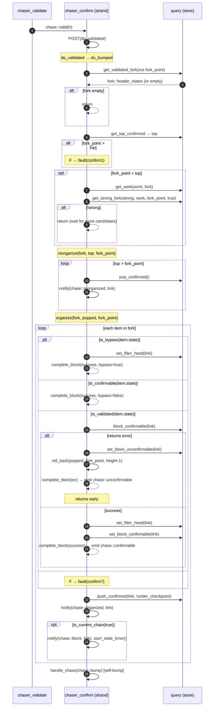
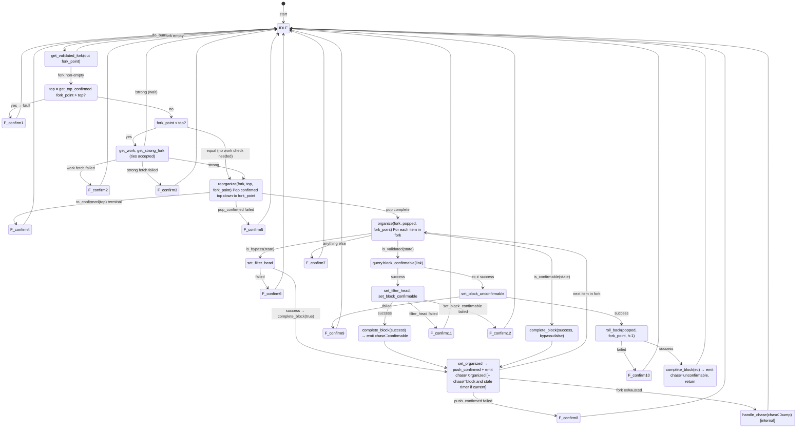
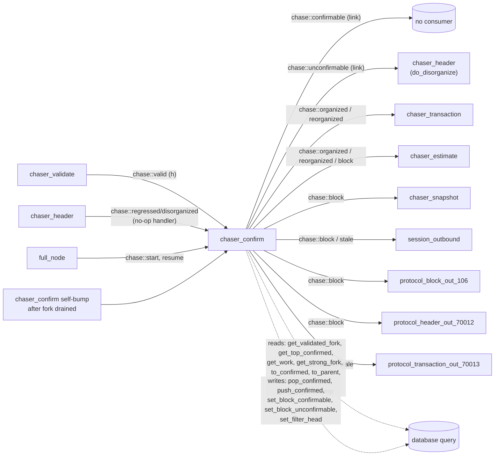

# 05 — Confirmation Chaser

> Companion to [`00-overview`](overview),
> [`01-event-bus`](event-bus),
> [`02-chaser-header`](header-chaser),
> [`03-chaser-download`](download-chaser),
> [`04-chaser-validate`](validation-chaser).
>
> `chaser_confirm` is the **only writer to the *confirmed* chain**. It
> takes the validated portion of the candidate chain (heights from the
> current confirmed top up to where validation, bypass or prior
> confirmation guarantees acceptance) and:
>
> 1. compares branch work against the current confirmed branch,
> 2. reorganises the confirmed chain (pop ⇒ push) if the candidate is
>    stronger,
> 3. runs **`query.block_confirmable(link)`** per block to do the
>    order-based consensus checks against the now-committed confirmed
>    chain,
> 4. persists `block_confirmable` and the filter head, and pushes the
>    confirmed link,
> 5. emits `chase::confirmable` / `chase::unconfirmable` per block,
>    `chase::organized` / `chase::reorganized` per push/pop, `chase::block`
>    when announcing newly-confirmed blocks to peers, and `chase::stale`
>    when the confirmed chain ages out of the currency window.
>
> The full transition from "header arrived" to "confirmed in the chain"
> goes:
>
> ```
> chaser_header  →  chaser_download  →  chaser_validate  →  chaser_confirm
>   (organize)       (download)      (consensus)         (order + commit)
> ```
>
> Confirmation is **sequential and not cancellable** — unlike validate's
> parallel pool.

| File                                                            | Role                                                            |
| --------------------------------------------------------------- | --------------------------------------------------------------- |
| `include/bitcoin/node/chasers/chaser_confirm.hpp`               | Class declaration                                                |
| `src/chasers/chaser_confirm.cpp`                                | Implementation                                                   |

---

## 1. Operating modes

There is no longer a defer-confirmation setting: the chaser always
subscribes (`chaser_confirm.cpp:43-58`). Its only configuration input is
the currency window used by the stale timer (§7).

### 1.1 No parallel pool (unlike validate)

`chaser_confirm` runs on its own chaser strand on the network pool; no
override. Confirmation cannot be parallelised because each block depends
on the cumulative state of the chain up to its parent — strictly
sequential.

> **Invariant (Confirm-Conc-1).** All confirm operations run on the
> chaser's own strand. Every `do_*` and helper has
> `BC_ASSERT(stranded())` at entry. No off-strand work.

---

## 2. State

The chaser holds *no in-memory state machine state* beyond the base
class's `position_` (set in `start`, otherwise unused) and the stale
timer (`chaser_confirm.hpp:78`).

All durable state lives in the database, specifically:

| Method                                       | Effect on store                                       |
| -------------------------------------------- | ----------------------------------------------------- |
| `query.push_confirmed(link, !under_checkpoint)` | Add to confirmed chain (strong = !under_checkpoint)  |
| `query.pop_confirmed()`                      | Remove top of confirmed chain                         |
| `query.set_block_confirmable(link)`          | Mark block as confirmed-in-chain (state transition)    |
| `query.set_block_unconfirmable(link)`        | Mark block as permanently rejected                    |
| `query.set_filter_head(link)`                | Commit BIP158 filter head record                       |

> **Invariant (Confirm-Store-1).** `chaser_confirm` and `chaser_header`
> are the only writers to the candidate / confirmed chain order.
> `chaser_confirm` is the only writer to the *confirmed* projection
> (push_confirmed / pop_confirmed); the header chaser only touches
> *candidate*. This separation underpins the spec's two-projection view.

---

## 3. Bus integration (verified)

Inputs:

| Event                     | Source                       | Reaction                                                             |
| ------------------------- | ---------------------------- | -------------------------------------------------------------------- |
| `chase::start`            | `full_node`                  | `do_bump` → `do_bumped`                                              |
| `chase::resume`           | `full_node`                  | `do_bump`                                                             |
| `chase::bump`             | `chaser_header`, `chaser_validate`, or self | `do_bump`                                              |
| `chase::valid`            | `chaser_validate`            | `do_validated(h)` → `do_bumped`                                       |
| `chase::regressed`/`disorganized` | `chaser_header`      | `do_regressed(h)` — **no-op** (only `BC_ASSERT(stranded())`)         |
| `chase::stop`             | service                      | unsubscribe                                                           |

Suspension: `handle_chase` short-circuits with `return true` if
`suspended()` (`chaser_confirm.cpp:84-85`). `do_bumped` also has an
explicit early exit on `suspended()` (`:158-159`).

> **Invariant (Confirm-Regress-1).** Regression events are *not acted
> upon*. The next bump-driven call to `do_bumped` will use
> `query.get_validated_fork` against the current candidate chain, which
> reflects the regression. So the chaser naturally tracks rollbacks
> without explicit handling.

Outputs (all from `chaser_confirm.cpp`, all stranded):

| Event              | Site                            | Payload      | Trigger                                                                 |
| ------------------ | ------------------------------- | ------------ | ----------------------------------------------------------------------- |
| `chase::reorganized` | `:380` (in `set_reorganized`) | `link`       | Each `pop_confirmed` during a reorg or rollback                         |
| `chase::organized` | `:413` (in `set_organized`)     | `link`       | Each `push_confirmed` during a reorg or rollback                        |
| `chase::block`     | `:445` (in `announce`)          | `link`       | Each `set_organized` *if the confirmed chain is current*                |
| `chase::stale`     | `:482` (in `handle_stale_timer`)| —            | The confirmed top aged past the currency window without a new block     |
| `chase::unconfirmable` | `:355` (in `notify_block`)  | `link`       | Block failed `block_confirmable` check                                  |
| `chase::confirmable` | `:362` (in `notify_block`)    | `link`       | Block passed, or was bypassed / previously confirmable                  |

---

## 4. The confirmation algorithm — overall flow



The fork returned by `get_validated_fork` is the shortest candidate chain
above the fork point whose blocks are all in a confirmable state; with
the database's scanned/filtered gating, a block whose silent-payment or
filter indexing is still banked is not yet part of it (doc 04 §5.4).

---

## 5. The confirm state machine



---

## 6. The three confirmation paths

`organize` (`chaser_confirm.cpp:240-291`) is a switch on the
*candidate-side state flags* of each block in the fork, read with the
database's `is_bypass`, `is_confirmable`, `is_validated` predicates:

### 6.1 Bypassed

```cpp
// chaser_confirm.cpp:253-262
if (!query.set_filter_head(item.link)) { fault(confirm6); return; }
complete_block(error::success, item.link, height, true);    // bypass=true
```

A block previously marked as bypass (under checkpoint or milestone in
validate). Skip confirmation work, just persist filter head, mark
"confirmed" (via `set_organized` below).

### 6.2 Previously confirmable

```cpp
// chaser_confirm.cpp:263-267
// Previously confirmable is not considered bypass.
complete_block(error::success, item.link, height, false);
```

Already confirmed (e.g. during a prior session, or on a branch that was
popped and is now being restored). Just emit `chase::confirmable` and
continue; `push_confirmed` re-establishes its position.

### 6.3 Validated

The normal path — block was validated, must now be confirmed against the
*current* confirmed chain.

```cpp
// chaser_confirm.cpp:293-330 (confirm_block)
if (const auto ec = query.block_confirmable(link)) {
    if (!query.set_block_unconfirmable(link)) { fault(confirm9); return false; }
    if (!roll_back(popped, fork_point, height-1)) { fault(confirm10); return false; }
    return complete_block(ec, link, height, false);          // emits chase::unconfirmable
}
if (!query.set_filter_head(link))         { fault(confirm11); return false; }
if (!query.set_block_confirmable(link))   { fault(confirm12); return false; }
return complete_block(error::success, link, height, false);  // emits chase::confirmable
```

> **Invariant (Confirm-Order-1).** `set_filter_head` precedes
> `set_block_confirmable`. Symmetric with validate's ordering: state
> bit is the last write so it never advances over an incomplete record.

> **Invariant (Confirm-Rollback-1).** A `block_confirmable` failure
> triggers `roll_back(popped, fork_point, height-1)` which:
> 1. Pops the confirmed top back to `fork_point` (reversing
>    confirmations completed for this fork before the failing block).
> 2. Re-pushes the originally-popped blocks (restoring the previous
>    confirmed chain).
>
> Implementation: `chaser_confirm.cpp:422-436`. Post-condition: confirmed
> chain == its state before this `do_bumped` call.

### 6.4 All other states → fault

```cpp
// chaser_confirm.cpp:274-278
default: fault(error::confirm7);
```

> **Invariant (Confirm-State-1).** `get_validated_fork` should not
> include blocks that are unassociated, unvalidated, or unconfirmable. If
> it does, the store is inconsistent and the chaser faults — proof
> obligation for libbitcoin-database.

### 6.5 Error routing in `complete_block`

`complete_block` (`:333-347`) treats any **database-category** error from
`block_confirmable` as a fault (`:339-344`) — disk full is the recoverable
case — and otherwise hands the code to `notify_block`, which emits
`unconfirmable` for a consensus failure or `confirmable` for success
(`:349-366`).

---

## 7. Announcement and the stale timer

`set_organized` calls `announce` (`:417`), which emits `chase::block` and
(re)starts the stale timer **only when the confirmed chain is current**
(`:438-448`). The timer expires at the top block's timestamp plus the
currency window, which may be sooner than a full window from now
(`:452-466`); on expiry it emits `chase::stale` (`:469-483`). Each new
current block restarts it.

Consumers: `session_outbound` adjusts its connection count on both
events, `protocol_transaction_out_70013` re-sends its fee filter (the
maximum while stale), and the header/block out protocols and
`chaser_snapshot` / `chaser_estimate` act on `block` (doc 01 §2.6).

> **Invariant (Confirm-Announce-1).** `chase::block(link)` is emitted
> only when `is_current_chain(true)`. Peers don't get announcements for
> catch-up blocks.

> **Invariant (Confirm-Stale-1).** Between a `chase::block` and the next
> one, at most one `chase::stale` is emitted, and only after the top's
> timestamp plus the currency window has passed. A zero window disables
> the timer (`:457-458`).

---

## 8. Side-effect summary table

For each fork-element state, listing observable effects:

| Block state on entry      | DB writes                                                                                                | Bus emits                                  |
| ------------------------- | -------------------------------------------------------------------------------------------------------- | ------------------------------------------ |
| bypass                    | `set_filter_head`, `push_confirmed`                                                                      | `chase::confirmable`, `chase::organized`, optionally `chase::block` |
| validated (success)       | `set_filter_head`, `set_block_confirmable`, `push_confirmed`                                             | `chase::confirmable`, `chase::organized`, optionally `chase::block` |
| validated (fail)          | `set_block_unconfirmable`, plus rollback writes (`pop_confirmed` × N then `push_confirmed` × M to restore) | `chase::unconfirmable`, plus per-pop `chase::reorganized` and per-restore `chase::organized` |
| confirmable               | `push_confirmed` only                                                                                    | `chase::confirmable`, `chase::organized`, optionally `chase::block` |

Per pop during reorg:
- `pop_confirmed`
- `chase::reorganized(link)`

> **Invariant (Confirm-Emit-1).** Reorg emits `chase::reorganized` per
> popped link before any `chase::organized` for newly-confirmed links.
> Order matters for subscribers that maintain auxiliary indexes
> (`chaser_transaction` re-pools the txs of a reorganized block,
> `chaser_estimate` pops and pushes fee rates).

---

## 9. Error inventory

All terminal (call `fault`, suspend network).

| Code                  | Site                                  | Cause                                                                                                            |
| --------------------- | ------------------------------------- | ---------------------------------------------------------------------------------------------------------------- |
| `confirm1`            | `chaser_confirm.cpp:174`              | `fork_point > top` — fork above confirmed top (inconsistent store)                                              |
| `confirm2`            | `chaser_confirm.cpp:185`              | `get_work(fork)` failed                                                                                          |
| `confirm3`            | `chaser_confirm.cpp:194`              | `get_strong_fork(strong, work, fork_point, true)` failed                                                        |
| `confirm4`            | `chaser_confirm.cpp:220`              | `to_confirmed(top)` returned terminal during pop                                                                |
| `confirm5`            | `chaser_confirm.cpp:227`              | `pop_confirmed()` failed in `set_reorganized`                                                                   |
| `confirm6`            | `chaser_confirm.cpp:257`              | `set_filter_head` failed in bypass path                                                                         |
| `confirm7`            | `chaser_confirm.cpp:276`              | Unexpected block state in fork                                                                                  |
| `confirm8`            | `chaser_confirm.cpp:283`              | `set_organized` (push_confirmed) failed                                                                          |
| `confirm9`            | `chaser_confirm.cpp:303`              | `set_block_unconfirmable` failed after `block_confirmable` returned error                                       |
| `confirm10`           | `chaser_confirm.cpp:309`              | `roll_back` failed                                                                                              |
| `confirm11`           | `chaser_confirm.cpp:319`              | `set_filter_head` failed before `set_block_confirmable`                                                         |
| `confirm12`           | `chaser_confirm.cpp:325`              | `set_block_confirmable` failed                                                                                  |
| (database code)       | `chaser_confirm.cpp:339-344`          | `block_confirmable` returned a database-category error (store fault or disk full)                               |
| `suspended_channel`   | `chaser_confirm.cpp:392-398` (`!NDEBUG`) | `confirmed_height != top+1` in `set_organized` — sequencing bug. Debug-only.                                 |
| `suspended_service`   | `chaser_confirm.cpp:400-406` (`!NDEBUG`) | `to_parent(link) != to_confirmed(previous_height)` — parent mismatch. Debug-only.                            |

> **Spec obligation list.** As with header/validate, every `confirmN`
> is unreachable under store-consistency invariants plus the strand
> discipline. The non-trivial ones are:
> - `confirm1`: `get_validated_fork` returns a fork whose `fork_point`
>   sits above `get_top_confirmed`.
> - `confirm7`: fork only contains validated/confirmable/bypass entries.
> - `confirm10`: `roll_back` succeeds whenever the inputs are
>   consistent with what was popped above.

---

## 10. Coupling diagram



---

## 11. Spec view

### 11.1 Process abstraction

```
chaser_confirm : Process
  state: {
    chain_confirmed : ℕ,             -- abstract: store-derived top
    stale_timer : Time ∪ {⊥}
  }
  inputs:  chase::{start, resume, bump, valid, regressed, disorganized, stop}, timer
  outputs: chase::{confirmable, unconfirmable, organized, reorganized, block, stale}
  effects: store mutations as in §8
```

### 11.2 Safety properties

1. **Confirmed monotonicity** (modulo reorgs): after each successful
   `set_organized`, `top_confirmed` increases by exactly one. After
   each successful `set_reorganized`, it decreases by exactly one.

2. **Reorg atomicity** (Confirm-Rollback-1): if `confirm_block` fails
   mid-fork, the post-rollback state equals the pre-`do_bumped` state.
   Either the whole fork commits or no part of it does.

3. **State-bit ordering** (Confirm-Order-1): `set_block_confirmable` is
   the last write per block. A reader observing the confirmable flag is
   guaranteed that `set_filter_head` and (eventually) `push_confirmed`
   have completed.

4. **Work monotonicity at switch** (`get_strong_fork` with ties
   accepted): the confirmed chain only changes when the candidate's work
   above the fork point is at least the confirmed work above it. A tie
   can only arise from prioritization (doc 02 §6.4).

5. **Bypassed soundness**: blocks confirmed in bypass mode were
   previously gated by `is_under_checkpoint(height) ∨
   query.is_milestone(link)` in validate — a checkpoint/milestone is
   the upstream proof of consensus correctness, transitively used here.

### 11.3 Liveness

- Provided validate keeps emitting `chase::valid`, every block on the
  candidate chain with a validated state eventually receives a
  `do_bumped` call that includes it in the fork.
- The self-bump after fork drain (`chaser_confirm.cpp:288-290`) ensures
  no stall when `chase::valid` arrived during the in-progress
  iteration.

### 11.4 What `query.block_confirmable(link)` actually checks

This is a **significant consensus operation**, not a narrow
double-spend probe. It evaluates *all block-relative, order-based
consensus constraints* on a block — everything except header chaining
and the chain-summation rules (cumulative work, MTP). Specifically:

1. **Strong-tx association for every spent prevout.** For every input,
   the previous output must be in a *strong* transaction — i.e. a tx
   that is associated to a block which is either (a) confirmed, or (b)
   in the confirmable candidate fork at *lesser* height than the
   spending block. This is the property that subsumes the "is the
   prevout in the UTXO set?" question, expressed in a tx→block
   association model rather than a separate UTXO snapshot.

2. **Coinbase maturity** (100-confirmation rule for spending coinbase
   outputs).

3. **Relative locktime rules** (BIP68 sequence locks).

These checks also exist on the `system::chain` objects (for
completeness, e.g. for stand-alone validation tools), but driving them
there requires populating each input's metadata first. The store
optimizes by performing the queries that *would have populated that
metadata*, directly — much more efficient than populate-then-check.
Validation persists prevout metadata (`set_prevouts`, doc 04 §4.3)
specifically to make this query fast.

So `block_confirmable` is correctly read as: *"under the assumption
that all lower-height blocks in this fork are confirmable, is this
block consensus-valid against all order-sensitive rules?"* Its
correctness is the joint responsibility of the libbitcoin-database
query implementation and the consensus rules it encodes; a formal
model should treat the call as a non-trivial proof obligation, not a
thin UTXO oracle.

For a model:

```
block_confirmable(link, fork, store_state) →
    Right(())               if for every input in block(link):
                              - prevout tx is strong under (store_state ∪ fork[< height])
                              - coinbase maturity satisfied
                              - relative-locktime constraints satisfied
                              - no double-spends within fork[≤ height]
    Left(error_code)        otherwise
```

The chaser sequences calls so that prior fork blocks have already had
`set_block_confirmable` written by the time `block_confirmable(link)`
runs for this block (loop ordering at `chaser_confirm.cpp:248-286`).

---

## 12. Implementation notes

- Confirmation is sequential — a single-threaded function, with no
  parallelism to model.
- The reorg / rollback structure is a clean two-phase commit:
  pop-confirmed-down-to-fork-point, then push-new-tops; on per-block
  failure, run roll-back.
- The fork is returned by `get_validated_fork` as a list of
  `header_state` records, iterated forward.
- Three state arms (bypass, confirmable, validated) and one
  fault arm — a simple `case`/`switch`.

---

## 13. Notes for the formal model

- The entire chaser is **strand-confined** (`Confirm-Conc-1`).
  Single-threaded reasoning suffices.
- The most subtle property is the **rollback**: prove that if
  `confirm_block` fails at height `h` after `j` prior successful
  pushes in this fork, then `roll_back(popped, fork_point, h-1)` is
  equivalent to undoing those `j` pushes and re-pushing the original
  `popped`.
- The "current chain" gate on `chase::block` (`Confirm-Announce-1`) and
  the stale timer are purely about peer-facing currency; not safety
  properties.

---

## Cross-references

- [`00-overview`](overview) §5 (pipeline overview), §9 (error
  categories — confirmN listed)
- [`01-event-bus`](event-bus) §2.5, §2.6 (confirm events)
- [`02-chaser-header`](header-chaser) §5 (`chase::unconfirmable`
  triggers disorganize, which is how *this* chaser's output flows back
  upstream)
- [`04-chaser-validate`](validation-chaser) §3 (issuer of
  `chase::valid` consumed here)
- [`11-chaser-transaction`](transaction-chaser) §2 (consumer of
  `organized`/`reorganized`)
- [`12-periphery-chasers`](periphery-chasers) §1, §4
  (`chaser_snapshot`, `chaser_estimate`, consumers of `chase::block`)
- [`08-block-out-protocols`](block-out-protocols) and
  [`07-header-protocols`](header-protocols) (consumers of `chase::block`
  for peer announcements)
