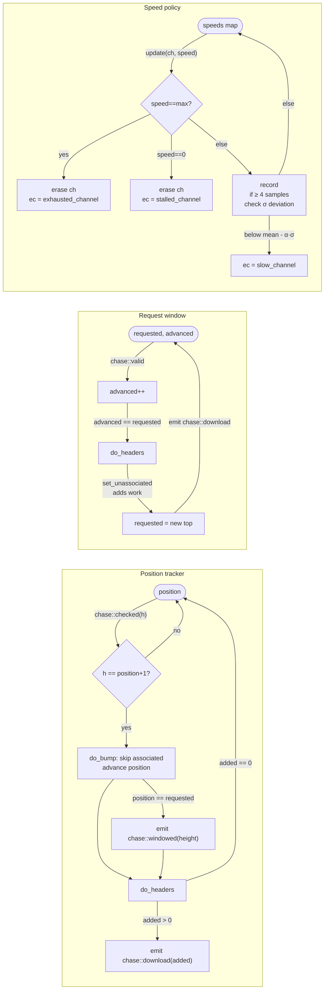
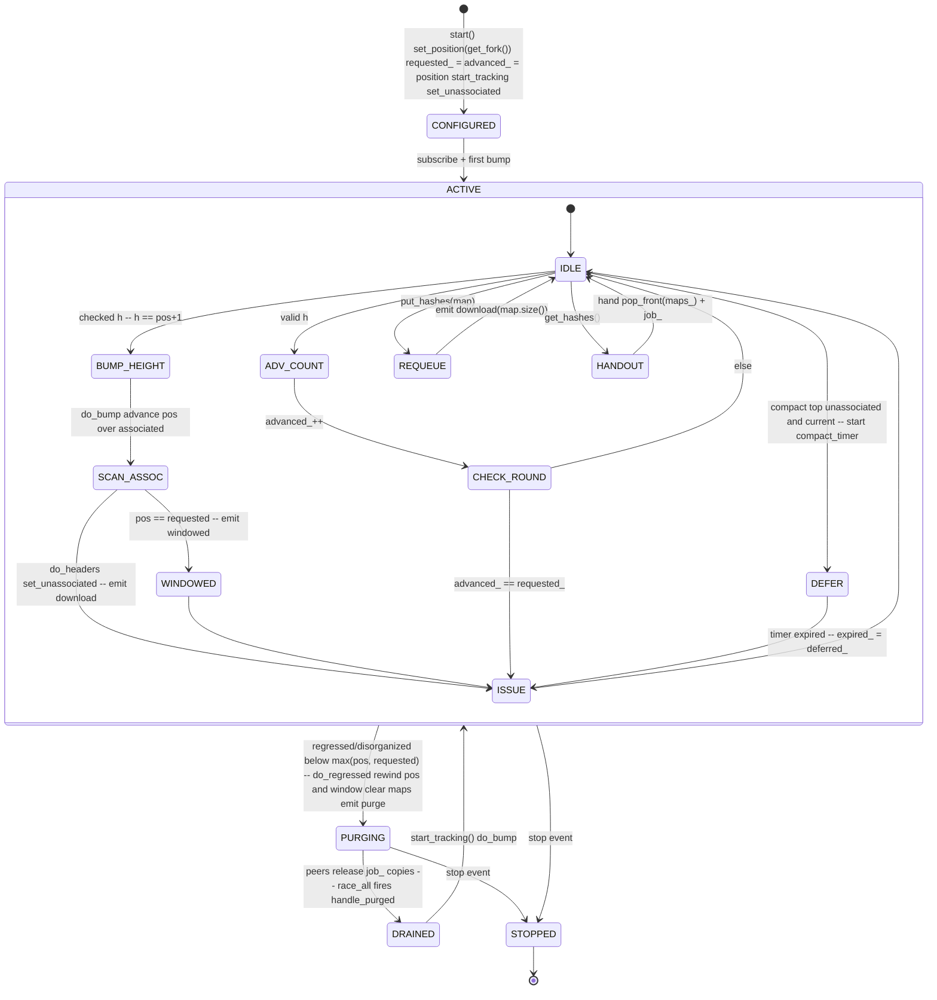
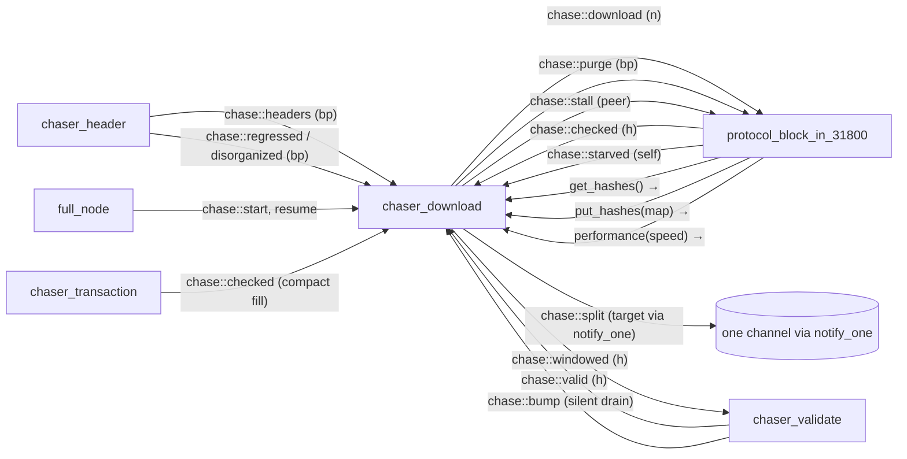

# 03 — Download Chaser

> Companion to [`00-overview`](overview),
> [`01-event-bus`](event-bus),
> [`02-chaser-header`](header-chaser).
>
> `chaser_download` is the dispatcher between the **header chain** and the
> peer **block-download protocols**. Conceptually:
>
> 1. The header chaser commits to a candidate chain of *headers*.
> 2. `chaser_download` notices which heights in that chain still lack block
>    bodies (are *unassociated*) and partitions them into work-maps.
> 3. Peer protocols (`protocol_block_in_31800`) pull maps via
>    `get_hashes`, download the blocks, and return any leftovers via
>    `put_hashes`.
> 4. As blocks arrive (`chase::checked`), the position advances; when the
>    position reaches the end of the request window it emits
>    `chase::windowed`; as validation completes (`chase::valid`), the
>    request window slides forward.
>
> `chaser_download` also runs the **performance-policing loop**: peers report
> their download speed, slow peers are detected by standard deviation,
> and starved peers cause work to be split off slow peers.

| File                                                               | Role                                                                   |
| ------------------------------------------------------------------ | ---------------------------------------------------------------------- |
| `include/bitcoin/node/chasers/chaser_download.hpp`                    | Class declaration; private types `speeds`, `maps`                       |
| `src/chasers/chaser_download.cpp`                                     | Implementation                                                          |

---

## 1. State

### 1.1 Configuration (immutable, set at construction)

```cpp
// chaser_download.hpp:96-102  / chaser_download.cpp:61-71
const float  allowed_deviation_;       // σ multiplier for "slow" cutoff
const size_t maximum_concurrency_;     // download window size cap
const size_t maximum_height_;          // hard ceiling (0 → no cap)
const size_t bypass_height_;           // max(milestone height, top checkpoint height)
const size_t connections_;             // target outbound count (or inbound if no outbound)
const size_t step_;                    // = min(max_concurrency, max_inventory × connections)
```

`connections_` is derived from network config
(`chaser_download.cpp:44-52`): outbound + manual peer count if any, else
inbound count. `step_` is the maximum number of hashes scanned when sizing
the inventory (`:54-59`).

### 1.2 Strand-protected runtime state

```cpp
// chaser_download.hpp:104-115
size_t   inventory_{};   // per-channel inventory size — latched after first nonzero
size_t   requested_{};   // height of last request issued
size_t   advanced_{};    // count of chase::valid events received (NOT a height)
job::ptr job_{};         // network::race_all<const code&> token; null ⇒ "purging"
network::deadline::ptr compact_timer_{};  // defers download of a current compact top
database::header_link deferred_{};        // the compact top being deferred
database::header_link expired_{};         // the compact top whose deferral expired
speeds   speeds_{};      // map<object_key channel, double kbps>
maps     maps_{};        // deque<map_ptr> of pending download chunks
```

Plus `position()` from the base `chaser` — the height at which all blocks
below are associated (downloaded) on the candidate chain.

### 1.3 Why `advanced_` is a counter, not a height

`do_advanced` (`chaser_download.cpp:369-379`) increments `advanced_` on every
`chase::valid` event, regardless of which height was validated. The
*round* is complete when `advanced_ == requested_`. This is correct
because:

- Every block hash that is requested will eventually be validated or the
  peer will fail (and the hash is returned to the pool).
- Once `requested_` round-trips have completed, the request window can
  slide forward without leaving gaps below.

It does **not** track an in-order height; out-of-order validation is
permitted as long as the count balances.

> **Invariant (Download-State-1).** `position() ≤ requested_` and
> `advanced_ ≤ requested_` always hold on the strand. `set_unassociated`
> short-circuits if either falls behind (`chaser_download.cpp:503-509`).

### 1.4 The `job_` token (purge semaphore)

`job_` is a `network::race_all<const code&>` whose completer is
`handle_purged`. Semantics:

- A `race_all` invokes its completer **once all copies are dropped**.
- `chaser_download` holds one copy in `job_`. Every peer protocol that
  calls `get_hashes` receives a copy via the `map_handler`
  (`chaser_download.cpp:455`: `handler(success, get_map(), job_)`).
- When `chaser_download` drops its copy via `stop_tracking()`
  (`:193-201`), the completer fires only after every peer has also
  dropped its copy — i.e., released its current download work.

So `job_` is effectively a *purge barrier*: "wait until every
in-flight download has either completed or surrendered, then resume".

> **Invariant (Download-Job-1).** `job_ == nullptr` ⇒ chaser is *purging*
> (currently waiting for the barrier). While purging, all of `do_bump`,
> `do_get_hashes`, `do_put_hashes`, and `set_unassociated` are no-ops
> (`:393-394`, `:452-453`, `:463-464`, `:500-501`). The transition out of
> purging is exactly the `do_handle_purged` callback (`:213-219`) which
> calls `start_tracking()` followed by `do_bump`.

---

## 2. Public interface

| External entry                            | Caller                            | Stranded? | Effect summary                                                                                          |
| ----------------------------------------- | --------------------------------- | --------- | ------------------------------------------------------------------------------------------------------- |
| `start()`                                 | `full_node::do_start`             | on node strand at startup | start tracking, create compact timer, position = fork, requested/advanced = position, first `set_unassociated`; subscribe |
| `stopping(ec)`                            | `full_node::do_close`             | no        | stop compact timer, drop `job_`                                                                          |
| `update(channel, speed, h)`               | `full_node::performance` ← protocols | posts to strand | record speed; detect slow channel; reply `slow_channel` if so                                      |
| `get_hashes(h)`                           | `full_node::get_hashes` ← protocols | posts to strand | hand a map and the `job_` pointer to the caller                                                |
| `put_hashes(map, h)`                      | `full_node::put_hashes` ← protocols | posts to strand | re-queue the returned map; emit `chase::download(map.size())`                                  |
| Bus subscription via `handle_chase`       | `event_subscriber_`               | node strand, POSTs | dispatch to `do_*`                                                                            |

---

## 3. Behaviour overview (3 cooperating state machines)



These three are interleaved on the same strand. The Mermaid grouping is
conceptual; in code they share `do_*` handlers.

---

## 4. Bus integration (verified)

Inputs (from [`01-event-bus §2`](event-bus#2-verified-event-reference)):

| Event           | Source                          | Reaction                                                                |
| --------------- | ------------------------------- | ----------------------------------------------------------------------- |
| `chase::start`  | `full_node`                     | `do_bump` — kickstart                                                   |
| `chase::resume` | `full_node`                     | `do_bump`                                                               |
| `chase::bump`   | `chaser_header`, `chaser_validate` | `do_bump`                                                            |
| `chase::headers`| `chaser_header`                 | `do_headers(branch_point)`                                              |
| `chase::checked`| `protocol_block_in_31800`, `chaser_transaction` | `do_checked(height)`                                    |
| `chase::valid`  | `chaser_validate`               | `do_advanced(height)`                                                   |
| `chase::regressed`/`disorganized` | `chaser_header` | `do_regressed(branch_point)` — rewind, purge work, emit `purge`           |
| `chase::starved`| `protocol_block_in_31800`       | `do_starved(channel)` — emit `split` or `stall`                         |
| `chase::stop`   | service                         | unsubscribe (return false)                                              |

Outputs:

| Event              | When                                                                | Payload                     |
| ------------------ | ------------------------------------------------------------------- | --------------------------- |
| `chase::download`  | After `set_unassociated` adds new work (`:420-421`), or `do_put_hashes` re-queues (`:466-467`) | `count` added |
| `chase::windowed`  | `do_bump` advanced the position to `requested_` (`:406-407`)        | `height`                    |
| `chase::purge`     | After `do_regressed` purges all outstanding work (`:363`)           | `branch_point`              |
| `chase::split`     | (`notify_one`) On starvation, target the slowest tracked channel (`:247`) | `channel` (= starved channel) |
| `chase::stall`     | On starvation when **no speeds** are tracked (`:252`)               | `channel` (= starved channel) |

---

## 5. The download-window state machine



> **Invariant (Download-Purge-1).** A `chase::purge` emission is always
> followed (eventually, after barrier completion) by an idempotent return
> to the ACTIVE state with `position_` rewound to
> `min(branch_point, position)`, `requested_ = advanced_ = position`, and
> `maps_` empty (`:348-364`). While in PURGING, no work is handed out and
> no new work is computed.

> **Invariant (Download-Purge-2).** `do_regressed` ignores regressions at or
> above `max(position, requested_)` (`:353-354`). These are
> "inconsequential": neither the position nor the window has reached that
> height, so there is no work to purge. A regression *inside* the window
> but above the position still purges, because the window must follow the
> position or the gap it awaits is never requested.

> **Invariant (Download-Window-1).** `chase::windowed(height)` is emitted
> exactly when the contiguous associated position reaches the last
> requested height (`:401-408`). `chaser_validate` uses it to know that no
> more blocks are coming for the window and drain its batches (doc 04 §5).

---

## 6. The performance / speed policy

`chaser_download` is the only chaser that interacts with peer connections
beyond bus events: `protocol_block_in_31800` calls
`full_node::performance(channel, speed, handler)` periodically, which
forwards to `chaser_download::update`. The reply `code` tells the peer
whether to keep going or terminate.

### 6.1 `do_update` decision tree

```
speed == max_uint64:    erase(channel); return exhausted_channel
speed == 0:             erase(channel); return stalled_channel
otherwise:              record speed = double(speed)
                        if count(speeds_) < 4:         return success
                        compute mean, σ from speeds_
                        if speed ≥ mean:               return success
                        if (mean - speed) > α·σ:       return slow_channel
                        else:                          return success
```

(`chaser_download.cpp:278-343`; `minimum_for_standard_deviation = 4`,
`chaser_download.hpp:83`)

- `exhausted_channel`: peer announces "I have nothing else useful for
  you". Peer pauses its timer; the record is released.
- `stalled_channel`: peer reports zero progress. Peer drops itself.
- `slow_channel`: peer is statistically below the herd. Returned only
  when ≥ 4 samples and the gap exceeds `allowed_deviation × σ`.

### 6.2 `do_starved` (when a peer has no work)

`protocol_block_in_31800` emits `chase::starved(self)` when it receives an
empty map. `do_starved` (`:224-253`):

1. Removes `self` from `speeds_` (so it can't be picked as its own
   victim).
2. Picks the slowest remaining channel by `speeds_` min.
3. If found: erases it and `notify_one(slow, chase::split, self)` — direct
   that single channel to split its work and stop, leaving the starved
   channel something to claim.
4. If `speeds_` is empty: broadcast `chase::stall(self)` to all
   download-capable channels.

The receiver of `split`/`stall` is `protocol_block_in_31800`; see
[`06 §5.3`](sessions-and-protocols#53-bus-event-handling).

---

## 7. `set_unassociated` — the work generator

`set_unassociated` (`chaser_download.cpp:496-571`) is the heart of work
generation. It:

1. Early-exits if purging, if not all previously-requested work has cleared
   (`position < requested`), or if validation has not caught up
   (`advanced < requested`) (`:500-509`).
2. Latches `inventory_` on first nonzero (`:512-514` →
   `get_inventory_size`).
3. Computes a `stop` height: `min(position + maximum_concurrency,
   maximum_height)`, **clamped to the bypass height** while the position
   is under it (`:524-527`). Bypassed blocks may archive unprobed, so the
   window must not extend above the bypass height until all blocks at or
   below it are associated.
4. When current and `compact_timeout` is nonzero, if the top candidate is
   a compact-announced header that is not yet associated, clamps `stop`
   to one below it and starts the compact timer (once per link)
   (`:530-547`). This gives the compact fill a chance before the block is
   downloaded in full; when the timer fires, `expired_` records the link
   and `do_headers` re-runs the generator without the clamp (`:573-582`).
5. Loops `query.get_unassociated_above(requested_, inventory_, stop)`,
   chunking each result into a `map_ptr` and pushing onto `maps_`, until
   `set_map` returns false (empty map, end of unassociated headers
   below `stop`) (`:549-560`).
6. Returns total count added.

`get_inventory_size` (`:584-593`):

- Returns 0 if no connections OR if `is_current_chain(false)` is false —
  i.e. the **candidate** (header) chain isn't current.
- Otherwise: `ceilinged_divide(unassociated_count_above(fork, step), connections)`.

The candidate-current gate is *not* "wait until caught up" — issuing
zero work until the node is caught up would just stall. Instead it
guards against dividing work over a *weak* header chain: until headers
are current, the partitioning of unassociated heights into per-peer
inventory chunks could be meaningless, so block download is paused
until header sync has produced a current (and therefore presumed
near-canonical) candidate.

> **Invariant (Download-Inventory-1).** `inventory_` is computed at most
> once (latch on first nonzero result, `:512-514`). Peer inventory size is
> fixed for the run, after the first "currentness" of the chain.

> **Invariant (Download-Bypass-1).** No download window spans the bypass
> height: while `position < bypass_height`, `stop ≤ bypass_height`
> (`:526-527`). Validation of bypassed blocks therefore never races
> ahead of their association.

---

## 8. Error inventory

Unlike `chaser_header`, `chaser_download` does **not** define numbered
faults. Its errors are channel-class codes returned to the peer (the
chaser itself does not call `fault`):

| Code returned by `do_update`                | Meaning                                            |
| ------------------------------------------- | -------------------------------------------------- |
| `error::exhausted_channel`                  | peer has no more work to offer                     |
| `error::stalled_channel`                    | peer reports zero progress                         |
| `error::slow_channel`                       | peer below statistical floor (mean − α·σ)          |
| `network::error::service_stopped`           | chaser is closed; `update` short-circuits          |
| `error::success`                            | continue                                           |

The peer-side reaction (drop connection vs. continue) lives in
`protocol_performer` (doc 06 §4).

---

## 9. Coupling diagram



---

## 10. Spec view

### 10.1 As a process

A formal model can represent `chaser_download` as a process with:

- **inputs**:
  - bus messages (`chase::*` listed in §4)
  - request RPCs: `update`, `get_hashes`, `put_hashes` (each carries a
    `result_handler` continuation)
  - the compact timer tick
- **outputs**:
  - bus messages (`chase::download`, `chase::windowed`, `chase::purge`,
    `chase::split`, `chase::stall`)
  - returned codes to request RPCs
- **state**:
  - `position`, `requested`, `advanced` ∈ ℕ
  - `inventory` ∈ ℕ (latched after first nonzero)
  - `purging` ∈ {true, false}  -- abstracts `job_`
  - `deferred`, `expired` ∈ Link ∪ {⊥}
  - `maps` : Queue of `map`  -- each `map` is a non-empty set of
    `(height, hash)` pairs
  - `speeds` : finite map from channel-id to ℝ⁺

### 10.2 Safety properties to prove

1. **No-overshoot**: `position ≤ requested` and `advanced ≤ requested`
   are loop invariants.
2. **Purge soundness**: while `purging`, `maps = ∅` and no `download`
   is emitted.
3. **Bypass clamp** (Download-Bypass-1): no requested height above the
   bypass height while the position is under it.
4. **Eventual progress**: assuming peers honour `get_hashes`/`put_hashes`
   contracts, the position increases monotonically when not purging.
   *Liveness*; requires fairness on peer scheduling.
5. **Split correctness**: `chase::split(self)` is sent only to
   `notify_one(slow)` where `slow ≠ self` (`:228-247`).
6. **Purge barrier completeness**: every `chase::purge` is eventually
   followed by a `chase::download` (or by `stop`). This depends on the
   `race_all` semantics and peer compliance.

### 10.3 Liveness assumptions

- Peers eventually release `job_` copies after `chase::purge` — the
  protocols layer guarantees this on stop (doc 06 §5.2).
- `query.get_unassociated_above` terminates and is monotone in
  `requested_`.
- The compact deferral is bounded by `compact_timeout` per top.

---

## 11. Implementation notes

- The three state machines (§3) are independent in their state space but
  interleaved in time — one actor per chaser with a single message-pump is
  sufficient.
- The `race_all` token (`job_`) is a non-trivial primitive. It is
  effectively a `(condition-variable, ref-count)` pair: each peer
  increments on `get_hashes` and decrements when done; the chaser waits on
  count → 0.
- `set_unassociated` is naturally a generator/iterator (lazy sequence of
  maps).

---

## 12. Notes for the formal model

- All `do_*` methods run on the strand. Race-freedom on internal state
  is by construction.
- The only externally-visible interaction beyond the bus is the peer
  speed/inventory protocol (§6, §7). Model the peer as a process that
  responds to `slow_channel`/`exhausted_channel`/`stalled_channel`
  return values by dropping or pausing its connection.
- A model of `race_all` requires a counted semaphore or refcount; this
  is the only place in `chaser_download` that needs more than
  single-threaded reasoning.

---

## Cross-references

- [`00-overview`](overview) §5 (chaser pipeline overview)
- [`01-event-bus`](event-bus) §2.1 (work-shuffling events) and
  §2.2 (candidate-chain events)
- [`02-chaser-header`](header-chaser) §3.2 (organize emits
  `headers`/`bump`/`regressed`/`disorganized` consumed here)
- [`04-chaser-validate`](validation-chaser) (issuer of `valid`; consumer
  of `windowed`)
- [`06-sessions-and-protocols`](sessions-and-protocols) §5
  (`protocol_block_in_31800` — peer-side counterpart; consumer of
  `download`/`purge`/`split`/`stall`/`report`)
- [`07-header-protocols`](header-protocols) §4 (compact block fill
  that the deferral timer waits for)
