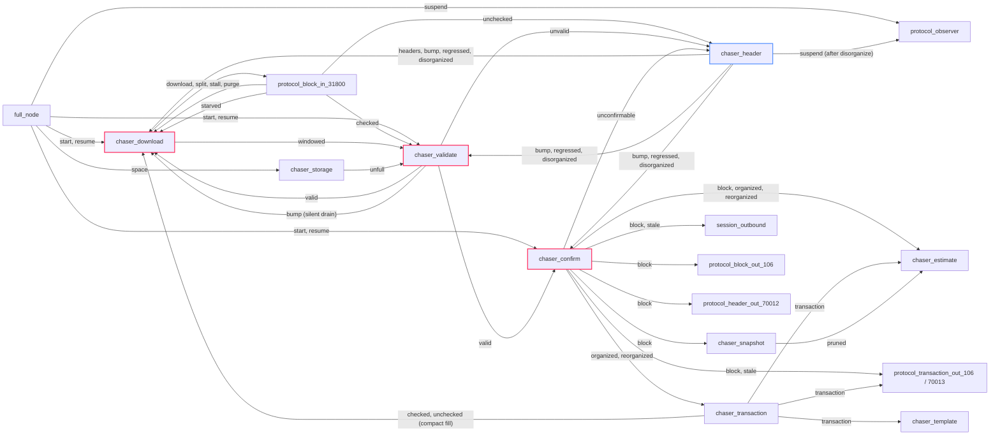

# 01 — Event Bus

> Companion to [`00-overview`](overview). This is the authoritative,
> source-verified reference for every `chase` enumerator: payload, issuer
> sites, handler sites, and known discrepancies with the inline
> `chase.hpp` documentation.
>
> Every fact below is grep-derived against master at `a5173475`.
> Methodology and queries are in [§4](#4-methodology) so any future change
> can be re-verified mechanically.

---

## 1. Subscriber model

### 1.1 Storage

```
event_subscriber_ : full_node                     // include/bitcoin/node/full_node.hpp:219
   = network::desubscriber<object_key, event_value>   // define.hpp:84
```

A `desubscriber` is the libbitcoin-network primitive that combines pub/sub
with explicit unsubscription via a key. All subscribers share one bus.

### 1.2 Typed payloads

`event_value` is a `std::variant` with one alternative per `chase`
enumerator, declared in enum order in `namespace chases`
(`include/bitcoin/node/chase.hpp`). Each payload struct carries a
`static constexpr chase id` and zero or one field:

| Field          | Type            | Events                                                                                      |
| -------------- | --------------- | ------------------------------------------------------------------------------------------- |
| —              |                 | `start`, `space`, `suspend`, `resume`, `unfull`, `stale`, `stop`                            |
| `height`       | `height_t`      | `snap`, `bump`, `checked`, `windowed`, `valid`, `template_`                                 |
| `branch_point` | `height_t`      | `purge`, `headers`, `regressed`, `disorganized`                                             |
| `channel`      | `object_t`      | `starved`, `split`, `stall`                                                                 |
| `count` / `sequence` | `count_t` | `download` / `report`                                                                       |
| `link`         | `header_t`      | `unchecked`, `unvalid`, `confirmable`, `unconfirmable`, `block`, `pruned`, `organized`, `reorganized` |
| `link`         | `transaction_t` | `transaction`                                                                               |

A `static_assert(is_chase_ordered(...))` guarantees the variant index equals
the enumerator, so `to_chase(value)` is `static_cast<chase>(value.index())`
and `to_payload<chase::X>(value)` is a `std::get` by that index.

> **Invariant (Bus-0).** An event cannot carry the wrong payload type: the
> payload struct *is* the event. Handlers switch on `to_chase(value)` and
> read `to_payload<chase::X>(value).field`.

### 1.3 Subscribe protocol

There are two subscribe APIs, both eventually owning state on the
`full_node` strand:

| API                                                       | Used by   | Strand discipline                                              |
| --------------------------------------------------------- | --------- | -------------------------------------------------------------- |
| `subscribe_chase(notifier) → object_key` (sync)           | chasers, `session_outbound` | Caller must already be on `full_node` strand |
| `subscribe_chase(notifier, completer)` (async)            | protocols | Posts to `full_node` strand internally; completer fires there  |

Chaser subscription path (`include/bitcoin/node/chasers/chaser.hpp:100-101`,
`src/chasers/chaser.cpp:91-94`):
```
chaser::subscribe_chase
  → full_node::subscribe_chase(handler)          // src/full_node.cpp:247-253
    → event_subscriber_.subscribe(handler, key)
```
Each chaser subscribes exactly once, in its `start()`, via
`SUBSCRIBE_CHASE(handle_chase, _1, _2)` (`chaser.hpp:166-167`). The
`handle_chase` body runs on the node strand and `POST`s the work to the
chaser's own strand.

Protocol subscription path (`src/protocols/protocol.cpp:183-232`):
```
protocol::subscribe_chase
  → session::subscribe_chase(handler, complete)  // src/sessions/session.cpp:114-118
    → full_node::subscribe_chase(handler, complete) // src/full_node.cpp:255-270
      → posts to strand → do_subscribe_chase
        → event_subscriber_.subscribe(handler, key)
        → complete(ec, key)   → protocol::handle_subscribe stores key_
                               → handle_subscribed posts subscribed() to channel strand
```
The async variant exists because a protocol is constructed on its channel
strand, not the node strand, so it must hop across. Subscription is
asynchronous, so a protocol may miss events emitted before it completes
(the source notes this at every protocol subscription site).

### 1.4 Notify protocol

```
chaser/protocol calls notify(ec, chases::X{...})
   → full_node::notify posts to strand           // src/full_node.cpp:217-222
     → do_notify on strand
        → event_subscriber_.notify(ec, value)     // :225-229
           → each subscriber's handle_chase runs here and POSTs to its own strand
```
`notify_one(key, ...)` (`:231-245`) delivers to a single subscriber by key;
it is used for `chase::split` (targeting the slowest channel) and for
`chase::stop` on unsubscribe.

### 1.5 Unsubscribe semantics

`full_node::unsubscribe_chase(key)` does not remove the entry; it sends a
single `chases::stop` to that subscriber only
(`src/full_node.cpp:272-275`). The subscriber's `handle_chase` returns
`false` on `chase::stop`, and the `desubscriber` interprets that as
removal. So:

> **Invariant (Bus-1).** A `false` return from `handle_chase` means
> "remove me". Every chaser returns `false` on `chase::stop` and when
> `closed()`; protocols return `false` when `stopped()`.

> **Invariant (Bus-2).** The bus is torn down only in `full_node::do_close`,
> which broadcasts `chases::stop` to all subscribers
> (`src/full_node.cpp:154`). After that point no further `notify` will
> deliver.

---

## 2. Verified event reference

Notation:
- **Issuer** is every `notify(... chases::X{...})` or
  `notify_one(... chases::X{...})` call site that is not commented out.
  Direct self-calls of `handle_chase` (not through the bus) are listed
  as *self*.
- **Handler** is every `case chase::X:` arm that is not commented out.
- Discrepancies with the `chase.hpp` inline doc are flagged ⚠.

### 2.1 Work shuffling

| Event       | Issuer (file:line)                                                                                   | Handler (file:line)                                                                                    |
| ----------- | ---------------------------------------------------------------------------------------------------- | ------------------------------------------------------------------------------------------------------ |
| `start`     | `src/full_node.cpp:115` (`do_run`, direct `do_notify`)                                               | `chaser_download.cpp:136`, `chaser_validate.cpp:113`, `chaser_confirm.cpp:90`                             |
| `space`     | `src/full_node.cpp:314` (`fault` when `query_.is_full()`)                                            | `chaser_storage.cpp:83`                                                                                |
| `snap`      | **none** ⚠ — chase.hpp says issued by `confirm`; no live issuer                                      | `chaser_snapshot.cpp:149`                                                                              |
| `bump`      | `chaser_header.cpp:378` (first current strong header, and first after each regression); `chaser_validate_batch.cpp:416` (silent batch drained) ⚠; *self*: `chaser_validate.cpp:288`, `chaser_confirm.cpp:290` | `chaser_download.cpp:137`, `chaser_validate.cpp:114`, `chaser_confirm.cpp:91` |
| `suspend`   | `src/full_node.cpp:305` (`suspend`, with `error::suspended_channel`); `chaser_header.cpp:549` (after `do_disorganize`) ⚠ | `protocol_observer.cpp:77` (only)                                                  |
| `resume`    | `src/full_node.cpp:296` (after `net::resume`)                                                        | `chaser_download.cpp:135`, `chaser_validate.cpp:119`, `chaser_confirm.cpp:89`                             |
| `unfull`    | `chaser_storage.cpp:168` (reload from disk full succeeded, before `resume`)                           | `chaser_validate.cpp:93` (latched before the suspension gate)                                          |
| `starved`   | `protocol_block_in_31800.cpp:426`                                                                    | `chaser_download.cpp:127`                                                                                 |
| `split`     | `chaser_download.cpp:247` (via `notify_one` to the slowest channel)                                     | `protocol_block_in_31800.cpp:107`                                                                      |
| `stall`     | `chaser_download.cpp:252`                                                                               | `protocol_block_in_31800.cpp:114`                                                                      |
| `purge`     | `chaser_download.cpp:363`                                                                               | `protocol_block_in_31800.cpp:122`                                                                      |
| `report`    | **external** — issued by the executor in libbitcoin-server                                           | `protocol_block_in_31800.cpp:137`                                                                      |

Discrepancy notes:
- ⚠ **`bump`**: chase.hpp says issued by 'organize'. `chaser_validate` also
  issues it when a silent-payment bank drains, because the blocks of that
  bank may now be confirmable (`chaser_validate_batch.cpp:396-397`).
- ⚠ **`suspend`** is also issued by `chaser_header` after a
  disorganization (`chaser_header.cpp:546-549`), to reset all connections.
- ⚠ **`snap`** has no live issuer anywhere in this repo. Treat as dormant.

### 2.2 Candidate chain

| Event          | Issuer (file:line)                                                      | Handler (file:line)                                                                |
| -------------- | ----------------------------------------------------------------------- | ---------------------------------------------------------------------------------- |
| `headers`      | `chaser_header.cpp:384` (every current strong organize)                 | `chaser_download.cpp:161`                                                             |
| `download`     | `chaser_download.cpp:421` (`do_headers`), `:467` (`do_put_hashes`)         | `protocol_block_in_31800.cpp:129`                                                  |
| `regressed`    | `chaser_header.cpp:326`                                                 | `chaser_download.cpp:147`, `chaser_validate.cpp:142`, `chaser_confirm.cpp:101`        |
| `disorganized` | `chaser_header.cpp:546`                                                 | `chaser_download.cpp:153`, `chaser_validate.cpp:148`, `chaser_confirm.cpp:107`        |

### 2.3 Check / Identify

| Event       | Issuer (file:line)                                                                  | Handler (file:line)                                                                       |
| ----------- | ----------------------------------------------------------------------------------- | ----------------------------------------------------------------------------------------- |
| `checked`   | `protocol_block_in_31800.cpp:352`; `chaser_transaction.cpp:414` (compact block fill) | `chaser_download.cpp:142`, `chaser_validate.cpp:127` (also clears `window_archived_` at `:103`) |
| `unchecked` | `protocol_block_in_31800.cpp:325`; `chaser_transaction.cpp:497` (compact block with an invalid tx) | `chaser_header.cpp:150` (gated on `database.mark_unconfirmable`)              |
| `windowed`  | `chaser_download.cpp:407` (position reached the last requested height)                 | `chaser_validate.cpp:101` (latch) and `:132` (drain batches, called directly)              |

### 2.4 Accept / Connect

| Event     | Issuer (file:line)                                                                              | Handler (file:line)                                                    |
| --------- | ----------------------------------------------------------------------------------------------- | ---------------------------------------------------------------------- |
| `valid`   | `chaser_validate.cpp:366` (`notify_block`; reached directly and from the batch drain's `mark_valids`) | `chaser_download.cpp:166`, `chaser_confirm.cpp:96`                  |
| `unvalid` | `chaser_validate.cpp:358` (`notify_block`; suppressed at startup)                               | `chaser_header.cpp:159` (gated on `database.mark_unconfirmable`)       |

### 2.5 Confirm (block)

| Event           | Issuer (file:line)        | Handler (file:line)                                            |
| --------------- | ------------------------- | -------------------------------------------------------------- |
| `confirmable`   | `chaser_confirm.cpp:362`  | None (chase.hpp agrees: "handled by none")                     |
| `unconfirmable` | `chaser_confirm.cpp:355`  | `chaser_header.cpp:168` (gated on `database.mark_unconfirmable`) |

### 2.6 Confirm (chain) and Mining

| Event           | Issuer (file:line)                                       | Handler (file:line)                                                                                                                                                 |
| --------------- | -------------------------------------------------------- | ------------------------------------------------------------------------------------------------------------------------------------------------------------------- |
| `block`         | `chaser_confirm.cpp:445` (`announce`, only when confirmed chain is current) | `chaser_snapshot.cpp:141`, `chaser_estimate.cpp:133`, `session_outbound.cpp:73`, `protocol_block_out_106.cpp:80`, `protocol_header_out_70012.cpp:71`, `protocol_transaction_out_70013.cpp:80` ⚠ |
| `pruned`        | `chaser_snapshot.cpp:86` (startup prune), `:192` (prune on first current block) | `chaser_estimate.cpp:124`                                                                                                                    |
| `stale`         | `chaser_confirm.cpp:482` (stale timer expiry)            | `session_outbound.cpp:74`, `protocol_transaction_out_70013.cpp:81` ⚠                                                                                                |
| `organized`     | `chaser_confirm.cpp:413` (`set_organized`)               | `chaser_transaction.cpp:79`, `chaser_estimate.cpp:142`                                                                                                              |
| `reorganized`   | `chaser_confirm.cpp:380` (`set_reorganized`)             | `chaser_transaction.cpp:84`, `chaser_estimate.cpp:152`                                                                                                              |
| `transaction`   | `chaser_transaction.cpp:230` (pooled from a reorganized block), `:329` (submitted package), `:456`, `:483` (compact fill) | `chaser_template.cpp:66`, `chaser_estimate.cpp:162`, `protocol_transaction_out_106.cpp:94` |
| `template_`     | **none** ⚠ — chase.hpp says `template` issues; dormant   | (miners, external)                                                                                                                                                  |

Discrepancies:
- ⚠ **`block`**: chase.hpp lists `protocol_header/block_out/estimator`.
  `chaser_snapshot` (one-shot prune trigger), `session_outbound`
  (connection count) and `protocol_transaction_out_70013` (fee filter
  refresh) are also live consumers.
- ⚠ **`stale`**: chase.hpp lists `protocol_transaction_out`;
  `session_outbound` also consumes it.

### 2.7 Stop

| Event  | Issuer (file:line)                                                                                                                                  | Handler                  |
| ------ | --------------------------------------------------------------------------------------------------------------------------------------------------- | ------------------------ |
| `stop` | `full_node::unsubscribe_chase` via `notify_one` (`src/full_node.cpp:274`); `full_node::do_close` via `event_subscriber_.stop(...)` (`:154`)          | Every chaser & protocol  |

---

## 3. Verified issuer / handler diagram

One node per *actual* source location rather than per chase.hpp comment.



`chase::confirmable` has no consumer and `chase::snap` / `chase::template_`
have no issuer, so they are omitted.

---

## 4. Methodology

The tables above were generated by these greps from repo root:

```sh
# Issuers (all notify and notify_one sites)
grep -rn 'notify\(_one\)\?(' src include | grep 'chases::'

# Direct self-calls that bypass the bus
grep -rn 'handle_chase(.*chases::' src

# Handlers
grep -rn 'case chase::' src include | grep -v '////'

# Subscription sites
grep -rn 'SUBSCRIBE_CHASE\|subscribe_chase' src
```

To recheck after source changes, run the same set and diff against the
tables here. Any new row must come with its source citation, and any
deletion should be cross-referenced with this doc to ensure no downstream
spec assumes the old behaviour.

---

## 5. Specification view

A formal model can treat the bus as follows.

**Processes.** Each chaser and each event-subscribing protocol is a
process `P` with:
- a single inbox typed `(code, event_value)`
- a private state space `Σ_P`
- a deterministic transition `δ_P : Σ_P × (code, event_value) → Σ_P × Output_P`
- where `Output_P` is a finite set of `notify` calls and outbound
  asynchronous actions (e.g. DB writes).

**Bus.** The bus is broadcast-with-filter: every `notify(ec, v)` is
delivered to every subscriber, and each subscriber's `handle_chase`
inspects `to_chase(v)` to decide whether to act. `notify_one` is a
point-to-point exception used only for `split` and `stop`.

**Invariants worth proving.**
1. *Liveness of stop*: after `full_node::do_close`, every process
   eventually reaches a terminal state. (Follows from Bus-2 + the universal
   `case chase::stop: return false;`.)
2. *Disorganize convergence*: every `chase::regressed`/`disorganized` is
   eventually responded to by the consuming chasers' "rewind" branches
   (`chaser_download.cpp:348-364`, `chaser_validate.cpp:170-177`,
   `chaser_confirm.cpp:129-132`) before the next forward event is processed.
3. *No spurious validation*: `chase::valid` is emitted only from
   `chaser_validate::notify_block` (`chaser_validate.cpp:366`), after either
   full validation, bypass processing, or batch verification of the height.
4. *Confirm uniqueness*: `chase::confirmable`, `unconfirmable`,
   `organized`, `reorganized`, `block`, `stale` all have a single issuer
   (`chaser_confirm`). Confirmation is centralized.
5. *Two archivers*: `chase::checked` and `chase::unchecked` have exactly
   two issuers — the download protocol and the compact block fill in
   `chaser_transaction` — and both write the block association before
   emitting (docs 06 §5.6, 11 §3).

**Dormant events (do not model as live).**
- `chase::snap` — handler exists, no issuer.
- `chase::template_` — handler is "miners" (external), no issuer in this
  repo.
- `chase::report` — issuer is the executor (external, libbitcoin-server).
- `chase::confirmable` — issued, no handler.

---

## Cross-references

- [`00-overview`](overview) §3 (concurrency model) and §4
  (high-level event table).
- [`02-chaser-header`](header-chaser) — the state machine
  that emits `bump`, `regressed`, `disorganized`, `headers`, `suspend`.
- [`04-chaser-validate`](validation-chaser) — the unique issuer of `valid`
  / `unvalid`.
- [`11-chaser-transaction`](transaction-chaser) — the issuer of
  `transaction` and the second issuer of `checked`/`unchecked`.
