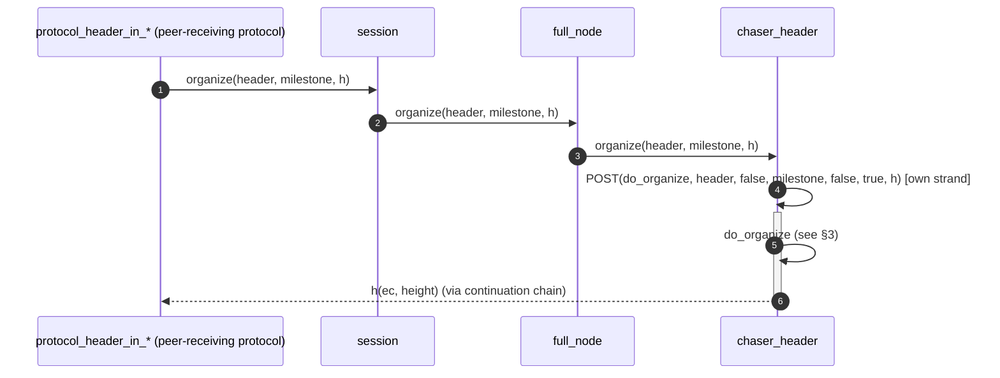
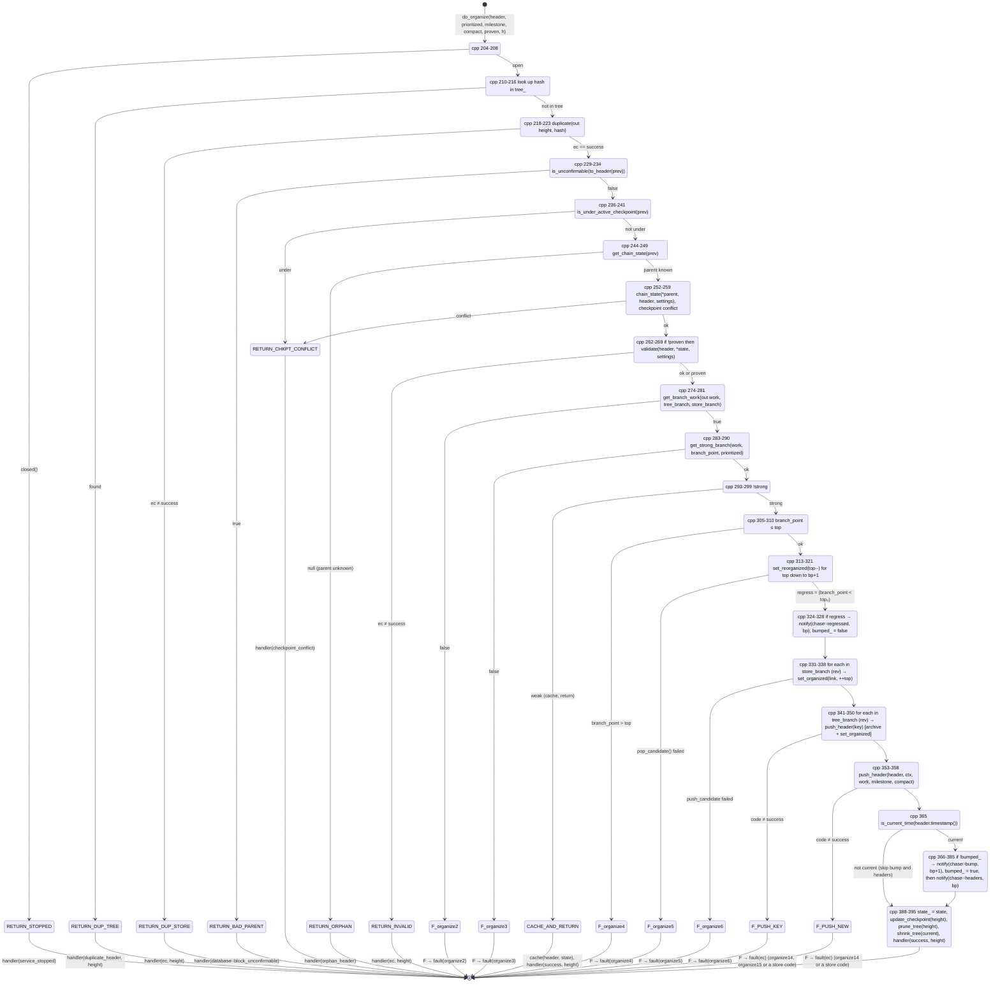
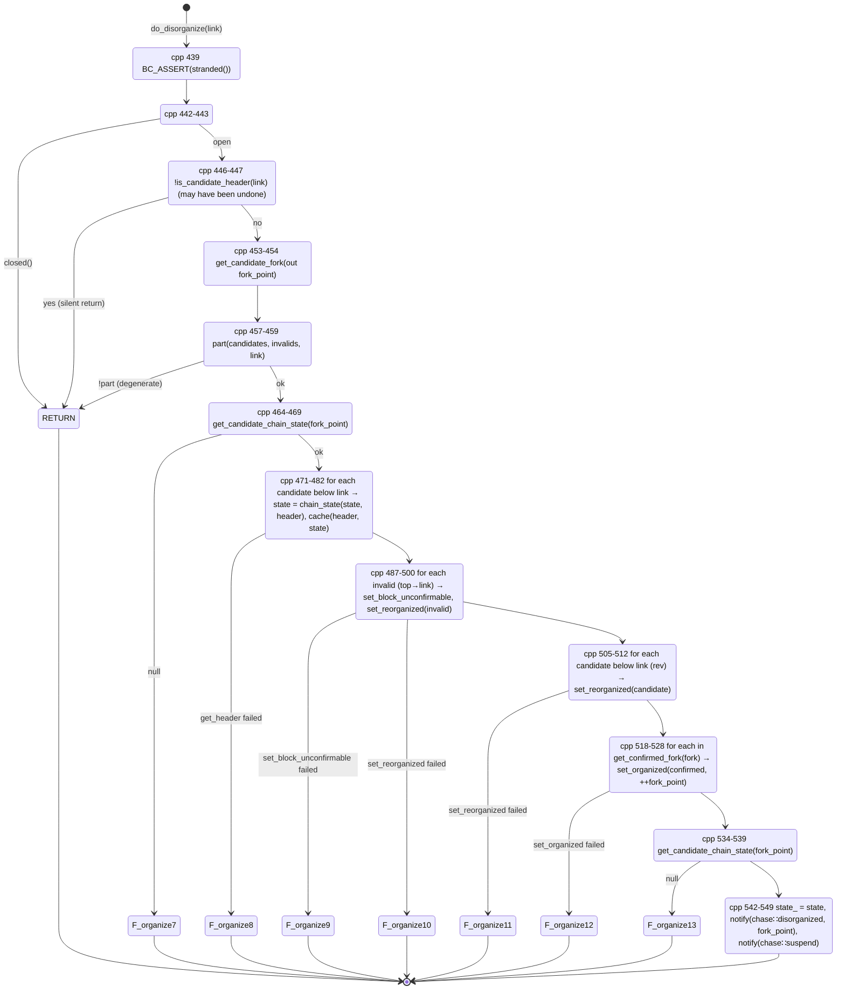

# 02 — Header Chaser

> Companion to [`00-overview`](overview) and
> [`01-event-bus`](event-bus).
>
> `chaser_header` is the state machine that attaches headers to the
> **candidate chain**. It is the only organizer: blocks-first
> synchronization and the templated `chaser_organize<Block>` it shared
> with the header chaser were removed in September 2026, and the
> organizer was folded into this class.
>
> Headers reach it in three forms: **proven** headers from the header
> protocols (already validated and proven to a checkpoint or to a current
> top at minimum work, doc 07 §2), **unproven** headers announced by
> compact blocks, and **prioritized** headers re-evaluated from the tree
> as a manual tie break.

| File                                                        | Role                                                |
| ----------------------------------------------------------- | --------------------------------------------------- |
| `include/bitcoin/node/chasers/chaser_header.hpp`            | Declaration, `header_tree`, strand-protected state   |
| `src/chasers/chaser_header.cpp`                             | Implementation (925 lines)                           |

---

## 1. State

### 1.1 Persistent (the store, accessed via `archive()`)

The chaser does not own the chain — the database does. It manipulates two
chain projections exposed by `database::query`:

| Projection      | Mutators called from organize                          | Read methods used                                                                                                                          |
| --------------- | ------------------------------------------------------ | ------------------------------------------------------------------------------------------------------------------------------------------ |
| Candidate chain | `push_candidate(link)`, `pop_candidate()`              | `get_top_candidate`, `to_top_candidate`, `to_candidate(height)`, `is_candidate_header(link)`, `get_candidate_fork(out fork_point)`, `get_candidate_chain_state(settings, height)` |
| Confirmed chain | — (organize never writes confirmed; see chaser_confirm) | `get_confirmed_fork(fork)`, `get_confirmed_chain_state(settings, hash)`                                                                    |
| Header records  | `set_code(out link, header, ctx, work, milestone, compact)`, `set_block_unconfirmable(link)` | `to_header(hash)`, `to_parent(link)`, `is_unconfirmable(link)`, `get_header(link)`, `get_height(link)`, `get_branch(out states, hash)`, `get_work(out, states)`, `get_strong_branch(out, work, branch_point, prioritized)` |

> **Invariant (Organize-Store-1).** Every store mutation in organize is
> performed on the chaser's own strand (`src/chasers/chaser_header.cpp:195`,
> `:439` — both `do_organize` and `do_disorganize` open with
> `BC_ASSERT(stranded())`). Concurrent writes from other chasers do not
> occur in this class's scope; coordination across chasers happens via
> the event bus.

### 1.2 In-memory (this chaser only)

```cpp
// chaser_header.hpp:138-149
const system::settings& settings_;               // immutable
const system::chain::checkpoints& checkpoints_;  // immutable

bool bumped_{};                     // strand-only; latches the one-shot bump
bool shrunk_{};                     // strand-only; tree buckets reduced once current
size_t next_window_{};              // strand-only; next height at which to prune by work
size_t next_checkpoint_{};          // strand-only; next configured checkpoint height
size_t active_checkpoint_{};        // strand-only; highest checkpoint reached on the candidate
chain_state::cptr state_{};         // strand-only; top candidate chain state
header_tree tree_{};                // strand-only; unordered_map<hash_cref, header::cptr>
```

- **`state_`** — current top of the *candidate* chain, cached as a
  `chain_state` (height, hash, flags, cumulative work). Initialised in
  `start()` (`:76-78`); updated at the end of every successful strong
  organize (`:389`); rewound by `do_disorganize` (`:542-543`).
- **`tree_`** — a memory-resident map of *weak-branch* headers (headers
  whose branch does not beat the current candidate). Populated by
  `cache()` (`:659-666`); drained by `push_header(key)` (`:647-657`);
  pruned by work window and by checkpoint (§6).
- **`bumped_`** — latches `true` after validation has been kicked via
  `chase::bump` for the first current strong header; reset to `false` on
  every regression (`:327`), so each regression is followed by exactly
  one bump.
- **`active_checkpoint_`** — the highest configured checkpoint at or
  under the candidate top; forks under it are refused (§4).

> **Invariant (Organize-Mem-1).** All of the above are set on the strand
> and read on the strand. `bumped_` exists to *suppress redundant
> validation bumps*, not to enforce a chain property.

---

## 2. Public interface (process boundary)



Entry points (`src/chasers/chaser_header.cpp:95-137`), each posting to
the strand after a `closed()` check:

| Entry                                       | `do_organize` flags (prioritized, milestone, compact, proven) | Caller                                       |
| ------------------------------------------- | -------------------------------------------------------------- | -------------------------------------------- |
| `organize(header, handler)`                 | `false, false, false, false`                                   | (unproven; not used by current protocols)    |
| `organize(header, milestone, handler)`      | `false, milestone, false, true`                                | header protocols after proving (doc 07 §2.3) |
| `organize_compact(header, handler)`         | `false, false, true, false`                                    | `protocol_header_in_70014` (doc 07 §4)       |
| `prioritize(hash, handler)`                 | `true, false, false, true` via `do_prioritize`                 | external (bitcoind `preciousblock` analogue) |
| `get_minimum_work(handler)`                 | —                                                              | header protocols (doc 07 §2.2)               |
| `handle_chase(code, value)`                 | —                                                              | bus: `unchecked`/`unvalid`/`unconfirmable` → `do_disorganize` |

`static validate(header, state, settings)` (`:41-60`) is the header
consensus check shared with the header protocols: `header.check` (PoW,
timestamp), `header.accept(ctx)` (version, bits, median time) and
checkpoint conflict.

> **Invariant (Organize-Iface-1).** No `do_organize` ever runs
> concurrently with another `do_organize`, `do_prioritize` or
> `do_disorganize` on this chaser: all go through `POST(...)` to the
> chaser's strand and asio strand semantics serialise them.

> **Invariant (Organize-Iface-2).** The disorganize handlers are gated on
> `database.mark_unconfirmable` (`:152`, `:161`, `:170`). With that setting
> off, invalid blocks are not marked and the candidate chain is not rolled
> back by this chaser.

---

## 3. `do_organize`: the forward state machine

The diagram labels each branch with the source line and, where
applicable, the `error::organize{N}` code it returns. Faults marked **F**
are terminal and call `fault(ec)` (which suspends the network); non-fatal
returns hand `ec` to the caller via `handler`.



### 3.1 Logical phases (for the spec)

```
PHASE                                LINES                 OBSERVABLE EFFECTS
---------------------------------    -----------------     ----------------------------------
A. Dedup / parent / checkpoint gate  cpp 210-241           none (read-only)
B. State roll-forward                cpp 244-259           none (in-memory)
C. Consensus validate (unproven)     cpp 262-269           none (read-only validate)
D. Branch-work accounting            cpp 274-290           none
E. Weak-branch test                  cpp 293-299           may write to tree_
F. Reorganize candidate chain        cpp 305-358           DB writes; emit regressed
G. Currency check & emit             cpp 365-385           emit bump (once per regression) + headers
H. State commit & tree maintenance   cpp 388-395           in-memory state_, tree pruning; handler
```

Every header that reaches phase E is **storable**: proven headers were
validated by the protocol, unproven ones in phase C. Only strength
decides between archival (F) and caching (E).

### 3.2 Side-effect summary table

| Path                           | DB writes                                                                        | Bus emits                                              | Reporting events                                                          |
| ------------------------------ | -------------------------------------------------------------------------------- | ------------------------------------------------------ | ------------------------------------------------------------------------- |
| Cache (weak)                   | none                                                                             | none                                                   | none                                                                      |
| Reorg without regress          | `set_code` per archived tree header + top; `push_candidate` per pushed link      | `chase::headers`; `chase::bump` if not yet bumped      | `events::header_archived`, `events::header_organized`                     |
| Reorg with regress             | `pop_candidate` (top→bp+1) + pushes above                                        | `chase::regressed`, then `headers`; `bump` (latch reset)| `events::header_reorganized` per pop; `header_organized` per push         |
| Non-current header (org. ok)   | DB writes as above                                                               | *neither* `bump` nor `headers`                         | reporting events as above                                                  |

> **Invariant (Organize-Emit-1).** `chase::bump` is emitted once per
> "currentness epoch": once for the first current strong header, and once
> more after every regression (latched by `bumped_`, `:324-328`, `:366-380`).
> The payload is `branch_point + 1`, the first height that may need
> validation.

> **Invariant (Organize-Emit-2).** `chase::headers` is emitted on **every**
> successful strong organize whose header is current, not only on regress
> (`:382-384`). Non-current organizes are silent so block download does not
> start until headers are current.

---

## 4. Checkpoint gate and milestone

A *checkpoint* is a configured `(hash, height)` pair that fixes the
chain. `update_checkpoint(top)` (`:697-718`) tracks the highest checkpoint
reached by the candidate top (`active_checkpoint_`) and the next one
above it; when a new checkpoint is reached, tree headers at or under it
are purged (`prune_tree()`, `:796-810`).

`is_under_active_checkpoint(previous)` (`:671-695`) refuses any header
whose parent is stored *below* the active checkpoint — a fork under a
reached checkpoint is a `checkpoint_conflict` before any state is
computed. Extending the top, extending a tree header, and orphans are
excluded from the test.

> **Invariant (Organize-Checkpoint-1).** Once the candidate reaches
> checkpoint `C`, no header forking below `C` is organized or cached. The
> `set_reorganized` assertion `!is_under_checkpoint(height)` (`:588`)
> follows: pops never descend under the top checkpoint.

A *milestone* is a configured `(hash, height)` pair that does **not** fix
the chain. It permits bypass of validation for blocks at or under it,
*if* the milestone is on the archived branch. The milestone flag is
decided by the header protocol while collecting a proven branch
(`milestone = height <= milestone_`, doc 07 §2.3) and stored with the
header by `set_code` (`:755-756`). This chaser does not track milestones
itself.

---

## 5. `do_disorganize`: the rollback state machine

Triggered by `handle_chase` on `chase::unchecked`, `chase::unvalid`,
`chase::unconfirmable` when `database.mark_unconfirmable` is set
(`:142-189`). Argument is the `header_t` link of the offending header.



### 5.1 What disorganize accomplishes

After a successful run, post-conditions:

1. **`set_block_unconfirmable`** has been called for the offending link
   and every candidate above it. The store now permanently marks
   these headers as bad (`:489`).
2. The **candidate chain top equals the previous confirmed chain top**:
   every candidate above the fork point has been popped
   (`:487-512`); every confirmed block above the fork point has been
   re-pushed as candidate (`:518-528`).
3. The valid portion of the candidate branch (below the bad link) has
   been re-cached into `tree_` so that subsequent organize calls can
   re-promote it (`:471-482`).
4. `state_` is reset to the new (lower) candidate top (`:542-543`).
5. **`chase::disorganized`** is published with payload = new fork point;
   downstream chasers (`download`, `validate`, `confirm`) rewind themselves
   to this height.
6. **`chase::suspend`** is published; peer connections are dropped so that
   fresh connections resync headers.

> **Invariant (Organize-Disorg-1).** After `chase::disorganized` is
> emitted, the candidate top equals the confirmed top (modulo races; the
> confirmed interlock guarantees the snapshot used to compute the fork
> point is consistent, `:452`, `:520`). This is the strongest correctness
> obligation in the organize machine.

> **Invariant (Organize-Disorg-2).** `chase::suspend` follows
> `chase::disorganized` *unconditionally* on success (`:546-549`).
> The two emissions are not reordered. A specification can treat them as
> a single atomic publish.

### 5.2 Re-entrancy

Disorganize can be triggered while another disorganize is still in
flight (a second `chase::unvalid` arrives). The `is_candidate_header`
short-circuit at `:446-447` handles this gracefully: the second call
silently returns because the offending link is no longer on the
candidate chain. There is no explicit lock.

> **Invariant (Organize-Disorg-3).** Repeated disorganize calls on the
> same link are idempotent: the second is a no-op after
> `is_candidate_header(link)` returns false.

---

## 6. Auxiliary state machines

### 6.1 The header tree (`tree_`)

`tree_` is an in-memory cache of headers that have arrived but are not
strong enough to archive. Two arrival paths:

1. **Weak branch** (`:293-299`) — branch work doesn't beat the current
   candidate top (or ties it without prioritization).
2. **Disorganize** (`:471-482`) — the valid portion of a rolled-back
   branch is re-cached with its chain state.

Exit paths:
- **`push_header(key)`** (`:647-657`) — extracts from `tree_`, archives,
  pushes to candidate.
- **`do_prioritize`** (`:400-427`) — extracts a cached branch top for
  re-evaluation as prioritized.
- **Pruning** (below).

### 6.2 Tree pruning (DoS bound)

The tree is bounded by three prunes:

| Prune                       | Trigger                                                     | Rule                                                                                                  |
| --------------------------- | ----------------------------------------------------------- | ----------------------------------------------------------------------------------------------------- |
| `prune_tree(threshold)` `:735-780` | once per window of candidate progress (`prune_tree(top)`, `:783-794`) | erase every tree branch whose top has cumulative work under the window threshold, descending while each parent has no other child |
| `prune_tree()` `:797-810`   | a new checkpoint reached (`update_checkpoint`)               | erase every tree header at or under the active checkpoint                                             |
| `shrink_tree(current)` `:723-732` | first current organize (one-shot, `shrunk_`)           | rehash the map to release bucket capacity used during catch-up                                        |

The *window* is `currency_window_minutes × 60 / block_spacing_seconds`
blocks (`get_window`, `:816-821`), and the work threshold is the
candidate top's cumulative work less one window of its proof
(`get_window_work`, `:824-831`). A zero currency window disables the
work prune.

> **Invariant (Organize-Tree-1).** A tree branch survives a window prune
> only if its top's cumulative work is at least the candidate top's work
> less one window of proof. A peer cannot hold memory with a dead branch
> for longer than one window of candidate progress.

> **Invariant (Organize-Tree-2).** Every tree header carries its chain
> state (`cache` sets it, `:659-666`), so `get_chain_state` can extend a
> tree branch without touching the store (`:833-850`).

### 6.3 Minimum work (`get_minimum_work`)

`do_get_minimum_work` (`:430-435`) answers the header protocols with
`max(settings.minimum_work, get_window_work())`: a proven branch must
reach at least the candidate top's work less one window, so a peer
cannot make the node archive a branch that is far behind.

### 6.4 Prioritization (`do_prioritize`)

A manual tie break between equal-work branches, bitcoind's
`preciousblock` analogue (`:398-427`). The hash must be the top of a
cached branch; it is extracted and reorganized with `prioritized = true`,
which `get_strong_branch` treats as "at least equal work". The preference
is not retained: the reorganized branch then wins ties.

---

## 7. Error inventory (`organizeN` and friends)

Every numbered fault is a *terminal* (calls `chaser::fault` which
suspends the network and is meant to indicate a programmer or
store-corruption error). For a formal model, each is a proof obligation:
"this branch is unreachable under the system invariants".

| Code               | Site                                | Meaning                                                                                                                            |
| ------------------ | ----------------------------------- | ---------------------------------------------------------------------------------------------------------------------------------- |
| `organize1`        | `cpp:80-83`                         | `start()`: `get_candidate_chain_state(top)` returned null                                                                          |
| `organize2`        | `cpp:277-280`                       | `get_branch_work` failed (store branch or work read)                                                                               |
| `organize3`        | `cpp:286-289`                       | `get_strong_branch` failed (could not decide strength)                                                                             |
| `organize4`        | `cpp:306-309`                       | branch_point > current candidate top (impossible if state is consistent)                                                           |
| `organize5`        | `cpp:316-319`                       | `pop_candidate()` failed during reorg                                                                                              |
| `organize6`        | `cpp:333-336`                       | `push_candidate(stored.link)` failed during reorg                                                                                  |
| `organize7`        | `cpp:464-468`                       | disorganize: `get_candidate_chain_state(fork_point)` returned null                                                                 |
| `organize8`        | `cpp:473-477`                       | disorganize: `get_header(candidate)` returned null                                                                                 |
| `organize9`        | `cpp:489-493`                       | disorganize: `set_block_unconfirmable(invalid)` failed                                                                             |
| `organize10`       | `cpp:495-499`                       | disorganize: `set_reorganized(invalid)` failed                                                                                     |
| `organize11`       | `cpp:507-511`                       | disorganize: `set_reorganized(candidate)` failed (pop weak)                                                                        |
| `organize12`       | `cpp:523-527`                       | disorganize: `set_organized(confirmed, ...)` failed (push confirmed back as candidate)                                             |
| `organize13`       | `cpp:534-538`                       | disorganize: `get_candidate_chain_state(fork_point)` after rebuild returned null                                                   |
| `organize14`       | `cpp:762` (in `push_header`)        | `set_organized` failed after a successful `set_code` (archived but not pushed to candidate)                                        |
| `organize15`       | `cpp:649-651` (in `push_header(key)`) | Tree extract returned no handle (item missing when expected)                                                                     |
| `stalled_channel`  | `cpp:604-610` (`set_organized`, `!NDEBUG` only) | Candidate height isn't `top+1` (broken sequencing). Debug-only safety check.                                           |
| `suspended_channel`| `cpp:612-618` (`set_organized`, `!NDEBUG` only) | Parent of new candidate isn't current top (broken sequencing). Debug-only safety check.                                |

`header1` is no longer issued by this chaser (milestone initialization
moved to the header protocols); it remains in `error.hpp`.

> **Spec obligation list.** A formal model should be able to discharge
> `organize2` through `organize15` as unreachable, given:
> - Store consistency invariants supplied by libbitcoin-database.
> - The strand invariant (Organize-Iface-1) excluding concurrent writes.
> - `tree_` invariant (every key has a value with state).
>
> `organize1` is startup-only and reduces to "store was initialised at boot".

---

## 8. Differences from the inline `chase.hpp` comments

(For book-keeping; cross-reference with
[`01-event-bus §2`](event-bus#2-verified-event-reference).)

- `chase::bump` "issued by 'organize'": this chaser (`:378`) plus
  `chaser_validate` on silent drain.
- `chase::headers` "issued by 'header'". ✓ (`:384`).
- `chase::regressed` / `disorganized` "issued by 'organize'". ✓
  (`:326`, `:546`).
- `chase::suspend` "issued by 'full_node'": incomplete, this chaser
  *also* emits it after a disorganize (`:549`).
- `chase::unchecked` / `unvalid` / `unconfirmable` "handled by
  'organize'": ✓, with the `mark_unconfirmable` gate.

---

## 9. Implementation notes

- The state machine is naturally functional. `do_organize` reads as a
  pipeline of `Maybe`-returning steps with the store as an effectful
  argument: the DB writes and bus emits are the only effectful boundaries;
  everything between them is pure computation over
  `(header, parent_state, settings)`.

- `tree_` is a hash table keyed by header hash. The old unbounded-tree
  concern is addressed by the window and checkpoint prunes (§6.2); an LRU
  cap would open a vector where an attacker evicts legitimate weak
  branches, which the work threshold does not.

- `get_branch_work` walks `tree_` by parent-hash chain into the store
  (`:854-890`) — straightforward recursion that also yields the ordered
  branch for the reorg.

---

## 10. Notes for the formal model

- The whole state machine is *strand-confined*, so single-threaded
  semantics suffice for proving local invariants.

- The store is treated as an oracle: every numbered failure mode
  `organizeN` reduces to a store-consistency assumption.

- Strongest provable property: after every `do_organize` that returns
  `success`, the candidate top has either (a) advanced strictly
  forward, (b) reorganized to a different top with at least as much
  work, or (c) the header is cached in `tree_`. Cases (a)/(b) coincide
  with emission of `chase::headers` when current; (c) does not emit.

- The "after disorganize, candidate == confirmed" post-condition
  (Organize-Disorg-1) is the hinge for downstream chasers: `download`,
  `validate`, `confirm` all use it to bound their rewind.

- A useful proof structure: define `Φ(σ)` = "candidate chain in `σ` has
  cumulative work `W` and parent of top has `W − proof(top)`" as a
  loop invariant for the reorg phase (F) — every iteration of the
  inner loops at `:331-350` preserves it.

---

## Cross-references

- [`00-overview`](overview) §2 (object graph), §3 (concurrency),
  §5 (chaser pipeline).
- [`01-event-bus`](event-bus) §2 (every event with citations).
- [`03-chaser-download`](download-chaser) (consumer of `headers`, producer of
  `download`/`split`/`stall`/`purge`).
- [`04-chaser-validate`](validation-chaser) (producer of `unvalid`).
- [`05-chaser-confirm`](confirmation-chaser) (producer of `unconfirmable`;
  the only writer to the *confirmed* chain).
- [`07-header-protocols`](header-protocols) §2 (how headers are proven
  before `organize(header, milestone, h)`).
