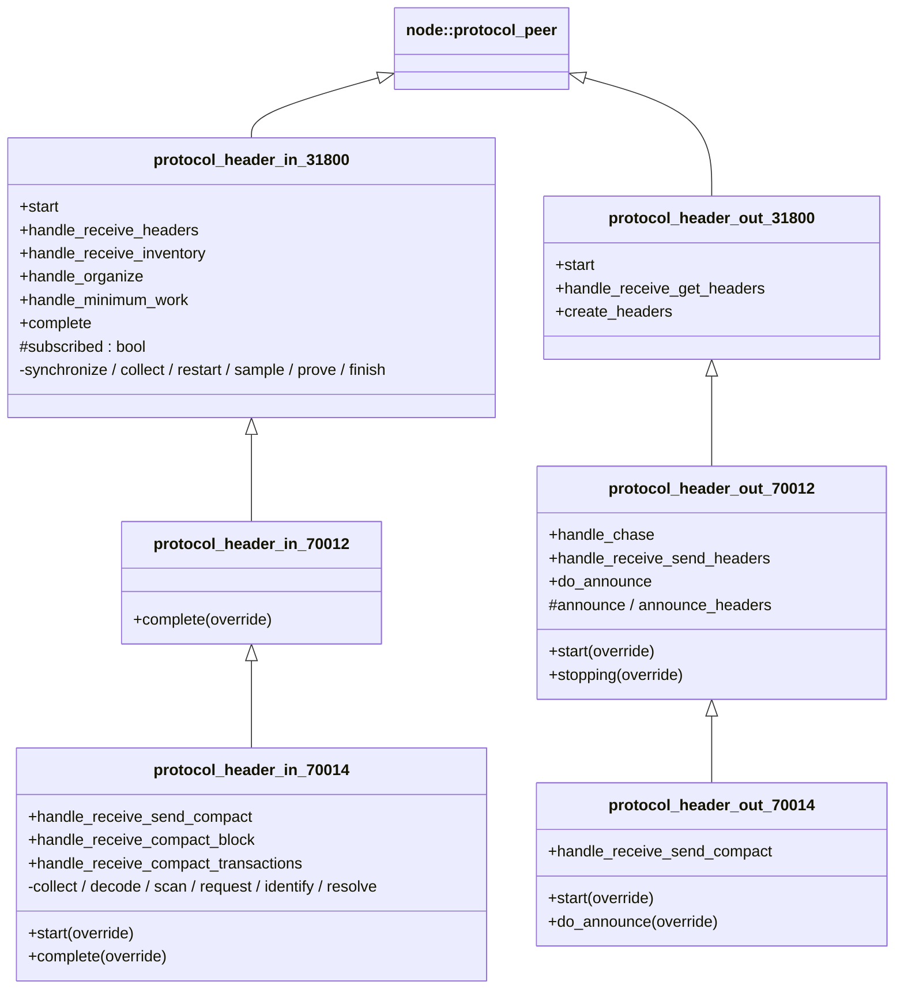
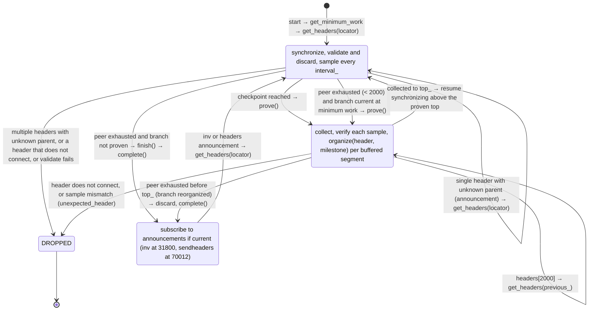
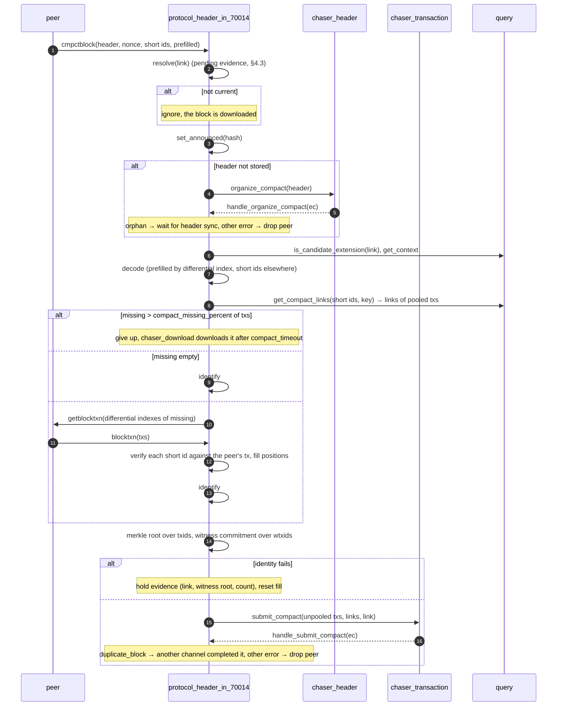

# 07 — Header Protocols

> Companion to [`06-sessions-and-protocols`](sessions-and-protocols)
> and [`02-chaser-header`](header-chaser).
>
> The header protocols are the wire-side of `chaser_header`: they sync
> headers from peers (`protocol_header_in_*`) and serve headers to peers
> (`protocol_header_out_*`). There are three versioned levels:
>
> - **31800**: classic. Sync via `get_headers`/`headers`; announcements
>   discovered indirectly via `inv` messages.
> - **70012** (BIP130): adds `sendheaders` — peers announce new blocks
>   directly with `headers` messages, bypassing `inv`.
> - **70014** (BIP152 version 2): adds compact block announcement and
>   fill. Attached when `network.enable_compact` and the peer negotiated
>   bip152.
>
> Each level *inherits* from the one below in both directions — an
> extension, not a replacement.
>
> Header sync is **prove-then-archive**: a peer's branch is validated
> and *discarded* header by header while sampling hashes, until it is
> proven (reaches a checkpoint, or is exhausted while current and at
> the minimum work); only then is it requested again and organized as
> proven against the samples. The node never archives a branch it has
> not seen through to proof, which closes the weak-headers DoS surface.

| File                                             | Lines | Role                                                                 |
| ------------------------------------------------ | ----- | -------------------------------------------------------------------- |
| `src/protocols/protocol_header_in_31800.cpp`     | 480   | Prove-then-archive sync + inv-based announcement detection            |
| `src/protocols/protocol_header_in_70012.cpp`     |  47   | Adds `sendheaders` request after initial sync                         |
| `src/protocols/protocol_header_in_70014.cpp`     | 572   | Compact block collection, fill, identification and submission         |
| `src/protocols/protocol_header_out_31800.cpp`    |  90   | Reply to `get_headers`                                                |
| `src/protocols/protocol_header_out_70012.cpp`    | 156   | Adds `chase::block` → announce new blocks via `headers`                |
| `src/protocols/protocol_header_out_70014.cpp`    | 103   | Announce via compact block when the peer requested high bandwidth     |

---

## 1. Inheritance and overrides



> **Invariant (HeaderProto-Inherit-1).** Higher levels *augment*
> lower ones. Sync (in) and serve (out) work identically; 70012 adds
> announcement-via-headers and 70014 adds compact blocks on top.

---

## 2. `protocol_header_in_31800` — inbound sync

### 2.1 Per-channel state

```cpp
// protocol_header_in_31800.hpp:66-95
bool subscribed{};                 // announcement subscription latch
bool archiving_{};                 // false: synchronize (prove); true: collect (archive)
size_t top_{};                     // proven top height
size_t index_{};                   // next sample to verify while collecting
size_t height_{};                  // height of previous_ (branch start, then collected top)
size_t milestone_{};               // height of the milestone if seen on this branch
hashes samples_{};                 // sampled hashes at multiples of interval_
hash_digest previous_{};           // last collected hash
header_cptrs buffer_{};            // collected headers awaiting the next sample
size_t interval_{ max_get_headers };  // sample interval (doubles at the budget)
uint256_t minimum_work_{};         // from chaser_header::get_minimum_work
chain_state::cptr state_{};        // chain state of the last validated header
```

### 2.2 Start

```cpp
// :44-54, :57-87
void start() { SUBSCRIBE_CHANNEL(headers, ...); get_minimum_work(BIND(handle_minimum_work, _1, _2, true)); ... }
void do_minimum_work(ec, work, initial) { minimum_work_ = work; if (initial) SEND(create_get_headers()); }
```

Sync begins once the minimum work is first obtained from the header
chaser (doc 02 §6.3) and is refreshed on every `restart` (`:294-295`).
The initial locator is built from the archived candidate chain
(`create_get_headers()`, `:439-447`).

### 2.3 The sync algorithm



**Synchronize** (`:121-202`). Each header must connect to `state_`
(else `orphan_header`); it is validated with `chaser_header::validate`
(header check, accept, checkpoint conflict) and its chain state rolled
forward, then discarded. Every `interval_` heights the hash is
`sample`d; a milestone match records `milestone_`; a checkpoint height
proves the branch immediately. A message that does not extend the
branch restarts from the parent of its first header if that parent is
stored (`restart`, `:281-297`): a single unknown-parent header is an
announcement from a peer that is ahead, so headers are requested from
the top candidate; multiple unknown-parent headers mean the peer does
not connect to the locator and it is dropped (`:138-154`).

**Prove** (`:327-341`). Records `top_`, adds the top hash as the last
sample if not on an interval, switches to `archiving_` and requests the
branch again from its parent.

**Collect** (`:205-278`). Headers are buffered until the next sample
height (each interval and the top). The hash at that height must equal
the next sample (else `unexpected_header`); the buffered segment is then
organized as proven, with `milestone = height <= milestone_` per header.
Reaching `top_` resumes synchronization above it with `state_` retained;
exhaustion before `top_` means the peer no longer presents the branch,
so it is discarded.

**Finish** (`:344-358`). The peer is exhausted. The branch is proven if
it extends the start height, its top is current, and its cumulative
work is at least `minimum_work_`; otherwise sync completes without
archiving anything.

**Sample budget** (`:300-324`). The sample vector is bounded by
`database.header.expected / 2000` (default 1024): at the budget every
other sample is dropped and `interval_` doubles, retaining the samples
at multiples of the new interval.

> **Invariant (HeaderIn-Prove-1).** A header is organized only as part
> of a branch that was validated end to end from a stored parent to a
> proof point, and only after each collected segment matched a hash
> sampled during that validation. Memory per channel is bounded by the
> sample budget plus one interval of buffered headers.

> **Invariant (HeaderIn-Prove-2).** A proof point is a checkpoint, or a
> current top at or above the minimum work. The minimum work is at least
> the candidate top's work less one currency window (doc 02 §6.3), so a
> peer cannot cause archival of a branch that is far behind the
> candidate.

> **Invariant (HeaderIn-Sync-1).** Each channel syncs *independently*
> from the candidate top. With many parallel channels, each will
> converge to the same head — duplicates are dropped by
> `chaser_header::do_organize` (returns `error::duplicate_header`,
> ignored by `handle_organize`, `:361-390`).

### 2.4 `complete()` — switching to announcement mode

```cpp
// :394-405
void complete() {
    if (!subscribed && is_current_chain(true)) {
        subscribed = true;
        SUBSCRIBE_CHANNEL(inventory, handle_receive_inventory, _1, _2);
    }
}
```

After initial sync, the protocol subscribes to **inventory** messages
to detect new block announcements indirectly (no `sendheaders` at
31800). `handle_receive_inventory` (`:411-434`): for each block-typed
`inv` item, if `query.is_block(hash)` is false, send a fresh
`get_headers`.

> **Invariant (HeaderIn-Subscribe-1).** Announcement subscription is
> gated on `is_current_chain(true)` — confirmed chain is current. Until
> then, the protocol does only initial sync.

> **Invariant (HeaderIn-Subscribe-2).** `subscribed` is one-shot:
> latched true on first successful `complete()`, never reset.

### 2.5 `set_announced` hookup

Inside `handle_receive_headers` (`:105-107`): once subscribed, every
received header hash is recorded as "announced-from-this-peer", to be
checked by the out protocols so we don't echo them back (§8).

---

## 3. `protocol_header_in_70012` — adds `sendheaders`

47 lines. Only override: `complete()` (`:31-44`): if not yet subscribed,
latch and `SEND(send_headers{})` (BIP130), then call the base. Because
`subscribed` is set first, the base skips the `inv` subscription.
Announcements then arrive as `headers` messages and flow through
`handle_receive_headers` exactly like sync: a single header with an
unknown parent is treated as an announcement from a peer that is ahead
(§2.3).

---

## 4. `protocol_header_in_70014` — compact blocks (BIP152 v2)

### 4.1 Role

Fill a *current* block announced as a compact block from the transaction
pool instead of downloading it. The protocol subscribes to `sendcmpct`,
`cmpctblock` and `blocktxn` (`:41-54`) and requests high-bandwidth
compact blocks from the peer once the chain is current, whichever of
the peer's `sendcmpct` signal and currency comes last (`upgrade`,
`:80-93`).

### 4.2 The fill



Source: `handle_receive_compact_block` `:98-133`, `collect` `:181-227`,
`decode` `:231-266`, `scan` `:269-303`, `request` `:306-323`,
`handle_receive_compact_transactions` `:328-382`, `identify` `:387-434`,
`handle_submit_compact` `:489-525`.

> **Invariant (Compact-Fill-1).** A compact block is filled only when it
> extends a current candidate (`is_candidate_extension`) and at most
> `compact_missing_percent` of its txs are missing from the pool;
> otherwise the block is left to normal download, which `chaser_download`
> defers by `compact_timeout` to give the fill a chance (doc 03 §7).

> **Invariant (Compact-Fill-2).** One fill at a time per channel
> (`fill_`), and a `blocktxn` is accepted only for the block in
> `fill_` with exactly the requested count; each received tx must hash
> to the short id at its position (the coinbase short id is over its
> witness serialization), else the peer is dropped.

> **Invariant (Compact-Fill-3).** The block is identified (merkle root
> over txids with 64-byte malleation check, witness commitment over
> wtxids) *before* submission. The transaction chaser then validates
> and archives the unpooled txs in block order and associates the
> block, emitting `chase::checked` (doc 11 §3).

### 4.3 Evidence

An unidentified compact block cannot be attributed to the peer until the
block is archived by another path. The protocol holds evidence (link,
witness root, tx count, `:417-419`) and resolves it on the peer's next
compact block: if the evidence block is now associated and does not
match the archived witness commitment and count, the peer sent an
invalid compact block and is dropped; a resend of the block in evidence
is not filled while it remains unarchived (`resolve`, `:533-566`).

---

## 5. `protocol_header_out_31800` — serve `get_headers`

```cpp
// :40-49, :54-67, :72-84
void start() { SUBSCRIBE_CHANNEL(get_headers, handle_receive_get_headers, _1, _2); protocol_peer::start(); }
bool handle_receive_get_headers(ec, message) { SEND(create_headers(*message), handle_send, _1); return true; }
headers create_headers(const get_headers& locator) {
    if (!is_current_chain(true)) return {};
    return { archive().get_headers(locator.start_hashes, locator.stop_hash, max_get_headers) };
}
```

> **Invariant (HeaderOut-Serve-1).** Header serving requires
> `is_current_chain(true)` — empty reply otherwise. A node that isn't
> current sends an empty `headers` reply, which the requester
> interprets as "peer exhausted". This prevents propagating stale data.

No bus subscription; this protocol is pure request/response.

---

## 6. `protocol_header_out_70012` — announce via `headers`

Adds a handler for the peer's `sendheaders` message, which lazily
activates the bus subscription, and a handler for `chase::block`, which
posts `do_announce(link)` to send a one-header `headers` message.

```cpp
// :39-57 lifecycle: SUBSCRIBE_CHANNEL(send_headers, ...); stopping → unsubscribe_chase
// :139-150 handle_receive_send_headers: announce_headers_ = true; announce(); return false (one-shot)
// :118-128 announce(): once, subscribe_chase(handle_chase)
// :88-116 do_announce(link): skip if was_announced(hash); NOTIFY(headers{ { ptr } })
```

> **Invariant (HeaderOut-70012-1).** Bus subscription for header
> announcements is *lazy* and *peer-driven*. A peer that doesn't send
> `sendheaders` (or `sendcmpct` at 70014) never triggers it; the channel
> stays purely request/response (like 31800).

> **Invariant (HeaderOut-70012-2).** A block is *not* announced back
> to the peer that announced it. Enforced by `was_announced(hash)`
> at `:98`.

> **Invariant (HeaderOut-70012-3).** `chase::block` is emitted by
> `chaser_confirm::announce` only when the confirmed chain is current,
> so this protocol only announces "live" blocks (doc 05 §7).

---

## 7. `protocol_header_out_70014` — announce via compact block

Subscribes to `sendcmpct` (`:39-48`). A version-2 high-bandwidth
`sendcmpct` from the peer activates the announcement subscription
(`:83-97`). `do_announce` (`:53-78`) then sends a compact block built by
`make_compact_block` (coinbase prefilled, short ids over wtxids) when the
peer wants compact blocks and did not announce the block to us; otherwise
it falls back to the 70012 `headers` announcement when the peer also sent
`sendheaders`.

> **Invariant (HeaderOut-70014-1).** Exactly one announcement per block
> per channel: compact block if requested, else headers if requested,
> else nothing. The 70012 block-out `inv` path is superseded in both
> cases (doc 08 §4).

---

## 8. Anti-echo mechanism (`set_announced` / `was_announced`)

Lives on `node::channel_peer` (`src/channels/channel_peer.cpp:32-49`).
Each channel maintains a bounded deque of recently-announced hashes
(`node.announcement_cache` entries; zero disables).

- `set_announced(hash)`: called by header-in (headers after
  subscription, compact blocks) and tx-in (every announced tx) when
  receiving an announcement.
- `was_announced(hash)`: called by header-out, block-out and tx-out
  before sending an announcement.

This is **not** global state; it's per-channel — exactly what's needed
to break the local A↔B echo.

> **Invariant (Anti-Echo-1).** The pair `(set_announced, was_announced)`
> guarantees a peer that announced X to us is never sent X back, *on
> that channel*, while X is within the last `announcement_cache`
> announcements. It does not guarantee global no-duplication.

---

## 9. Error / outcome inventory

| Event                                  | Site                                        | Effect                                                          |
| -------------------------------------- | ------------------------------------------- | --------------------------------------------------------------- |
| header does not connect to the branch  | `in_31800.cpp:139-154`, `:161-168`, `:213-220` | `stop(orphan_header)` — channel dropped (single announcement excepted) |
| header fails validate                  | `in_31800.cpp:171-177`                      | `stop(ec)` — consensus or checkpoint failure                    |
| collected hash mismatches a sample     | `in_31800.cpp:230-237`                      | `stop(unexpected_header)`                                       |
| organize returns `service_stopped` or `duplicate_header` | `in_31800.cpp:365-368`    | silently ignored                                                |
| organize returns any other code        | `in_31800.cpp:371-386`                      | `stop(ec)` — channel dropped                                    |
| get_minimum_work fails                 | `in_31800.cpp:76-80`                        | `stop(ec)`                                                      |
| compact decode / short id / count failure | `in_70014.cpp:205-209`, `:345-349`, `:357-374` | `stop(protocol_violation)`                                   |
| compact context / hash lookup failure  | `in_70014.cpp:190-194`, `:211-215`, `:395-401` | `stop(fault(protocol2))` — node fault                        |
| unidentified compact block             | `in_70014.cpp:411-422`                      | evidence held; dropped later if the archived block disproves it |
| organize_compact orphan                | `in_70014.cpp:159-164`                      | ignored (resolved by header sync)                               |
| submit_compact error                   | `in_70014.cpp:513-520`                      | `stop(ec)` unless `duplicate_block`                             |
| `get_header(link)` null in out_70012   | `out_70012.cpp:104-110`                     | log; do not announce; do not stop (defensive)                   |

Only `protocol2` is a node fault; every other failure affects one
channel.

---

## 10. Configuration interactions

From [`06 §2.3`](sessions-and-protocols#23-attach_protocolschannel--session_peeripp71-190):

- `provide_blocks` false ⇒ no header-in or header-out protocols.
- peer negotiated bip152 and `network.enable_compact` ⇒ 70014 in/out.
- else bip130 ⇒ 70012 in/out.
- else `headers_protocol` ⇒ 31800 in/out (out only when `blocks_out`).
- below 31800 ⇒ no header protocols and no block download.

> **Invariant (HeaderAttach-1).** A channel never runs two levels
> simultaneously for the same direction. The attach tree is a strict
> `if/else if/else`.

---

## 11. Spec view

### 11.1 As processes

```
header_in : Process
  state: subscribed ∈ 𝔹, archiving ∈ 𝔹, samples : Seq Hash, interval ∈ ℕ,
         state : ChainState ∪ {⊥}, buffer : Seq Header, top ∈ ℕ, milestone ∈ ℕ,
         minimum_work ∈ ℕ; (70014) fill ∈ Fill ∪ {⊥}, evidence ∈ Evidence ∪ {⊥}
  inputs:  peer.headers, peer.inv (31800 only), peer.cmpctblock / blocktxn / sendcmpct (70014)
  outputs: peer.get_headers, peer.sendheaders (70012), peer.sendcmpct / getblocktxn (70014),
           organize(header, milestone) RPC per collected header,
           organize_compact / submit_compact RPCs (70014)

header_out : Process
  state: announcing ∈ 𝔹, announce_headers ∈ 𝔹 (70012+)
  inputs:  peer.get_headers, peer.sendheaders, peer.sendcmpct (70014), bus chase::block
  outputs: peer.headers, peer.cmpctblock (70014)
```

### 11.2 Safety properties

1. **No archival without proof** (HeaderIn-Prove-1, HeaderIn-Prove-2).
2. **No echo within a channel** (Anti-Echo-1).
3. **Sync convergence**: assuming a peer's header chain extends ours
   and is proven, each `get_headers` reply strictly extends the
   candidate chain (or is empty). Convergence after 2⌈Δ/2000⌉
   round-trips where Δ is the gap (one pass to prove, one to archive).
4. **Compact identity before submission** (Compact-Fill-3).

### 11.3 Liveness

- Each channel makes progress as long as the peer responds to
  `get_headers`.
- After `complete()`, the channel quiesces until the peer sends a
  `headers`, `cmpctblock` (70014) or `inv` (31800) message.

---

## 12. Implementation notes

- The sync is two passes over the branch; the second is the one that
  writes. The sample vector is the only memory held across them.
- BIP130 and BIP152 are strict extensions over 31800; mirror that with a
  class hierarchy or trait composition.
- `set_announced`/`was_announced` is a per-channel bounded FIFO.

---

## 13. Notes for the formal model

- The in protocol is stateful in the sync bookkeeping (§11.1); the
  proof points (checkpoint, current-and-minimum-work) are the
  obligations that tie it to `chaser_header`.
- The compact fill is a per-channel single-slot state machine whose
  correctness obligations are identity-before-submit and short-id
  verification; the pool side is in doc 11.
- The end-to-end "candidate chain converges to peer's tip" property
  requires reasoning across multiple channels — out of scope of a
  per-protocol spec but provable given `chaser_header`'s safety
  properties.

---

## Cross-references

- [`02-chaser-header`](header-chaser) — the consumer of headers
  organized by these protocols; `get_minimum_work`; `organize_compact`
- [`03-chaser-download`](download-chaser) §7 — compact deferral
- [`05-chaser-confirm`](confirmation-chaser) §7 — emits `chase::block`
- [`06-sessions-and-protocols`](sessions-and-protocols) §2 —
  attach tree; §3 — `node::protocol_peer` base and `make_compact_block`
- [`08-block-out-protocols`](block-out-protocols) (block serving and
  the supersede gate)
- [`11-chaser-transaction`](transaction-chaser) §3 (`submit_compact`)
