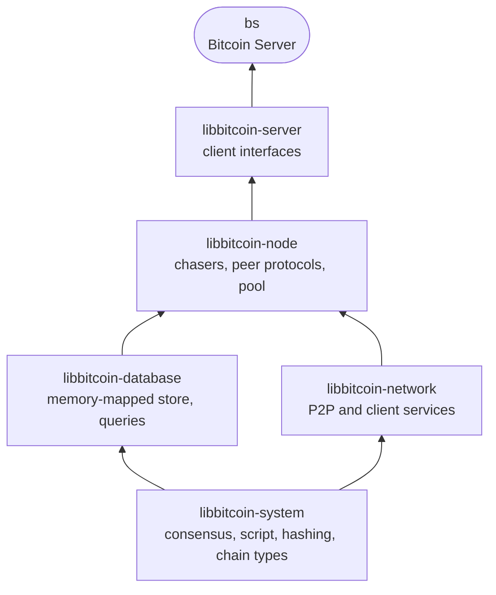
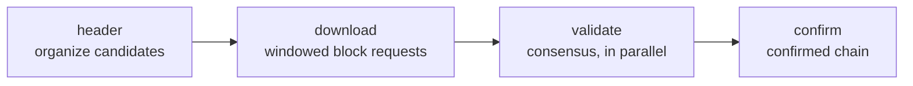

# Architecture Overview

Bitcoin Server (`bs`) is a stack of C++ libraries, each built on those
below it. This page outlines how the layers fit together. The node and the
store are each described in depth, against their source, in
[Node Architecture](node/index) and
[Database Architecture](database/index).

## 1. Stack

| Layer | Role |
| ----- | ---- |
| libbitcoin-system | Bitcoin primitives and consensus rules: blocks, transactions, script execution, hashing and cryptography. |
| libbitcoin-database | The store: append-only, memory-mapped tables and the queries over them. |
| libbitcoin-network | Connections, sessions and protocols: the Bitcoin P2P network, and the HTTP, websocket, JSON-RPC, TLS and ZMQ services. |
| libbitcoin-node | The full node: header and block sync, validation, confirmation and the transaction pool. |
| libbitcoin-server | The client interfaces of Bitcoin Server, and `bs`. |

The libraries are listed under [Developers](../developers/index).

## 2. Node

Synchronization is headers-first. Peer protocols prove and archive each
peer's headers, and a chain of **chasers** carries them from there to
confirmation:

Blocks are downloaded from many peers at once and validated concurrently,
while organization and confirmation follow in order. The chasers
communicate only through an event bus, and share state only through the
store. Further chasers maintain the transaction pool, fee estimates, store
snapshots and disk space.

Quiescing the pipeline allows store snapshot, remap and shutdown.

## 3. Store

The store is strictly relational, without a query engine. Every relation is
resolved by one of two physical operations chosen when the table is
designed: **navigation**, following a link that is a row's position, or
**search**, a hash lookup through a table's head.

Table bodies are append-only and published by small heads, so every write
becomes visible atomically, and a snapshot is a copy of the heads. All files
are memory-mapped, and grow by remapping. A store that closes cleanly reopens as
it was; one that does not is restored from its last snapshot.

## 4. Server

Bitcoin Server adds client interfaces to the node, on the services of
libbitcoin-network, serving from the node's store. The interfaces are listed in [BS Interfaces](../interfaces.html).

## 5. Design documents

The architecture follows the 2021 design documents for version 4:

| Document | Topic |
| -------- | ----- |
| [Node design](node/libbitcoin-v4-node-design.pdf) | Parallel download, sequential chasers, validation bypass, append-only writes, quiescence |
| [Relational database](database/libbitcoin-v4-relational-database.pdf) | Natural, foreign and search keys, navigation versus search, recoverability |
