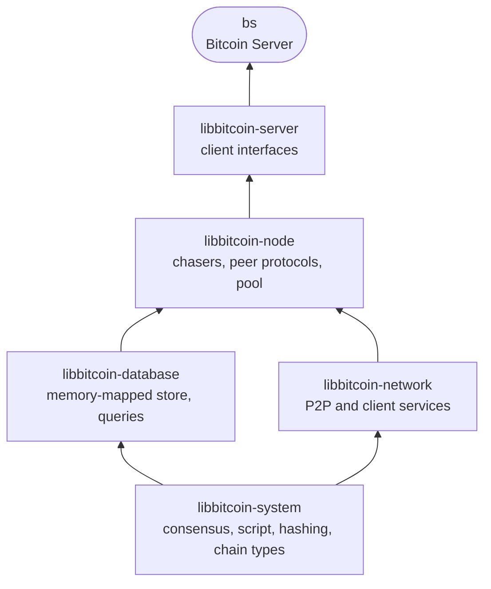
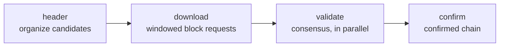

# Architecture Overview

Bitcoin Server (`bs`) is a stack of C++ libraries, each built on those
below it. This page outlines how the layers fit together. The node and the
store are each described in depth, against their source, in
[Node Architecture](node/index) and
[Database Architecture](database/index).

## 1. Stack

| Layer | Role |
| ----- | ---- |
| libbitcoin-system | Bitcoin primitives and consensus rules: blocks, transactions, script execution, hashing and cryptography. |
| libbitcoin-database | The store: append-only, memory-mapped tables and the queries over them. |
| libbitcoin-network | Connections, sessions and protocols: the Bitcoin P2P network, and the HTTP, websocket, JSON-RPC, TLS and ZMQ services. |
| libbitcoin-node | The full node: header and block sync, validation, confirmation and the transaction pool. |
| libbitcoin-server | The client interfaces of Bitcoin Server, and `bs`. |

The libraries are listed under [Developers](../developers/index).

## 2. Node

Synchronization is headers-first. Peer protocols prove and archive each
peer's headers, and a chain of **chasers** carries them from there to
confirmation:

Blocks are downloaded from many peers at once and validated concurrently,
while organization and confirmation follow in order. The chasers
communicate only through an event bus, and share state only through the
store. Further chasers maintain the transaction pool, fee estimates, store
snapshots and disk space.

Quiescing the pipeline allows store snapshot, remap and shutdown.

## 3. Store

The store is strictly relational, without a query engine. Every relation is
resolved by one of two physical operations chosen when the table is
designed: **navigation**, following a link that is a row's position, or
**search**, a hash lookup through a table's head.

Table bodies are append-only and published by small heads, so every write
becomes visible atomically, and a snapshot is a copy of the heads. All files
are memory-mapped, and grow by remapping. A store that closes cleanly reopens as
it was; one that does not is restored from its last snapshot.

## 4. Server

Bitcoin Server adds client interfaces to the node, on the services of
libbitcoin-network, serving from the node's store. The interfaces are listed in [BS Interfaces](../interfaces.html).

## 5. Protocol evolution

The protocol evolves by addition: new consensus rules and new P2P
protocol versions. None is hardwired. Each is implemented on its own and
selected by configuration, so each is developed and tested in isolation,
read and verified as one unit of code, and enabled or disabled on its own.
The full stack runs with any individual rule or protocol version disabled.

Old rules and versions are never dropped, in consensus or in P2P: a node
validates the whole chain under the rules of each height, and serves a
peer at any version it implements, within the configured bounds. There is
no way to know which rules miners enforce or which versions peers run, so
none can be assumed unused. It also lets the node be operated at any
historical level, back to its minimums: the rules of the satoshi client
v0.3.0 in consensus (before BIP16, forks were implemented on an ad hoc
basis, without coordination), and
version 31402 in P2P.

Some rules and versions are not implemented, which is often a judgement
call, such as the forks made by `bitcoind` without prior specification,
listed in `chain/enums/flags.hpp`, and Erlay (BIP330) in P2P.

### 5.1 Forks

The consensus rules define which blocks are valid. A fork is a new rule.
Rules only accumulate: a rule that disables part of an earlier one is
itself a new rule, applied with the earlier rule, which remains. A fork
(in fact the coin itself) is classified by the rules alone, by the validity
of blocks without the rule and with it:

| Fork | Without the rule and with it | Example |
| ---- | ---------------------------- | ------- |
| Soft | A block valid without the rule is invalid with it | BIP66 requires strict signature encoding |
| Hard | A block invalid without the rule is valid with it | BIP90 imposes the rule of BIP34 above a fixed block |

A rule that makes any block valid that is invalid without it is a hard
fork, whatever else it does. A rule that leaves the validity of every block
as it is without it is not a fork.

The classification is independent of how a fork is deployed, and of
whether any chain is observed to split because of it. A split is an event:
nodes enforcing different rules diverge only when a block is mined that is
valid under one set and not the other. A hard fork that no block exercises
splits nothing, and remains a hard fork: BIP90 has not split the chain,
because no block in its history is valid under one and not the other. A
soft fork can split the chain: in July 2015, after BIP66 activated, miners
that did not validate extended a block invalid under it. Whether a split is
likely or unlikely is an estimate of how miners and nodes will behave, not
a property of the rule.

A soft fork is not backward compatible. Nodes that do not adopt the rule
accept blocks that are invalid under it, as the BIP66 split shows. The
chain without the rule does not survive only because majority hash power
enforces the rule, by not extending blocks that are invalid under it, and
that enforcement is indistinguishable from censorship. Under a hard fork,
nodes that do not adopt the rule reject blocks that the nodes that adopt
it accept.

Each flag in `chain/enums/flags.hpp` is labeled with its type, and with
its purpose: feature, security, determinism, inflation, deflation or
arbitrary.

### 5.2 Consensus

Each fork is one flag (`chain::flags`), enabled by
its own member of the configured forks (`[forks]`), and activated by its
own deployment. The chain state computes the flags active at each height
from the configured forks and the chain, and each rule is a predicate of
the chain types applied only under its flag.

Activation is configured as well: activation times, version thresholds,
burial heights, checkpoints and BIP9 deployments are all settings of
`[bitcoin]`. BIP54 (proposed) is implemented as five forks, one per rule, each
switched and deployed independently. See
[Activation](system/chain#43-activation), and the
[`[forks]`](../configuration/reference#5-forks) and
[`[bitcoin]`](../configuration/reference#4-bitcoin) settings.

### 5.3 P2P

Each P2P protocol is a class, and each protocol version that extends it
is a class derived from that of the previous version, named by the version
that introduced it. A derived class adds only what its version adds, and
overrides only the handlers that it extends: `protocol_ping_60001` derives
from `protocol_ping_106` and adds the nonce and `pong` of BIP31. The
earlier class remains, for peers at the earlier version.

| Protocol | Library | Versions |
| -------- | ------- | -------- |
| Version handshake | network | 106 → 70001 → 70002 → 70014 → 70016 |
| Ping | network | 106 → 60001 |
| Address in, address out, seed | network | 209 → 70016 |
| Alert | network | 311 |
| Reject | network | 70002 |
| Header in, header out | node | 31800 → 70012 → 70014 |
| Block in | node | 31800 |
| Block out | node | 106 → 70001 → 70012 → 70014 |
| Transaction in | node | 106 → 70001 → 70013 → 70016 |
| Transaction out | node | 106 → 60002 → 70001 → 70013 → 70016 |
| Client filters out | node | 70015 |

A session attaches to each channel the most derived class of each
protocol that the negotiated version and the configuration allow. The
version is bounded by `protocol_maximum` and `protocol_minimum`, and each
optional feature has its own switch, such as `enable_compact`,
`enable_address_v2` and `enable_witness_tx`, so a channel can run any
version with any of its features disabled. See
[`[peer]`](../configuration/reference#9-peer) and
[Sessions and protocols](node/sessions-and-protocols).

## 6. Design documents

The architecture follows the 2021 design documents for version 4:

| Document | Topic |
| -------- | ----- |
| [Node design](node/libbitcoin-v4-node-design.pdf) | Parallel download, sequential chasers, validation bypass, append-only writes, quiescence |
| [Relational database](database/libbitcoin-v4-relational-database.pdf) | Natural, foreign and search keys, navigation versus search, recoverability |
