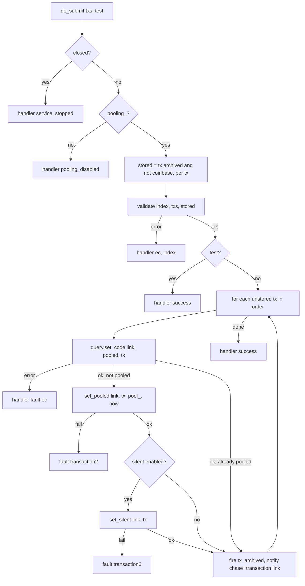
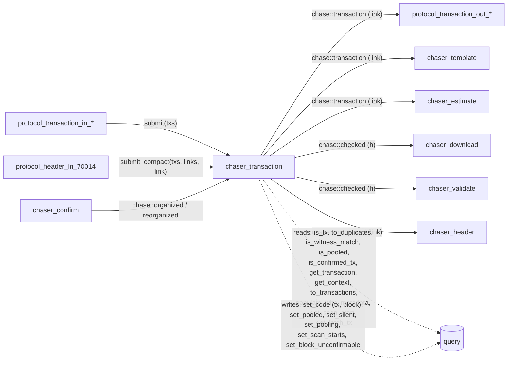

# 11 — Transaction Chaser

> Companion to [`04-chaser-validate`](validation-chaser),
> [`05-chaser-confirm`](confirmation-chaser),
> [`07-header-protocols`](header-protocols) §4 and
> [`10-tx-protocols`](transaction-protocols).
>
> `chaser_transaction` owns the **unconfirmed transaction pool**. The
> pool is an *index over archived transactions*: a submitted transaction
> is validated, archived in the store like any other tx, and marked
> pooled under the context of the next block. There is no separate
> mempool data structure; "pooled" is a store property, and the pool
> contents outlive the process.
>
> The chaser:
>
> 1. validates and archives submitted packages (`submit`), emitting
>    `chase::transaction` per newly pooled tx;
> 2. fills identified compact blocks from the pool (`submit_compact`),
>    validating and archiving the unpooled txs in block order,
>    associating the block, and emitting `chase::checked` — the second
>    archiver of blocks after `protocol_block_in_31800`;
> 3. re-pools the unpooled txs of a reorganized block;
> 4. maintains the pool context on every organized block, closes the
>    pool when the chain is not current, and maps **silent-payment scan
>    starts** on a dedicated single thread.

| File                                                     | Lines | Role                                   |
| -------------------------------------------------------- | ----- | -------------------------------------- |
| `include/bitcoin/node/chasers/chaser_transaction.hpp`    | 108   | Declaration                            |
| `src/chasers/chaser_transaction.cpp`                     | 602   | Implementation                         |

---

## 1. State

```cpp
// chaser_transaction.hpp:95-102
network::threadpool scan_threadpool_;   // one thread, node.thread_priority
stopper stopping_{};                    // cancels a running scan map

// strand-protected
system::chain::context pool_{};         // context of the next block (where a pooled tx would confirm)
bool pooling_{};                        // pool open (relay enabled and confirmed chain current)
bool scanning_{};                       // a scan-start map is running
```

> **Invariant (Pool-Context-1).** `pool_` is the chain context of the
> block *after* the confirmed top (`chain_state{ *state, settings }.context()`,
> `:134`), recomputed on every `organized` and `reorganized` event. Every
> pool admission and every fee-rate decision is made against that
> context.

---

## 2. Bus integration

Inputs (`:72-100`):

| Event                | Reaction                                                                 |
| -------------------- | ------------------------------------------------------------------------ |
| `chase::organized`   | `do_bump`: recompute the pool context, open/close the pool, map scan starts |
| `chase::reorganized` | `do_reorganized(link)`: `do_bump`, then pool the unpooled txs of the block |
| `chase::stop`        | unsubscribe                                                              |

`start()` subscribes and posts an initial `do_bump` (`:46-51`).

Outputs:

| Event                | Site                                   | Trigger                                                       |
| -------------------- | -------------------------------------- | ------------------------------------------------------------- |
| `chase::transaction` | `:230`, `:329`, `:456`, `:483`         | a tx was pooled (reorganized block, package, compact fill)    |
| `chase::checked`     | `:414`                                 | a compact block was filled and associated                     |
| `chase::unchecked`   | `:497`                                 | an identified compact block contained an invalid tx           |

Reporting: `events::tx_archived` with the tx fee rate (`:328`, `:482`),
`events::block_archived` (`:415`), `events::block_unconfirmable` (`:498`).

### 2.1 The pool latch

```cpp
// :105-153 do_bump
pooling_ = false;
if (closed() || !is_current_chain(true)) return;
if (network_settings().enable_relay) {
    pool_ = next-block context of the confirmed top;
    query.set_pooling();          // permanent store property
    pooling_ = true;
}
map scan starts (§5)
```

> **Invariant (Pool-Open-1).** The pool accepts submissions only while
> relay is enabled and the confirmed chain is current (`pooling_`,
> checked in `do_submit`, `:268-272` → `error::pooling_disabled`). The
> store latch `set_pooling` is one-way: txs archived while the pool was
> open outlive a later loss of currency.

---

## 3. Submission

### 3.1 Packages (`submit`)



Source: `do_submit` `:257-333`. Parents precede children in a package,
so a parent is archived before its child is resolved.

Package validation (`validate(index, txs, stored)`, `:518-557`):

1. empty package → `empty_package`; all already stored →
   `duplicate_transaction`;
2. `block::is_forward_reference` → `forward_reference`;
   `block::is_internal_double_spend` → `block_internal_double_spend`;
3. `block::populate(txs, pool_)` fills intra-package prevouts;
4. each unstored tx is validated (below), accumulating fee and virtual
   size; `index` reports the failing tx;
5. the package rate (satoshis per virtual kilobyte) must reach
   `node.minimum_fee_rate` → `insufficient_fee`.

Per-tx validation (`validate(tx)`, `:559-579`):

```
tx.check(); tx.check(pool_)                        // tx consensus
archive().populate_with_metadata(tx, true, true)   // external prevouts from confirmed and pooled
tx.accept(pool_)
tx.check_guard(); tx.check_guard(pool_); tx.accept_guard(pool_); tx.confirm_guard(pool_)   // presumed block rules (DoS guard)
tx.connect(pool_)                                  // scripts last, most costly
```

> **Invariant (Pool-Validate-1).** A pooled tx has passed tx consensus,
> the block-level rules it would be subject to in the next block (the
> guards), and script validation, all under the pool context. The
> pooled block path of `chaser_validate` relies on this to skip per-tx
> validation (doc 04 §4.2).

> **Invariant (Pool-Package-1).** A package is accepted or rejected as a
> whole, by validation; archival is per tx in order, so a disk-full
> decline can leave a package partly archived, which a resubmit
> resolves (`:306-310`).

### 3.2 Compact blocks (`submit_compact`)

`do_submit_compact(txs, links, link)` (`:336-417`) receives the unpooled
txs of an identified compact block and the full link vector with
terminal entries at their positions:

1. `duplicate_block` if the block is already associated (another channel
   filled it); `transaction3` fault if the context is missing;
   `transaction5` if the terminal count does not match the tx count.
2. Each terminal position is filled in block order by `fill` (`:435-487`):
   an already stored tx (matched by witness, `to_stored`) is reused and,
   if pooling and not yet pooled or confirmed, validated under the block
   context and pooled; an unstored tx is validated under the block
   context, archived (`set_code`), pooled unless coinbase, and silent
   indexed when at or above `silent_start_height` under taproot. Each
   newly pooled tx emits `chase::transaction`.
3. The coinbase, when missing, is filled last (validation indexes only
   txs linked above it).
4. `query.set_code(link, filled, strong)` associates the block with
   `strong = is_under_checkpoint(height)`; then `chase::checked`.

A tx that fails validation makes the identified block unconfirmable:
`unconfirmable` (`:490-500`) sets the block unconfirmable (`transaction4`
on failure), emits `chase::unchecked` and returns the consensus code to
the protocol, which drops the peer.

Block-context tx validation (`validate(tx, ctx)`, `:583-596`) applies
`check`, `check(ctx)`, `populate_with_metadata`, `accept(ctx)`,
`connect(ctx)` — no policy (fee rate, guards), because a block tx is
under proof of work and may conflict with unconfirmed txs.

> **Invariant (Pool-Compact-1).** A compact-filled block is associated
> only after every one of its txs is archived and (for unpooled ones)
> validated under the block's own context, in block order. `chase::checked`
> then carries the same guarantee as the download path (doc 06 §5.6):
> the block is durably associated before the event.

> **Invariant (Pool-Compact-2).** Block checks are deferred: the txs
> given to `submit_compact` are an arbitrary subset of the block, so
> block-level rules run in `chaser_validate` (the pooled path when all
> txs are sufficiently pooled, else full validation).

---

## 4. Reorganization

`do_reorganized(link)` (`:193-232`) recomputes the pool context, then
for every non-coinbase tx of the popped block that is neither pooled nor
confirmed by another block, populates it with metadata and pools it
under the block's context with the block's timestamp as arrival time,
emitting `chase::transaction`. Block txs are already silent indexed.

> **Invariant (Pool-Reorg-1).** No transaction of a reorganized block is
> lost: it is either confirmed elsewhere, already pooled, or re-pooled by
> this handler.

---

## 5. Silent-payment scan starts

When the store's silent index is enabled, the chaser builds and
maintains the **scan start map** — the per-block entry points that the
server's silent-payment scans use — on the single-thread
`scan_threadpool_` (`start_scan`/`do_scan`/`do_scanned`, `:155-189`):

- a full map (`remap = true`) when genesis has no scan start;
- an extension when the top has none and the pool is not yet latched;
- a remap when the top is unmapped and the top's coinbase precedes the
  pool latch tx (rows of a block archived before the latch may precede
  mapped starts).

The map is bounded by the scan frontier once pooling. Blocks organized
during a map are mapped by the `do_bump` that `do_scanned` re-runs.

> **Invariant (Pool-Scan-1).** Scan starts are mapped only after the
> pool latch, since pooled rows are unordered; at most one map runs at a
> time (`scanning_`), and a failed map is a `transaction8` fault.

---

## 6. Error inventory

| Code           | Site                        | Cause                                                               |
| -------------- | --------------------------- | ------------------------------------------------------------------- |
| `transaction1` | `:127-131`                  | confirmed chain state of the top not obtainable                     |
| `transaction2` | `:224-228`, `:315-318`, `:449-450`, `:472-473` | `set_pooled` failed                              |
| `transaction3` | `:356-360`                  | `get_context` of the compact block's link failed                    |
| `transaction4` | `:493-494`                  | `set_block_unconfirmable` of an invalid compact block failed        |
| `transaction5` | `:362-368`                  | compact fill: terminal count ≠ tx count (protocol-side error, not a fault) |
| `transaction6` | `:321-324`, `:452-454`, `:475-477` | `set_silent` failed                                         |
| `transaction7` | `:203-207`, `:217-221`      | reorganized block txs or context not readable                       |
| `transaction8` | `:182-186`                  | scan start map failed                                               |
| `transaction9` | `:118-122`                  | height of the confirmed top not obtainable                          |
| `pooling_disabled`, `insufficient_fee`, `empty_package`, `duplicate_transaction` | `:268-272`, `:518-557` | package rejections returned to the submitter |

All `transactionN` except `transaction5` are faults; store write codes
from `set_code` are faulted and returned (`:307-310`, `:466-467`).

---

## 7. Coupling diagram



---

## 8. Spec view

```
chaser_transaction : Process
  state: pool_ctx : Context, pooling ∈ 𝔹, scanning ∈ 𝔹
  inputs:  chase::{organized, reorganized, stop}
           submit(txs, test), submit_compact(txs, links, link) RPCs
  outputs: chase::{transaction, checked, unchecked}; handler codes
  effects: tx archival, pooled/silent rows, block association, scan starts
```

Safety: Pool-Validate-1 (every pooled tx is valid under the next-block
context); Pool-Compact-1 (association after archival, in order);
Pool-Reorg-1. Liveness: pooling resumes on the first organized block
after the chain becomes current; scan maps complete or fault.

---

## 9. Notes for the formal model

- Strand-confined except for the scan map, which only writes scan
  starts and reports back by post.
- The pool is a store projection ("pooled under context C"); model it
  as a set of (tx, context, arrival) rows with the latch as a one-way
  flag.
- The compact fill is the only place where a block is archived by a
  path other than the download protocol; its `checked` obligation is the
  same as doc 06 §8.3-1.

---

## Cross-references

- [`01-event-bus`](event-bus) §2.3, §2.6
- [`04-chaser-validate`](validation-chaser) §4.2 (pooled block path)
- [`05-chaser-confirm`](confirmation-chaser) §8 (organized/reorganized
  ordering)
- [`07-header-protocols`](header-protocols) §4 (compact fill)
- [`10-tx-protocols`](transaction-protocols) (submitters and announcers)
- [`12-periphery-chasers`](periphery-chasers) §3, §4 (`chaser_template`,
  `chaser_estimate` consume `transaction`)
