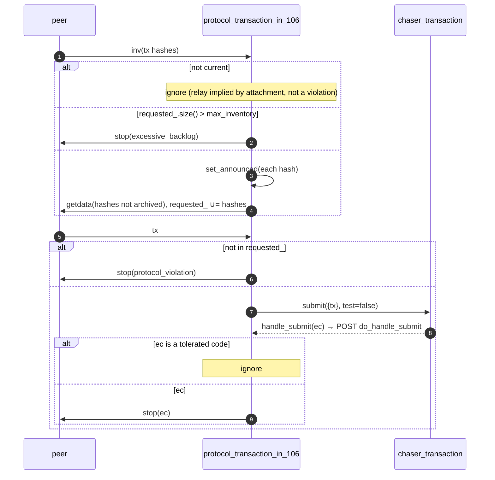
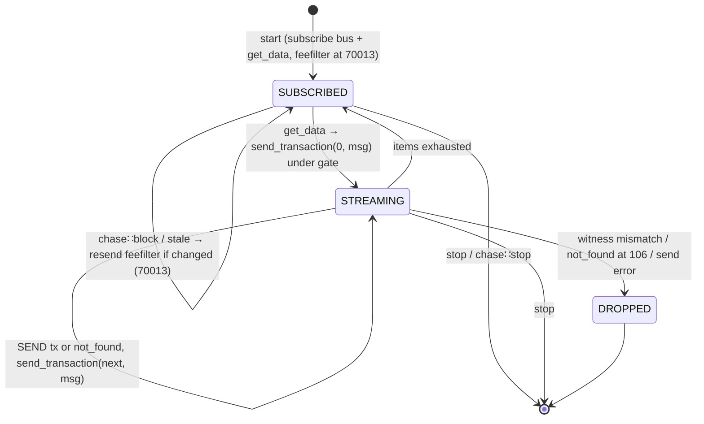

# 10 — Transaction Protocols

> Companion to [`06-sessions-and-protocols`](sessions-and-protocols),
> [`08-block-out-protocols`](block-out-protocols) and
> [`11-chaser-transaction`](transaction-chaser).
>
> The transaction protocols relay unconfirmed transactions between the
> pool (`chaser_transaction`) and peers. Each direction is a ladder of
> levels, each inheriting the one below:
>
> | Direction | 106 | 60002 (BIP35) | 70001 (BIP37) | 70013 (BIP133) | 70016 (BIP339) |
> | --------- | --- | ------------- | ------------- | -------------- | -------------- |
> | in        | `inv` → `getdata` → `tx` → `submit` | — | `not_found` accepted | fee / suspension violations drop the peer | wtxid identity |
> | out       | `chase::transaction` → `inv`; `getdata` → `tx` | `mempool` | `not_found` reported | `feefilter` both ways; filtered announcements | wtxid identity |
>
> Relay is gated on `network.enable_relay`; currency is signalled to
> peers by the fee filter rather than by attaching late (doc 06 §2.4).

| File                                                    | Lines | Role                                                              |
| ------------------------------------------------------- | ----- | ----------------------------------------------------------------- |
| `src/protocols/protocol_transaction_in_106.cpp`         | 221   | Request announced txs, submit received txs to the pool             |
| `src/protocols/protocol_transaction_in_70001.cpp`       |  84   | Accept `not_found` for requested txs                               |
| `src/protocols/protocol_transaction_in_70013.cpp`       |  61   | Drop peers that send against our fee filter or suspension          |
| `src/protocols/protocol_transaction_in_70016.cpp`       |  63   | Identify by wtxid                                                  |
| `src/protocols/protocol_transaction_out_106.cpp`        | 238   | Announce pooled txs, serve `get_data`                              |
| `src/protocols/protocol_transaction_out_60002.cpp`      | 123   | Serve `mempool`                                                    |
| `src/protocols/protocol_transaction_out_70001.cpp`      |  74   | `not_found` accumulation                                           |
| `src/protocols/protocol_transaction_out_70013.cpp`      | 154   | Fee filter                                                         |
| `src/protocols/protocol_transaction_out_70016.cpp`      |  63   | Identify by wtxid                                                  |

---

## 1. Attachment

From `session_peer.ipp:158-189`:

```
if (relay) {
    witness_tx = network.enable_witness_tx && peer.wants_witness_tx() && peer bip339
    tx in:  70016 if witness_tx else 70013 if bip133 else 70001 if bip37 else 106
    if (peer_version.relay)
        tx out: 70016 if witness_tx else 70013 if bip133 else 70001 if bip37 else 60002 if bip35 else 106
}
```

> **Invariant (TxAttach-1).** The in protocol is attached whenever
> relay is enabled; the out protocol additionally requires that the
> peer asked for relay in its version message. Our own relay request is
> made only when the confirmed chain is current
> (`session_peer::relay()`, doc 06 §1.2).

> **Invariant (TxAttach-2).** Exactly one level per direction; the
> ladders are strict `if/else if`.

---

## 2. The in ladder

### 2.1 `protocol_transaction_in_106`

State: `requested_` (an unordered set of announced-and-requested hashes,
`protocol_transaction_in_106.hpp:88`) and `tx_type_` (`witness_tx` iff
`node.require_witness`, `:39-40`).



Source: `handle_receive_inventory` `:82-117`, `create_get_data`
`:120-141`, `handle_receive_transaction` `:155-176`,
`do_handle_submit` `:186-215`.

> **Invariant (TxIn-Request-1).** Only announced txs are requested and
> only requested txs are accepted; an unrequested `tx` is a protocol
> violation. The backlog of outstanding requests is bounded by
> `max_inventory` (measured between messages, so it may exceed the bound
> by one message).

> **Invariant (TxIn-Tolerance-1).** These submit results are *not*
> misbehaviour at 106 and are ignored: `pooling_disabled`,
> `insufficient_fee`, `duplicate_transaction`, `double_spend`,
> `absolute_time_locked`, `relative_time_locked`,
> `missing_previous_output` (`:203-210`). A conflict with an unconfirmed
> tx, an orphan, a lock evaluated against the presumed next block, and a
> rate the peer could not know are all legitimate from the peer's view.
> Everything else (consensus failure, faults) drops the peer.

### 2.2 `protocol_transaction_in_70001`

Adds `not_found` handling (`:39-78`): each tx item must be in
`requested_`, else protocol violation.

### 2.3 `protocol_transaction_in_70013`

Overrides `do_handle_submit` (`:39-55`): because the peer was sent our
fee rate when current and the maximum while not, a tx below the rate
(`insufficient_fee`) or any tx while pooling is disabled
(`pooling_disabled`) was sent against instruction and drops the peer.

### 2.4 `protocol_transaction_in_70016`

Overrides identity (`:37-57`): announcements and requests use
`type_id::wtxid`, the request record is keyed by the witness hash, and
"archived" is tested with `to_witness_tx`.

---

## 3. The out ladder

### 3.1 `protocol_transaction_out_106`

```cpp
// :39-60 start: subscribe_chase; SUBSCRIBE_CHANNEL(get_data); stopping → unsubscribe_chase
// :85-106 handle_chase: chase::transaction → POST(do_announce, link)
// :111-139 do_announce → announce(hash): skip if was_announced or null; NOTIFY(inv{ type, hash })
// :144-153 handle_receive_get_data → send_transaction(success, 0, message, gate())
// :159-212 send_transaction: loop over tx items, witness gate, get_transaction, unservable → stop(not_found) at 106
```

The send loop has the same shape as block-out (doc 08 §2.5): drain
unservable items (106 stops the channel; 70001 accumulates), report,
send one tx, continue from the completion.

> **Invariant (TxOut-Announce-1).** Same anti-echo discipline as
> block-out and header-out: a peer that announced a tx to us does not
> receive an echo.

> **Invariant (TxOut-Witness-1).** A node that does not provide witness
> drops a peer requesting a witness tx (`witness_tx` or `wtxid` items,
> `:180-187`).

### 3.2 `protocol_transaction_out_60002` — `mempool`

When `network.enable_memory_pool`, subscribes to `mempool` (`:39-50`).
`handle_receive_memory_pool` (`:63-76`) snapshots the pool record count
and streams `inv` messages of up to `max_inventory` confirmable pooled
txs each (`get_confirmable_txs` by pool cursor, `:81-117`), skipping
filtered txs; txs pooled after the snapshot are announced by the
`transaction` event.

### 3.3 `protocol_transaction_out_70001` — `not_found`

As for block-out 70001: unservable items are accumulated when
`enable_not_found_` and reported with one `not_found` whose completion
resumes the send loop (`:40-68`).

### 3.4 `protocol_transaction_out_70013` — fee filter

- Sends `feefilter{ minimum_fee_rate() }` at start and whenever
  `chase::block` or `chase::stale` changes the answer (`:42-52`,
  `:58-69`, `:71-93`): the configured rate while current, `max_money`
  while not (`protocol::minimum_fee_rate`, doc 06 §3). This is how
  currency is signalled to peers.
- Records the peer's `feefilter` on the channel (`set_minimum_fee`,
  `:98-108`).
- `do_announce` skips txs whose rate is below the peer's filter
  (`is_filtered`, `:113-148`); a missing fee record is a store integrity
  fault.

> **Invariant (TxOut-Fee-1).** A peer is never sent an announcement
> below the rate it advertised, and is told `max_money` whenever the
> node is not current, so the node receives no relay while catching up.

### 3.5 `protocol_transaction_out_70016`

Identity by wtxid (`:39-57`): announcements carry `type_id::wtxid` with
the witness hash, and `wtxid` get_data items resolve through
`to_witness_tx`.

---

## 4. Bus integration

| Protocol                          | Subscribes to                        | Emits |
| --------------------------------- | ------------------------------------ | ----- |
| `protocol_transaction_in_*`       | none                                 | none  |
| `protocol_transaction_out_106/60002/70001/70016` | `chase::transaction`  | none  |
| `protocol_transaction_out_70013`  | `chase::transaction`, `chase::block`, `chase::stale` | none |

The in protocols reach the pool through the `submit` RPC
(`protocol → session → full_node → chaser_transaction`); the pool's
`chase::transaction` is what drives announcements to every other peer.

---

## 5. State machine view (out)



---

## 6. Error / outcome inventory

| Site                                              | Code                                  | Trigger                                                     |
| ------------------------------------------------- | ------------------------------------- | ----------------------------------------------------------- |
| `in_106.cpp:100-106`                              | `error::excessive_backlog`            | more than `max_inventory` requested txs outstanding         |
| `in_106.cpp:164-170`, `in_70001.cpp:68-74`        | `protocol_violation`                  | unrequested `tx` or `not_found`                             |
| `in_106.cpp:203-214`                              | submit code                           | consensus failure or fault from the pool                    |
| `in_70013.cpp:47-52`                              | `insufficient_fee`, `pooling_disabled`| tx sent against the advertised fee filter / suspension      |
| `out_106.cpp:180-187`                             | `protocol_violation`                  | witness requested but `provide_witness` false               |
| `out_106.cpp:215-225`                             | `system::error::not_found`            | tx requested but missing from store (106 only)              |
| `out_60002.cpp:96-101`                            | store code                            | `get_confirmable_txs` failed                                |
| `out_70013.cpp:131-135`                           | `database::error::integrity` (fault)  | fee record missing for an announced tx                      |

---

## 7. Spec view

```
tx_in : Process
  state: requested : Set Hash
  inputs:  peer inv(tx) → request unknown; peer tx → submit; peer not_found (70001+)
  outputs: peer getdata, submit(tx) RPC, drop_channel

tx_out : Process
  state: sent_fee ∈ ℕ (70013)
  inputs:  bus chase::transaction(link) → inv (filtered by was_announced, fee filter)
           bus chase::block / stale → feefilter (70013)
           peer get_data → stream tx | not_found
           peer mempool → stream inv (60002)
           peer feefilter → minimum_fee (70013)
  outputs: peer inv | tx | not_found | feefilter
```

Safety: request discipline (TxIn-Request-1); anti-echo
(TxOut-Announce-1); fee filter honoured both ways (TxOut-Fee-1); witness
consistency (TxOut-Witness-1). Liveness: bounded entirely by the pool and
the peer.

---

## Cross-references

- [`01-event-bus`](event-bus) §2.6 (`chase::transaction`, `block`,
  `stale` — emitter / consumer table)
- [`06-sessions-and-protocols`](sessions-and-protocols) §2.3
  — attach predicates; §3 — `minimum_fee_rate`
- [`08-block-out-protocols`](block-out-protocols) §2.5
  (streaming send loop — same pattern)
- [`11-chaser-transaction`](transaction-chaser) (the pool that
  `submit` reaches and that emits `chase::transaction`)
- BIPs 35, 37, 133, 144, 339 (external)
