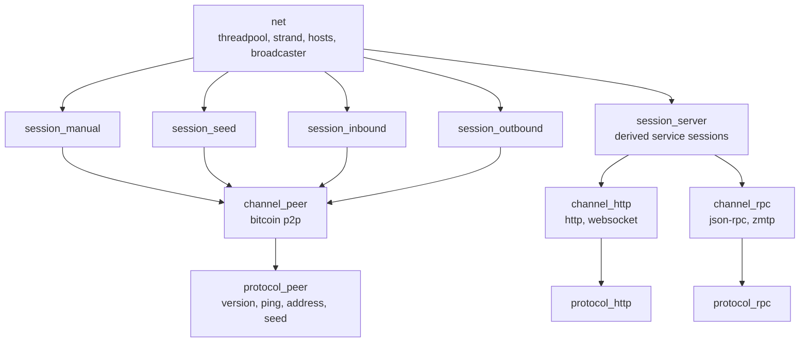
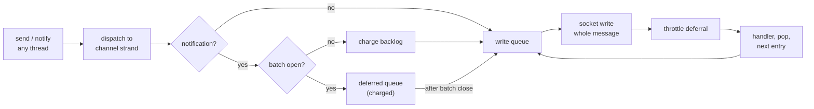
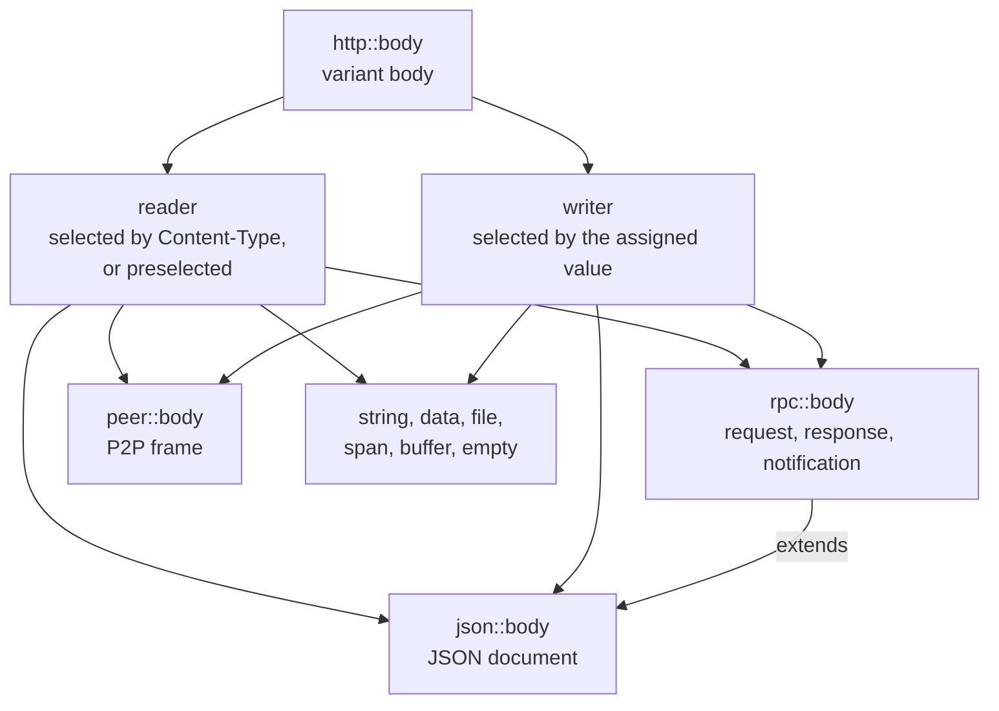

# Network Architecture

The network library (libbitcoin-network) is asio-based networking for the
Bitcoin peer-to-peer protocol and for client-facing services: HTTP,
WebSocket, JSON-RPC, TLS and ZeroMQ (ZMTP). It provides the connection
lifecycle, the wire encodings and the threading model, and leaves the
behavior of a node or server to libraries that derive from its types.

Paths are relative to `include/bitcoin/network/` in
[libbitcoin-network](https://github.com/libbitcoin/libbitcoin-network), at
master `001c1a32` (2026-10-27).

## 1. The object model

### 1.1 Objects

| Object | Type | Role |
| ------ | ---- | ---- |
| Network | `net` (`net.hpp`) | Owns the threadpool, the network strand, the address pool, the broadcaster, and the sessions |
| Session | `session` (`sessions/`) | Creates channels of one kind (accept, connect, seed), starts them and attaches their protocols |
| Channel | `channel` (`channels/`), over `proxy` and `socket` (`net/`) | One connection: reads, writes, timers, stop |
| Protocol | `protocol` (`protocols/`) | One behavior on one channel, such as handshake, ping or address exchange |
| Message | `messages/peer`, `messages/rpc`, `messages/http` | P2P messages, JSON-RPC values, HTTP bodies |

`net` attaches sessions, a session creates channels and attaches protocols
to each, and each protocol holds its channel and its session:



### 1.2 Network

`net` starts in two phases. `start()` attaches the manual session, loads the
hosts file and attaches the seed session. `run()` connects the configured
manual peers, then starts the inbound session and, once that has started,
the outbound session. A derived network attaches its own sessions with
`attach<Session>()`, or with `attach_service<Session>()` for client-facing
services, which `stop_services()` can then stop independently of P2P. Both
subscribe the session's `stop()` to the network's stop subscriber, which
holds the session for its lifetime.

The address pool (`net/hosts.hpp`) is owned by `net` and loaded from and
saved to the file at `settings::path`. Peer sessions take, restore, fetch
and save addresses through the network, on its strand.

### 1.3 Sessions

| Session | Base | Connections |
| ------- | ---- | ----------- |
| `session_manual` | `session_peer` | Connect to configured or requested endpoints, reconnect on stop |
| `session_seed` | `session_peer` | Connect to seed nodes to populate the address pool |
| `session_inbound` | `session_peer` | Accept peer connections on the configured bindings |
| `session_outbound` | `session_peer` | Maintain a target count of peer connections drawn from the address pool |
| `session_server` | `session` | Accept client connections on clear and secure bindings |

`session` declares `create_channel()`, `attach_handshake()` and
`attach_protocols()` as pure virtual. `session_peer` implements them for
`channel_peer`; `session_server` implements only the handshake, so a service
derives from it and supplies its channel type and protocols. Acceptors and
connectors (`net/acceptor.hpp`, `net/connector.hpp`) are created through the
network, with SOCKS5 connection (`net/connector_socks.hpp`) and I2P SAM
acceptance (`net/acceptor_sam.hpp`) as alternatives.

Outbound connections are made in batches of `connect_batch_size`, raced with
`race_quality` so that the first successful connection of a batch wins. The
seed session completes with `race_volume`, once enough addresses have been
received or every seed has finished.

### 1.4 Channels

`proxy` (`net/proxy.hpp`) owns the `socket` and implements reads, a queued
and metered write path, stop, and stop subscription. `channel` adds an
identifier and nonce, inactivity and expiration timers, pause and resume,
and protocol attachment. The derived channels each own a `dispatcher` over
an interface (section 4) and read one message type:

| Channel | Options | Reads | Interface |
| ------- | ------- | ----- | --------- |
| `channel_peer` | `tcp_server` | `messages::peer` frames | `interfaces/peer_dispatch.hpp` |
| `channel_http` | `http_server` | `http::request` | `interfaces/http.hpp` |
| `channel_rpc<Interface>` | `tcp_server` | `rpc::request` | template argument |

A protocol is attached on the channel strand, and its lifetime is held by
the channel's stop subscription (`channels/channel.hpp`, simplified):

```cpp
template <class Protocol, class SessionPtr, typename... Args>
typename Protocol::ptr attach(const SessionPtr& session,
    Args&&... args) NOEXCEPT
{
    auto protocol = std::make_shared<Protocol>(session,
        shared_from_base<channel>(), args...);

    subscribe_stop([=](const code& ec) NOEXCEPT
    {
        protocol->stopping(ec);
    });

    return protocol;
}
```

`socket` (`net/socket.hpp`) holds the transport as a variant of
`asio::socket`, `asio::ssl::socket`, `ws::socket`, `ws::ssl::socket`,
`p2ps::stream` and `zmtp::stream`. The `transport` setting carries the
context that selects the TLS, P2PS or ZMTP upgrade.

### 1.5 Protocols

Peer protocols are named for the protocol version level at which they apply
(`messages/peer/enums/level.hpp`), such as `protocol_ping_106` and
`protocol_ping_60001` (BIP31). `session_peer::attach_handshake()` attaches
the highest configured version protocol, from `protocol_version_106` to
`protocol_version_70016`, and `attach_protocols()` attaches alert, reject,
ping and address protocols according to the levels negotiated in the
handshake. The seed session attaches `protocol_seed_209` or
`protocol_seed_70016` instead, and the inbound session omits inbound address
protocols.

| Protocol | Level | Messages | Role |
| -------- | ----- | -------- | ---- |
| `protocol_version_106` | 106 | `version`, `verack` | The version handshake |
| `protocol_version_70001` | 70001 (BIP37) | `version.relay` | Handshake with transaction relay preference |
| `protocol_version_70002` | 70002 (BIP61) | `reject` | Handshake that rejects an obsolete or duplicate version |
| `protocol_version_70014` | 70014 (BIP152) | `send_compact` | Handshake that signals compact blocks |
| `protocol_version_70016` | 70016 (BIP155, BIP339) | `send_address_v2`, `witness_tx_id_relay` | Handshake that signals address v2 and witness transaction relay |
| `protocol_ping_106` | 106 | `ping` | Keepalive ping on a timer |
| `protocol_ping_60001` | 60001 (BIP31) | `ping`, `pong` | Ping with nonce, answered by pong |
| `protocol_alert_311` | 311 | `alert` | Logs received alerts |
| `protocol_reject_70002` | 70002 (BIP61) | `reject` | Logs received rejects |
| `protocol_address_in_209` | 209 | `address` | Stores received addresses |
| `protocol_address_in_70016` | 70016 (BIP155) | `address`, `address_v2` | Stores received addresses, including v2 |
| `protocol_address_out_209` | 209 | `get_address`, `address` | Answers address requests (IPv4 and IPv6) |
| `protocol_address_out_70016` | 70016 (BIP155) | `get_address`, `address_v2` | Answers address requests with v2 addresses |
| `protocol_seed_209` | 209 | `get_address`, `address` | Seeding: requests addresses, then stops |
| `protocol_seed_70016` | 70016 (BIP155) | `get_address`, `address_v2` | Seeding with v2 addresses |
| `protocol_http` | | HTTP methods | Base of HTTP service protocols |
| `protocol_rpc<Channel>` | | JSON-RPC | Base of JSON-RPC service protocols |

A protocol subscribes to channel messages with `SUBSCRIBE_CHANNEL`, sends
with `SEND`, and binds its handlers to its shared pointer. A handler returns
true to remain subscribed. For example, the BIP31 pong handler
(`protocols/protocol_ping_60001.hpp`):

```cpp
bool protocol_ping_60001::handle_receive_pong(const code& ec,
    const pong::cptr& message) NOEXCEPT
{
    if (stopped(ec))
        return false;

    if (message->nonce != nonce_)
    {
        stop(error::protocol_violation);
        return false;
    }

    nonce_ = acknowledged;
    set_pong();
    return true;
}
```

`protocol_http` provides one handler per HTTP method and the standard
responses, and `protocol_rpc<Channel>` provides result, error and
notification sends. Both are bases for service protocols.

## 2. Threading and concurrency

### 2.1 Threadpool and strands

`net` constructs one `threadpool` (`async/threadpool.hpp`) of
`settings::threads_()` threads sharing one asio context. Objects that share
state are confined to a strand of that context:

| Strand | Objects |
| ------ | ------- |
| Network strand (`net::strand()`) | `net`, all sessions, `hosts`, the broadcaster |
| Socket strand (`socket::strand()`) | the socket, its channel, and the channel's protocols |

`session::strand()` returns the network strand, so all sessions are
serialized with the network. Each socket constructs its own strand on the
network's context, and `proxy::strand()` returns it. Members are documented
as thread safe (const or atomic) or as protected by strand, and methods
assert `stranded()`. Work that must not hold a channel strand is posted to
the context with `protocol::parallel()`.

Channel start crosses strands. The session pends the channel on the network
strand, attaches the handshake on the channel strand, returns to the network
strand when the handshake completes, attaches protocols on the channel
strand, and completes on the network strand (`session::start_channel()` and
its handlers in `sessions/session.hpp`).

### 2.2 Read flow control

A channel reads one message at a time. Each derived channel's `receive()`
issues a read only if the channel is not stopped and no read is
outstanding. On completion the channel opens a gate, notifies its
dispatcher, and closes the gate (`channel_peer::handle_receive()`,
`channel_http::dispatch()`, `channel_rpc::dispatch()`). The gate is a
`race_all` whose completion handler posts `receive()` to the channel strand
when the last reference is released, so the next read is armed only after
every subscriber has released it (`src/channels/channel.cpp`, simplified):

```cpp
open_gate();
const auto code = dispatcher_.notify(request);
close_gate();

if (code)
    stop(code);
```

A protocol that retains `gate()` defers the next read until it releases the
pointer. While a protocol holds the gate the channel is not reading, so
`gate()` also starts a monitor that polls the socket for a half-closed
connection every 10 milliseconds and stops the channel with
`peer_disconnect` if the peer has gone (`channel::monitor()`,
`socket::poll()`). The monitor ends when the read is re-armed.

`pause()` holds the gate, or a gate of its own outside of a dispatch, and
stops the channel timers. `resume()` restarts the timers and releases the
held gate, or arms the read if none is held. A channel is created paused.
The session resumes it after attaching the handshake, the version protocol
pauses it on completing the handshake, and the session resumes it again
after attaching protocols (`sessions/session.hpp`,
`protocols/protocol_version_106.hpp`).

Reads are not rate metered, as they are bounded by protocol correctness.
They are bounded instead as follows:

| Bound | Mechanism | Setting |
| ----- | --------- | ------- |
| Message size | Parser and frame limits | `tcp_server::maximum_request` |
| Concurrency | One read per channel, deferred by the gate | |
| Idle peer | Inactivity timer, stops with `channel_inactive` | `tcp_server::inactivity_minutes` (10) |
| Channel lifetime | Expiration timer, stops with `channel_expired` | `tcp_server::expiration_minutes` (60) |

The inactivity timer arms once per window. Each read records its time
(`channel::reading()`), and on expiration the timer rearms for the
remainder of the window if a read occurred since it was armed, so activity
costs a time stamp and not a timer reset. A zero setting disables the
corresponding timer.

Sends are throttled by rate. The proxy allocates each send
`bytes / rate_limit` seconds, measured from the moment the write is issued
to the socket, and defers the send's completion handler by whatever portion
of that allocation the write did not consume (`proxy::metered()`,
`proxy::unconsumed()`). The deferral is a `deadline` on the channel strand
(`throttle_`). Since the write queue does not start the next send until the
completion handler of the current one runs, the deferral throttles the
channel without a queue of its own, and time spent idle between sends earns
no credit. A channel is never stopped for exceeding the rate, it is only
slowed.

| Setting | Scope |
| ------- | ----- |
| `settings::rate_limit` | Bytes per second per channel, all sessions |
| `tcp_server::rate_limit` | Bytes per second per channel of the service |

`settings::rate_limited(options)` applies the more restrictive of the two,
where zero is unlimited, so the limit is zero only if both are zero. A zero
limit constructs no throttle. Stop is never deferred: `unconsumed()` is zero
for a stopped channel, and stopping the throttle fires a pending deferral,
whose handler reports the send's own result.

### 2.3 Write flow control

Every send of a channel passes through one write queue on the channel
strand (`src/net/proxy_queue.cpp`). A send from any thread is dispatched to
the strand as a `pending` entry holding a writer closure, its completion
handler, and a cost. The first entry starts the write loop, and each
completion invokes the entry's handler, pops it, and starts the next:

```cpp
void proxy::handle_write(const code& ec, size_t bytes) NOEXCEPT
{
    const auto handler = std::move(queue_.front().handler);
    handler(ec, bytes);
    backlog_ = floored_subtract(backlog_, queue_.front().cost);
    queue_.pop_front();

    if (!stopped())
        write();
}
```

The handler runs before the pop, so a send issued from the handler is
queued behind the entry and does not start a second loop. One entry is one
whole message, and its completion fires only when the message is fully
written. A body that spans several writer buffers is written in a loop
within the socket (`socket::body_write()`), and a chunked batch part writes
its HTTP header and first chunk within one entry
(`proxy::handle_http_header_write()`). No other write can start between
the parts of a message, which is what prevents interleaving.



Sends are of two kinds. A response (`proxy::write()`, reaching the socket as
`rpc_write`, `http_write` or `body_write`) is solicited, paced by the
request that provoked it, and is queued at zero cost. A notification
(`proxy::notify()`, reaching the socket as `rpc_notify` or `body_notify`)
is unsolicited, so the recipient can force it to accumulate, and it is
charged against the channel backlog. Peer channels expose the same split as
`channel_peer::send()` and `channel_peer::notify()`, and `channel_rpc`
selects by type: a request model is a notification, a response model is a
response. HTTP has no notifications, since it is half duplex;
`channel_http::notify()` requires a WebSocket or a downgraded channel.

| | Response | Notification |
| - | -------- | ------------ |
| Proxy call | `write()` | `notify()` |
| Reads | Completes the request under its read gate, so the channel reads its next request only after the response is queued | Independent of reads, so it may be sent while a request is in progress |
| Cost | Zero | Estimated message size plus 256 bytes per entry |
| During an open batch | Stamped as a batch part and queued | Deferred until the batch closes |
| Over `maximum_backlog` | Not applicable | Channel stops with `channel_backlog` (ZMTP: dropped with `message_dropped`) |

The cost estimates the memory an entry pins, so a flood of small messages
is charged more than its wire size. A charge is refused only when the queue
is not idle and the backlog would exceed `tcp_server::maximum_backlog`
(1 MiB by default), so one message is always accepted. The backlog is
reduced as each entry is popped.

A JSON-RPC batch is answered as one stream of parts. While a batch is open
the proxy stamps each response as a batch part (the first carries the
open), defers notifications to a separate `deferred_` queue, and on reading
the batch close queues the close part. When the close part is written the
deferred notifications are moved to the write queue and the read is
re-armed (`proxy::handle_close_write()`). A notification is therefore
written only between whole responses or whole batches, and within each kind
writes are in the order issued on the strand. WebSocket channels reject
batches, as pipelined requests obtain the same result.

### 2.4 Long-running requests

A request whose work is long, such as a store query, must not run on the
channel strand, which would block every other operation of the channel,
including its stop. The handler instead posts the work to the threadpool
with `PARALLEL` (`protocol::parallel()`), passing the retained gate. The
work runs off the strand and posts its result back to the strand with
`POST` (`protocol::post()`), still carrying the gate, where the handler
writes the response. For example, the Electrum balance query in
libbitcoin-server (`src/protocols/electrum/protocol_electrum_scripthash.cpp`,
simplified):

```cpp
void protocol_electrum::get_balance(const hash_digest& hash) NOEXCEPT
{
    PARALLEL(do_get_balance, hash, gate());
}

void protocol_electrum::do_get_balance(const hash_digest& hash,
    const gate_t::ptr& gate) NOEXCEPT
{
    uint64_t confirmed{}, unconfirmed{};
    auto ec = archive().get_balance(stopping_, confirmed, unconfirmed, hash);
    POST(complete_get_balance, ec, confirmed, unconfirmed, gate);
}

void protocol_electrum::complete_get_balance(const code& ec,
    uint64_t confirmed, int64_t unconfirmed, const gate_t::ptr&) NOEXCEPT
{
    if (stopped())
        return;

    send_result(...);
}
```

While the gate is retained the channel does not read the next request, so
requests on one channel are answered in order and at most one is in
flight. The gate is released when the completion handler returns, after
the response is queued, and the read is then re-armed. The channel strand
is free throughout the work, so the channel's timers, notifications, and
stop proceed.

Both bound methods hold the protocol's shared pointer, so the protocol
outlives the work, but nothing waits on it. Stop stays fast in three ways:

| Mechanism | Effect |
| --------- | ------ |
| Socket stop flag | `stopped()` is atomic and set before anything is posted, so it is visible off the strand |
| Cancellation flag | The protocol's `stopping(ec)` sets an atomic flag that the query polls, so the query returns early |
| Stopped check | The completion handler tests `stopped()` on the strand and abandons the result |

A response issued after stop is not queued (`proxy::do_write()`), and its
handler is not invoked. A peer that disconnects while the work is in flight
is detected by the gate monitor of section 2.2, which stops the channel and
so cancels the query. The cancellation flag is a protocol member in
libbitcoin-server (`stopping_`), not a network mechanism; the network
provides the stopped state, the stop notification on the strand, and the
gate.

### 2.5 Stop

`protocol::stop(ec)` stops the channel. `proxy::stop()` stops the socket,
which sets the atomic stopped flag and cancels pending work, and then posts
`stopping(ec)` to the channel strand. `stopping(ec)` stops the channel
timers, releases a held gate, fires any throttle deferral, releases an HTTP
parse in progress, clears the write and deferred queues without invoking
their handlers, and notifies the stop subscribers, each protocol's
`stopping(ec)` among them. Handlers test `stopped(ec)` on entry, which is
true for an error code or a stopped channel.

A stop on the channel strand while a batch response is open first releases
the throttle and writes the batch close part, then stops the socket
(`proxy::do_stop()`), so the client receives a well-formed response. A stop
from off the strand, such as shutdown, is immediate. A WebSocket close or a
channel expiration or inactivity stops the socket lazily, which allows a
graceful WebSocket and TLS close; a subsequent stop terminates it directly.

`net::close()` sets the closed flag and posts `do_close()`, which releases
the sessions, stops the stop, service and connect subscribers and the
broadcaster, and removes the threadpool's keep-alive. `close()` then joins
the threadpool, so it must not be called from a pool thread (it aborts if
the join fails), and then saves the hosts file.

## 3. Asynchronous utilities

`async/` provides the primitives the objects above are built from:

| Type | Behavior |
| ---- | -------- |
| `threadpool` | Threads sharing one asio context, kept alive until `stop()` |
| `subscriber<Args...>` | Handlers returning void; all notified, all dropped on `stop()` |
| `unsubscriber<Args...>` | Handlers returning bool; false desubscribes |
| `desubscriber<Key, Args...>` | Keyed bool handlers, with `notify_one(key)` |
| `race_all` | Completes when the last reference is released |
| `race_any` | Completes with the first `finish()` (thread safe) |
| `race_speed<Size>` | Completes with the first of `Size` finishers, at the last |
| `race_quality` | Completes with the first success, or with the last failure |
| `race_unity` | Completes at the last finisher, with the first failure if any |
| `race_volume` | Completes when a finisher reports a sufficient count |
| `enable_shared_from_base` | `shared_from_this` for derived classes |

The subscribers are not thread safe: every method is called on the owner's
strand and every handler is invoked there. `handlers.hpp` defines the common
handler types `result_handler`, `count_handler` and `notify_handler`.
`net/deadline.hpp` wraps a restartable asio timer, which completes with
success on expiration and with `operation_canceled` on stop.

## 4. Dispatch and broadcast

An interface (`interfaces/`) is a compile-time list of methods, each a name
and its argument types, and the subscriber type for its handlers. The peer
dispatch interface (`interfaces/peer_dispatch.hpp`) lists each P2P message
by its command, such as `method<"pong", messages::peer::pong::cptr>`.
Condensed, with most methods cut:

```cpp
struct peer_dispatch
{
    /// Unsubscriber requires bool handlers, injects `code` parameter.
    template <typename... Args>
    using subscriber = network::unsubscriber<Args...>;

    /// dispatcher.subscribe(std::forward<signature>(handler));
    template <class Message>
    using signature = std::function<bool(const code&,
        const typename Message::cptr&)>;

    /// Messages exchanged after the handshake completes.
    static constexpr std::tuple messages
    {
        method<"addr", messages::peer::address::cptr>{},
        method<"block", messages::peer::block::cptr>{},
        // ...
        method<"ping", messages::peer::ping::cptr>{},
        method<"pong", messages::peer::pong::cptr>{},
        // ...
        method<"tx", messages::peer::transaction::cptr>{}
    };

    /// Handshake methods (exchanged before the handshake completes).
    static constexpr std::tuple handshake
    {
        method<"version", messages::peer::version::cptr>{},
        method<"verack", messages::peer::version_acknowledge::cptr>{},
        // ...
    };
};
```

The HTTP interface (`interfaces/http.hpp`) has the same form, one method per
HTTP verb, with a subscriber of `void` handlers in place of the peer
interface's `bool` (unsubscribing) handlers:

```cpp
struct http_methods
{
    static constexpr std::tuple methods
    {
        method<"get", http::method::get::cptr>{},
        method<"head", http::method::head::cptr>{},
        method<"post", http::method::post::cptr>{},
        // ...
        method<"unknown", http::method::unknown::cptr>{}
    };

    /// Subscriber requires void handlers, injects `code` parameter.
    template <typename... Args>
    using subscriber = network::subscriber<Args...>;

    /// dispatcher.subscribe(std::forward<signature>(handler));
    template <class Request>
    using signature = std::function<void(const code&,
        const typename Request::cptr&)>;
};
```

Since the method list is a type, a dispatcher's subscribers, and the
binding of each handler to its method, are resolved at compile time. The
JSON-RPC interfaces of the server take the same form, with each method's
parameters in place of a message type (see
[Server Architecture](../server/index)).

`rpc::dispatcher<Interface>` (`messages/rpc/dispatcher.hpp`) holds one
subscriber per method and notifies the matching subscriber of a request,
whose method name and parameters are an `rpc::request_t`. A received peer
frame is dispatched as a request whose method is its command and whose
parameter is the deserialized message. The same mechanism dispatches HTTP
requests by method and JSON-RPC requests by name.

`rpc::broadcaster<Interface>` (`messages/rpc/broadcaster.hpp`) is a
dispatcher over keyed subscribers, so a subscription can be removed by
channel identifier. The network owns one over the peer broadcast interface
(`interfaces/peer_broadcast.hpp`): `addr`, `block`, `tx`, and the internal
`diagnostics` and `terminator` messages, which are never serialized. A
protocol broadcasts with `BROADCAST`, which posts the message and its
channel identifier to the network strand, and subscribes with
`SUBSCRIBE_BROADCAST`, whose handler is posted back to the channel strand
(`protocols/protocol.hpp`), or desubscribed once the channel has stopped.

A `terminator` (`broadcast/terminator.hpp`) stops a channel identified by
identifier or address, or the channels of slots at or above a count. A
`diagnostics` broadcast collects one row of state from each targeted
channel, on that channel's strand. `wire_tx` and `wire_block` carry
transaction and block views to service channels, and `net` counts demand
for them (`demand_wire_tx()`, `demand_wire_block()`).

## 5. Messages

### 5.1 Groups

| Group | Path | Contents |
| ----- | ---- | -------- |
| Peer | `messages/peer/` | Each P2P message type with its `command`, `deserialize()` and `serialize()`; `heading`; `registry` |
| RPC | `messages/rpc/` | `value_t`, a JSON-RPC document model extended with fixed-width integers, `any_t` and embedded JSON; request and response types |
| HTTP | `messages/http/`, `http_body.hpp`, `json_body.hpp` | `boost::beast` bodies selected by content type, fields, status and media type enums |

`any_t` holds a type-erased shared pointer, which allows a deserialized
message to pass through the dispatcher as a parameter and be received by
its handler as its own type. The peer message codec (`messages/peer/body.hpp`)
reads v1 frames and v2 packets into the same frame type, and the registry
(`messages/peer/registry.hpp`) indexes the messages for per-message byte
counts.

### 5.2 Bodies

HTTP and WebSocket are implemented with `boost::beast`, the Boost library
for HTTP and WebSocket protocols built on `boost::asio`. Every message is
read and written through a body: a `boost::beast` body type, with
a `reader` that parses incrementally as bytes arrive and a `writer` that
serializes incrementally into buffers. The library defines its own bodies
for JSON, JSON-RPC and P2P messages, and a variant body that holds any of
them. Since a body does not depend on HTTP framing, the same bodies serve
HTTP, WebSocket, raw TCP and ZMTP: the socket's `rpc_*`, `peer_*` and
`body_*` operations drive a body directly, without an HTTP message around
it.



| Body | Path | Value | Purpose |
| ---- | ---- | ----- | ------- |
| `json::body` | `messages/json_body.hpp` | A JSON document, with an estimated size and a serialization buffer owned by the socket | Reader parses and writer serializes JSON, both streamed |
| `rpc::body` | `messages/rpc/body.hpp` | `rpc::request` or `rpc::response`, with batch state | JSON-RPC, extending `json::body` with validation and batch framing; the reader reads requests, the writer writes responses, and the notifier writes notifications (requests) |
| `peer::body` | `messages/peer/body.hpp` | A P2P frame: heading and type-erased message | P2P messages, read from v1 frames or v2 packets, written as serialized v1 frames |
| `http::file_body` | `messages/http/file_body.hpp` | An open file | File responses, with a smaller buffer than `boost::beast`'s |
| `http::body` | `messages/http_body.hpp` | A variant of all of the above and the `boost::beast` string, data, span, buffer and empty bodies | Any message |

The JSON body defines no size, so a response is sent chunked rather than
serialized first to compute a content length: serialization streams
directly to the socket. Its writer's buffer belongs to the socket, which
retains it across messages and can reduce it to the minimum
(`reclaim_buffer`).

The JSON-RPC body adds what JSON-RPC requires of a document: request and
response validation, and the framing of batches, which the reader reports
as it opens and closes and the writer is told by its caller. It tolerates
the observed deviations of clients, such as the single value parameters of
Electrum clients and the version 1 messages that btcd places within a
version 2 batch, and records them for the channel to validate. Message
termination is by transport: newline terminated over TCP, and by the frame
over HTTP and WebSocket.

The P2P body parses a message's heading and payload into a frame that
holds the deserialized message, type-erased, with a parse context stamped
by the channel and any fault detail. For BIP324 the payload of an already
identified message is accepted directly.

The variant body (`http::body`) holds one of the bodies, selected when its
reader or writer is constructed, and passes every call through to it. For a
request, the reader is selected by the `Content-Type` header
(`messages/http_body.hpp`):

| Content type | Body |
| ------------ | ---- |
| `application/json` | `rpc::request`, or a plain `json::body` document where the caller sets plain JSON |
| `text/plain` | String |
| `application/octet-stream` | File for an attachment, otherwise data |
| Otherwise | Empty |

A body may also be preselected before the read, which is how the P2P and
JSON-RPC bodies are used on transports without HTTP headers.

The writer is selected by the value the caller assigns to the message, an
empty body if none:

| Assigned value | Writer |
| -------------- | ------ |
| `rpc::response` | `rpc::writer`, a JSON-RPC response |
| `rpc::request` | `rpc::notifier`, a JSON-RPC notification |
| JSON document | `json::body` writer |
| P2P frame | `peer::body` writer |
| String, data, file, span, buffer | The corresponding `boost::beast` writer |
| None | Empty |

The JSON and JSON-RPC writers hold their serializers, so they are not
movable and are constructed in place within the variant. The writer also
reports whether its output is binary (data, file, span, buffer and P2P) or
text (string, JSON and JSON-RPC), which selects the frame type of a
WebSocket write. Like the JSON body, the variant defines no size, so every
variant message is chunked.

## 6. Transports

### 6.1 Overview

A `socket` (`net/socket.hpp`) carries every transport. Its transport is
selected by a context (`settings::transport`), a variant of none (clear),
an `asio::ssl::context`, a `p2ps::context` or a `zmtp::context`, and
`upgrade()` applies it on accept and on a non-proxied connect. HTTP and
WebSocket are layered over the clear or TLS socket, and `detect()`
distinguishes HTTP from raw TCP on the same port from the first bytes.

| Transport | Over | Implementation | Carries |
| --------- | ---- | -------------- | ------- |
| TCP | | `asio::socket` | Bitcoin P2P (v1), JSON-RPC over TCP (Electrum, Stratum v1) |
| TCP/S | TLS 1.3 | `asio::ssl::socket` over `tls::server` | The same, encrypted |
| HTTP, HTTP/S | TCP, TLS | `boost::beast` HTTP over the socket | REST, JSON-RPC over HTTP |
| WS, WS/S | HTTP upgrade | `ws::socket`, `ws::ssl::socket` | JSON-RPC over WebSocket |
| P2PS | TCP | `p2ps::stream` | Bitcoin P2P, BIP324 (v2) encrypted |
| ZMTP, CurveZMQ (ZMTPS) | TCP | `zmtp::stream`, NULL or CURVE mechanism | ZeroMQ publish, request and pipeline sockets |
| SOCKS5 | TCP | `connector_socks` | Outbound connections through a proxy (such as Tor) |
| I2P SAM | TCP | `acceptor_sam` | Inbound connections forwarded by an I2P SAM bridge |

The socket's operations are grouped by what they read and write: `tcp_*`
fixed buffers, `peer_*` P2P messages, `rpc_*` JSON-RPC requests,
responses and notifications, `http_*` HTTP messages (including progressive
reads for batched JSON-RPC bodies), `ws_*` WebSocket frames, and `body_*`
non-HTTP bodies.

### 6.2 TCP

Every transport begins as an `asio::socket` (`boost::asio::ip::tcp::socket`,
`asio.hpp`), held as the first alternative of the socket's variant
(`socket_t` in `net/socket.hpp`). Upgrades move the TCP socket into a
wrapping stream, and `get_base()` recovers it from any alternative through
`boost::beast::get_lowest_layer`, so shutdown, close and peer liveness
always act on the TCP layer.

Each socket owns a strand of the network context. Every public operation
dispatches its work to that strand, and every completion handler runs on
it, so one socket's asio calls are never concurrent. The exception is
`accept()`, which runs on the acceptor's (network) strand until its handler
is invoked (`src/net/socket_connect.cpp`).

| Step | Implementation |
| ---- | -------------- |
| Accept | `acceptor.async_accept`, then `do_handshake()` unless the acceptor is proxied |
| Connect | `boost::asio::async_connect` over the resolved range, or per endpoint of the bound address family when a binding is configured |
| Handshake | `do_upgrade()` applies the context; inbound sockets are bounded by the connect timeout, which stops the socket on expiry |
| Stop | `shutdown(shutdown_both)` and `close()` on the strand |

The `tcp_*` operations move fixed buffers. `tcp_read` completes only when
the buffer is filled (`boost::asio::async_read`), and `tcp_write` writes the
whole buffer (`boost::asio::async_write`) (`src/net/socket_tcp.cpp`). The
SOCKS5 and SAM negotiations are written entirely with these operations.

Body reads over TCP (`body_*`, `rpc_*`) use `async_read_some` into a
`http::flat_buffer`, preparing whatever capacity remains below the buffer's
`max_size()` (`buffer_overflow` if none). The body reader consumes what it
parses and the residue stays in the buffer for the next read. A read whose
total exceeds `maximum_request` fails with `message_overflow`
(`src/net/socket_body.cpp`). JSON-RPC over TCP (Electrum, Stratum v1) is
newline terminated: `rpc_write` and `rpc_notify` set `terminate` on the
message before writing it (`src/net/socket_rpc.cpp`).

`watch()` and `poll()` share a 10 ms timer that checks the TCP layer for a
received FIN (`asio::half_closed`), reporting `peer_disconnect`. Asio
cancellation is reported to the caller as `channel_stopped`.

| Setting (`settings::tcp_server`) | Default | Use |
| -------------------------------- | ------- | --- |
| `maximum_request` | `max_payload` | Bound on one read (body, HTTP body, WebSocket message, P2P payload, ZMTP frame) |
| `minimum_buffer` | 4 KiB | Size retained buffers are reduced to when idle |
| `maximum_buffer` | 64 KiB | Bound of the retained JSON serialization buffer |
| `connect_timeout_seconds` | 0 (network default) | Inbound handshake bound, outbound connect bound |

### 6.3 TLS (TCP/S)

`tls/` implements the server side of TLS 1.3 (RFC 8446). `tls::server` is a
state machine that consumes transport bytes with `receive()` and produces
them into `output()`, with x25519, P-256 or P-384 key exchange, ECDSA P-256
or P-384 server authentication, optional client authentication, and
AES-128-GCM, AES-256-GCM or ChaCha20-Poly1305. It has no pre-shared keys or
early data. `tls::context` holds the certificate chain, private key and
verification policy shared by a server's connections, `tls::schedule` and
`tls::transcript` the key schedule and handshake hash, `tls::record` the
protection of one direction, and `tls/codec.hpp` the presentation language
reader and writer.

`ssl/openssl/` provides the `<openssl/*.h>` headers that `boost::asio::ssl`
includes, implemented over `tls::server` (`ssl/openssl/openssl.h`), so
`asio::ssl::socket` (`boost::asio::ssl::stream<asio::socket>`) runs on this
implementation. `SSL_accept` creates one `tls::server` per connection from
the context. Asio's stream engine moves socket bytes through a memory BIO
pair (17 KiB per direction by default), and each call pumps the pair: queued
input is passed to `receive()`, and as much of `output()` as the BIO holds
is queued for sending, the remainder reported as `SSL_ERROR_WANT_WRITE`
(`src/ssl/openssl.cpp`). `SSL_connect` fails with a `handshake_failure`
alert, so TLS is a server transport only.

`settings::tls_server::initialize_context()` creates the
`asio::ssl::context` as `tlsv13_server` with SSLv2, SSLv3, TLS 1.0 and TLS
1.1 disabled, loads the certificate chain (`cert_path`) and PEM private key
(`key_path`, with `key_pass` if set), and, when `cert_auth` is set, requires
a verified client certificate from that directory (`verify_peer` and
`verify_fail_if_no_peer_cert`). The context is applied to the secured
bindings (`safes`, `safe_port`). On accept, `do_upgrade()` moves the TCP
socket into an `asio::ssl::socket` and runs `async_handshake` as server.

Since `get_tcp()` returns either the clear or the TLS socket, the `tcp_*`,
`body_*`, `rpc_*` and `http_*` operations run unchanged over TLS. A lazy
stop sends `close_notify` (`async_shutdown`) before closing the TCP layer
(`src/net/socket_stop.cpp`).

### 6.4 HTTP

HTTP is the `boost::beast` HTTP/1.1 implementation over the clear or TLS socket. A
request is read with a `boost::beast::http::request_parser<http::body>`, so
the variant body of section 5.2 selects its reader from the
`Content-Type` header, and a response is written with
`boost::beast::http::async_write` or a `response_serializer<http::body>`.
Reads use a caller-owned `http::flat_buffer`
(`boost::beast::flat_buffer`) whose residue carries pipelined bytes to the
next read (`src/net/socket_http.cpp`).

| Limit | Value |
| ----- | ----- |
| Body | `maximum_request` (`parser.body_limit`) |
| Header | The lesser of `maximum_request` and `maximum_http_header` (16 KiB) (`parser.header_limit`) |

A request with an unknown method fails with `bad_method`, since dispatch of
`verb::unknown` is reserved for WebSocket. A WebSocket upgrade request is
returned to the channel with `error::upgrade` rather than dispatched
(section 6.5).

On a JSON-RPC port, `detect()` decides between HTTP and raw TCP from the
first bytes without consuming them. Empty lines preceding a request line
are skipped, and a first byte of `{` or `[` (neither a valid method token
character) latches the socket as `downgraded()`, after which it reads and
writes newline terminated JSON-RPC as in section 6.2. Detection reads only
when the buffer holds nothing but line breaks.

The `http_*` operations read and write whole messages: `http_read` parses
the header and body, and `http_write` serializes the response, its JSON body
through the socket's retained buffer, which is reduced to `minimum_buffer`
when the write completes. Batched JSON-RPC is read and written
progressively instead, without materializing the batch:

| Operation | Implementation |
| --------- | -------------- |
| `http_read_header` | `beast::http::async_read_header` into a caller-owned parser |
| `http_read_body` | `beast::http::async_read`, completing when the body is done or the parse pauses |
| `http_read_some` | `beast::http::async_read_some`, continuing a paused parse |
| `http_write_header` | `beast::http::async_write_header`, once per message (chunked, no content length) |
| `rpc_write_chunk` | Each response part as `make_chunk` data, followed by `0\r\n\r\n` after the part that closes the batch |

The JSON-RPC body reader pauses the parse at each element of a batch, which
the socket reports as `need_buffer`. `proxy` (`net/proxy.hpp`) owns the
parser across the message, delivers each element as a request carrying the
message headers, absorbs the batch close, and stamps response parts with the
batch state (`src/net/proxy_actions.cpp`). HTTP settings
(`settings::http_server`) add the server name, permitted hosts and origins,
and basic authorization credentials.

### 6.5 WebSocket

`ws::socket` and `ws::ssl::socket` (`beast.hpp`) are
`boost::beast::websocket::stream` over `asio::socket` and over
`asio::ssl::socket`. A socket becomes a WebSocket only by upgrade: `http_read`
returns `error::upgrade` with the request, and the channel accepts it with
`accept_websocket(request)` on the strand (`src/net/socket_ws.cpp`).

```cpp
auto tcp = std::move(get_base());
socket_.emplace<ws::socket>(std::move(tcp));

auto& sock = std::get<ws::socket>(socket_);
sock.read_message_max(maximum_);
sock.auto_fragment(false);
sock.control_callback(...);
sock.text(true);
sock.accept(request);
```

The TLS case moves the `asio::ssl::socket` into a `ws::ssl::socket` the same
way. The handshake response carries a `Server` header of
`BC_HTTP_SERVER_NAME`. If the accept throws, the stream is moved back to its
prior alternative and the refusal is an HTTP response. Ping, pong and close
control frames are answered by `boost::beast` during reads and reported to the
control callback, which logs them.

| Operation | WebSocket behavior |
| --------- | ------------------ |
| `ws_read` | `async_read` of one whole message into the flat buffer, in any number of frames, up to `maximum_request` |
| `ws_write` | One whole buffer as one message (`async_write_some` with finish set), text or binary |
| `http_read`, `rpc_read`, `body_read` | `body_read` of one whole message into the preselected body, with no HTTP header |
| `http_write`, `rpc_write`, `body_write` | `body_write`, each writer buffer one frame, the last finishing the message |
| `tcp_read` | Fails, since WebSocket reads frame messages, not sizes |
| `http_read_header`, `http_read_*`, `rpc_write_chunk` | Fail, since messages have no HTTP framing |

A body that spans several writer buffers is therefore delivered as one
multi-frame message. Text is the default, and `body_write` takes the
binary setting from the body's writer. JSON-RPC over WebSocket (btcd) is
framed by the message and not newline terminated. A lazy stop sends a
normal close frame (`async_close`), then closes TLS if present, then the
TCP layer.

### 6.6 P2P (v1)

The v1 peer transport is the clear `asio::socket`, read and written with the
`peer_*` operations (`src/net/socket_peer.cpp`). Each message is a 24 byte
heading (`messages/peer/heading.hpp`) followed by its payload:

| Field | Size |
| ----- | ---- |
| `magic` | 4 |
| `command` | 12, null padded |
| `payload_size` | 4 |
| `checksum` | 4 |

`peer_read` makes exact reads into caller memory: first `heading::size()`
bytes into a fixed array, then `payload_size` bytes into the channel's
payload buffer, each with `boost::asio::async_read`. Between the two, the
`peer::body` reader (`src/messages/peer/body.cpp`) parses the heading and
rejects it with `invalid_magic` if the magic is not the network identifier,
and with `oversized_payload` if the size exceeds the frame's maximum. Once
the payload is read, the checksum is verified only if `validate_checksum`
is set (default false), and the payload is deserialized by its registered
command (`registry::to_any`). The channel stamps each read frame with these
parameters (`channel_peer::create_frame()`):

| Frame field | Source |
| ----------- | ------ |
| `magic` | `settings::identifier` |
| `version` | The negotiated protocol version |
| `checksum` | `settings::validate_checksum` |
| `maximum` | `maximum_request` of the session's `tcp_server` settings |

The channel reduces its payload buffer to `minimum_buffer` after a read
once the node is current. `peer_write` passes the frame to `body_write`, and
the body writer serializes the whole v1 frame (`registry::to_frame`) into
one buffer.

On an inbound socket with a P2PS context, the first bytes have already been
read to detect the peer's transport (section 6.7). For a v1 peer they are
retained in the socket's detection buffer and drained into the first
heading read.

### 6.7 P2PS (BIP324)

`p2ps::stream` implements the BIP324 (v2) encrypted peer transport, with
`p2ps::cipher` holding the ephemeral ElligatorSwift keypair, the directional
ciphers and the session identifier. An inbound socket detects a v1 peer
from the magic and command prefix (`detected_v1()`), and otherwise upgrades
to the stream.

The context (`p2ps::context`) holds only the network magic, which keys the
v2 key derivation salt and the v1 detection prefix. It is applied to peer
sockets when the node provides the encryption service (`net::privacy_`), to
inbound, SAM and outbound sockets alike (`src/net.cpp`).

| Side | Handshake (`src/p2ps/stream.cpp`) |
| ---- | --------------------------------- |
| Detection (inbound) | Read 16 bytes (`detection_size`, magic and command); a v1 peer matches the magic, `version` and five null bytes |
| Responder | The 16 bytes begin the peer's key, the balance is read, then the own key is sent ahead of the terminator |
| Initiator | Send the own key, read the peer's |
| Both | Derive the ciphers, send the garbage terminator and a version packet, scan for the peer's terminator within the garbage allowance, read version packets, skipping decoys |

The first packet received authenticates the peer's garbage as associated
data, and bytes read past the terminator are replayed into the packet
reads. After the handshake the stream is message oriented:

- `async_read_message` reads the 3 byte encrypted length, rejects a length
  above the lesser of the cipher's content maximum and `maximum_request`
  plus the 13 byte message type, reads the packet into the caller's buffer,
  decrypts it in place, and skips decoy packets.
- The message type is one byte: a nonzero short identifier, or zero
  followed by a 12 byte null padded command.
- `async_write_message` writes one message as one encrypted packet, using
  the registry's short identifier or its command.

`peer_read` and `peer_write` select the stream when `encrypted()`. The
payload span from the stream is passed directly to the `peer::body`
reader's identified overload, which synthesizes the v1 heading for the
channel (section 5.2).

### 6.8 ZMTP and CurveZMQ (ZMTPS)

`zmtp::stream` implements ZMTP 3.1 framing over a TCP socket: the greeting,
the NULL or CURVE mechanism handshake, and one frame per read. Under
CurveZMQ (ZMTPS) (`zmtp::cipher`), each frame is boxed into a MESSAGE
command, so the layers above see the same frames. CurveZMQ (ZMTPS) is
implemented for the server role only. `zmtp::context` holds the server
keypair and the authorized client keys (any client if none). `zmtp::role`
(`zmtp/role.hpp`) is the socket type a server channel advertises, which
fixes the admitted peer types and the grammar of reads and writes:

| Role | Socket type | Admits |
| ---- | ----------- | ------ |
| `publisher` | PUB | SUB, XSUB |
| `puller` | PULL | PUSH |
| `replier` | REP | REQ, DEALER |
| `router` | ROUTER | REQ, DEALER, ROUTER |

The handshake (`src/zmtp/stream.cpp`) sends the 64 byte greeting at once,
then reads the peer's in two stages: the signature and major version (11
bytes), which must be `0xff`, a tenth byte with its low bit set, and major
version 3 or above, then the balance. The peer's mechanism must match the
context's, and under CurveZMQ (ZMTPS) the peer must be the client.

| Mechanism | Commands after the greeting |
| --------- | --------------------------- |
| NULL | Send READY with `Socket-Type`, read the peer's READY |
| CurveZMQ (ZMTPS) | Read HELLO, send WELCOME, read INITIATE, authorize the client key, send READY |

The peer's `Socket-Type` must be admitted by the role, and its `Identity`
property, if any, is retained. A refusal sends a best-effort ERROR command
(`400` for an unauthorized client). Handshake frames are limited to 8 KiB.

A frame is a flags byte (MORE, LONG, COMMAND), a one byte length or, with
LONG, an eight byte big-endian length, and the body. `async_read_frame`
reads these with three exact reads into a caller-owned frame, failing a
body above the caller's maximum (`maximum_request`) before reading it.
`async_write` writes a caller-framed buffer.

There are no public `zmtp_*` operations: `rpc_read`, `rpc_write` and
`rpc_notify` select ZMTP when `zeromq()` (`src/net/socket_rpc.cpp`), and
translate frames to and from JSON-RPC messages by role
(`src/net/socket_zmtp.cpp`):

- A read collects parts until one without MORE, up to 32 parts. A command
  frame must be a whole message: PING and PONG become `ping` and `pong`,
  and for a publisher SUBSCRIBE and CANCEL become `subscribe`.
- A publisher also accepts a single part subscription prefixed `0x01` or
  `0x00`. A puller reads a method part and one part per positional
  parameter. A replier requires the empty delimiter part and sets a null
  id. A router accepts an optional delimiter and sets the id to the peer's
  `Identity`.
- A response (replier, router) is the delimiter, then the result part or
  the error code and message parts. A notification is written by a
  publisher, or by a router behind an empty delimiter; PING and PONG are
  written in every role.
- Parameters are positional, one part each: integers little-endian,
  booleans one byte, strings as bytes, and shared chunks and streamable
  values written in place. Named parameters are not serializable.

The parts of a message are framed into one allocation and written with
one `async_write`. `settings::zmtp_server` applies the NULL context to the
clear bindings and the CurveZMQ (ZMTPS) context, from the Z85 server secret
`key` and the authorized client `certs`, to the secured bindings.

### 6.9 SOCKS5

`connector_socks` (`net/connector_socks.hpp`) creates outbound connections
through a SOCKS5 proxy (RFC 1928), with optional username and password
authentication (RFC 1929). When `settings::socks5::proxied()`, the TCP
connection is made to the proxy endpoint, and the socket is constructed as
proxied, so its transport handshake is deferred until the proxy has
connected the peer (`src/net/connector_socks.cpp`).

The negotiation is a sequence of `tcp_write` and `tcp_read` calls on the
socket's strand:

| Step | Write | Read |
| ---- | ----- | ---- |
| Method | Version 5, one method: none (`0x00`), or username/password (`0x02`) if credentials are set | Version and the same method, else `socks_method` |
| Authentication | Version 1, username and password, each length prefixed and at most 255 bytes | Version 1 and success, else `socks_authentication` |
| Connect | Version 5, CONNECT, reserved, then the target address and big-endian port | Version, reply code, reserved, address type |
| Bound address | | IPv4, IPv6 or length prefixed name, and port (discarded) |

The target is sent as an IPv4 or IPv6 address when the peer address is one,
and otherwise by name (from the address or the endpoint host) for
resolution at the proxy. Each nonzero reply code maps to its own error
(`socks_failure` through `socks_unsupported_address`). On success the
connector calls `socket::handshake()`, which applies the socket's context
to the peer connection (for example P2PS), and the result is posted back
to the connector's strand. `settings::socks5` (`username`, `password`,
`socks`) is part of the outbound and manual peer settings.

### 6.10 I2P SAM

`acceptor_sam` (`net/acceptor_sam.hpp`) accepts inbound peers forwarded by
an I2P SAM bridge (SAM v3). It listens on an ephemeral loopback port, and
on accept, if no forwarding is established, establishes it over two
control connections to the bridge (`src/net/acceptor_sam.cpp`):

| Connection | Requests |
| ---------- | -------- |
| Session | `HELLO VERSION` (3.1, or 3.2 with `USER` and `PASSWORD` when credentials are set), then `SESSION CREATE STYLE=STREAM` with a random session id and the stored destination key, or a transient ed25519 destination |
| Forward | `HELLO VERSION`, then `STREAM FORWARD` of the session to the loopback listener's port |

Requests are written with `tcp_write`. Replies are newline terminated
lines, read one byte at a time with `tcp_read` (bytes after a line belong
to the peer), bounded at 64 KiB, tokenized with quoted values, and mapped
from `RESULT` to `sam_*` errors. A transient destination returned by the
bridge is saved to `key_path`, so the address is retained across sessions.
Both control sockets are watched, and if the bridge closes either, the
session is torn down and recreated on the next accept.

Each forwarded stream arrives on the loopback listener, prefixed by the
peer's destination line. The acceptor is proxied, so the socket's
handshake waits until the acceptor has read that line, decoded the
destination (I2P base64 alphabet), and set the socket address to the
SHA256 of the destination with port zero (`set_address`). It then calls
`socket::handshake()`, which applies the P2PS context when configured,
including v1 detection. `settings::sam` (`username`, `password`, `bridge`,
`key_path`) is part of the inbound peer settings.

## 7. Connections

### 7.1 Acceptor

An `acceptor` (`net/acceptor.hpp`) creates inbound sockets. `start()` opens,
binds and listens on a local endpoint, with address reuse, and an IPv6
listener is IPv6 only. `accept()` accepts the next connection and hands its
socket to the session, which must call `accept()` again for the next one.
Accepts are serialized on the acceptor's strand, and `stop()` cancels a
pending accept. A TLS, P2PS or ZMTP acceptor creates its sockets with the
transport context of its binding, and the socket upgrades on accept. The
SAM acceptor (`net/acceptor_sam.hpp`) instead accepts the streams that an
I2P bridge forwards to a loopback listener, reading the peer's destination
from the line that prefixes each stream (see [I2P SAM](#610-i2p-sam)).

### 7.2 Connector

A `connector` (`net/connector.hpp`) creates outbound sockets. `connect()`
takes an address from the pool (outbound session) or an endpoint from the
configuration (seed and manual sessions), resolves a host name, and connects
the socket. The connection races a deadline (`race_speed` of two): the
first of the connect and the `connect_timeout` timer to complete wins, and
the loser is cancelled, so a connect attempt cannot outlive its timeout.
The SOCKS5 connector (`net/connector_socks.hpp`) derives from it,
connecting to the proxy and negotiating the connection to the target
before the socket upgrades (see [SOCKS5](#69-socks5)).

Sessions create their acceptors and connectors through the network
(`net::create_acceptor()`, `create_acceptor_sam()`, `create_connector()`,
`create_connectors()`), so a derived network can substitute its own. The
outbound session creates a batch of connectors per attempt and races them,
keeping the first successful connection.

## 8. Cross-cutting concerns

### 8.1 Configuration

`settings` (`settings.hpp`) holds the transport and peer settings common to
all sessions (threads, timeouts, rate limit, black and white lists, protocol
levels and feature flags, user agent, hosts file path) and one options
struct per peer session. The option structs form a hierarchy:

| Struct | Adds |
| ------ | ---- |
| `tcp_server` | Bindings, connection limit, inactivity and expiration, buffer and request sizes, backlog, rate limit |
| `secure_server` | Secure bindings (`safes`), clear and secure transport contexts |
| `tls_server` | Key and certificate paths, and the `asio::ssl::context` |
| `zmtp_server` | CURVE key and authorized client keys |
| `http_server` | Server name, allowed hosts and origins, credentials |
| `websocket_server` | As `http_server` |
| `peer_manual`, `peer_outbound`, `peer_inbound` | Manual peers, seeds and batch size, loopback and self addresses; SOCKS5 or SAM |

The config types (`config/`) parse and print settings values:

| Type | Value |
| ---- | ----- |
| `authority` | IP address and port, with CIDR subnet; a zero port matches any port |
| `endpoint` | Scheme, host and port, where the host may be a DNS name |
| `address` | An address item with timestamp and services, the hosts file line format |
| `credential` | `username:password[:method[,method]...]` for HTTP basic authorization |

### 8.2 Logging

`logger` (`log/logger.hpp`) is thread safe. `write(level)` returns a
streaming writer that commits its message when destroyed, and `fire(event)`
records an event and value. Messages and events are delivered to
subscribers on the logger's own single-thread, low-priority threadpool.
Objects derive from `reporter`, which holds the logger. Levels
(`log/levels.hpp`) are news, session, protocol, proxy, remote, fault,
quitting, objects and verbose, each with a macro (`LOGN`, `LOGS`, `LOGP`,
`LOGX`, `LOGR`, `LOGF`, `LOGQ`, `LOGO`, `LOGV`) that compiles away unless
its level is enabled at build time. `tracker<Class>` counts live instances
at the objects level, and `capture` reads console input lines for
subscribers.
