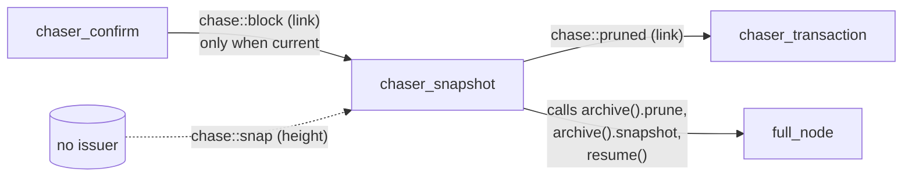
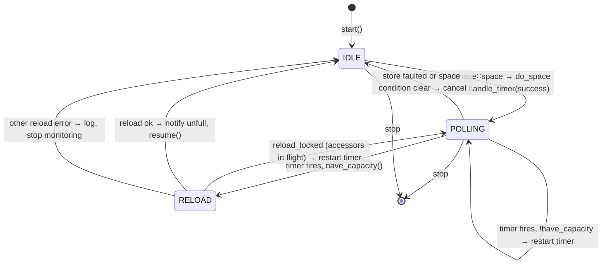
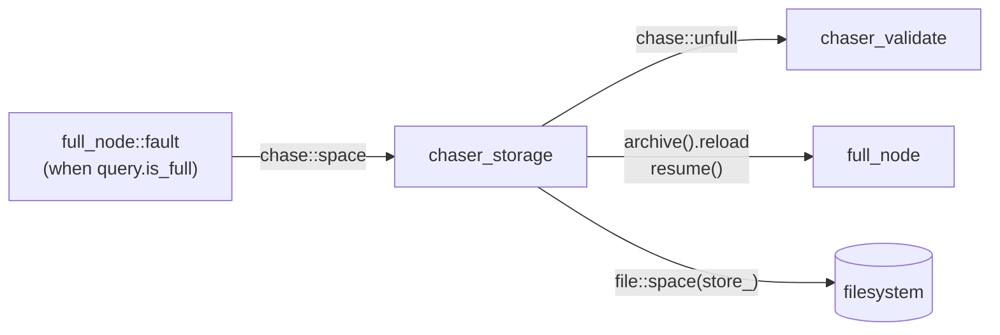
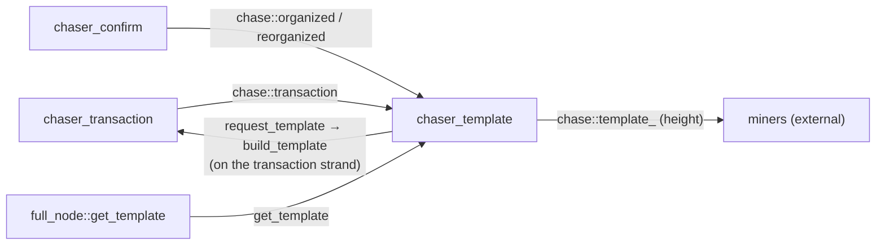

# 12 — Periphery Chasers

> Companion to the core-pipeline chaser docs
> [`02`](header-chaser)–[`05`](confirmation-chaser) and
> [`11`](transaction-chaser).
>
> The three chasers covered here are operationally peripheral to consensus.
>
> | Chaser              | Role                                        | Current state                     | Bus events                                                |
> | ------------------- | ------------------------------------------- | --------------------------------- | --------------------------------------------------------- |
> | `chaser_snapshot`   | One-shot prune on first current block, explicit snapshot | Live (snapshot trigger dormant) | Consumes `block`, `snap`; emits `pruned`   |
> | `chaser_storage`    | Disk-space recovery + reload after full      | Fully live                         | Consumes `space`; emits `unfull`                           |
> | `chaser_template`   | Holds the latest mining template, rebuilt on pool and chain change | Live while the pool is open | Consumes `transaction`, `organized`, `reorganized`; emits `template_` |
>
> Fee estimation is a `chaser_transaction` function over the pool
> projection, not a chaser of its own (§4).

| File                                          | Lines |
| --------------------------------------------- | ----- |
| `src/chasers/chaser_snapshot.cpp`             | 289   |
| `src/chasers/chaser_storage.cpp`              | 189   |
| `src/chasers/chaser_template.cpp`             | 164   |
| `include/bitcoin/node/chasers/chaser_template.hpp` |  67   |

All three inherit from the base `chaser`, run on their own strand on the
network pool, and subscribe to the bus in `start()`.

---

## 1. `chaser_snapshot`

### 1.1 Role

Two triggers:

- **One-shot prune on announce**: when the confirmed chain first
  announces a current block (`chase::block`), prune the prevout cache
  once if the store is coalesced and emit `chases::pruned{ link }`;
  latched by `pruned_` (`chaser_snapshot.cpp:115-122`, `:140-176`).
- **Explicit snapshot**: on `chase::snap(height)`, take a full store
  snapshot. *No issuer of `chase::snap` exists in this repo* — dormant
  (doc 01 §2.1).

`start()` only subscribes to the bus (`:53-70`); it performs no store
operation.

### 1.2 State

```cpp
// chaser_snapshot.hpp:70
std::atomic_bool pruned_{};   // one-shot latch for prune
```

The periodic-snapshot thresholds (`snapshot_bytes/valid/confirm`) remain
commented out in source and settings.

> **Invariant (Snapshot-State-1).** `pruned_` is set at most once per
> process lifetime, by the first successful announce-time prune. After
> it is set, `chase::block` events are dropped at the handler
> (`:117-118`).

### 1.3 Live event handlers

```cpp
// :75-135 handle_chase (ignored while suspended, :82-83)
case chase::block: if (!pruned_) POST(do_prune, link);
case chase::snap:  POST(do_snap, height);
```

#### `do_prune(link)` — `:140-176`

Returns silently if already pruned, closed, or not coalesced. Calls the
base `chaser::prune` (a wrapper around `full_node::prune`, doc 00 §6.2),
which suspends the network, runs `query.prune`, and leaves the network
suspended. On success: latch `pruned_`, emit `chases::pruned{ link }`,
and `resume()` if the chaser was running before and the store is not
full. On failure (typically not coalesced following a suspend) the prune
is retried on the next announce.

> **Invariant (Snapshot-Prune-1).** `pruned_` is latched and
> `chase::pruned` emitted *before* `resume()`, because the resumption
> is observable (`chaser_transaction` raises its arrivals floor on
> `pruned`, doc 11 §6.4, and organization resumes with it).

> **Invariant (Snapshot-Prune-2).** Prune is gated on
> `archive().is_coalesced()`. If the store isn't ready, the handler
> returns silently; the next `chase::block` re-triggers it.

#### `do_snap(height)` — `:178-186`

Calls `take_snapshot(height)` (`:222-262`), which calls the base
`chaser::snapshot(handler)`: same suspend/resume dance as prune.
Currently unreachable — no `chase::snap` issuer in source.

### 1.4 Coupling



---

## 2. `chaser_storage`

### 2.1 Role

When the node faults with a **full disk** (`chase::space`), monitor free
space on the store volume and **reload + resume** once space becomes
available. It owns a one-second `network::deadline` on its own strand
(`chaser_storage.cpp:51`).

### 2.2 Lifecycle and events

```cpp
// :48-55 start: create timer; subscribe
// :57-71 stopping: stop and reset the timer on the strand
// :76-99 handle_chase: chase::space → POST(do_space); stop → false
```

### 2.3 The polling loop



```cpp
// :116-141 handle_timer
if (archive().is_fault() || !to_bool(archive().get_space())) return;   // monitor the space condition, not suspension
if (!have_capacity()) { disk_timer_->start(...); return; }
do_reload();

// :143-174 do_reload
ec = reload(...);
if (ec == database::error::reload_locked) { disk_timer_->start(...); return; }   // in-flight accessors: wait
if (ec) { LOGF(...); return; }
notify(error::success, chases::unfull{});   // before resume, so validate latches recovery
resume();
```

> **Invariant (Storage-Loop-1).** The polling loop exits exactly when:
> the store is faulted, the space condition has cleared (`get_space()`
> is zero), or a reload succeeded. Suspension state is not consulted,
> because other suspensions start and stop independently.

> **Invariant (Storage-Reload-1).** `archive().reload(handler)` is
> called only after `file::space` reports at least `get_space()` bytes
> free. A locked reload (accessors still holding the map) is a wait, not
> a failure; any other reload error ends monitoring.

> **Invariant (Storage-Unfull-1).** `chase::unfull` precedes
> `chase::resume` (emitted inside `resume()`), so `chaser_validate` can
> latch recovery before the suspension gate lifts and reset its position
> once its backlog clears (doc 04 §6.2).

### 2.4 Coupling



---

## 3. `chaser_template`

### 3.1 Role

Holds the latest **block template**: the pooled transactions of the
next block, parents first, and the height of that block. It rebuilds the
template whenever the pool or the confirmed chain changes, and emits
`chase::template_(height)` after each build to wake a miner. The
template itself is built on the `chaser_transaction` strand
(`build_template`, doc 11 §6.1), because the pool context and the
projection are owned there; this chaser only sequences the builds and
holds the result.

### 3.2 State

```cpp
// chaser_template.hpp:57-61 (strand-protected)
database::tx_links links_{};   // template txs, parents first
size_t height_{};              // height of the template block
bool building_{};              // a build is in flight on the transaction strand
bool stale_{};                 // the pool changed during the build
```

### 3.3 Events and builds

```cpp
// :63-93 handle_chase (ignored while suspended, :70-71)
case chase::transaction:
case chase::organized:
case chase::reorganized: POST(do_update);

// :96-107 do_update
if (building_) { stale_ = true; return; }
build();

// :119-126 build
building_ = true; stale_ = false;
request_template(BIND(handle_build, _1, _2, _3));   // chaser::request_template → full_node::build_template → chaser_transaction
```

`handle_build` (`:129-133`) posts the result back to this chaser's
strand; `do_build` (`:136-159`) clears `building_`, then:

- returns without a template when the node is closed or the result is
  `service_stopped` or `pooling_disabled` (the pool is closed because
  relay is disabled or the confirmed chain is not current);
- faults on any other error code (a store read failure);
- otherwise stores `links_` and `height_`, emits
  `chases::template_{ height }`, and starts one more build if `stale_`.

`get_template(handler)` (`:52-58`, `full_node::get_template`) posts
`do_get_template` (`:109-113`), which returns `success` with the stored
height and links. Before the first build completes the template is
height zero with no txs.

> **Invariant (Template-Coalesce-1).** At most one build is in flight.
> Events that arrive during a build set `stale_`, and the completion of
> that build starts exactly one more, so a burst of pool changes costs
> at most two builds and the last template reflects every change before
> the last build started.

### 3.4 Coupling



---

## 4. Fee estimation

Fee estimation is not a chaser. `full_node::estimate(target, mode)`
(`src/full_node.cpp:485-489`) forwards to `chaser_transaction::estimate`,
which projects the pool into future blocks and returns the lowest fee
rate that confirms within the target block. It is described with the
pool in [doc 11 §6.2](transaction-chaser#62-fee-estimation).

---

## 5. Summary table of bus interactions for the periphery

| Chaser              | Subscribes to (live)                                           | Emits (live)         |
| ------------------- | -------------------------------------------------------------- | -------------------- |
| `chaser_snapshot`   | `chase::block`, `chase::snap` (dormant)                         | `chase::pruned`      |
| `chaser_storage`    | `chase::space`, `chase::stop`                                   | `chase::unfull`      |
| `chaser_template`   | `chase::transaction`, `organized`, `reorganized`, `stop`        | `chase::template_`   |

> **Invariant (Periphery-Bus-1).** The periphery emits exactly three
> events: two store-maintenance signals (`pruned`, `unfull`) and the
> template signal to miners (`template_`). It never writes chain order
> and never affects validation outcomes.

---

## 6. Spec view (combined)

```
chaser_snapshot : Process
  state: pruned : Bool                      -- one-way latch
  inputs:  chase::block(link) — fires do_prune unless pruned
           chase::snap(height) — fires do_snap (dormant; no issuer)
  effects: archive.prune (network suspend → resume), archive.snapshot; emits pruned

chaser_storage : Process
  state: in {IDLE, POLLING}
  inputs:  chase::space — switch IDLE → POLLING
           timer tick — re-check capacity; if ok do_reload → IDLE
  effects: archive.reload (clears the full condition), emits unfull, resume()

chaser_template : Process
  state: links : Seq TxLink, height : ℕ, building : Bool, stale : Bool
  inputs:  chase::transaction, organized, reorganized — build, or mark stale while building
           build result (height, links) from chaser_transaction
           get_template RPC — returns (height, links)
  effects: none on the store; emits template_(height) per completed build
```

---

## 7. Notes for the formal model

- These three chasers contribute little to the global proof obligation
  set; the one obligation that touches the pipeline is
  Storage-Unfull-1 (ordering of `unfull` before `resume`).
- `chaser_snapshot`'s `pruned_` latch is a standard monotone Boolean;
  Snapshot-Prune-1 orders the latch and `pruned` before the resumption.
- `chaser_storage`'s polling loop is a classic "wait until precondition
  holds" pattern; formally a liveness property "if `chase::space` is
  emitted and disk eventually has capacity, the system eventually
  resumes".
- `chaser_template` is a read-only cache of a function of the pool
  (`get_pool_template`); Template-Coalesce-1 is its only ordering
  property. Its template is the first block of the projection that fee
  estimation extends (doc 11 §6).

---

## Cross-references

- [`00-overview`](overview) §6.2 (the suspend/resume/fault
  cycle that `chaser_storage` and `chaser_snapshot` participate in)
- [`01-event-bus`](event-bus) §2 (rows for `block`, `snap`, `space`,
  `unfull`, `pruned`, `transaction`, `template_`)
- [`04-chaser-validate`](validation-chaser) §6.2 (recovery from
  `unfull`)
- [`05-chaser-confirm`](confirmation-chaser) §7 (emits `chase::block`)
- [`11-chaser-transaction`](transaction-chaser) (emits
  `chase::transaction`, consumes `chase::pruned`, builds templates and
  estimates fees)
