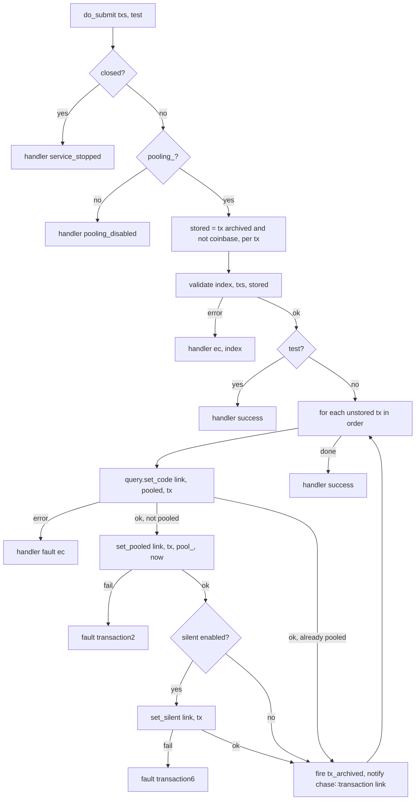
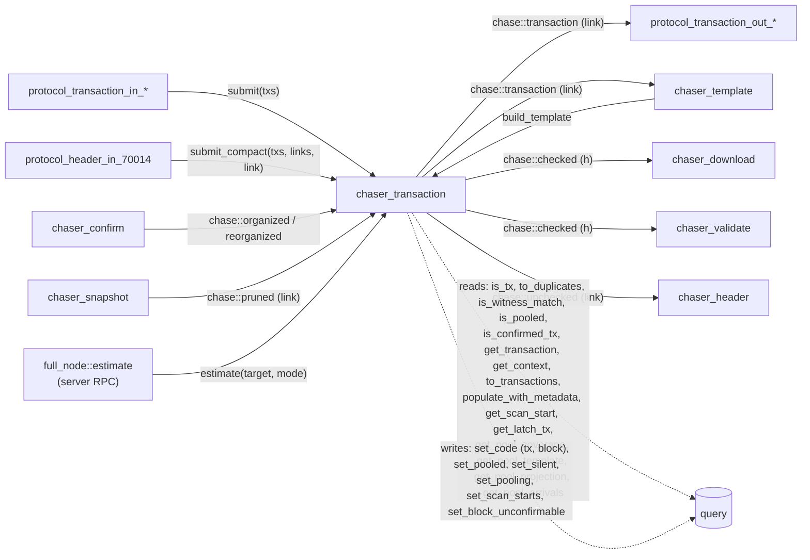

# 11 — Transaction Chaser

> Companion to [`04-chaser-validate`](validation-chaser),
> [`05-chaser-confirm`](confirmation-chaser),
> [`07-header-protocols`](header-protocols) §4,
> [`10-tx-protocols`](transaction-protocols) and
> [`12-periphery-chasers`](periphery-chasers) §3.
>
> `chaser_transaction` owns the **unconfirmed transaction pool**. The
> pool is an *index over archived transactions*: a submitted transaction
> is validated, archived in the store like any other tx, and marked
> pooled under the context of the next block. There is no separate
> mempool data structure; "pooled" is a store property, and the pool
> contents outlive the process.
>
> The chaser:
>
> 1. validates and archives submitted packages (`submit`), admitting a
>    package that conflicts with pooled txs only when the fee it adds to
>    the pool covers it, and emitting `chase::transaction` per newly
>    pooled tx;
> 2. fills identified compact blocks from the pool (`submit_compact`),
>    validating and archiving the unpooled txs in block order,
>    associating the block, and emitting `chase::checked` — the second
>    archiver of blocks after `protocol_block_in_31800`;
> 3. re-pools the unpooled txs of a reorganized block;
> 4. maintains the pool context on every organized block, closes the
>    pool when the chain is not current, and maps **silent-payment scan
>    starts** on a dedicated single thread;
> 5. projects the pool into future blocks, answering block template
>    builds for `chaser_template` (`build_template`) and fee estimates
>    (`estimate`) from that projection.

| File                                                     | Lines | Role                                   |
| -------------------------------------------------------- | ----- | -------------------------------------- |
| `include/bitcoin/node/chasers/chaser_transaction.hpp`    | 131   | Declaration                            |
| `src/chasers/chaser_transaction.cpp`                     | 872   | Implementation                         |

---

## 1. State

```cpp
// chaser_transaction.hpp:114-125
network::threadpool scan_threadpool_;   // one thread, node.thread_priority
stopper stopping_{};                    // cancels a running scan map

// strand-protected
system::chain::context pool_{};         // context of the next block (where a pooled tx would confirm)
query::pool_projection projection_{};   // the pool taken into successive blocks by chunk rate (§6)
query::pool_arrivals arrivals_{};       // rate and size pooled at each recent height (§6.2)
size_t floor_{};                        // lowest height from which arrivals are whole (§6.4)
bool pooling_{};                        // pool open (relay enabled and confirmed chain current)
bool scanning_{};                       // a scan-start map is running
bool projected_{};                      // projection_ reflects the current pool (§6.3)
bool arrived_{};                        // arrivals_ reflects the current pool (§6.3)
```

> **Invariant (Pool-Context-1).** `pool_` is the chain context of the
> block *after* the confirmed top (`chain_state{ *state, settings }.context()`,
> `:141`), recomputed on every `organized` and `reorganized` event. Every
> pool admission, fee-rate decision, template and estimate is made
> against that context.

---

## 2. Bus integration

Inputs (`:72-105`):

| Event                | Reaction                                                                 |
| -------------------- | ------------------------------------------------------------------------ |
| `chase::organized`   | `do_bump`: recompute the pool context, open/close the pool, map scan starts |
| `chase::reorganized` | `do_reorganized(link)`: `do_bump`, then pool the unpooled txs of the block |
| `chase::pruned`      | `do_pruned(link)`: raise the arrivals floor above the pruned block (§6.4) |
| `chase::stop`        | unsubscribe                                                              |

`start()` subscribes and posts an initial `do_bump` (`:46-51`).

Outputs:

| Event                | Site                                   | Trigger                                                       |
| -------------------- | -------------------------------------- | ------------------------------------------------------------- |
| `chase::transaction` | `:241`, `:378`, `:620`, `:648`         | a tx was pooled (reorganized block, package, compact fill)    |
| `chase::checked`     | `:466`                                 | a compact block was filled and associated                     |
| `chase::unchecked`   | `:673`                                 | an identified compact block contained an invalid tx           |

Reporting: `events::tx_archived` with the tx fee rate (`:377`, `:647`),
`events::block_archived` (`:467`), `events::block_unconfirmable` (`:674`).

Calls in: `submit`, `submit_compact`, `build_template` and `estimate`
(`:267-301`) are posted to the chaser strand from `full_node`
(`src/full_node.cpp:185-201`, `:485-489`).

### 2.1 The pool latch

```cpp
// :110-164 do_bump
pooling_ = false; projected_ = false;
if (closed() || !is_current_chain(true)) return;
if (network_settings().enable_relay) {
    pool_ = next-block context of the confirmed top;
    query.set_pooling();          // permanent store property
    pooling_ = true;
    if (pool was closed) floor_ = max(floor_, pool_.height);   // §6.4
}
map scan starts (§5)
```

> **Invariant (Pool-Open-1).** The pool accepts submissions, builds
> templates and answers estimates only while relay is enabled and the
> confirmed chain is current (`pooling_`, checked in `do_submit`
> `:315-319` and `do_build_template` `:483-487` →
> `error::pooling_disabled`; in `do_estimate` `:519-523` →
> `error::estimate_premature`). The store latch `set_pooling` is
> one-way: txs archived while the pool was open outlive a later loss of
> currency.

---

## 3. Submission

### 3.1 Packages (`submit`)



Source: `do_submit` `:304-383`. Parents precede children in a package,
so a parent is archived before its child is resolved. A package that is
archived (not `test`) clears `projected_` (`:342`).

Package validation (`validate(index, txs, stored)`, `:758-827`) runs
the cheapest checks first and script validation last:

1. empty package → `empty_package`; all already stored →
   `duplicate_transaction` (`:761-765`);
2. `block::is_forward_reference` → `forward_reference`;
   `block::is_internal_double_spend` → `block_internal_double_spend`
   (`:767-771`);
3. `block::populate(txs, pool_)` fills intra-package prevouts
   (`:773-774`);
4. each unstored tx is checked and accepted (`accept`, below),
   accumulating its fee and its chargeable size, the greater of its
   virtual size and its signature operations times
   `pool.bytes_per_sigop`; `index` reports the failing tx (`:782-795`);
5. the package rate (satoshis per virtual kilobyte) must reach
   `pool.minimum_fee_rate` → `insufficient_fee` (`:797-803`);
6. **coverage**: `query.get_pool_coverage` must find that the package
   pays for itself against the txs it conflicts with (§3.2) →
   `insufficient_fee` if not covered, `database::error::pool_limit`
   returned to the submitter if the conflict exceeds the search bounds,
   any other code faulted (`:805-818`);
7. `connect(pool_)` runs the scripts of each unstored tx (`:820-824`).

Per-tx check and accept (`accept(tx)`, `:829-849`):

```
tx.check(); tx.check(pool_)                        // tx consensus
tx.check_guard(); tx.check_guard(pool_)            // presumed block rules (DoS guard), before any store read
archive().populate_with_metadata(tx, true, true)   // external prevouts from confirmed and pooled
tx.accept(pool_); tx.accept_guard(pool_); tx.confirm_guard(pool_)
double_spend → success                             // a conflict with a pooled tx is decided by coverage
```

> **Invariant (Pool-Validate-1).** A pooled tx has passed tx consensus,
> the block-level rules it would be subject to in the next block (the
> guards), the package fee rate, coverage, and script validation, all
> under the pool context. The pooled block path of `chaser_validate`
> relies on this to skip per-tx validation (doc 04 §4.2).

> **Invariant (Pool-Package-1).** A package is accepted or rejected as a
> whole, by validation; archival is per tx in order, so a disk-full
> decline can leave a package partly archived, which a resubmit
> resolves (`:355-360`).

### 3.2 Coverage

A package may spend an output that a pooled tx already spends.
Conflicting txs coexist in the pool, and a block can confirm only one
spender of each output, so each set of txs
linked by conflicts and by parent/child edges is a **conflict
component** whose confirmable subsets are its *outcomes*.
`get_pool_coverage(covered, txs, stored, context(pool_), rate,
pool.bytes_per_sigop, block_limit(), pool.maximum_outcomes)` decides
whether the package pays for its place in the pool (libbitcoin-database
`query/pool/pool_coverage.ipp`, algorithm in libbitcoin-system
`pool/algorithm`):

- a package spending an output already spent by a confirmed tx is not
  covered, and neither is one with a pooled parent that no outcome can
  confirm;
- for each component that contains an unstored package tx, every
  outcome is enumerated and the best total fee is found with the package
  and without it; a component with more members than the outcome mask
  holds, with more than `pool.maximum_outcomes` outcomes, or whose
  ancestry exceeds the block limit is `pool_limit`;
- the package is covered when the fee it adds (the sum over its
  components of best-with less best-without) pays for the package's
  chargeable size at `pool.minimum_fee_rate`.

A package with no conflict adds its whole fee, so coverage reduces to
the package rate check of step 5.

> **Invariant (Pool-Coverage-1).** A package enters the pool only if
> the best confirmable fee of the pool rises by at least
> `pool.minimum_fee_rate` times the chargeable size the package adds. A
> conflicting package that would lower the pool's best outcome, or raise
> it by less than its own minimum fee, is rejected, so a peer cannot
> grow the pool with conflicts that pay nothing.

### 3.3 Compact blocks (`submit_compact`)

`do_submit_compact(txs, links, link)` (`:386-469`) receives the unpooled
txs of an identified compact block and the full link vector with
terminal entries at their positions:

1. `duplicate_block` if the block is already associated (another channel
   filled it); `transaction3` fault if the context is missing;
   `transaction5` if the terminal count does not match the tx count
   (`:399-418`).
2. Each terminal position is filled in block order by `fill` (`:599-653`):
   an already stored tx (matched by witness, `to_stored`) is reused and,
   if pooling and not yet pooled or confirmed, validated under the block
   context and pooled; an unstored tx is validated under the block
   context, archived (`set_code`), pooled unless coinbase, and silent
   indexed when at or above `silent_start_height` under taproot. Each
   newly pooled tx emits `chase::transaction`.
3. The coinbase, when missing, is filled last (validation indexes only
   txs linked above it, `:456-457`).
4. `query.set_code(link, filled, strong)` associates the block with
   `strong = is_under_checkpoint(height)`; then `chase::checked`
   (`:459-466`).

A tx that fails validation makes the identified block unconfirmable:
`unconfirmable` (`:666-676`) sets the block unconfirmable (`transaction4`
on failure), emits `chase::unchecked` and returns the consensus code to
the protocol, which drops the peer.

Block-context tx validation (`validate(tx, ctx)`, `:853-866`) applies
`check`, `check(ctx)`, `populate_with_metadata`, `accept(ctx)`,
`connect(ctx)` — no policy (fee rate, guards, coverage), because a block
tx is under proof of work and may conflict with unconfirmed txs.

> **Invariant (Pool-Compact-1).** A compact-filled block is associated
> only after every one of its txs is archived and (for unpooled ones)
> validated under the block's own context, in block order. `chase::checked`
> then carries the same guarantee as the download path (doc 06 §5.6):
> the block is durably associated before the event.

> **Invariant (Pool-Compact-2).** Block checks are deferred: the txs
> given to `submit_compact` are an arbitrary subset of the block, so
> block-level rules run in `chaser_validate` (the pooled path when all
> txs are sufficiently pooled, else full validation).

---

## 4. Reorganization

`do_reorganized(link)` (`:204-244`) recomputes the pool context, then
for every non-coinbase tx of the popped block that is neither pooled nor
confirmed by another block, populates it with metadata and pools it
under the block's context with the block's timestamp as arrival time,
emitting `chase::transaction`. Block txs are already silent indexed.

> **Invariant (Pool-Reorg-1).** No transaction of a reorganized block is
> lost: it is either confirmed elsewhere, already pooled, or re-pooled by
> this handler.

---

## 5. Silent-payment scan starts

When the store's silent index is enabled, the chaser builds and
maintains the **scan start map** — the per-block entry points that the
server's silent-payment scans use — on the single-thread
`scan_threadpool_` (`start_scan`/`do_scan`/`do_scanned`, `:166-200`;
the choice in `do_bump`, `:150-163`):

- a full map (`remap = true`) when genesis has no scan start;
- an extension when the top has none and the pool is not yet latched;
- a remap when the top is unmapped and the top's coinbase precedes the
  pool latch tx (rows of a block archived before the latch may precede
  mapped starts).

The map is bounded by the scan frontier once pooling. Blocks organized
during a map are mapped by the `do_bump` that `do_scanned` re-runs.

> **Invariant (Pool-Scan-1).** Scan starts are mapped only after the
> pool latch, since pooled rows are unordered; at most one map runs at a
> time (`scanning_`), and a failed map is a `transaction8` fault.

---

## 6. Projection: templates and fee estimates

The pool is **projected** into successive blocks: pooled txs are taken
by chunk rate (a tx with its untaken ancestors, at their combined rate),
best first, into blocks of `block_limit()`, until the requested number
of blocks is filled or the pool is exhausted. Conflict components are
first resolved to their best outcome, and the txs outside it are
excluded from the projection. Projection runs in the store
(`get_pool_template`, `get_pool_projection`) on the chaser strand.

`block_limit()` (`:737-753`) is the block budget of a projected block:
the maximum block weight less the header, the largest possible tx count
prefix and `pool.coinbase_weight`, as virtual size, with the sigop limit
of the pool context (the bip141 limit once segwit is active). A chunk
deeper than `pool.maximum_chunk_depth` levels of untaken ancestors is
not taken.

### 6.1 Template build

`build_template(handler)` (`:286-292`) posts `do_build_template`
(`:472-499`), which returns `service_stopped` when closed and
`pooling_disabled` while the pool is closed; otherwise it calls
`get_pool_template` and returns the txs of the **first projected
block**, parents first, with `pool_.height` (the height the block would
have). The one-block projection is kept as `projection_` (`projected_`
set when the build succeeds) and `arrived_` is cleared, so the next
estimate extends this projection and reads fresh arrivals. The caller is
`chaser_template` (doc 12 §3), through `chaser::request_template` and
`full_node::build_template`.

### 6.2 Fee estimation

`estimate(target, mode, handler)` (`:294-301`) posts `do_estimate`
(`:502-581`). The result is the lowest fee rate, in satoshis per virtual
kilobyte, at which a tx submitted now is projected to confirm within
`target + 1` blocks:

| Step | Rule | Result |
| ---- | ---- | ------ |
| 1 | closed | `service_stopped` |
| 2 | `network.enable_relay` false | `estimate_disabled` |
| 3 | pool closed (`!pooling_`, the confirmed chain is not current) | `estimate_premature` |
| 4 | `mode` is `unknown`, or `target ≥ maximum_estimate_horizon` (1008) | `estimate_false` |
| 5 | extend `projection_` to `target + 1` blocks (`get_pool_projection`, `:541-548`) | store code faulted |
| 6 | read arrivals unless `basic` or already read (`get_pool_arrivals`, `:552-564`) | store code faulted |
| 7 | binary search for the lowest rate that `target + 1` blocks take (`pool::algorithm::estimate`, `:571-573`) | `estimate_false` if no rate is taken |
| 8 | otherwise | `success`, the rate raised to at least `pool.minimum_fee_rate` (`:580`) |

A rate is *taken* within the count of blocks when, block by block, the
chargeable size already pooled at or above the rate plus the size
carried from the blocks before it fits in the block: a block that left
pooled txs behind is full at its projected size, and the blocks beyond
the projected pool have the whole block budget. The size projected to
arrive in each block at or above the rate is added to the carry, by
`mode` (`arriving`, `:679-721`; modes and windows in
`include/bitcoin/node/define.hpp:37-57`):

| Mode           | Arrivals per block                                                              |
| -------------- | ------------------------------------------------------------------------------- |
| `basic`        | none: the pool as it is                                                         |
| `geometric`    | every recent height weighted by recency, each half the weight of the one above it |
| `economical`   | the mean over the most recent `economical_estimate_window` (12) heights         |
| `conservative` | the peak over up to `conservative_estimate_window` (144) heights                |

`arrivals_` holds, for each of up to 144 heights below `pool_.height`
and at or above `floor_`, the rate and chargeable size of each pooled
row whose context is that height (`get_pool_arrivals`, most recent
first). The forwarding chain is `protocol::estimate` →
`session::estimate` → `full_node::estimate` → `chaser_transaction`.

### 6.3 Projection cache

`projection_` and `arrivals_` persist across calls on the strand.
`projected_` is cleared whenever the pool can have changed: every
`do_bump` (each `organized` and `reorganized` event, `:115`), each
archived package (`:342`), each compact fill (`:420`) and each
`pruned` event (`:260`). An estimate that finds `projected_` clear
discards the projection and the arrivals and recomputes both
(`:531-535`); otherwise it extends the cached projection only by the
blocks it lacks (the store continues a projection from its marks).

### 6.4 The arrivals floor

Arrivals are whole only for heights at which the pool held every row
that arrived. `floor_` is the lowest such height:

- when the pool opens (from closed), `floor_` rises to `pool_.height`,
  because rows that arrived while the pool was closed are not in it
  (`:145-147`);
- on `chase::pruned(link)`, `do_pruned` (`:247-262`) raises `floor_`
  above the pruned block, because the prune does not retain the rows
  confirmed by that block.

The arrival window is `min(pool_.height − floor_, 144)` heights
(`:554-555`).

> **Invariant (Pool-Estimate-1).** An estimate is a pure function of
> the pool rows, the pool context, `floor_`, the target and the mode.
> The cache only shortens the computation: a cleared `projected_` forces
> both the projection and the arrivals to be read again from the store.

---

## 7. Error inventory

| Code           | Site                        | Cause                                                               |
| -------------- | --------------------------- | ------------------------------------------------------------------- |
| `transaction1` | `:134-138`                  | confirmed chain state of the top not obtainable                     |
| `transaction2` | `:235-239`, `:364-367`, `:613-614`, `:637-638` | `set_pooled` failed                              |
| `transaction3` | `:405-410`                  | `get_context` of the compact block's link failed                    |
| `transaction4` | `:669-670`                  | `set_block_unconfirmable` of an invalid compact block failed        |
| `transaction5` | `:412-418`                  | compact fill: terminal count ≠ tx count (protocol-side error, not a fault) |
| `transaction6` | `:370-374`, `:616-618`, `:640-642` | `set_silent` failed                                         |
| `transaction7` | `:214-218`, `:228-232`      | reorganized block txs or context not readable                       |
| `transaction8` | `:193-197`                  | scan start map failed                                               |
| `transaction9` | `:125-129`, `:254-258`      | height of the confirmed top, or of the pruned block, not obtainable |
| `pooling_disabled`, `insufficient_fee`, `empty_package`, `duplicate_transaction`, `database::error::pool_limit` | `:315-319`, `:758-827` | package rejections returned to the submitter |
| `estimate_disabled`, `estimate_premature`, `estimate_false` | `:513-529`, `:574-578` | estimate results returned to the caller, not faults |

All `transactionN` except `transaction5` are faults; store write codes
from `set_code` are faulted and returned (`:356-360`, `:459-464`,
`:631-632`), as are store codes from coverage other than `pool_limit`
(`:811`) and from the estimate's projection and arrivals reads
(`:545-547`, `:558-560`). A template store code is returned to
`chaser_template`, which faults it (doc 12 §3.3).

---

## 8. Coupling diagram



---

## 9. Spec view

```
chaser_transaction : Process
  state: pool_ctx : Context, pooling ∈ 𝔹, scanning ∈ 𝔹,
         floor ∈ ℕ, projection (cache), arrivals (cache), projected ∈ 𝔹, arrived ∈ 𝔹
  inputs:  chase::{organized, reorganized, pruned, stop}
           submit(txs, test), submit_compact(txs, links, link),
           build_template(), estimate(target, mode) RPCs
  outputs: chase::{transaction, checked, unchecked}; handler codes, templates, rates
  effects: tx archival, pooled/silent rows, block association, scan starts
```

Safety: Pool-Validate-1 (every pooled tx is valid under the next-block
context); Pool-Coverage-1 (a conflict enters only by raising the pool's
best fee); Pool-Compact-1 (association after archival, in order);
Pool-Reorg-1; Pool-Estimate-1. Liveness: pooling resumes on the first
organized block after the chain becomes current; scan maps complete or
fault.

---

## 10. Notes for the formal model

- Strand-confined except for the scan map, which only writes scan
  starts and reports back by post.
- The pool is a store projection ("pooled under context C"); model it
  as a set of (tx, context, arrival) rows with the latch as a one-way
  flag. Conflicting rows coexist; the projection and coverage choose
  among their outcomes.
- The compact fill is the only place where a block is archived by a
  path other than the download protocol; its `checked` obligation is the
  same as doc 06 §8.3-1.
- Templates and estimates read the pool and write nothing; the
  projection cache can be modelled away (Pool-Estimate-1).

---

## Cross-references

- [`01-event-bus`](event-bus) §2.3, §2.6
- [`04-chaser-validate`](validation-chaser) §4.2 (pooled block path)
- [`05-chaser-confirm`](confirmation-chaser) §8 (organized/reorganized
  ordering)
- [`07-header-protocols`](header-protocols) §4 (compact fill)
- [`10-tx-protocols`](transaction-protocols) (submitters and announcers)
- [`12-periphery-chasers`](periphery-chasers) §1 (`chaser_snapshot`
  emits `pruned`), §3 (`chaser_template` consumes `transaction` and
  requests templates)
