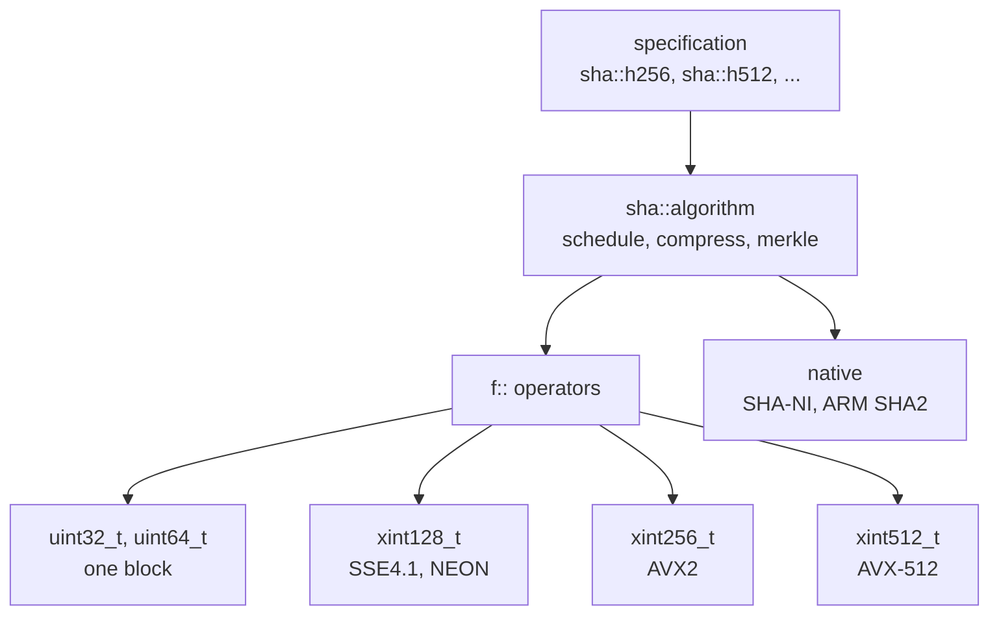

# Hash

The hash functions, from SHA-256 to SHA-3, are C++ class templates rather
than collections of C functions. One template
implements each algorithm family, and the same source compiles to scalar
code or to vector code over the extensions the build targets.

Paths are relative to `include/bitcoin/system/` in
[libbitcoin-system](https://github.com/libbitcoin/libbitcoin-system), at
master `0cd57fcf` (2026-10-27).

## 1. Algorithms

| Group | Algorithms | Location |
| ----- | ---------- | -------- |
| Hash functions | SHA-1, SHA-224, SHA-256, SHA-384, SHA-512 and its truncations, RIPEMD-128, RIPEMD-160, SHA3-256, Keccak-256 | `hash/sha/`, `hash/rmd/`, `hash/sha3/` |
| Hash constructions | Streaming accumulator, HMAC, HKDF, PBKDF2, scrypt, checksums, SipHash, MuHash | `hash/` |

The named algorithms are instantiations of their family templates
(`hash/algorithms.hpp`):

```cpp
// FIPS 180-4 (SHA-1, SHA-2)
using sha160     = sha::algorithm<sha::h160>;
using sha256_224 = sha::algorithm<sha::h256<224>>;
using sha256     = sha::algorithm<sha::h256<>>;
using sha512_256 = sha::algorithm<sha::h512<256>>;
using sha512_224 = sha::algorithm<sha::h512<224>>;
using sha512_384 = sha::algorithm<sha::h512<384>>;
using sha512     = sha::algorithm<sha::h512<>>;

// RIPEMD (Dobbertin, Bosselaers, Preneel)
using rmd128     = rmd::algorithm<rmd::h128<>>;
using rmd128_256 = rmd::algorithm<rmd::h128<256>>;
using rmd160     = rmd::algorithm<rmd::h160<>>;
using rmd160_320 = rmd::algorithm<rmd::h160<320>>;

// FIPS 202 (SHA-3), and pre-standard Keccak
using sha3_256   = sha3::algorithm<sha3::h256<>>;
using keccak_256 = sha3::algorithm<sha3::h256<sha3::keccak_domain>>;
```

## 2. Templates over specifications

An algorithm template takes its specification as a type. For SHA, the
specification is the round constants, the initial value and the digest
size (`hash/sha/sha256.hpp`):

```cpp
struct k256 : public k<256, 64> { static constexpr constants_t get{ ... }; };
template <> struct h256<256> : public h<k256, 256> { static constexpr state_t get{ ... }; };
```

`sha::algorithm` (`hash/sha/algorithm.hpp`) implements FIPS 180-4 once,
for every one of these. Word size, rounds and the sigma rotations follow
from the specification at compile time, so SHA-1, SHA-256 and SHA-512 share
the parsing, padding, message schedule, compression, double hashing,
midstate and merkle code. The same holds for the RIPEMD and SHA-3
families.

Constructions are templates over the algorithm. `hmac<Algorithm>`,
`accumulator<Algorithm>`, HKDF and PBKDF2 work with any iterated hash that
exposes the members they use, so HMAC-SHA256 and HMAC-SHA512 are one
implementation.

Most of the hashing interface is `constexpr`. A digest of constant data,
such as the midstate of a tagged hash, can be computed by the compiler, and
the same code runs at compile time and at run time.

## 3. One code path, scalar and vector

The round functions are written once, over `auto` words, using the
operators of namespace `f` (`impl/hash/sha/algorithm_functions.ipp`):

```cpp
INLINE constexpr auto CLASS::choice(auto x, auto y, auto z) NOEXCEPT
{
    return f::xor_(f::and_(x, f::xor_(y, z)), z);
}
```

`f::xor_`, `f::and_`, `f::ror` and the rest are defined for integral words
and overloaded for the extended words `xint128_t`, `xint256_t` and
`xint512_t` (`intrinsics/types.hpp`). Each overload maps to the intrinsics
of one platform (`intrinsics/intel/`, `intrinsics/neon/`,
`intrinsics/sve/`):

| Extended word | x86-64 | ARM |
| ------------- | ------ | --- |
| `xint128_t` | SSE4.1 | NEON, SVE |
| `xint256_t` | AVX2 | SVE |
| `xint512_t` | AVX-512 (BW, VL) | SVE |

With an integral word the schedule and compression templates hash one
block. With an extended word the same templates hash one block per lane,
the blocks striped across the vector: 4, 8 or 16 SHA-256 blocks, or 2, 4 or
8 SHA-512 blocks. This vectorizes the message schedules of long messages
and, for merkle trees, the complete double hash of each pair of digests.



The dedicated SHA instructions (SHA-NI, ARM SHA2 and SHA512) are the one
separate path. They keep the working variables in registers between rounds,
so they use their own round sequence (`impl/hash/sha/algorithm_native.ipp`),
within the same template and behind the same interface.

[Crypto](crypto) is built on the same `f` operators and extended
words.

## 4. Selection at compile time

An instruction set extension must be enabled in the compiler to be used:
its intrinsics are undefined behavior in code compiled without it. The
compiler flags of the build therefore determine what is available. `have.hpp`
maps them to `HAVE_*` macros, `constants.hpp` to `constexpr` flags
(`have_128`, `have_256`, `have_512`, `have_sha`, `have_aes`, ...), and each
template selects its path with `if constexpr`:

```cpp
static constexpr auto use_128 = Vector && bc::have_128;
static constexpr auto use_sha = Native && bc::have_sha;
```

The extended word types are always defined, as stand-ins where the
extension is not available, so the algorithms contain no conditional
compilation and every path is type-checked on every platform. Paths that
are not available are discarded at compile time. There are no function
pointers and no run-time dispatch, so the selected code inlines into its
callers. The CPU detection functions (`intrinsics/detection.hpp`) are
used only to report what a machine supports, never to select code.

A build therefore uses the extensions it was compiled for, and its binary
runs only on hardware that has them. See
[Hardware options](../../building/options#2-hardware-options).

## 5. Compared with per-extension translation units

A binary that is portable across CPUs cannot compile its general code with
extensions enabled. The common workaround is a separate translation unit
for each optimization, compiled alone with its extension enabled, the only
place its intrinsics are used, and selected at run time through function
pointers. Each is a complete implementation of the algorithm for one
instruction set. Bitcoin Core's SHA-256, for example, comprises `sha256.cpp` (generic),
`sha256_sse4.cpp` (an assembly transform), `sha256_sse41.cpp` (4-way),
`sha256_avx2.cpp` (8-way), `sha256_x86_shani.cpp` and
`sha256_arm_shani.cpp`, with `SHA256AutoDetect` choosing among them, and
separate `hmac_sha256` and `hmac_sha512` implementations.

| | Per-extension translation units | libbitcoin-system |
| - | ------------------- | ----------------- |
| Algorithm source | One copy per instruction set | One template per algorithm family |
| Related algorithms | Separate implementations (SHA-256, SHA-512, HMAC of each) | Instantiations of one template |
| A new instruction set | A new implementation | A new set of `f` operators |
| An improvement to the algorithm | Repeated in each copy | Made once, applies to every width |
| Selection | Run time, through function pointers | Compile time, inlined |
| Binary portability | Any CPU of the architecture | CPUs with the extensions of the build |
| Compile-time evaluation | No | `constexpr` |
| Coverage | The few functions given dedicated translation units | Every algorithm built on the templates |

The per-extension approach yields one portable binary that adapts to the
machine, but only within the few functions given dedicated translation units, since
everything else is compiled without extensions. The template approach
compiles the whole library for the target hardware, keeps a single
statement of each algorithm, which every width shares, and extends to new
hardware by implementing a small set of primitive operations.

The template approach also compresses what would be hundreds of redundant
implementations, one for each algorithm, variant and instruction set, into
one algorithmic code path. The algorithms in turn feed the construction
templates (`hmac<Algorithm>`, `accumulator<Algorithm>`, `hkdf<Algorithm>`,
`pbkd<Algorithm>`) generically, so each construction is also one
implementation for every algorithm. There is one statement of each
algorithm and construction to review, and the tests of that path exercise every width and extension it
compiles to, where per-extension implementations each require their own
review and tests, and can each diverge from the others.
