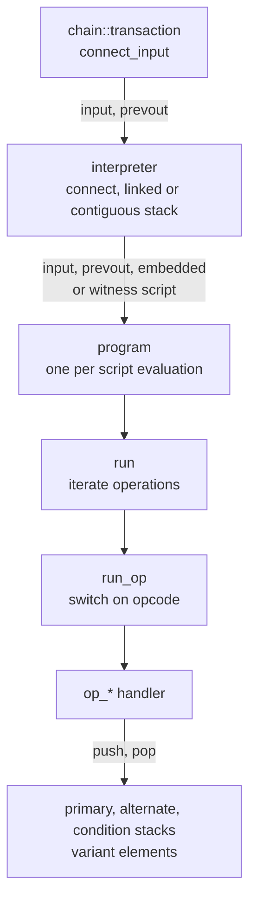

# Machine

The script machine (`machine/`) executes the scripts of a transaction's
inputs against the outputs they spend.

Paths are relative to `include/bitcoin/system/` in
[libbitcoin-system](https://github.com/libbitcoin/libbitcoin-system), at
master `0cd57fcf` (2026-10-27).

## 1. A stack language

Bitcoin script is a stack language, in the manner of Forth. A script is a
sequence of operations, and each operation pops its operands from a stack
and pushes its result. A push operation pushes the data it carries. There
are no variables, loops or jumps: execution runs once, from the first
operation to the last, and the conditionals (`if`, `notif`, `else`,
`endif`) only enable or disable the operations between them. This bounds
the cost of every script by its length.

An input's script runs first, leaving its data on the stack, and the script
of the output it spends then runs on that stack. The spend is valid if
execution completes and leaves true on top of the stack. The machine has
three stacks: the primary stack, on which operations work, an alternate
stack (`toaltstack`, `fromaltstack`), and a condition stack that tracks the
nesting of conditionals.

For example, the table below traces one of the script test vectors: the
input script `10 0 11 toaltstack drop fromaltstack`, then the output script
`add 21 equal`. Each row is one operation, and the contents of the primary
and alternate stacks after it, top of stack last. The output leaves true on
top, so the spend is valid.

| Script | Operation | Primary Stack | Alternate Stack |
| ------ | --------- | ------- | --------- |
| input | `10` | 10 | |
| | `0` | 10, 0 | |
| | `11` | 10, 0, 11 | |
| | `toaltstack` | 10, 0 | 11 |
| | `drop` | 10 | 11 |
| | `fromaltstack` | 10, 11 | |
| output | `add` | 21 | |
| | `21` | 21, 21 | |
| | `equal` | true | |

## 2. The machine in libbitcoin

Each concept of the language is a type:

| Concept | Type |
| ------- | ---- |
| Operation: an opcode, and the data of a push | `chain::operation` |
| Script: a sequence of operations | `chain::script` |
| Machine state: the three stacks, operation counts, and the transaction and input being validated | `machine::program<Stack, Tx>` |
| Execution: iterate, dispatch, and one handler per opcode | `machine::interpreter<Stack, Program>` |

The components at work when an input is connected:



A script parses from its serialization or from mnemonics, as above:

```cpp
const chain::script input{ "10 0 11 toaltstack drop fromaltstack" };
const chain::script output{ "add 21 equal" };
```

The interpreter's `run()` is the machine's cycle: for each operation, count
it, skip it if a conditional has disabled it, execute its handler, and
check the stack limits (`impl/machine/interpreter_run.ipp`):

```cpp
for (auto it = state::begin(); it != state::end(); ++it)
{
    const auto& op = *it;

    if (op.is_oversized())
        return error::invalid_push_data_size;

    if (!state::ops_increment(op))
        return error::invalid_operation_count;

    if (state::if_(op))
    {
        if (const auto ec = run_op(it))
            return ec;

        if (state::is_stack_overflow())
            return error::invalid_stack_size;
    }
}
```

`run_op()` calls the handler of the operation's opcode. There is one
handler for each opcode, a member function of the interpreter named for it
(`impl/machine/interpreter.ipp`). A handler pops the opcode's operands from
the primary stack, computes its result, and pushes the result. If the
operands are not there, it returns the opcode's error, which fails the
script. For example, `op_add`, the handler of `add` in the trace above:

```cpp
TEMPLATE
error::op_error_t CLASS::
op_add() NOEXCEPT
{
    int32_t right, left;
    if (!pop_binary32(left, right))
        return error::op_add;

    // addition overflow precluded by domain increase.
    push_signed64(add<int64_t>(left, right));
    return error::op_success;
}
```

Every handler has this form, so the body of each is the definition of its
opcode in stack operations:

| Opcode | Stack effect | Handler body (excerpt) |
| ------ | ------------ | ---------------------- |
| `dup` | x &rarr; x x | `push_variant(peek_());` |
| `add` | a b &rarr; a+b | `push_signed64(add<int64_t>(left, right));` |
| `equal` | a b &rarr; a=b | `push_bool(equal_chunks(pop_(), pop_()));` |
| `hash160` | x &rarr; ripemd160(sha256(x)) | `push_chunk(bitcoin_short_chunk(*pop_chunk_()));` |

The program provides the stack operations (`push`, `pop`, `peek`, and
their typed forms), the interpreter implements the opcodes with them, and
`chain::script` holds the operations they run.

## 3. Script versions

A program is constructed for each kind of script that an input can
execute: the input script, the previous output script (or a BIP16
embedded script), a witness v0 script (BIP141, BIP143), and a witness v1
tapscript (BIP341, BIP342). The interpreter connects an input by running
these in sequence, each program constructed from the stack the previous
one left. One set of opcode handlers serves every version, and the rules
that differ between versions are decided by the program's version and
the active fork flags.

## 4. Variant stack

Script stack elements are byte vectors, and numeric and boolean opcodes
interpret them as integers. The primary and alternate stacks are instead
**variant stacks**, each element a variant of the three types
(`machine/stack.hpp`):

```cpp
typedef std::variant<bool, int64_t, chunk_xptr> stack_variant;
```

An opcode that produces a number or a boolean pushes it as one, and the
next opcode reads it without decoding it from bytes. A value is encoded as
bytes only when an opcode requires bytes. Byte elements are pointers (see
[Allocation and copy](#5-allocation-and-copy)).

In standard scripts, no value is ever type-converted: each element is read
as the type it was pushed as, so the conversions occur only in nonstandard
scripts that mix them.

The stack container is a template parameter (`linked_stack` or
`contiguous_stack`, see [Rock and roll](#6-rock-and-roll)), and so is the
transaction model: the same interpreter
runs over a deserialized `chain::transaction`, or over a
`chain::view::transaction` that reads its fields in place from the
serialized block.

## 5. Allocation and copy

The data of a script is never copied during execution. A byte element on
the stack is a `chunk_xptr` (`data/external_ptr.hpp`), a copyable pointer
to a `data_chunk` whose lifetime is guaranteed elsewhere. The handler of
the push opcodes, `op_push_size`, pushes a pointer to the data the
operation carries, which the parsed script owns:

```cpp
push_chunk(op.data_ptr());
```

Data that execution creates, such as the result of a hash opcode, is
allocated once and moved into a **tether** owned by the stack, and the
stack holds a pointer to it. `op_hash160` computes its hash as a new
`data_chunk` and passes it by move to the program, which moves it to the
primary stack's `push`, which moves it into the tether and pushes the
returned pointer:

```cpp
// op_hash160 (impl/machine/interpreter.ipp)
push_chunk(bitcoin_short_chunk(*pop_chunk_()));

// program::push_chunk (impl/machine/program.ipp)
primary_.push(std::move(datum));

// stack::push (impl/machine/stack.ipp)
container_.push_back(make_external(std::move(value), tether_));
```

The tether keeps every created chunk until the program is destroyed, and
the number it can hold is bound by the script size limit. A standard input
and output script pair tethers only one chunk, the computed hash.

Every stack operation therefore moves a pointer, a boolean or an integer.
`dup`, `pick`, `roll`, `swap`, `toaltstack` and the rest never copy or
allocate data. The only data allocated during execution are the results
of opcodes that compute new data, and of converting a number or boolean to
bytes, which standard scripts never do.

## 6. Rock and roll

`roll` moves the stack element at a given depth to the top. On a contiguous
stack this erases the element from the middle of the container, shifting
every element above it. Sergio Demian Lerner showed that this makes script
execution quadratic
([New quadratic delays in Bitcoin scripts](https://bitslog.com/2017/04/17/new-quadratic-delays-in-bitcoin-scripts)):
a script that fills the stack to its limit of 1000 elements and then rolls
the deepest of them repeatedly moves hundreds of thousands of elements per
script, and a block of such scripts takes seconds to validate.

libbitcoin selects the stack container for each input by whether its
scripts can roll. A script records when it is parsed whether it contains
`roll` (`chain::script::is_roller`), and the transaction instantiates the
interpreter over a linked stack for those inputs and a contiguous stack for
all others (`src/chain/transaction.cpp`):

```cpp
if (input.is_roller() || input.prevout->script().is_roller())
{
    // Evaluate rolling scripts with linear search but constant erase.
    return interpreter<linked_stack>::connect(ctx, *this, it, capture);
}

// Evaluate non-rolling scripts with constant search but linear erase.
return interpreter<contiguous_stack>::connect(ctx, *this, it, capture);
```

On the linked stack, `roll` erases in constant time after its linear walk
to the element. On the contiguous stack, every other operation reads by
index in constant time. Both are the same interpreter and handlers,
instantiated over two containers (`machine/stack.hpp`), so the choice costs
no second implementation. The `op_roll` handler itself only peeks, erases
and pushes:

```cpp
TEMPLATE
error::op_error_t CLASS::
op_roll() NOEXCEPT
{
    size_t index;

    // 998,[0,1,2,...,997,998,999] => {998} [0,1,2,...,997,998,999]
    if (!pop_index32(index))
        return error::op_roll;

    // Copy variant because should be deleted before push (no stack alloc).
    stack_variant temporary{ peek_(index) };

    // Shifts maximum of n-1 references within vector of n.
    // [0,1,2,...,997,xxxx,999] => [0,1,2,...,997,999]
    erase_(index);

    // [0,1,2,...,997,999] => 998,[0,1,2,...,997,999]
    push_variant(std::move(temporary));
    return error::op_success;
}
```

## 7. Dispatch

`run_op()` dispatches each operation through a single `switch` over the
opcode (`impl/machine/interpreter_run.ipp`), which the compiler implements
as a jump table. Each handler is a member of the
interpreter template, so dispatch is a direct call. An opcode is a single
byte, and the cases are ordered by opcode, one for each from 0 through 186
(`checksigadd`), so the compiler can build a dense jump table indexed by
the opcode. The `default` covers only the codes that follow, from 187
through 255. Condensed, with most cases cut:

```cpp
TEMPLATE
error::op_error_t CLASS::
run_op(const op_iterator& op) NOEXCEPT
{
    const auto code = op->code();

    switch (code)
    {
        case opcode::push_size_0:
            return op_push_number(0);
        case opcode::push_size_1:
        // ...
        case opcode::push_size_75:
            return op_push_size(*op);
        case opcode::push_one_size:
            return op_push_one_size(*op);
        // ...
        case opcode::push_positive_16:
            return op_push_number(16);
        case opcode::if_:
            return op_if();
        // ...
        case opcode::dup:
            return op_dup();
        // ...
        case opcode::roll:
            return op_roll();
        // ...
        case opcode::equal:
            return op_equal();
        // ...
        case opcode::add:
            return op_add();
        // ...
        case opcode::hash160:
            return op_hash160();
        // ...
        case opcode::checksig:
            return op_check_sig();
        // ...
        case opcode::checksigadd:
            return op_check_sig_add();
        default:
            return op_unevaluated(code);
    }
}
```

## 8. Signature capture

Signature checks dominate script execution. When the node enables batch
verification, the interpreter is given a capture context
(`chain/batch/signatures.hpp`). In scripts whose result the signature fully
determines, a signature operation appends the signature, key and message
to a per-thread accumulator and proceeds as if it had succeeded. The node
commits the accumulated rows to the store and verifies them in batches
(see [Node Architecture](../node/validation-chaser)), and a failed
batch invalidates its block. Any signature that cannot be captured is
verified inline, so a block's validity is always fully determined.

Nearly every signature is captured. Over the 950,000 blocks of mainnet:

| Signatures | Captured | Total | Rate |
| ---------- | -------: | ----: | ---: |
| ECDSA | 2,621,968,879 | 2,635,044,550 | 99.50% |
| ECDSA multisig | 838,232,784 | 842,168,596 | 99.53% |
| Schnorr | 285,446,955 | 296,426,496 | 96.30% |
| Schnorr threshold | 1,582,347 | 1,582,347 | 100.00% |

## 9. Testability

The machine is layered, and each layer has one clearly defined job, so each
is tested in isolation against its own contract (`test/machine/`):

| Layer | Contract | Tests |
| ----- | -------- | ----- |
| `machine::number` | Script number encoding and decoding | `number.cpp` (63) |
| `machine::stack` | Push, pop, peek, erase and swap of variant elements, over both containers | `stack.cpp` (48) |
| `machine::program` | Script state: initialization and limits, typed stack access, conditionals | `program.cpp`, `program_batch.cpp`, `program_verify.cpp` (80) |
| Handlers | The stack effect and errors of each opcode | `interpreter.cpp` (275) |
| `run()`, `run_op()` | Iteration, limits, and dispatch of each opcode to its handler | `interpreter_run.cpp` (16) |
| `connect()` | The sequence of scripts for each script version | `interpreter_connect.cpp` (31) |
| Scripts | Input and output script pairs, executed end to end | `test/chain/script*.cpp` |

A handler reads its operands from the stack (and, for the signature and
locktime opcodes, from the transaction), and produces its result on the
stack and an error code. A test accessor exposes the
protected handlers (`test/machine/accessor.hpp`), so a test sets up the
stack, calls one handler, and checks the stack and the error, with no
script, iteration or dispatch involved:

```cpp
BOOST_AUTO_TEST_CASE(interpreter__op_add1__value__incremented)
{
    machine_accessor<contiguous_stack> machine{ {}, flags::all_rules };
    machine->push_signed64(41);
    BOOST_REQUIRE_EQUAL(code{ machine->op_add1() }, error::op_success);

    int32_t value{};
    BOOST_REQUIRE(machine->pop_signed32(value));
    BOOST_REQUIRE_EQUAL(value, 42);
}
```

Because the stack container is a template parameter, each stack
operation is tested over both the contiguous and the linked container.
The end-to-end script vectors then test the composition, on top of
layers that are each already verified.
