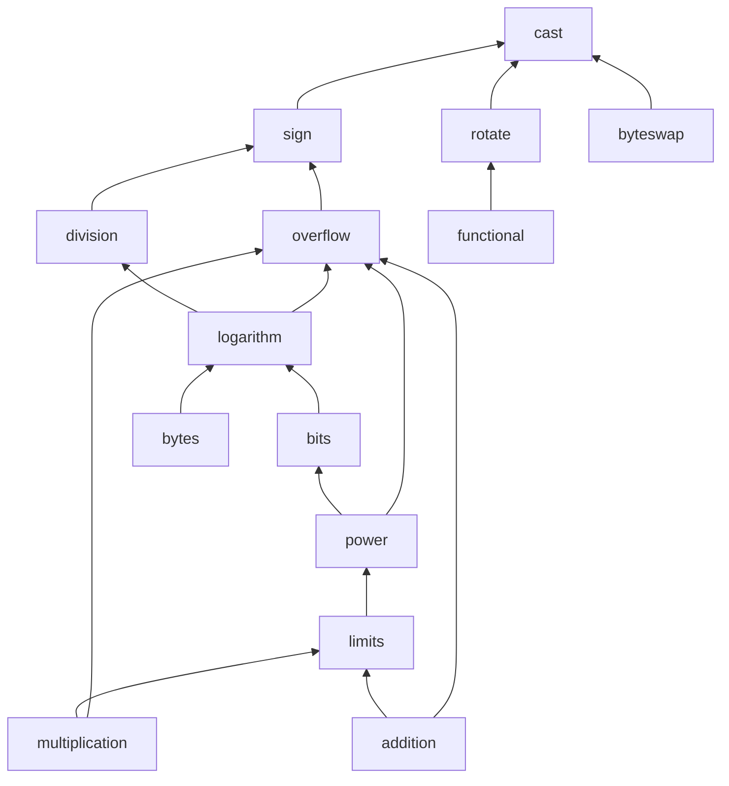

# Math

The `math` module of libbitcoin-system is a header-only library of integer
operations: casts, sign handling, overflow predicates, clamped arithmetic,
division and logarithm with explicit rounding, powers, bit and byte
manipulation, byte swapping and rotation. Each operation is a `constexpr`
function template, constrained to the integer types it is defined for, and
the result type of each is stated rather than left to the native promotion
rules. Paths are relative to `include/bitcoin/system/` in
[libbitcoin-system](https://github.com/libbitcoin/libbitcoin-system), at
master `0cd57fcf` (2026-10-27).

## 1. Why a math library

Integer arithmetic is one of the most error-prone areas of C++, as of most
languages. Code that reads correctly often relies on assumptions that do not
hold, and the compiler converts values into types they do not fit, silently:

| Assumption | What actually happens |
| ---------- | --------------------- |
| Arithmetic on a type produces that type | Operands narrower than `int` are promoted, so `uint8_t + uint8_t` is an `int`, and `~uint8_t{0}` is `-1` |
| A comparison compares values | Mixed signed and unsigned operands convert to unsigned, so `-1 < 0u` is false |
| Overflow wraps | Signed overflow is undefined, and the optimizer may remove a check written after it, on the assumption that it cannot happen |
| A shift by the width yields zero | A shift by the width or more is undefined, as is a left shift of a negative value before C++20 |
| An assignment keeps the value | A narrowing conversion truncates without warning |
| Division and remainder round down | They round toward zero, so a negative remainder keeps the sign of the dividend |
| A type has the same size everywhere | `long` is 32 bits on Windows and 64 bits on Linux and macOS |

In Bitcoin these are consensus failures, not merely bugs. Script numbers,
amounts, sizes, heights, difficulty and the compact number are all integer
arithmetic that every node must compute identically, and bitcoind has had
numerical bugs in several of them:

| Bug | Cause | Consequence |
| --- | ----- | ----------- |
| Value overflow (2010, CVE-2010-5139) | The sum of a transaction's output values overflowed a signed 64 bit integer | A transaction creating more than 184 billion bitcoin was valid, and the chain was forked to remove it |
| `OP_LSHIFT` crash (2010, CVE-2010-5137) | A script could shift a number by an arbitrary amount | Any node could be crashed by a transaction, and the shift opcodes were disabled |
| Subsidy shift (BIP42) | The subsidy was computed as `50 * COIN >> halvings`, and a shift by 64 or more is undefined | On common hardware the shift count wraps, so after 64 halvings the subsidy would have returned to 50 bitcoin; BIP42 defined it as zero |
| Retarget off by one | The retarget measures 2015 block intervals of a 2016 block period | The time warp attack, mitigated by BIP94 for testnet4 |
| Compact number sign | The target's compact form was derived from a signed format | A mantissa bit is lost to a sign that a target cannot have (see [Chain](chain#5-compact-number)) |

The subsidy shows the problem in its purest form. The original code was
correct C++ only up to 63 halvings, and its result beyond that depends on
the compiler and the processor. libbitcoin implements both behaviors
explicitly, the presumed wrapping by default and zero under BIP42, rather
than inherit either (`src/chain/block.cpp`):

```cpp
//*****************************************************************************
// CONSENSUS:
// bip42 compensates for C++ undefined behavior of a right shift of a number of
// bits greater or equal to the shifted integer width. Yet being undefined, the
// result of this operation may vary by compiler. The shift_right call below
// explicitly implements presumed pre-bip42 behavior (shift overflow modulo) by
// default, and specified bip42 behavior (shift overflow to zero) with bip42.
//*****************************************************************************
uint64_t block::subsidy(size_t height, size_t subsidy_interval,
    uint64_t initial_block_subsidy_satoshi, bool bip42) NOEXCEPT
{
    const auto halves = floored_divide(height, subsidy_interval);
    return shift_right(initial_block_subsidy_satoshi, halves, bip42);
}
```

The `math` module removes these assumptions from the code that uses it.
Every operation is constrained to the types it is defined for, its result
type is stated rather than promoted, overflow is tested before it can
occur, and every narrowing is an explicit, named cast. Since the operations
are `constexpr`, their tests are evaluated by the compiler, and a constant
expression that invokes undefined behavior does not compile, so the tests
check the absence of undefined behavior as well as the results (see
[Tests](#5-tests)).

## 2. Structure

Declarations are in `math/*.hpp` and definitions in `impl/math/*.ipp`, which
each header includes at its end. `src/math/math.cpp` contains no code. The
aggregate header is `math/math.hpp`.

### 2.1 Headers

| Header | Provides |
| ------ | -------- |
| `math/cast.hpp` | `promote`/`depromote` around native operators; explicit casts (`narrow_cast`, `sign_cast`, `narrow_sign_cast`, `wide_cast`, `wide_sign_cast`); `possible_*` casts; `pointer_cast`; `to_signed`/`to_unsigned`; floating point to integer (`to_ceilinged_integer`, `to_floored_integer`, `to_rounded_integer`, `to_truncated_integer`) and `to_floating` |
| `math/sign.hpp` | `absolute`, `negate`, `floored_negate`, `ones_complement`, `twos_complement`, `is_negative`, mixed-sign `is_greater`/`is_lesser`, `greater`/`lesser` |
| `math/overflow.hpp` | Predicates `is_add_overflow`, `is_subtract_overflow`, `is_multiply_overflow`, `is_negate_overflow`, `is_divide_overflow`, shift, power and log overflow; deprecated throwing `safe_*` functions |
| `math/addition.hpp` | `add`, `subtract`, `ceilinged_add`, `floored_subtract`, `delta` |
| `math/multiplication.hpp` | `is_multiple`, `is_product`, `ceilinged_multiply` |
| `math/division.hpp` | Ceilinged, floored and truncated `*_divide` and `*_modulo` |
| `math/limits.hpp` | `is_limited`, `limit`; `maximum`, `minimum`, `unsigned_max`, `absolute_min`; byte-sized `domain_max`/`domain_min` and `bitcoin_max`/`bitcoin_min` |
| `math/power.hpp` | `power`, `power2`, floating point `power` with integer exponent |
| `math/logarithm.hpp` | `is_power2`; `ceilinged_log`, `floored_log` and their base 2 and base 256 forms |
| `math/bits.hpp` | `bit_width`, zero/one counts, `bit_and`/`bit_or`/`bit_xor`/`bit_not`, single-bit get/set, masks, guarded shifts, rotations, `hi_word`/`lo_word`, `pack_word`/`unpack_word` |
| `math/bytes.hpp` | `byte_width`, bit to byte counts, `byte<Index>`, `is_negated`/`to_negated`/`to_unnegated` |
| `math/byteswap.hpp` | `byteswap` for 8, 16, 32 and 64 bit integrals, signed or unsigned |
| `math/rotate.hpp` | `rotl`/`rotr` with runtime or template shift |
| `math/functional.hpp` | Namespace `f`: word primitives (`and_`, `xor_`, `shr`, `ror`, `add`, `addc`, `mul`, `madd52lo`/`madd52hi`, `select`, `gather`) |

### 2.2 Dependencies

`math/math.hpp` records the permitted inclusion order. `cast` depends on
nothing in the module, `sign` and `overflow` only on `cast` and `sign`, and
the remaining headers build on those, so that the low-level headers can be
used by every other one without cycles.



## 3. Design

### 3.1 Type constraints

Every template is constrained with `if_*` aliases from `constraints.hpp`,
defaulted `bool` template parameters that remove an overload when the type
does not qualify. The distinctions are drawn in `typelets.hpp`: an
*integral* is a native signed or unsigned integer other than `bool`, and an
*integer* is any type whose `std::numeric_limits` reports `is_integer`, which
includes the Boost multiprecision `uintx` and `uintx_t<Bits>` types of
`types.hpp`. Functions that need domain bounds take `if_integral_integer`;
`power2`, `ceilinged_log2` and others have a separate
`if_non_integral_integer` overload for `uintx`. Signed and unsigned operands
usually select different overloads, as in `is_add_overflow`
(`impl/math/overflow.ipp`):

```cpp
template <typename Signed, if_signed_integer<Signed>>
constexpr bool is_add_overflow(Signed left, Signed right) NOEXCEPT
{
    const auto negative_right = is_negative(right);

    return is_nonzero(right) &&
        (!negative_right || (left < (minimum_<Signed> - right))) &&
        ( negative_right || (left > (maximum_<Signed> - right)));
}

template <typename Unsigned, if_unsigned_integer<Unsigned>>
constexpr bool is_add_overflow(Unsigned left, Unsigned right) NOEXCEPT
{
    return right > (maximum_<Unsigned> - left);
}
```

### 3.2 Promotion and result type

Native operators promote small operands to `int`. The module performs the
operation on promoted values and narrows the result back to the operand type
with `depromote`, so that `add` of two `uint8_t` is a `uint8_t`. Operands of
different types default to the wider type (`to_greater_type`), and an
`Explicit` template argument selects any other result type
(`impl/math/addition.ipp`):

```cpp
template <typename Integer, if_integral_integer<Integer>>
constexpr Integer add(Integer left, Integer right) NOEXCEPT
{
    // is_add_overflow() can be used to guard this addition.
    return depromote<Integer>(promote(left) + promote(right));
}
```

The bit functions in `math/bits.hpp` follow the same rule: they do not
promote, and shifts take an `overflow` flag that selects between a full shift
and one taken modulo the type width.

### 3.3 Overflow handling

Arithmetic does not check by default. Overflow is handled in one of two ways:
a predicate in `math/overflow.hpp` guards the native-width operation, or a
clamped form (`ceilinged_add`, `floored_subtract`, `ceilinged_multiply`,
`floored_negate`, `limit`) saturates at the bound of the result type.
Logarithm and power return zero for undefined arguments rather than
faulting. The `safe_*` functions in `math/overflow.hpp` throw
`overflow_exception` and are marked `DEPRECATED`.

### 3.4 Explicit casts

Conversions are named for what they do. `narrow_cast` requires a smaller
target of the same sign, `sign_cast` a target of different sign that is not
smaller, and `wide_cast` a larger target of the same sign; each fails to
compile otherwise. The `possible_*` casts are used where the relationship
varies by platform or compiler settings, such as `size_t` against a fixed
width type, so that the same code compiles where the cast is a narrowing,
a widening or no change. The narrowing and sign-changing casts are
each a `static_cast` with the corresponding compiler warning suppressed at
that one point.

### 3.5 Constant evaluation and intrinsics

`byteswap` and `rotl`/`rotr` are `INLINE constexpr`. Under
`std::is_constant_evaluated()` they use a portable form, and otherwise call
the platform intrinsic of matching width from the `intrinsics` module
(`impl/math/rotate.ipp`):

```cpp
template <size_t Shift, typename Integral,
    if_integral_integer<Integral>>
INLINE constexpr Integral rotl(Integral value) NOEXCEPT
{
    if (std::is_constant_evaluated())
    {
        return rotl_nominal<Shift>(to_unsigned(value));
    }
    else
    {
        constexpr auto cycle = Shift % bits<Integral>;
        if constexpr (is_zero(cycle)) return value;
        else return rotl(to_unsigned(value), cycle);
    }
}
```

The `f` namespace in `math/functional.hpp` gives scalar words the same
function names that the `intrinsics` module defines in its own `f`
namespace for vector words, with an `S` template parameter that the scalar
forms ignore, so algorithm code calls either through the same names.

## 4. Use by other modules

| Module | Use |
| ------ | --- |
| `hash`, `crypto` | Round functions written in `f::` primitives, for example `f::rol<s>(f::addc<k>(...))` in RIPEMD; `rotl`/`rotr` |
| `endian` | `byteswap` for byte order conversion |
| `chain` | Clamped sums of sizes, weights and counts; overflow predicates in multisig checks |
| `machine` | `is_negated`/`to_negated` for script number sign bytes; `bitcoin_min`/`bitcoin_max` bounds for script integers |
| Throughout | Explicit and `possible_*` casts in place of `static_cast` |

Transaction weight, for example, saturates rather than wrapping
(`chain/enums/magic_numbers.hpp`):

```cpp
constexpr size_t weighted_size(size_t nominal, size_t witnessed) NOEXCEPT
{
    return ceilinged_add(
        ceilinged_multiply(base_size_contribution, nominal),
        ceilinged_multiply(total_size_contribution, witnessed));
}
```

## 5. Tests

Because the functions are `constexpr`, the tests in `test/math/` are almost
entirely `static_assert` statements evaluated by the compiler, covering
values at the type bounds and the result type of each overload. Undefined
signed overflow fails constant evaluation, so it cannot pass silently.
`test/math/expectations.cpp` asserts the compiler's usual arithmetic
conversions that the module is built against (`test/math/addition.cpp`):

```cpp
// Unsigned overflow (signed overflow fails constexpr evaluation).
static_assert(add(max_uint32, max_uint32) == sub1(max_uint32));
static_assert(is_add_overflow(max_uint32, max_uint32));
```
