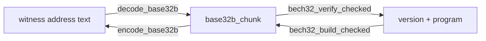

# Radix

The radix module converts between bytes and text in the bases that Bitcoin
and its neighboring protocols use: hexadecimal for hashes, base58 for legacy
addresses and keys, bech32's base32 for witness addresses, base64 for PSBT
and PEM, base2048 for mnemonic word lists, and decimal for BIP21 amounts. It
also holds the exponential form behind the block header's compact `bits`
field. Header paths are relative to `include/bitcoin/system/` in
[libbitcoin-system](https://github.com/libbitcoin/libbitcoin-system), at
master `0cd57fcf` (2026-10-27); implementation files are under `src/radix/`.

Bitcoin's encodings carry behavior that can seem arbitrary: hashes displayed
in reversed byte order, leading zero bytes carried by base58 as leading `1`
characters, a base32 alphabet and case rules of bech32's own, mnemonic words
that each carry 11 bits, and a compact number that loses a bit to a sign.
The radix module states each once, as a pure conversion with a fixed
interface, so that the code above it deals only in bytes and values.

## 1. Encodings

### 1.1 Headers

| Header | Provides | Used by |
| ------ | -------- | ------- |
| `radix/radix.hpp` | Aggregate header for the module | |
| `radix/base_10.hpp` | `encode_base10`, `decode_base10` over `uint64_t` with a decimal point position | BIP21 amounts (`wallet/addresses/bitcoin_uri`) |
| `radix/base_16.hpp` | `encode_base16`, `decode_base16`, `encode_hash`, `decode_hash`, `is_base16`, literal helpers `base16_array`, `base16_hash`, `base16_chunk`, `base16_string` | Byte and hash display, test vectors |
| `radix/base_2n.hpp` | `base2n<Base, Precision, Span>` exponential form and `base256e` | `chain::compact` (header `bits`) |
| `radix/base_32.hpp` | `encode_base32`, `decode_base32` (RFC 4648) | `config::base32` |
| `radix/base_32b.hpp` | `encode_base32b`, `decode_base32b`, `base32b_pack`, `base32b_unpack` | Witness and silent payment addresses, bech32 checksums |
| `radix/base_58.hpp` | `encode_base58`, `decode_base58`, `is_base58`, `base58_array` | Payment addresses, WIF, HD keys, encrypted keys |
| `radix/base_64.hpp` | `encode_base64`, `decode_base64` | PSBT (`wallet/psbt`), PEM (`x509`) |
| `radix/base_85.hpp` | `encode_base85`, `decode_base85` (Z85) | X25519 key text (`crypto/x25519`), `config::base85` |
| `radix/base_2048.hpp` | `encode_base2048`, `decode_base2048` and `_list` forms, `base2048_pack`, `base2048_unpack` | BIP39 and Electrum mnemonics |

Templates and `constexpr` functions are defined in
`impl/radix/base_16.ipp`, `impl/radix/base_2n.ipp` and
`impl/radix/base_58.ipp`; the remaining encodings are compiled functions
exported with `BC_API`.

### 1.2 Interface

Each encoding is a pair of free functions in `libbitcoin::system`. The
encoder returns a string, and the decoder writes to an output parameter and
returns `bool`. All are `NOEXCEPT`; malformed input is reported by a `false`
return, not by an exception.

```cpp
/// Encode data as base58.
BC_API std::string encode_base58(const data_slice& unencoded) NOEXCEPT;

/// Attempt to decode base58 data.
/// False if the input contains non-base58 characters.
BC_API bool decode_base58(data_chunk& out, const std::string& in) NOEXCEPT;
```

Two encodings differ from this shape. `encode_base85` also returns `bool`,
because Z85 accepts only input in multiples of four bytes. The `base2048`
names run in the opposite direction: `encode_base2048` takes words and
produces bytes, and `decode_base2048` takes bytes and produces words, because
the word sequence is authoritative for mnemonic entropy
(`radix/base_2048.hpp`).

Decoders into a fixed-size `data_array<Size>` fail when the decoded length
differs from `Size`, so a caller that expects a 32-byte hash cannot receive
any other length:

```cpp
template <size_t Size>
bool decode_base58(data_array<Size>& out, const std::string& in) NOEXCEPT
{
    data_chunk data{};
    if (!decode_base58(data, in) || (data.size() != Size))
        return false;

    std::copy(data.cbegin(), data.cend(), out.begin());
    return true;
}
```

### 1.3 Base16

Base16 is the library's canonical byte encoding: each byte maps to two
characters with no padding. `encode_base16` writes bytes in order, and
`encode_hash` writes them reversed, which is the display order of Bitcoin
hashes. Encoding and decoding are `constexpr`, and `is_base16` replaces
`isxdigit`, whose result depends on locale and code page
(`impl/radix/base_16.ipp`):

```cpp
constexpr std::string encode_base16(const data_slice& data) NOEXCEPT
{
    std::string out{};
    out.resize(data.size() * octet_width);
    auto digit = out.begin();

    for (const auto octet: data)
    {
        *digit++ = to_base16_hi_character(octet);
        *digit++ = to_base16_lo_character(octet);
    }

    return out;
}
```

The literal helpers take a string literal and size the result from the
literal's length at compile time. `base16_array` and `base16_hash` return a
zero-filled array on malformed input, and `base16_chunk` returns an empty
chunk, so constants such as test vectors are written in source as text:

```cpp
template <size_t Size, if_odd<Size> = true>
constexpr data_array<to_half(sub1(Size))>
base16_array(const char(&string)[Size]) NOEXCEPT;
```

### 1.4 Base58

Base58 uses the alphabet without `0`, `O`, `I` and `l`. Because 58 is not a
power of two, the conversion is a big-number change of base: each input
byte is folded into a base-58 digit vector by `b58 = b58 * 256 + ch`, and
each leading zero byte is written as a leading `1` (`src/radix/base_58.cpp`).
The base58 functions do not add or verify a checksum; callers such as
`wallet/keys/ec_private` add it with `insert_checksum` before encoding.

### 1.5 Base32 and bech32

There are two base32 encodings. `base_32.hpp` is RFC 4648: encoding emits
upper case padded to eight characters, and decoding accepts either case and
unpadded input, as in `.onion` and `.i2p` names (`src/radix/base_32.cpp`).
Decoding rejects lengths that no encoding produces and nonzero trailing
bits.

`base_32b.hpp` is the bech32 alphabet `qpzry9x8gf2tvdw0s3jn54khce6mua7l`,
with no prefix, separator or checksum. It exposes the intermediate five-bit
form as `base32b_chunk` (a vector of `uint5_t`), because BIP173 injects the
witness version and checksum into that form rather than into the bytes.
`decode_base32b` rejects mixed case. The checksum is built and verified by
`bech32_build_checked` and `bech32_verify_checked` in `hash/checksum.hpp`,
which operate on `base32b_chunk`:



`base32b_pack` converts five-bit elements to bytes and fails, by returning
an empty result, when the trailing pad element is nonzero, which detects
input not produced by `base32b_unpack`.

### 1.6 Base64 and base85

`encode_base64` and `decode_base64` use the standard alphabet with `=`
padding; decoding fails on a length that is not a multiple of four or on any
other character. `encode_base85` and `decode_base85` implement Z85, which
maps four bytes to five characters with no padding, and fail on input that
is not a whole number of groups. `crypto/x25519` uses Z85 to reject
generated keys whose text contains `#`, a configuration comment character.

### 1.7 Base2048

Base2048 maps each 11-bit element (`uint11_t`) to a word of a BIP39
dictionary. The dictionaries for English, Spanish, Italian, French, Czech,
Portuguese, Japanese, Korean and both Chinese scripts are held in one
catalog set (`src/radix/base_2048.cpp`). Words are matched bytewise against
lower case NFKD dictionaries and must be delimited by space (0x20). An
unknown word fails encoding, and an unsupported language returns an empty
decoding. `base2048_pack` fails when the pad element is nonzero, as in
base32b.

### 1.8 Base10

`decode_base10` parses a BIP21 amount with a decimal point position
(`btc_decimal_places` is 8, `mbtc_decimal_places` 5, `ubtc_decimal_places`
2) into an integer without floating point. Only the digits `0`-`9` and one
`.` are accepted. With `strict` set, fractional results fail; otherwise
they round up. `encode_base10` writes the integer back with trailing zeros
and a trailing point removed.

## 2. Exponential form

`base2n<Base, Precision, Span>` represents a `Span`-bit unsigned value as a
mantissa of `Precision` bits and an exponent in powers of `Base`. All
members are `static constexpr`, and the parameters are checked by
`static_assert` (`radix/base_2n.hpp`):

```cpp
static constexpr size_t factor  = floored_log2(base);
static constexpr size_t e_max   = span / factor;
static constexpr size_t e_bits  = bit_width(e_max);
static constexpr size_t e_bytes = to_ceilinged_bytes(e_bits);
static constexpr size_t e_width = to_bits(e_bytes);
static constexpr size_t m_bytes = precision / factor;
```

`compress` produces the normal form with the minimal exponent, and zero
only for a zero value. `expand` returns zero for an exponent out of range,
so zero is the invalid sentinel. The instantiation for block headers is:

```cpp
/// chain::header.bits
using base256e = base2n<256, 24, 256>;
```

`chain::compact` (`chain/compact.hpp`) derives from `base256e` to
reproduce the sign artifact of the consensus `bits` encoding (see
[Chain](chain#5-compact-number)).
Since both functions are `constexpr`, the conversions are checked at
compile time in `test/radix/base_2n.cpp`:

```cpp
static_assert(base256e::compress(to_uintx(base16_hash("0000000000000000000000000000000000000000000000000000000000000007"))) == 0x01070000ul);
```
