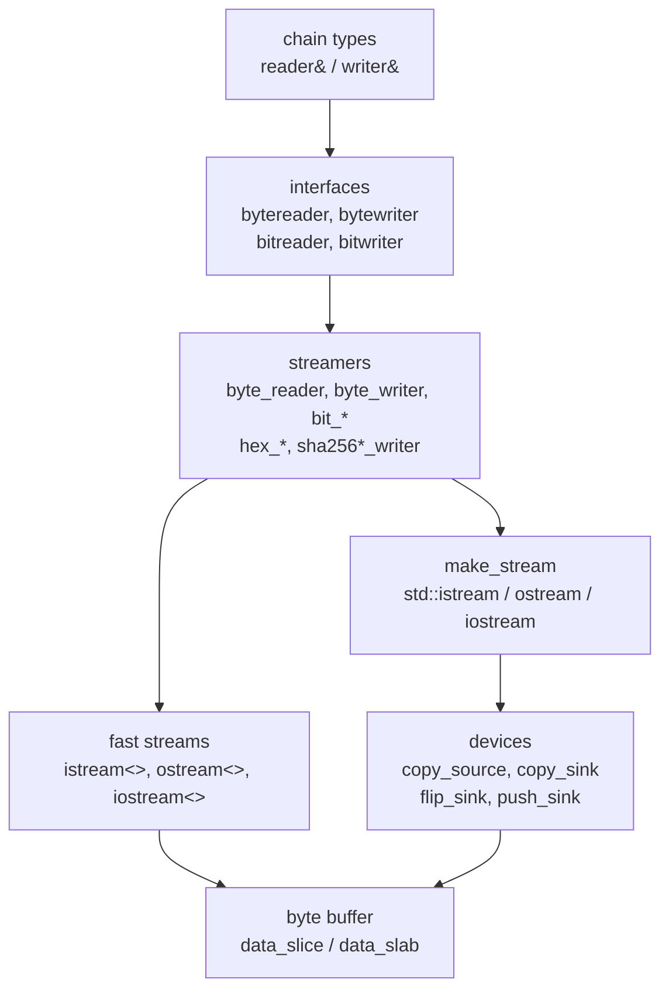

# Stream

The stream module serializes and deserializes bytes for every wire and
store type in the stack. It has three layers: devices, which expose a byte
buffer or container; streams, which present a device as a `std::istream`,
`std::ostream` or `std::iostream`, or as a lighter in-memory equivalent;
and streamers, the readers and writers that chain types call to encode
integers, hashes, variable-length sizes and strings. Paths are relative to
`include/bitcoin/system/` in
[libbitcoin-system](https://github.com/libbitcoin/libbitcoin-system), at
master `0cd57fcf` (2026-10-27).



## 1. Types

### 1.1 Aliases

Callers name streams and streamers by aliases rather than by template.
`streams.hpp` defines the streams and `streamers.hpp` the streamers. Each
alias namespace offers the same variants: `fast` over the in-memory stream,
`copy` over a buffer device, `push` (with `text` and `data`) appending to a
`std::string` or `data_chunk`, and `istream`/`ostream`/`iostream` wrapping a
caller-supplied standard stream.

| Alias | Provides | Location |
| ----- | -------- | -------- |
| `stream::in::fast`, `stream::in::copy` | Input stream over a `data_reference` | `stream/streams.hpp` |
| `stream::out::fast`, `stream::out::copy`, `stream::out::push<C>` | Output stream to a `data_slab` or appended to a container | `stream/streams.hpp` |
| `stream::flip::fast`, `stream::flip::copy` | Input/output stream over one `data_slab` | `stream/streams.hpp` |
| `read::bytes::*`, `read::bits::*`, `read::base16::*` | Byte, bit and hex readers | `stream/streamers.hpp` |
| `write::bytes::*`, `write::bits::*`, `write::base16::*` | Byte, bit and hex writers | `stream/streamers.hpp` |
| `flip::bytes::*`, `flip::bits::*` | Combined reader/writer over one stream | `stream/streamers.hpp` |
| `hash::sha256::*`, `hash::sha256x2::*`, `hash::sha256t::*` | Writers that emit a SHA-256, double SHA-256 or tagged SHA-256 digest | `stream/streamers.hpp` |
| `reader`, `writer`, `flipper` | Abstract `bytereader`, `bytewriter`, `byteflipper` | `stream/streamers.hpp` |

`stream/binary.hpp` is also in the module. It is a constant bit-vector
class for serialization and comparison of bit strings, not a stream.

### 1.2 Streamers

| Type | Base | Provides |
| ---- | ---- | -------- |
| `byte_reader<IStream>` | `bytereader` | Big- and little-endian integers of 2 to 8 bytes, Bitcoin variable integers, hashes, byte vectors, strings, lines, skip, rewind, limit, position |
| `byte_writer<OStream>` | `bytewriter` | The corresponding writes, plus flush; flushes on destruct |
| `bit_reader<IStream>`, `bit_writer<OStream>` | `byte_reader`/`byte_writer`, `bitreader`/`bitwriter` | Single bits and bit fields of up to 64 bits, high to low |
| `byte_flipper<IOStream>`, `bit_flipper<IOStream>` | reader and writer over one stream | Read and write at one position |
| `hex_reader<IStream>`, `hex_writer<OStream>` | `byte_reader`, `byte_writer` | Base16 text on the stream, bytes at the interface |
| `sha256_writer`, `sha256x2_writer`, `sha256t_writer<Tag>` | `byte_writer` | Accumulate written bytes into a hash, write the digest on flush |

## 2. Devices and streams

### 2.1 Devices

A device (`stream/device.hpp`) declares a category from the `ios` tags.
The category decides how `make_stream` buffers it:

| Device | Container | Category | Behavior |
| ------ | --------- | -------- | -------- |
| `copy_source` | `data_reference` | `input_seekable`, `direct_tag` | Reads in place from the buffer |
| `copy_sink` | `data_slab` | `output_seekable`, `direct_tag` | Writes in place to the buffer |
| `flip_sink` | `data_slab` | `seekable`, `direct_tag` | Reads and writes in place at one position |
| `push_sink` | `std::string`, `data_chunk` | `sink_tag`, `optimally_buffered_tag` | Appends to the container through a buffer |

A direct device exposes its memory as a `sequence` of two character
pointers. `push_sink` is indirect: it receives writes through `do_write`
and sizes its buffer from the container's unused capacity, or 1024 bytes
if there is none (`stream/devices/push_sink.hpp`):

```cpp
void do_write(const typename device<Container>::value_type* from,
    typename device<Container>::size_type size) NOEXCEPT override
{
    container_.insert(container_.cend(), from, std::next(from, size));
}
```

### 2.2 make_stream

`make_stream<Device>` (`stream/make_stream.hpp`) derives from
`std::istream`, `std::ostream` or `std::iostream` according to the
device category, and installs a `device_buffer<Device>`, a
`std::streambuf` implemented in the module. For a direct input or output
device the buffer's get or put area is the device's own sequence, so no
copy is made between device and stream. An input/output device shares one
position for reading and writing and is unbuffered. An indirect device is
output only, and is buffered by `optimal_buffer_size()` and flushed on
`sync` and on destruction.

```cpp
template <typename Device>
using device_stream = std::conditional_t<device_buffer<Device>::input,
    std::conditional_t<device_buffer<Device>::output, std::iostream,
        std::istream>, std::ostream>;
```

### 2.3 Fast streams

`system::istream<>`, `system::ostream<>` and `system::iostream<>`
(`stream/iostream/`) are not standard streams. Each holds three byte
pointers and a one-byte state, and implements only the subset of the
standard stream interface that the streamers use: `rdstate`, `setstate`,
`clear`, `tellg`/`tellp`, `seekg`, `peek`, `read`, `write` and `flush`.
The streamers are templates over the stream type, so the same streamer code
compiles against either. A read is a bounds check and a `std::copy_n`
(`impl/stream/iostream/istream.ipp`):

```cpp
auto bytes = possible_narrow_sign_cast<size_t>(count);
if (is_overflow(bytes))
{
    if (state_ != goodbit)
        return;

    // Allow read to end if state was good (std::istream behavior).
    bytes = end_ - position_;
    setstate(badbit);
}

std::copy_n(position_, bytes, data);
position_ += bytes;
```

These are the `fast` aliases, and the ones chain types use internally.

Fast streams are used extensively in libbitcoin. They are significantly
faster than the standard streams, yet provide the same simplifying
abstractions. They are generally passed through the `reader` and `writer`
interfaces, which accept standard streams as well, so a function written
against the interfaces serves either (see [Streamers](streamers)).

### 2.4 make_streamer

`make_streamer<Device, Base>` (`stream/make_streamer.hpp`) owns a
`make_stream<Device>` and a streamer over it in one object, so a `copy` or
`push` streamer is constructed from the container alone. The stream is held
in a private base, `stream_owner`, so that it is destroyed after the
streamer, whose destructor flushes into it.

## 3. Error state

### 3.1 Invalidation

No streamer operation throws; all are `NOEXCEPT`. A reader or writer is
valid while its stream state is `goodbit`. Any failure sets all of
`eofbit`, `failbit` and `badbit`, so that a state some standard streams
treat as recoverable cannot be cleared by a later operation
(`impl/stream/streamers/byte_reader.ipp`):

```cpp
template <typename IStream>
void byte_reader<IStream>::invalid() NOEXCEPT
{
    // If eofbit is set, failbit is generally set on all operations.
    // badbit is unrecoverable, set the others to ensure consistency.
    stream_->setstate(IStream::eofbit | IStream::failbit | IStream::badbit);
}
```

`validate()` calls `invalid()` after each stream operation that left any
flag set. Exceptions from `tellg` and `seekg` on a standard stream are
caught and converted to invalidation. Callers test the reader once, at
the end, through `operator bool`. Reads past the end of an invalid reader
return padded or empty values: integers and arrays are zero filled, and
`read_bytes`, `read_bytes_cptr` and `read_string` return empty or null
without allocating. `set_position` clears the invalid state before
seeking.

### 3.2 Limits

A reader carries a `remaining_` limit, unbounded by default. `set_limit(size)`
bounds reads to the next `size` bytes, and a read, skip or peek beyond it
invalidates the reader without reading from the stream. `read_size(limit)`
reads a variable integer and invalidates if it exceeds `limit`, returning
zero, so its result can be passed to a following read before the reader is
tested. `read_variable` invalidates on a non-minimal encoding.

## 4. Chain types

### 4.1 Deserialization

Chain types construct from a `reader&`. This includes `block`, `header`,
`transaction`, `input`, `output`, `point`, `outpoint`, `script`,
`operation` and `witness` (`chain/`). Constructors from a `data_slice`,
a `stream::in::fast` or a `std::istream` wrap it in a reader and delegate
(`src/chain/transaction.cpp`):

```cpp
transaction::transaction(const data_slice& data, bool witness) NOEXCEPT
  : transaction(stream::in::fast(data), witness)
{
}

transaction::transaction(stream::in::fast& stream, bool witness) NOEXCEPT
  : transaction(read::bytes::fast(stream), witness)
{
}

transaction::transaction(std::istream& stream, bool witness) NOEXCEPT
  : transaction(read::bytes::istream(stream), witness)
{
}
```

`from_data(reader&)` reads fields in sequence without testing for errors
between them, and passes the reader, converted to `bool`, as the object's
validity. A superfluous witness invalidates the reader explicitly with
`source.invalidate()`.

### 4.2 Serialization and hashing

Serialization takes a `writer&`. `to_data(bool)` sizes a `data_chunk` from
`serialized_size`, and writes into it through a fast stream, so the buffer
is allocated once. Hashing uses the same `to_data(writer&)` against a hash
writer, so the serialized bytes are never materialized
(`src/chain/header.cpp`):

```cpp
stream::out::fast stream{ digest };
hash::sha256x2::fast sink{ stream };
to_data(sink);
sink.flush();
return digest;
```

`sha256x2_writer` overrides `do_write_bytes` to feed its accumulator, and
on flush writes the double SHA-256 digest through the base writer to the
underlying stream, here the 32-byte `digest`.
