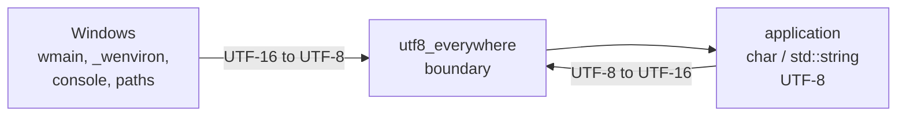

# Unicode

The `unicode` module makes UTF-8 the one string encoding of the library and
of the applications built on it, on every platform. On Windows it converts
at the process boundary, so portable code written against `char` and
`std::string` compiles and behaves the same there as elsewhere. It also
carries its own Unicode tables, with its normalization tables extracted
from Python's `unicodedata`, so that passphrase normalization in wallet operations matches Python wallets such as
Electrum exactly. Paths are relative
to `include/bitcoin/system/` in
[libbitcoin-system](https://github.com/libbitcoin/libbitcoin-system), at
master `0cd57fcf` (2026-10-27).

| Header | Contents |
| ------ | -------- |
| `unicode/conversion.hpp` | `to_utf8`, `to_utf16`, `to_utf32` over strings and string lists |
| `unicode/normalization.hpp` | NFC, NFD, NFKC, NFKD, case conversion, character tests, combining and diacritic removal, CJK compression |
| `unicode/code_points.hpp` | Separator, whitespace, diacritic and CJK sets, Python combining class tables |
| `unicode/unicode_tables.hpp` | Generated decomposition, composition and case tables |
| `unicode/ascii.hpp` | ASCII character tests and case conversion |
| `unicode/utf8_everywhere/environment.hpp` | `BC_USE_LIBBITCOIN_MAIN`, argument and environment conversion |
| `unicode/utf8_everywhere/stdio.hpp` | UTF-8 `cin`, `cout`, `cerr`, stdio modes, console echo |
| `unicode/utf8_everywhere/console_streambuf.hpp` | Windows console input buffer |
| `unicode/utf8_everywhere/unicode_streambuf.hpp`, `unicode_istream.hpp`, `unicode_ostream.hpp` | UTF-8 streams over wide streams |
| `unicode/utf8_everywhere/paths.hpp` | UTF-8 `std::filesystem::path` construction and extraction, long paths |
| `unicode/utf8_everywhere/ifstream.hpp`, `ofstream.hpp` | File streams with UTF-8 and long path translation |

## 1. UTF-8 everywhere

Windows APIs accept UTF-16 (`wchar_t`) for text, not UTF-8. The library
follows the [UTF-8 Everywhere](https://utf8everywhere.org/) design: `char` holds UTF-8 throughout, and
wide characters exist only at the edge, where the process meets the
operating system. On other platforms the same names resolve to the standard
facilities, so application code has no platform branches.



### 1.1 Arguments and environment

An application declares `BC_USE_LIBBITCOIN_MAIN` and implements
`bc::system::main` as it would `main`, with UTF-8 `argv`. On Windows the
macro defines `wmain` and forwards (`unicode/utf8_everywhere/environment.hpp`):

```cpp
int wmain(int argc, wchar_t* argv[])
{
    return libbitcoin::system::call_utf8_main(argc, argv,
        &libbitcoin::system::main);
}
```

`call_utf8_main` sets the global locale to UTF-8 for character conversion
only, keeping numeric formatting classic, then converts `_wenviron` and
`argv` to UTF-8 buffers, replaces `environ` for the duration of the call,
and restores it afterward:

```cpp
std::locale::global(std::locale(std::locale::classic(),
    std::locale(utf8_locale_name), std::locale::ctype));
std::setlocale(LC_NUMERIC, "C");

auto backup = environ;
auto environment = allocate_environment(_wenviron);
```

On other platforms the macro defines `main` and forwards directly.

### 1.2 Console

The macro also defines `bc::system::cin`, `cout` and `cerr`, used in place
of the `std` streams. On Windows these are `unicode_istream` and
`unicode_ostream` objects over `std::wcin`, `std::wcout` and `std::wcerr`;
elsewhere they are references to `std::cin`, `std::cout` and `std::cerr`
(`unicode/utf8_everywhere/stdio.hpp`).

| Component | Windows behavior |
| --------- | ---------------- |
| `unicode_streambuf` | Translates UTF-8 narrow buffers to and from the wrapped wide `std::wstreambuf`, carrying a partial UTF-8 character on output to the next flush |
| `console_streambuf` | Sets the console input and output code pages to `CP_UTF8`, and replaces the `std::wcin` buffer with one that reads through `ReadConsoleW` |
| `set_utf8_stdio` | Sets stdin, stdout and stderr to `_O_U8TEXT` mode |
| `set_binary_stdin`, `set_binary_stdout` | Set the descriptor to `_O_BINARY` mode |

Console setup is performed once per process, and is skipped for a process
with no attached console, such as a service. On other platforms these are
no-ops, except `set_console_echo` and `unset_console_echo`, which use
`termios`.

> **Do not use `std::cin`, `std::cout` or `std::cerr` once the console
> streams are substituted.** On Windows `set_utf8_stdio` puts the standard
> descriptors in `_O_U8TEXT` mode, which cannot be undone. In that mode
> the C runtime does not support narrow character I/O on those
> descriptors, so `std::cin`, `std::cout`, `std::cerr` and `printf` fault
> (an assertion in debug builds). All console I/O must go through `bc::system::cin`, `cout` and
> `cerr` (or `cin_stream()`, `cout_stream()`, `cerr_stream()`). The fault is
> Windows-only, so code that mixes the two can pass on other platforms and
> fail only there.

### 1.3 Paths and files

`std::filesystem::path` constructs from a narrow string using the ANSI code
page on Windows. `to_path` and `from_path` construct and extract through
`std::u8string` instead (`unicode/utf8_everywhere/paths.hpp`):

```cpp
std::filesystem::path to_path(const std::string& value) NOEXCEPT
{
    return { cast_to_u8string(value) };
}
```

`extended_path` fully qualifies a path and, on Windows, prefixes `\\?\`
when its length reaches `MAX_PATH`; elsewhere it returns the path
unchanged. `bc::system::ifstream` and `ofstream` open through
`extended_path`, so a long path works on every platform. `module_path`
returns the executable path from `GetModuleFileNameW`, `/proc/self/exe`, or
`_NSGetExecutablePath`, and `default_config_path` resolves under the common
application data folder on Windows or `SYSCONFDIR` elsewhere.

## 2. Conversion

`unicode/conversion.hpp` converts between UTF-8 (`std::string`), UTF-16
(`std::wstring`) and UTF-32 (`std::u32string`), for single strings and
lists. One decoder and one encoder, selected by character size, implement
all six directions. Conversion is strict: a truncated or overlong sequence,
an unpaired surrogate, or a value above U+10FFFF yields an empty result,
with no replacement or skipping.

```cpp
// Empty if any sequence is invalid (no replacement or skipping).
template <typename CharOut, typename CharIn>
static std::basic_string<CharOut> to_utf(
    const std::basic_string<CharIn>& in) NOEXCEPT
```

The implementation uses neither `std::codecvt` nor a platform API. UTF-32 is
the working form for character-level operations, since each `char32_t` holds
one code point.

## 3. Normalization

`unicode/normalization.hpp` provides the four Unicode normal forms, case
conversion, and the character operations that wallet seed derivation
requires.

| Function | Operation |
| -------- | --------- |
| `to_canonical_composition` | NFC |
| `to_canonical_decomposition` | NFD |
| `to_compatibility_composition` | NFKC |
| `to_compatibility_decomposition` | NFKD |
| `to_lower`, `to_upper` | Full case folding (lower), simple 1:1 mapping (upper) |
| `to_non_combining_form` | Remove characters of nonzero canonical combining class |
| `to_non_diacritic_form` | Remove characters with the Unicode `Diacritic` property |
| `to_compressed_form` | Collapse ASCII whitespace, remove an ASCII space between CJK characters |
| `is_combining`, `is_diacritic`, `is_chinese_japanese_or_korean`, `is_whitespace`, `is_separator` | Character tests |

### 3.1 Algorithm

A normal form decomposes each code point recursively through a two-level
trie, applies canonical ordering (a stable sort of each combining run by
combining class), and for NFC and NFKC recomposes through a sorted pair
table. Hangul syllables decompose and compose algorithmically. Pure ASCII
input is returned unchanged, and ASCII case conversion takes a direct path.

```cpp
static void normal_form(std::string& value, bool compatible,
    bool recompose) NOEXCEPT
{
    const auto points = to_utf32(value);
    std::u32string out{};

    out.reserve(points.size() * two);
    for (const auto point: points)
        decompose_one(out, point, compatible);

    canonical_order(out);
    if (recompose)
        compose(out);

    value = to_utf8(out);
}
```

### 3.2 Tables

The library carries its own tables so that normalization gives the same
result on every platform and matches the Python wallets it must
interoperate with. The tables are extracted from Python's `unicodedata`,
the same source Electrum normalizes with, which in turn extracts them from
the Unicode Consortium's publications (the Unicode Character Database).

| Table | Source | Use |
| ----- | ------ | --- |
| `decomposition_index1`, `decomposition_index2`, `decomposition_pool` | Python's `unicodedata` module ([`Modules/unicodedata_db.h`](https://github.com/python/cpython/blob/main/Modules/unicodedata_db.h)), by `tools/generate_unicode_tables.py` (`unicodedata.decomposition`) | NFD, NFKD |
| `composition_pairs` | same | NFC, NFKC |
| `case_fold_pairs` | same (`str.casefold`) | `to_lower` |
| `upper_pairs` | same (`str.upper`, 1:1 only) | `to_upper` |
| `unicode_data1`, `unicode_data2`, `combining_index` | Python's [`Modules/unicodedata_db.h`](https://github.com/python/cpython/blob/main/Modules/unicodedata_db.h) | Canonical combining class |
| `char32_chinese_japanese_korean` | Electrum [`electrum/mnemonic.py`](https://github.com/spesmilo/electrum/blob/master/electrum/mnemonic.py#L41-L71) intervals | CJK test |
| `char32_diacritics`, `char32_whitespace` | Unicode [`PropList.txt`](https://unicode.org/Public/UNIDATA/PropList.txt) (`Diacritic`, `White_Space`) | Diacritic and whitespace tests |

The generated tables (`unicode/unicode_tables.hpp`, `src/unicode/unicode_tables.cpp`)
record their origin:

```cpp
// Generated by tools/generate_unicode_tables.py
// Unicode version: 15.0.0 (Python 3.12.3)
```

The tables are fixed, not regenerated.

### 3.3 Passphrase safety

A wallet passphrase is normalized before it is hashed into the seed, so the
seed depends on the normalization as well as on the passphrase. Unicode
normalization is a very large standard that changes with each Unicode
version, so this dependency is inherently fragile: a passphrase outside
ASCII can normalize differently under a different version of the data, or
in a different implementation, and so derive a different seed, and with it
different keys.

Our approach is to align as closely as possible with early Electrum, the
original seed phrase implementation, and to keep the tables fixed. If the
Unicode standard or its use by Electrum, or by other wallets and tools, changes
the result for a passphrase, that is an inherent break, one that the
standards and their implementations themselves do not address. A
passphrase of ASCII characters only is unaffected.

## 4. Use

| Caller | Normalization | Standard | Matches | bx commands |
| ------ | ------------- | -------- | ------- | ----------- |
| `wallet/mnemonics/electrum` seeder | Passphrase: NFKD, `to_lower`, `to_non_combining_form`, `to_compressed_form`; words: `to_non_combining_form`, `to_compressed_form` | Electrum seed version system | Electrum | `electrum-to-seed`, `electrum-new` |
| `wallet/mnemonics/electrum` validator | Words: `to_non_combining_form`, `to_compressed_form` | Electrum seed version system | Electrum | `electrum-decode` |
| `wallet/mnemonics/mnemonic` seeder | Passphrase: NFKD | BIP39 | BIP39 wallets (reference: python-mnemonic) | `mnemonic-to-seed` |
| `words/languages` | Dictionary matching: NFKD and `to_lower`; Japanese joins with the ideographic space | BIP39 word lists | BIP39 wallets | `mnemonic-decode`, `mnemonic-to-seed`, `electrum-decode`, `electrum-new` |
| `wallet/keys/encrypted_keys` | Passphrase: NFC | BIP38 | BIP38 wallets | `ec-to-ek`, `ek-to-ec`, `ek-to-address`, `ek-public-to-ec`, `ek-public-to-address`, `token-new` |

The Electrum seeder follows Electrum's `normalize_text` step by step, each
call annotated with the Python line it reproduces:

```cpp
// seed = unicodedata.normalize('NFKD', seed)
// seed = seed.lower()
to_compatibility_decomposition(phrase);
to_lower(phrase);
```

Electrum removes characters for which `unicodedata.combining` is nonzero,
so `to_non_combining_form` tests the canonical combining class from
Python's own database, not the `Diacritic` property, and the CJK intervals
are [Electrum's](https://github.com/spesmilo/electrum/blob/master/electrum/mnemonic.py#L41-L71)
rather than a Unicode block list.
