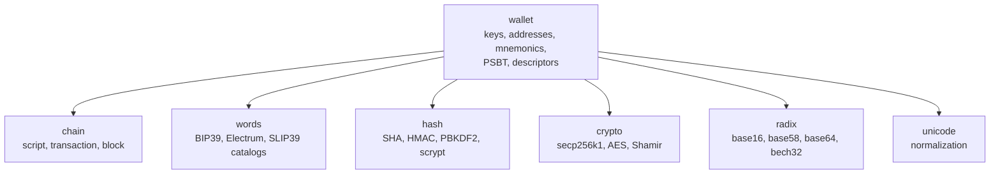

# Wallet

The wallet module of libbitcoin-system implements the standards that
wallets share: keys and their encodings, addresses, mnemonics, message
signing, partially signed transactions, output descriptors, compact block
filters and silent payment scanning. It is a library of value types and
functions. It holds no keys and opens no files or connections, and the
caller supplies all entropy. Paths are relative to `include/bitcoin/system/`
in [libbitcoin-system](https://github.com/libbitcoin/libbitcoin-system), at
master `0cd57fcf` (2026-10-27).

## 1. Entropy

libbitcoin does not provide seed entropy. Every wallet class and function
that creates a seed, key or mnemonic accepts its entropy from the caller. Software cannot provide entropy, and cannot ensure that it
is provided by the compiler, operating system or hardware beneath it, so
the library leaves its source to the application and to the user. The
`maybe_random` function in `crypto/` is named for this uncertainty, and is
used only for ephemeral values such as network session keys, never for
wallet seeds (see [Crypto](crypto#5-entropy)).

## 2. Organization

`wallet/wallet.hpp` includes every header of the module. The types are in
namespace `wallet`, except `ec_scalar` and `ec_point` (namespace `system`),
PSBT (`wallet::psbt`), and the block filter functions of
`wallet/neutrino.hpp` (namespace `neutrino`).

| Group | Header | Provides |
| ----- | ------ | -------- |
| Keys | `wallet/keys/ec_scalar.hpp`, `ec_point.hpp` | secp256k1 scalar and point arithmetic (`+`, `-`, `*`) with a validity state |
| | `wallet/keys/ec_private.hpp` | Private key with compression and version, WIF encoding |
| | `wallet/keys/ec_public.hpp` | Public key, compressed or uncompressed, base16 encoding |
| | `wallet/keys/hd_private.hpp`, `hd_public.hpp` | BIP32 extended keys, derivation, base58 encoding |
| | `wallet/keys/encrypted_keys.hpp` | BIP38 encryption, decryption, intermediate tokens and key pair creation |
| | `wallet/keys/ek_private.hpp`, `ek_public.hpp`, `ek_token.hpp` | Text forms of the BIP38 values |
| | `wallet/keys/mini_keys.hpp` | Casascius mini key to secret |
| Addresses | `wallet/addresses/checked.hpp` | `checked<Prefix, Payload, Checksum>`, a checksummed byte array |
| | `wallet/addresses/payment_address.hpp` | Base58 P2PKH and P2SH addresses, extraction from scripts |
| | `wallet/addresses/witness_address.hpp` | BIP173 (bech32) and BIP350 (bech32m) witness addresses |
| | `wallet/addresses/silent_payment.hpp` | BIP352 receiver: address, prevouts summary, output scanning |
| | `wallet/addresses/uri.hpp`, `uri_reader.hpp`, `bitcoin_uri.hpp` | RFC 3986 URI parsing, BIP21 and BIP72 payment URIs |
| | `wallet/addresses/qr_encoder.hpp`, `qr_code.hpp`, `qr_matrix.hpp`, `png.hpp`, `tiff.hpp` | QR code encoding, QR codes as TIFF images, PNG and TIFF image output |
| Mnemonics | `wallet/mnemonics/mnemonic.hpp` | BIP39 |
| | `wallet/mnemonics/electrum_v1.hpp`, `electrum.hpp` | Electrum v1 and v2 seeds |
| | `wallet/mnemonics/slip39.hpp` | SLIP39 Shamir shares |
| Signing | `wallet/message.hpp` | Legacy message signing and verification (P2PKH only) |
| Transactions | `wallet/psbt/` | BIP174 and BIP370 partially signed transactions |
| | `wallet/point_value.hpp`, `points_value.hpp` | Valued outpoints and output selection |
| | `wallet/descriptor.hpp` | BIP380 output script descriptors |
| Filters | `wallet/neutrino.hpp` | BIP158 block filter computation, headers and matching |
| Networks | `wallet/context.hpp` | Prefixes and version bytes of a network |

## 3. Value types

### 3.1 Validity

The wallet types are values. Each is constructed from its text form, its
binary form, or the values it derives from, and a failed construction
produces an invalid instance rather than an exception. As with the chain
types, an instance does not change after construction, other than by being
replaced through move or assignment. The exceptions are the math types
`ec_scalar` and `ec_point`, which are accumulators, with compound
assignment operators (`+=`, `-=`, `*=`), and `bitcoin_uri`, which is built
up by setters. The `bool` operator
reports validity, and a failed operation on `ec_point` or `ec_scalar`
returns an invalid or zero value.

Most types are copyable and comparable, and `payment_address` has a
`std::hash` specialization so it can key unordered containers.

### 3.2 Text forms

Each type with a text form has an `encoded()` serializer, a constructor
from `std::string`, and stream operators that use the two, so the text
round-trips. The stream extraction operators of the key, address, URI and
PSBT types throw on invalid text, for parsing text from a stream
(`ec_private`, from `src/wallet/keys/`):

```cpp
std::istream& operator>>(std::istream& in, ec_private& to)
{
    std::string value;
    in >> value;
    to = ec_private(value);

    if (!to)
        throw istream_exception(value);

    return in;
}
```

The encodings come from the `radix` module: base58 for WIF, extended keys
and payment addresses, base16 for public keys, bech32 and bech32m for
witness and silent payment addresses, and base64 for PSBT. Mnemonics
round-trip as word sentences, `bitcoin_uri` as a BIP21 URI, and
`descriptor` as its expression with checksum.

### 3.3 Network context

A key or address carries the prefixes of its network as values, not as a
global setting. `context` collects one network's prefixes, and the
contexts `btc_mainnet`, `btc_testnet` and `btc_regtest` are predefined, `btc_mainnet` the default argument where a
context is taken (`wallet/context.hpp`):

```cpp
struct BC_API context
{
    /// Extended (hd) private/public key prefixes.
    prefix::hds hd;

    /// Witness address prefix.
    std::string p2w;

    /// Pay to key hash address version byte.
    uint8_t p2kh;

    /// Pay to script hash address version byte.
    uint8_t p2sh;

    /// WIF (legacy private key) version byte.
    uint8_t wif;

    /// Silent payment address prefix.
    std::string sp;
```

`ec_private` packs its WIF and address version bytes into one 16 bit
`versions` value, and `hd_private` its private and public prefixes into one
64 bit `prefixes` value.

The classes are designed to forward these network parameters through every
derivation, so the network is given once, where the root value is
constructed. A derived HD key keeps its parent's prefixes in its lineage,
`hd_private::to_public` gives the corresponding public prefix, and
`ec_private` produces its `payment_address` with its own address version:

```cpp
const hd_lineage lineage
{
    lineage_.prefixes,
    add1(lineage_.depth),
    fingerprint(),
    index
};
```

## 4. Built on the primitives

The wallet module implements standards, not algorithms. Hashing, elliptic
curve operations, ciphers and encodings come from the modules below it, and
word lists from the `words` module.



| Standard | Primitives used |
| -------- | --------------- |
| BIP32 | HMAC-SHA512, secp256k1 point and scalar addition |
| BIP38 | scrypt, AES-256 |
| BIP39 | PBKDF2-HMAC-SHA512 (2048 iterations), SHA-256 checksum, NFKD |
| SLIP39 | Shamir over GF(256), RS1024 checksum |
| Message signing | Double SHA-256, ECDSA public key recovery |
| BIP352 | Tagged SHA-256, secp256k1, bech32m |
| BIP158 | SipHash, Golomb-Rice coding |

A BIP32 master key is the HMAC-SHA512 of the seed under the specified key,
split into secret and chain code (`src/wallet/keys/hd_private.cpp`):

```cpp
// This is a magic constant from BIP32.
static const auto magic = to_chunk("Bitcoin seed");
const auto intermediate = split(hmac<sha512>::code(entropy, magic));

return { intermediate.first, intermediate.second, prefixes };
```

## 5. Mnemonics

The mnemonic types derive from `words::languages`, which holds the entropy,
the words and the dictionary language, and provides `sentence()`, `words()`,
validity and the stream operators. Each type selects its dictionaries from
the `words` catalogs.

| Type | Standard | Words | Dictionaries | Produces |
| ---- | -------- | ----- | ------------ | -------- |
| `mnemonic` | BIP39 | 12 to 24, in multiples of 3 | en, es, it, fr, cs, pt, ja, ko, zh_Hans, zh_Hant | Seed, `hd_private` |
| `electrum_v1` | Electrum v1 | 12 or 24 | en, pt | `ec_private`, `ec_public` |
| `electrum` | Electrum v2 | 12 to 46 | en, es, it, fr, cs, pt, ja, ko, zh_Hans, zh_Hant | Seed, `hd_private` |
| `slip39` | SLIP39 | 20 or 33 per share | en | Master secret, `hd_private` |

An `electrum` seed has a prefix (`standard`, `witness`, and the two factor
forms) that states its use, and construction from entropy can grind the
entropy until the words carry the requested prefix. `slip39::to_shares`
splits a master secret into groups of shares, and `slip39::to_secret`
recovers it from a threshold of groups.

## 6. Signing and transactions

`wallet/message.hpp` implements the legacy Bitcoin message signature, the
format of Bitcoin Core's `signmessage` and `verifymessage`, which predates
segregated witness and identifies the signer by a P2PKH address only. It
signs a message with an `ec_private`, WIF or secret,
and verifies a signature against a `payment_address`. The signature is a
compact ECDSA signature with a prefix byte that encodes the recovery id and
key compression. The signed hash is the double SHA-256 of the prefix
`"Bitcoin Signed Message:\n"`, the message length and the message.

`psbt::transaction` parses and serializes BIP174 (version 0) and BIP370
(version 2) transactions. Input and output maps are structs of typed fields,
and fields the type does not interpret are kept as raw `entry` pairs, so
they survive a round trip. Its methods are those of the PSBT roles that need
no keys:

| Method | Operation |
| ------ | --------- |
| `combine()` | Merge the fields of another copy of the same transaction |
| `join()` | Merge the inputs and outputs of another transaction |
| `finalize()` | Convert complete signature sets into final scripts |
| `extract()` | The network transaction, once all inputs are final |
| `fee()`, `locktime()` | Values computed from prevouts and lock time fields |

Finalization covers legacy and version 0 witness scripts. Taproot fields
are parsed and preserved but not satisfied.

`descriptor` parses a BIP380 expression in a given context and produces the
output scripts at an index, or the scripts with their key origins as
`psbt::derivation` records for signing. The supported functions are `pk`,
`pkh`, `wpkh`, `sh`, `wsh`, `multi`, `sortedmulti`, `combo`, `tr` (key path),
`addr` and `raw`.

`points_value::select` chooses outpoints for a spend from a set of valued
outpoints, either the smallest sufficient set (`greedy`) or the individually
sufficient outputs (`individual`).

## 7. Scanning

`neutrino::compute_filter` computes a block's BIP158 filter, from a
`chain::block` or from a `chain::view::block` read in place, and
`compute_header` chains the filter headers. `match_filter` tests a filter
against scripts or payment addresses.

`silent_payment` is a BIP352 receiver, constructed from a scan secret, a
spend key and labels. The static members summarize a transaction's inputs
(the input hash times the sum of its eligible input keys) and collect the
summaries of a block's transactions as columns. `scan()` finds the outputs
of a transaction that pay the receiver, with the tweak and label of each,
and `match()` tests only for the first output to the receiver (k = 0).
`keys()` exposes the receiver keys to the batch scanner
(`crypto/secp256k1/batch/scan.hpp`).
