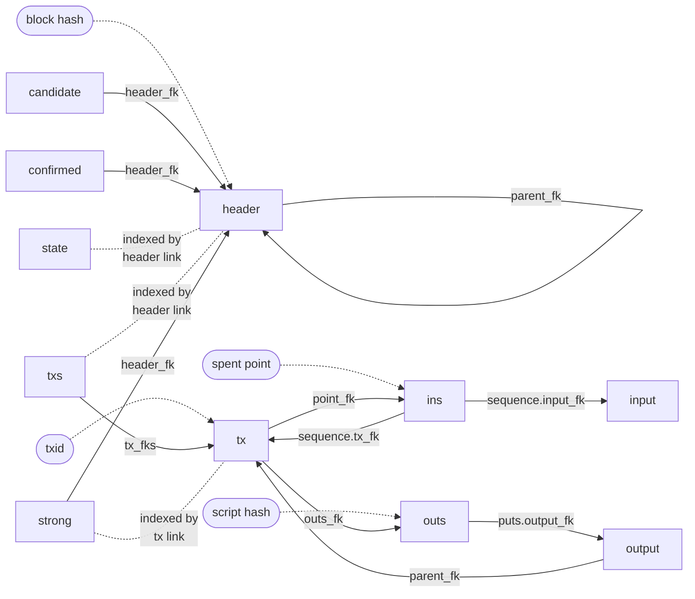

# 02 — Tables

> Companion to [`01-primitives`](01-primitives) and [`04-queries`](04-queries).
>
> Each table is declared in `tables/<category>/<name>.hpp` with its schema
> in `tables/schema.hpp`. The store owns them (`store.hpp:367-406`) and
> binds them to storages and settings (`impl/store/store.ipp:42-198`).
> Schema version `{4,0,15,0}` (`tables/schema.hpp:62`).

---

## 1. Relations

Arrows are foreign keys (navigation), labelled with the field that holds
the link. Dotted arrows are searches through a hash head, labelled with the
search key. Headmaps are indexed by the link of the table they annotate.

Reading a block: `header` by hash, `txs` at the header link, then each
`tx`, whose `point_fk` and `outs_fk` are the first of its contiguous
`ins` and `outs` rows (`ins_count`, `outs_count` give the extent). Each
`ins` row leads to the `input` (script and witness) and each `outs` row
to the `output` (value and script).

> **Invariant (Table-2).** A transaction's `ins` and `outs` rows are
> contiguous and allocated before the tx row is written, so `point_fk`
> and `outs_fk` with the two counts determine them exactly
> (`impl/query/archive/chain_writer.ipp:161-186`).

---

## 2. Archive tables

| Table  | Map / head | Link | Key | Row | Fields |
| ------ | ---------- | ---- | --- | --- | ------ |
| header | hash_map, cell 4 | 3 / 23 | block hash | 79 (+7 index) | ctx flags 4, ctx height 3, ctx mtp 4, parent_fk 3, version 4, timestamp 4, bits 4, nonce 4, merkle root 32, work 16, flags 1 |
| tx     | hash_map, cell 4 | 4 / 31 | txid | 28 (+36 index) | light 3 (coinbase bit 23), heavy 3, locktime 4, version 4, ins_count 3, outs_count 3, point_fk 4, outs_fk 4 |
| ins    | hash_maps, cell 8 | 4 / 32 | point (hash 32, index 3) | point 39, sequence 13 | point: next 4 + key 35. sequence: sequence 4, input_fk 5, tx_fk 4 |
| outs   | hash_maps, cell 4 | 4 / 32 | script hash (search, 0 bytes) | address 4 (or 0), puts 5 | address: next link. puts: output_fk 5 (excluded bit 39) |
| txs    | array_map slab | 5 / 40 | header link | ≥ 12 | light 3 (interval bit 23), heavy 3, count 2, tx_fk × count, optional interval hash 32 |
| input  | no_map slab | 5 / 40 | — | ≥ 2 | script (prefixed), witness (prefixed) |
| output | no_map slab | 5 / 39 | — | ≥ 6 | parent tx_fk 4, value varint, script (prefixed) |

Sources: `tables/archives/*.hpp`, `tables/schema.hpp:105-289`.

- **header** stores the chain context (flags, height, median time past)
  computed at archival, so validation does not recompute it from ancestors.
  `work` is the low-order bytes of the header's proof.
- **ins** is the spent-point index and the per-input navigation in one
  table. A null point's index is terminal, so coinbase inputs carry no
  real point and land in bucket zero.
- **outs** stores no key bytes. With the address index enabled, a bucket
  is selected by the output's script hash and each candidate is verified
  against the output's script (`tables/archives/output.hpp:129-146`). With
  it disabled the keyed record is unbacked (width 0) and only `puts` is
  stored (`tables/archives/outs.hpp:277-291`).
- **txs** is written once per block, after the header and every tx are
  archived. Its presence is the block's association
  ([`04 §2.3`](04-queries)).

---

## 3. Index tables

| Table | Map / head | Link | Indexed by | Cell / row | Content |
| ----- | ---------- | ---- | ---------- | ---------- | ------- |
| candidate | head_map | 3 / 23 | height | 4 | header_fk |
| confirmed | head_map | 3 / 23 | height | 4 | header_fk |
| strong    | value_map | 4 / 31 | tx link | 4 | header_fk with "positive" bit 23 |
| state     | value_map | 3 / 24 | header link | 1 | `block_state` flags |
| duplicate | hash_map, cell 4 | 3 / 24 | point | 38 (key only) | none |
| wtxid     | hash_map, cell 4 | 4 / 32 | wtxid (search, 0 bytes) | 4 | next link; row aligned with pool |
| scan      | arraymaps | 4 / 32 | header link | identity 4, point 33, outputs 7 | tx_fk; tweak point; first prefix + count |
| scan_prefix | no_map | 4 / 32 | — | 8 | output key prefix |

Sources: `tables/indexes/*.hpp`, `tables/schema.hpp:298-443`.

- **candidate** and **confirmed** are the two chains. Push and truncate
  change only the head's logical size ([`04 §4`](04-queries)).
- **strong** associates each tx with the block that makes it strong, so
  confirmation of a spend is a cell read, not a search. A zero cell is a
  negative association, so an unset tx is never strong
  (`tables/indexes/strong.hpp:30-57`).
- **state** holds `associated`, `valid`, `confirmable`, `unconfirmable`,
  `milestoned`, `checkpointed`, `scanned` and `filtered`
  (`types/block_state.hpp:28-56`), updated atomically by merge and clear.
- **duplicate** is the set of points spent by more than one archived tx,
  written at archival when a point push collides with an existing spender
  (`impl/query/archive/chain_writer.ipp:220-243`). Absence from it proves
  a point has a single spender, so conflict detection for every other
  point is a filter test (`consensus/consensus_prevouts.ipp:191-213`).

---

## 4. Cache tables

| Table | Map / head | Link | Row | Content |
| ----- | ---------- | ---- | --- | ------- |
| prevout | array_map slab, by header link | 5 / 40 | ≥ 6 | conflict count, conflict tx_fks, then per spend: parent tx_fk 4 (coinbase bit 31), sequence 4 |
| pool | hash_maps, cell 4 | 4 / 32 | context 38, id0..id3 8 each | key: tx link 4. ctx flags 4, height 3, mtp 4, fee 8, sigops 3, spends_fk 4, time 4 |
| spends | no_map | 4 / 32 | 4 | parent tx_fk (coinbase bit 31), per pooled input |
| ecdsa0, ecdsa1 | nomaps | 4 / 32 | 6 / 32 / 33 / 64 | identity, digest, key, signature |
| schnorr0, schnorr1 | nomaps | 4 / 32 | 3 / 32 / 32 / 64 | identity, digest, x-only key, signature |
| silent0, silent1 | nomaps | 4 / 32 | 4 / 33 / 32 / 7 | tx_fk, sum, hash, outputs |
| silent{0,1}_prefix | no_map | 4 / 32 | 8 | output key prefix |
| prevalid0, prevalid1 | no_map | 3 / 23 | 3 | header_fk pending batch validation |
| presilent0, presilent1 | no_map | 3 / 23 | 3 | header_fk pending silent batch |
| envelope | headmap slab | 2 / 16 | — | the store envelope |

Sources: `tables/caches/*.hpp`, `tables/schema.hpp:336-516`.

- **prevout** caches, per block, the parent tx and sequence of every
  spent output, and the txs that conflict with it, so confirmation reads
  one row instead of one search per input ([`04 §5`](04-queries)).
- **pool**, **spends** and **wtxid** are the transaction pool index over
  archived transactions; a pooled tx is archived exactly like a
  confirmed one ([`04 §6`](04-queries)).
- The **batch** tables come in two banks so one can be filled while the
  other is verified. Each is truncated to zero when its batch completes,
  and all are dropped at restore.

### 4.1 Envelope

The envelope is a single slab element, written at create and read at open
(`tables/envelope.hpp:30-111`, `src/tables/envelope.cpp`). Stored values
govern the store; configuration is consumed only at creation.

| Group | Content |
| ----- | ------- |
| schema | version, 4 × u32; open fails on mismatch |
| system | fork flags, subsidy, retarget and timing parameters, activation heights, checkpoints, milestone |
| database | interval depth; bucket counts and filter k for header, ins, outs, tx, duplicate, pool, wtxid |
| network | limited_blocks, provide_filters |
| node | silent_start_height (`max_uint32` = disabled) |
| state | pooling, scan_frontier, latch_tx (rewritten in place by `set_pooling`) |

---

## 5. Optional tables

| Table | Map / head | Link | Row | Content |
| ----- | ---------- | ---- | --- | ------- |
| filter_bk | array_map, by header link | 3 / 24 | 64 | BIP157 filter hash 32, filter header 32 |
| filter_tx | array_map slab, by header link | 5 / 40 | ≥ 1 | BIP158 filter, varint length prefixed |

Filters are enabled when both tables have buckets
(`impl/query/extent.ipp:319-322`). The address search is enabled when
`outs` has buckets (`extent.ipp:312-316`). Silent-payment scanning is
enabled by `silent_start_height` in the envelope (`extent.ipp:325-328`).

---

## 6. Hash heads and their filters

| Table | Buckets setting | Cell | Link bits | Filter bits | k max |
| ----- | --------------- | ---- | --------- | ----------- | ----- |
| header | `header` | 4 | 23 | 9 | 9 |
| ins | `ins` | 8 | 32 | 32 | 12 |
| duplicate | `duplicate` | 4 | 24 | 8 | 8 |
| tx | `tx` | 4 | 31 | 1 (off) | — |
| outs | `outs` | 4 | 32 | 0 | — |
| pool | `pool` | 4 | 32 | 0 | — |
| wtxid | `wtxid` | 4 | 32 | 0 | — |

The two point filters carry the load: archival of an input in a dirty
store asks whether its point is already in `ins`, and building a block's
prevout cache asks whether each of its points is in `duplicate`. Nearly
all of these answers are "no", and the filter gives them without touching
the body ([`01 §2.1`](01-primitives)).

---

## Cross-references

- [`01-primitives`](01-primitives) — the templates behind each map type
- [`04-queries`](04-queries) — how the tables are written and read
