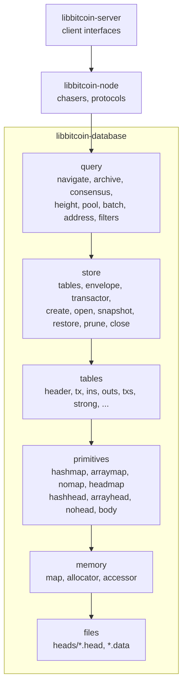

# 00 — Overview

> Companion to [`02-primitives`](primitives), [`03-tables`](tables),
> [`04-storage`](storage) and [`05-queries`](queries).

---

## 1. Layers



| Layer      | Location                                   | Role |
| ---------- | ------------------------------------------ | ---- |
| query      | `query.hpp`, `impl/query/`                 | The only interface the node uses. Typed reads and writes over links. |
| store      | `store.hpp`, `impl/store/`                 | Owns every storage and table, the envelope, and the transactor lock. Lifecycle and recovery. |
| tables     | `tables/`                                  | One schema per table: link width, key, row and the element serializers. |
| primitives | `primitives/`, `impl/primitives/`          | The head, body and map templates. |
| memory     | `memory/`, `impl/memory/`, `src/memory/`   | Memory-mapped files, growth, flush, and the remap lock. |

---

## 2. A relational store without a query engine

The store is strictly relational, but every relation is resolved by one of
two physical operations chosen when the table is designed:

- **Navigation.** A row holds the **link** of a row in another table. A
  link is that row's position (record ordinal or byte offset), so following
  it is a multiply and an add: no hash, no search, no lock beyond the remap
  lock. Links are the store's foreign keys (FK). Tables do not store their
  own primary keys; a row's PK is its position.
- **Search.** A hash head maps a key to the newest row with that key, and
  rows in a bucket chain to older rows. Search is how a natural key (NK)
  from outside the store becomes a link.

The 2021 design names the key kinds used throughout:

| Key | Meaning | Implementation |
| --- | ------- | -------------- |
| PK  | Row identity | The row's link (position). Never stored in its own row. |
| FK  | Reference to another table's PK | A link field, e.g. `tx.outs_fk`, `ins.sequence.input_fk`. |
| NK  | Unique property derived from the row | Block hash (header), txid (tx). |
| SK  | Indexed search value | The hash-head key: block hash, txid, point, output script hash, wtxid. |
| NP  | Natural point: txid + index | The `ins` key, the prevout an input spends. |
| FP  | Foreign point: tx FK + index | Proposed in 2021; not used. `ins` is keyed by NP. |

> **Invariant (Table-1).** The only public entries to the archive are the
> two natural keys exposed by the chain: block hash and txid. Every other
> archive object is reached from one of them by navigation, or by a
> height index once confirmed. Optional entries are output script hash
> (address index) and wtxid (pool).

### 2.1 Deferred associations

Two associations cannot be written when their parent is written, because
the store is append-only and blocks and transactions arrive out of order:

- **Header → transactions.** Headers are archived first (headers-first
  sync), and a block's transactions arrive later. The association is a
  single `txs` row written once the header and all its transactions are
  archived. In 2021 this was a search; it is now an array map indexed
  directly by the header link, so it is navigation
  (`tables/archives/txs.hpp:36-46`).
- **Output → spending input.** An output can be archived before or after
  any input that spends it. The `ins` hash map is keyed by the spent point
  (NP), so spenders of an output are found by search on that point
  (`tables/archives/ins.hpp`).

### 2.2 Publication

Bodies are append-only. A row is allocated, written, and only then made
reachable: by a head push (search), an array or headmap cell (index), or a
foreign key written into a row that is itself published later. A reader
therefore never reaches a partly written row, without any read lock on the
row ([`02 §4.1`](primitives), [`05 §2`](queries)).

This one property gives both concurrency (readers and the single writer
of each row do not coordinate) and recovery: a consistent state is a copy
of the heads, since every body row beyond what the heads publish is
unreachable ([`04 §6`](storage)).

---

## 3. Table categories

| Category  | Tables | Character |
| --------- | ------ | --------- |
| archive   | header, input, output, ins, outs, tx, txs | The blockchain itself. Append-only, never pruned. |
| index     | candidate, confirmed, strong, state, duplicate, wtxid, scan, scan_prefix | Mutable state over the archive: chains, confirmation, validation. |
| cache     | prevout, pool, spends, ecdsa, schnorr, silent, prevalid, presilent, envelope | Derived or transient data; prunable, truncated per batch, or rewritten in place. |
| optional  | filter_bk, filter_tx; address search in outs | Enabled by configuration at creation. |

Details per table are in [`03-tables`](tables).

---

## 4. Files

Each table has a head file and, unless it is a headmap, one body file per
record (`store.hpp:346-359`, `tables/names.hpp`).

```
<path>/
├── flush.lock                  present while open; left behind by a faulted close
├── process.lock                exclusive OS file lock
├── heads/                      the live heads
│   ├── archive_header.head
│   ├── index_candidate.head    headmap: the whole table
│   └── ...
├── primary/                    newest snapshot of heads/
├── secondary/                  previous snapshot (transient during rotation)
├── temporary/                  snapshot being written
├── archive_header.data
├── archive_ins_point.data      multi-record bodies: <name>_<record>.data
├── archive_ins_sequence.data
└── ...
```

Heads are a few percent of the store. Bodies are the bulk and are never
copied ([`04 §6`](storage)).

---

## 5. Optimizations since the 2021 design

The implementation originally followed the design closely. Each difference
below is an optimization made as the store evolved.

| 2021 design | Optimization |
| ----------- | -------------- |
| Array and blob primitives | headmap and nomap, plus arraymap, each map generalized to record(s) |
| Point table deduplicating spent txids; inputs keyed by FP | `ins` keyed by NP (hash + index); no point table |
| Puts table of input and output FKs | `ins.sequence` and `outs.puts` records, contiguous per tx |
| Txs found by search on header FK | `txs` array map indexed by header link |
| Confirmed and validated block/tx tables | `strong` (tx → block) and `state` (block flags) headmaps |
| Height arrays snapshotted with their body | headmaps: the head is the table |
| `.idx` and `.dat` files | `heads/*.head` and `*.data` |
| Optional spend/spender indexes for mining | `prevout` cache per block, `duplicate` set for BIP30 twins |

---

## Cross-references

- [Node architecture](../architecture/index.html) — the chasers that drive
  these queries
