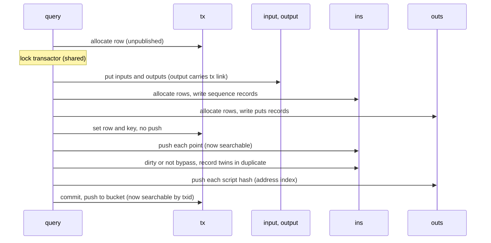
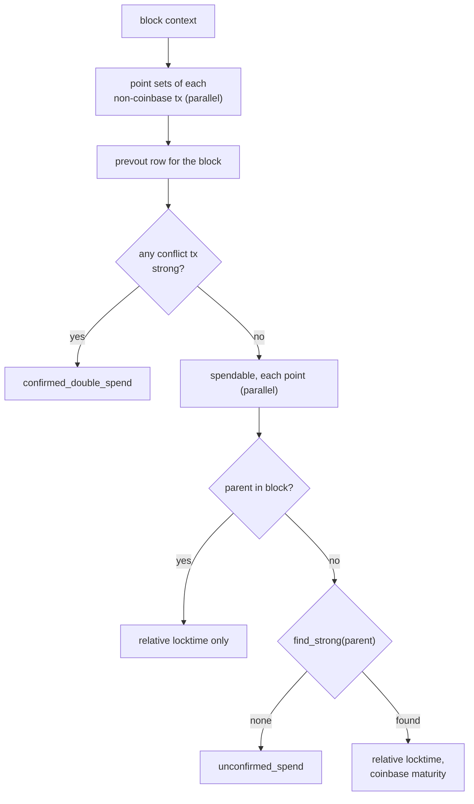

# 05 — Queries

> Companion to [`03-tables`](tables) and [`04-storage`](storage).
>
> `query<store>` (`query.hpp`, `impl/query/`) is the whole interface the
> node uses. Apart from the two chain reorganization mutexes, its state
> is the store.

---

## 1. Families

| Family | Source | Purpose |
| ------ | ------ | ------- |
| store  | `query.ipp` | Transactor, fault and disk-full state, snapshot, reload, prune, pooling latch |
| extent, sizes | `extent.ipp`, `sizes.ipp` | Head and body sizes, bucket counts, record counts, enabled options |
| initialize | `initialize.ipp` | Genesis |
| navigate | `navigate/*.ipp` | Key to link: `to_header`, `to_tx`, `to_txs`, `to_state`, parents, children, spenders, `to_block` |
| archive | `archive/*.ipp` | Read and write headers, txs and blocks, as objects or wire bytes |
| properties | `properties_*.ipp`, `fee_rate.ipp`, `merkle.ipp` | Sizes, heights, values, fee rates, merkle over the confirmed index |
| consensus | `consensus/*.ipp` | Block state, chain state, work, prevouts, strong, `block_confirmable` |
| height | `height.ipp`, `locator.ipp`, `sequences.ipp` | Candidate and confirmed push and pop, locators, ancestry, mtp |
| confirmed | `confirmed.ipp` | Non-consensus confirmation and spent tests |
| pool | `pool.ipp` | Pooled tx records, confirmability, ancestors and descendants |
| batch | `batch/*.ipp` | Signature and silent-payment batch banks |
| address | `address/*.ipp` | Script-hash history, unspent, balance |
| filters | `filters.ipp` | BIP157/158 |
| unspent | `unspent.ipp`, `amounts.ipp` | Unspent output totals and set commitments |

Writes return a `code`. A write fails on a full or faulted storage, and
the node maps each failure to a fault of its own
([node 00 §9](../architecture/overview.html)).

---

## 2. Archival

### 2.1 Transaction

`set_code(tx_link, tx, bypass, prune)` is the only query that writes
several tables for one object (`impl/query/archive/chain_writer.ipp:128-271`).
The tx row is allocated first, so its link is known to every component,
but it is published last.

> **Invariant (Archive-1).** A transaction is findable by txid only after
> its inputs, outputs, `ins`, `outs` and its own row are written and its
> points are searchable. Finding a tx therefore implies its spends are
> navigable, and finding a spender implies its tx row is complete
> (`chain_writer.ipp:188-201`, `:214-219`).

The point push precedes the tx commit because a spender found by point
search navigates to its tx through `ins.sequence.tx_fk`; that row must be
complete by then, though it need not yet be searchable.

When the pool is enabled, a tx already archived and pooled with a matching
witness is reused rather than archived again (`chain_writer.ipp:94-125`).

### 2.2 Header

`set_code(header_link, header, ctx, ...)` puts the header row (allocate,
write and push in one call), then merges its initial flags into `state`:
`milestoned`, `checkpointed`, and `scanned` or `filtered` when those
features are off (`chain_writer.ipp:301-354`).

### 2.3 Block association

A block is associated once its header and every tx are archived
(`chain_writer.ipp:424-547`):

1. Each tx not already archived is written as in §2.1, each under its own
   transactor.
2. Under one transactor, `set_txs`: if the block is already known strong,
   write `strong` for each tx; put the `txs` row at the header link; merge
   `associated` into `state`.

> **Invariant (Archive-2).** `associated` implies a complete `txs` row,
> and a `txs` row implies every tx it lists is archived and searchable.
> The `txs` element is written before its array cell is set
> (`impl/primitives/arraymap.ipp:189-213`).

---

## 3. Block state

`state` holds one flag byte per header (`types/block_state.hpp:28-62`).

| Flag | Set by |
| ---- | ------ |
| associated | block association (§2.3) |
| valid | validation succeeded |
| confirmable | `block_confirmable` succeeded |
| unconfirmable | validation or confirmation failed (if `mark_unconfirmable` is configured) |
| milestoned | header archival under a milestone (bypass) |
| checkpointed | header archival under a checkpoint (bypass) |
| scanned | silent-payment scan complete, or silent disabled |
| filtered | BIP158 filter written, or filters disabled |

Predicates: `is_validated` = (valid or confirmable) and not
unconfirmable; `is_confirmable` = confirmable and not unconfirmable;
`is_bypass` = milestoned or checkpointed. `set_block_unknown` clears the
three validation flags. All updates are atomic read-modify-writes of the
cell (`impl/primitives/headmap.ipp:364-402`,
`impl/query/consensus/consensus_states.ipp`).

---

## 4. Chains and the strong index

`candidate` and `confirmed` map height to header link. A push reserves
space outside the transactor, then writes the cell into unpublished
capacity and publishes it by advancing the size; a pop truncates
(`impl/query/height.ipp`, `impl/primitives/headmap.ipp:281-322`).

| Query | Effect |
| ----- | ------ |
| `push_candidate(link)` | Append to candidate; re-evaluate currency |
| `pop_candidate()` | Mark the store dirty; truncate candidate by one |
| `push_confirmed(link, strong)` | Optionally set `strong` for the block's txs; append to confirmed |
| `pop_confirmed()` | Clear `strong` for the block's txs; truncate confirmed by one |

`strong` records, per tx, the block that makes it strong. A tx is strong
when its cell holds a positive association. Confirmation of a spend is
then `find_strong(parent)`: the parent's own cell, or the cell of any
duplicate of its txid (`impl/query/consensus/consensus_strong.ipp:83-121`).

> **Invariant (Confirm-1).** A tx is strong only if a block containing it
> is strong: a candidate being confirmed, or confirmed. `strong` is set
> for a block's txs before the block is pushed to confirmed and cleared
> before it is popped (`impl/query/height.ipp:80-133`).

> **Invariant (Confirm-2).** Each chain has a single writer, serialized by
> its reorganization mutex (`height.ipp:54-133`), and readers see a
> height only after its cell is written.

---

## 5. block_confirmable

`block_confirmable(link)` checks every spend of a validated block against
the strong index (`impl/query/consensus/consensus_block.ipp:33-104`):

The `prevout` row was written during validation (`set_prevouts`,
`consensus_prevouts.ipp:78-118`). It holds each spend's parent tx link,
coinbase bit and sequence, so confirmation searches nothing per input, and
it holds the txs that spend any of the block's points that appear in
`duplicate` (`get_doubles`, `:191-229`). A block with no double-spent
points has no conflicts, and that is decided by the `duplicate` filter.

---

## 6. Pool

The pool is an index over archived transactions, not a separate store.
`set_pooling()` is a one-way latch recorded in the envelope with the tx
and scan counts at the moment of latching; it marks the store dirty
(`impl/store/store.ipp:263-279`).

`set_pooled(link, tx, ctx, time)` writes, under one transactor, the
`spends` rows for the tx's prevouts, the `wtxid` row and the four id
records, and last the `pool` record, keyed by tx link, which publishes it
(`impl/query/pool.ipp:460-536`). `is_pooled(link)` is a search of `pool`
by tx link.

Prune keeps only pool records that can still confirm, compacting them
through a separate directory (`impl/store/store_prune.ipp:125-338`).

---

## 7. Batches

Signature and silent-payment verification are batched through the
two-bank cache tables. One bank fills while the other is verified; a
drained bank is truncated to zero. `prevalid` and `presilent` list the
headers whose rows are in the bank (`impl/query/batch/*.ipp`). The node
side of this protocol is in
[node 04 §5](../architecture/validation-chaser.html).

---

## Cross-references

- [`03-tables`](tables) — the tables these queries write
- [Node architecture](../architecture/index.html) — the chasers that call
  them
