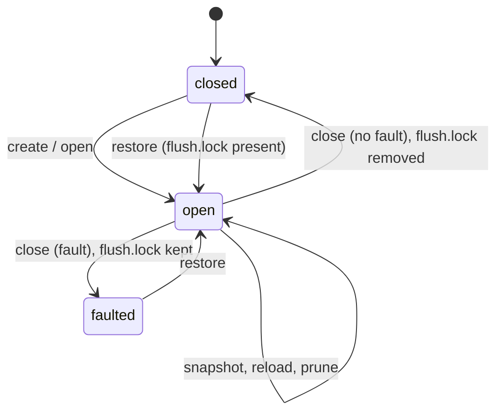
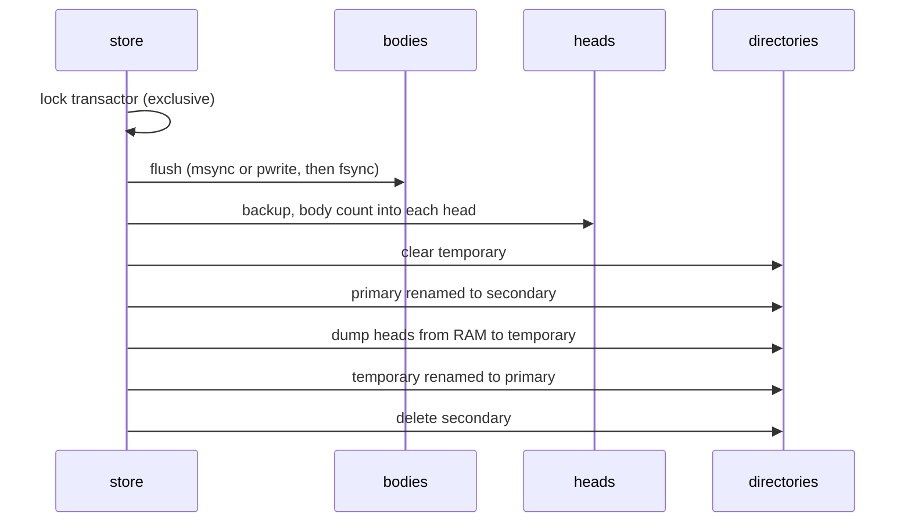

# 03 — Storage

> Companion to [`01-primitives`](primitives) and [`04-queries`](queries).
>
> Heads and bodies sit on the `storage` interface
> (`memory/interfaces/storage.hpp:31-143`), implemented by
> `mmap<Widths...>` (`memory/mmap.hpp:43-551`): one memory-mapped file, or
> a multi-record aggregate of several files that share one size and one set of
> locks (`memory/mmaps.hpp`).

---

## 1. Sizes

Each storage keeps a chain of sizes as atomics (`memory/mmap.hpp:431-437`):

```
settled ≤ frontier ≤ logical ≤ capacity ≤ file
```

| Size | Meaning |
| ---- | ------- |
| logical  | Bytes allocated to rows. This is what `size()` reports and what a head records as the body count. |
| frontier | End of the contiguous run of rows whose writes have completed. |
| settled  | Rows flushed and moved to a read-only file mapping (staged bodies only). |
| capacity | Mapped and usable without a remap. |
| file     | Bytes reserved on disk. |

> **Invariant (Storage-1).** The size chain is monotone in that order at
> every observable point (`impl/memory/mmap.ipp:188-223`).

### 1.1 Allocation and growth

`allocate(count)` claims rows by a compare-exchange on `logical` while
the claim fits in capacity, which is the common case and takes no lock
(`impl/memory/mmap_storage.ipp:457-470`). A claim past capacity takes the
growth mutex (one grower at a time), then the remap lock exclusively, and
grows (`:472-497`).

Growth targets `required × (1 + rate/100)` (default rate 5%) for native
maps, and whole chunks of `min(256 MiB, RAM/256)` for staged bodies
(`impl/memory/mmap.ipp:119-160`). If the disk refuses the target, the
surplus is halved toward the exact requirement before giving up
(`impl/memory/mmap_private.ipp:150-184`).

---

## 2. The remap lock

Growing a map can move it, which invalidates every pointer into it. Each
storage therefore has a shared mutex over its mapping
(`memory/mmap.hpp:443-445`):

- Every read and write goes through an **accessor** (`memory`), which holds
  the shared side for its lifetime and bounds access at the logical size
  (`memory/accessor.hpp:30-34`, `impl/memory/mmap_dispatch.ipp:112-132`).
- Growth, unload, reload and shrink take the exclusive side.

Accessors are short-lived: a query takes one, reads or writes a row, and
releases it. A table iterator holds one for its life, which is why writing
to the same table while iterating it will deadlock
(`impl/query/query.ipp:50-58`).

On macOS the shared mutex is a `pthread_rwlock_t`, because the libc++
`shared_mutex` serializes readers (`locks/shared_mutex.hpp:26-63`).

> **Invariant (Storage-2).** No pointer into a storage outlives the shared
> lock under which it was obtained, except the unguarded `get_raw` used
> for fixed-size heads that never remap
> (`impl/memory/mmap_dispatch.ipp:89-104`).

---

## 3. Mapping modes

| Mode | Platform | Used by | Behaviour |
| ---- | -------- | ------- | --------- |
| native  | Windows (all storages) | — | File-backed shared mapping. Flush is `FlushViewOfFile` and `FlushFileBuffers` (`src/memory/mman.cpp`). A background reader touches head pages to keep them resident (`impl/memory/mmap_native.ipp:197-250`). |
| staged  | Linux, macOS | bodies | Writes land in anonymous memory and are written to the file with `pwrite` at flush, then the flushed range is remapped read-only from the file (settled). A worker settles and evicts under memory pressure; writers are throttled at the staging bound (`impl/memory/mmap_body.ipp`). |
| managed | Linux, macOS | heads | An anonymous copy of the head with a dirty-page bitmap. Dirty pages are written back lazily and at flush (`impl/memory/mmap_head.ipp`). |
| shared  | Linux, macOS | the strong head | A file-backed shared mapping (`impl/store/store.ipp:76`). |

Bodies are staged because they are append-only, and heads stay resident
because they update in place. The strong head is the exception: it is
appended in tx order and goes cold behind its top, so it maps its file
and its pages can be dropped (`store.hpp:338-344`).

---

## 4. Disk full and faults

A storage has two error states (`memory/mmap.hpp:431-436`):

- **space**: the bytes a refused growth needed. Set when `fallocate`
  returns `ENOSPC` or the free-space probe fails; the map stays loaded
  (`impl/memory/mmap_private.ipp:218-282`).
- **fault**: the first unrecoverable error code, latched. Any other
  resize or map failure sets it and unmaps.

At the query level, `is_full()` is space without fault, and `get_code()`
reports `disk_full` before any fault (`impl/query/query.ipp:83-104`).

Recovery from disk full is `store::reload()`: it takes the transactor
exclusively, marks the store dirty, and reloads every storage, which clears
space and discards orphaned staged extents
(`impl/store/store_reload.ipp:30-51`, `impl/memory/mmap_storage.ipp:153-183`).
The node drives this from `chaser_storage` once space is freed.

> **Invariant (Storage-3).** A refused allocation publishes nothing:
> `logical` is not advanced, so no row exists past the last successful
> claim.

---

## 5. The transactor and store lifecycle

Every query write holds the store's **transactor**, the shared side of a
timed mutex (`store.hpp:47`, `impl/store/store.ipp:281-284`). Lifecycle
operations take it exclusively, so they run only between writes: create,
open and restore with `try_lock`; close, snapshot, reload and prune by
waiting, raising `wait_lock` events while they wait.



- **open** takes the process lock (an OS file lock) and creates
  `flush.lock`, which exists only while the store is open
  (`impl/store/store_open.ipp:29-118`, `locks/flush_lock.hpp`). It loads
  the envelope before any table and fails on a schema mismatch. Stored
  bucket counts and filter k override configuration.
- **close** writes each table's body count into its head, unloads and
  closes every storage, and removes `flush.lock` only if no storage
  faulted (`impl/store/store_close.ipp:30-100`).
- A `flush.lock` found at open means the store was not closed cleanly, and
  only **restore** will open it.

---

## 6. Snapshot and restore

A snapshot is the heads alone. Bodies are flushed in place and never
copied; each head records its body's count, and restore truncates every
body back to that count.



Sources: `impl/store/store_snapshot.ipp:30-82`,
`impl/store/store_backup.ipp:31-127`, `impl/store/store_dump.ipp:28-88`.

Heads are written from memory, not copied as files, so the snapshot does
not depend on the head files having been flushed. Each rotation step is a
rename, so at every instant at least one complete snapshot exists in
`primary` or `secondary`.

**Restore** (`impl/store/store_restore.ipp:29-204`) requires the
`flush.lock` left by an unclean close. It replaces `heads/` with
`primary` (or `secondary`, or recreates the store if neither exists),
opens, and for each table verifies its head and truncates its body to the
recorded count. The batch tables are dropped instead.

> **Invariant (Snapshot-1).** Restore yields a state that was reachable at
> the snapshot: every row a restored head publishes was fully written and
> flushed before the head was dumped, because bodies are flushed first
> and are append-only (Body-1).

> **Invariant (Snapshot-2).** Headmaps (candidate, confirmed, strong,
> state, envelope) have no body; their content is restored with the heads
> (`primitives/headmap.hpp:32-38`).

### 6.1 Prune

`prune()` requires the candidate and confirmed chains to coincide. It
clears the prevout, pool and wtxid heads, snapshots with a zero count for
the cache tables, truncates the prevout body, and shrinks the cache and
batch bodies to reclaim disk (`impl/store/store_prune.ipp`). Pool records
that can still confirm are compacted and kept.

---

## 7. Dirty

`dirty` means the archive may hold a point spent more than once, so
tx archival must detect duplicates ([`04 §2.1`](queries)). It is set at
open when the header table holds more than genesis, by a candidate pop
(reorganization), by `set_pooling`, and by a reload after disk full
(`impl/store/store.ipp:233-243`, `impl/store/store_reload.ipp:42-47`,
`impl/query/height.ipp:66`). While clean, archival of a bypassed
(milestone or checkpoint) block skips the duplicate search
(`impl/query/archive/chain_writer.ipp:214-220`).

---

## 8. Locking

Progress is classified by the standard non-blocking definitions. An
operation is **wait-free** if it completes in a bounded number of its own
steps, and an algorithm is **lock-free** if, run long enough, some thread
always makes progress, whatever the scheduling of the others. Code in
which a thread can wait on another is **blocking**, and for blocking code
the property that matters is **deadlock-freedom**. Non-blocking guarantees
hold whatever the scheduler does; blocking guarantees assume that every
thread keeps being scheduled, so that a lock holder eventually releases.

| | Non-blocking (no scheduler assumption) | Blocking (fair scheduling) |
| --- | --- | --- |
| Every thread progresses | wait-free | starvation-free |
| Some thread progresses | lock-free | deadlock-free |
| Progress only when running alone | obstruction-free | — |

Two things do not affect the classification. A lock that only provides an
atomic read or write of one value is a primitive, interchangeable with an
atomic. A join on the parts of one operation (a parallel query fanned out
over the pool) blocks only the thread that started it. A lock counts when
it is held across steps of an algorithm while independent operations wait
on it.

### 8.1 Non-blocking

| Mechanism | Progress | Source |
| --------- | -------- | ------ |
| Head reads (hash cells, array buckets, headmap cells) | wait-free | `impl/primitives/hashhead.ipp:329-359`, `arrayhead.ipp:142-177`, `headmap.ipp:140-207` |
| Headmap push (single writer, published by size) | wait-free | `impl/primitives/headmap.ipp:283-322` |
| Hash head push | lock-free | `impl/primitives/hashhead.ipp:361-411` |
| Headmap `set` (`state` merge and clear, `strong` replace) | lock-free | `impl/primitives/headmap.ipp:367-402` |
| `allocate` within capacity | lock-free | `impl/memory/mmap_storage.ipp:457-470` |
| Staged write completion (extent `claim_`) | lock-free | `impl/memory/mmap_extent.ipp:118-155` |

Each lock-free step is a compare-exchange loop in which a failed exchange
means another thread's exchange succeeded.

Parallel queries fan out through standard library algorithms under a
parallel execution policy (`std::for_each`, `transform`,
`transform_reduce`, `reduce`, `sort`, `all_of`), whose join blocks only the
initiating thread. The one other fan-out is the unspent output set
commitment, which pipelines its sequential hash fold on a dedicated thread
beside the parallel bucket fill (`impl/unspent/unspent_serial.ipp:59-101`);
it is likewise joined within the one operation.

### 8.2 Blocking

**Memory map.** These locks are private to one storage (`mmap`) and
contend only among accessors of that storage.

| Lock | Held across | Waiters | Source |
| ---- | ----------- | ------- | ------ |
| Remap lock (exclusive side) | growing a storage's mapping | every accessor of that storage | `memory/mmap.hpp:443-445`, `impl/memory/mmap_storage.ipp:436-450`, `:472-497`, `impl/memory/mmap_dispatch.ipp:33-72` |
| Growth mutex | the growth of one storage | other writers that need growth | `memory/mmap.hpp:439-441` |
| Extent ring mutex | ring maintenance and a staged claim | other staged writers of that body | `impl/memory/mmap_extent.ipp:161-200` |
| Restore mutex | restoring a released head segment | head writers and the head worker | `impl/memory/mmap_head.ipp:572-580`, `:660-663` |

The write throttle parks a staged writer until the settle worker has
written to disk (`impl/memory/mmap_body.ipp:196-212`). That is a wait on
I/O, not on another thread's progress.

**Store and query.** These locks are taken by queries and lifecycle
operations.

| Lock | Held across | Waiters | Source |
| ---- | ----------- | ------- | ------ |
| Candidate reorganization mutex | a candidate pop | candidate height readers (fork, sequence queries) | `query.hpp:1393`, `impl/query/height.ipp:69`, `impl/query/consensus/consensus_forks.ipp:53`, `:68`, `:124`, `impl/query/sequences.ipp:41` |
| Confirmed reorganization mutex | a confirmed pop | confirmed height readers (fork, sequence queries) | `query.hpp:1394`, `impl/query/height.ipp:126`, `impl/query/consensus/consensus_forks.ipp:54`, `:95`, `impl/query/sequences.ipp:62` |
| Transactor (exclusive side) | create, open, restore, snapshot, prune, reload, close | all writers | `store.hpp:303`, §5 |

These locks are extremely low frequency and contention. Readers and writers take
only their shared sides, which do not contend with each other. The
reorganization mutexes are taken exclusively only by a chain pop, which
occurs only in a reorganization. The transactor is taken exclusively only
by:

- create, open and restore, which only try the lock, before any writer
  exists (`impl/store/store_create.ipp:31`, `store_open.ipp:34`,
  `store_restore.ipp:31`);
- snapshot (`impl/store/store_snapshot.ipp:32`);
- prune, which snapshots under the same hold (`impl/store/store_prune.ipp:34`);
- reload after disk full (`impl/store/store_reload.ipp:32`);
- close (`impl/store/store_close.ipp:33`).

**Files.** Two file locks guard the store directory, not threads. Both are
only tried, never waited on.

| Lock | Taken | Released | Purpose | Source |
| ---- | ----- | -------- | ------- | ------ |
| Process lock (`process.lock`) | create, open, restore | close | an exclusive OS file lock, so one process opens the store | `locks/interprocess_lock.hpp`, `impl/store/store_open.ipp:37`, `store_close.ipp:89` |
| Flush lock (`flush.lock`) | create, open | close, if no storage faulted | a sentinel whose presence at open marks an unclean close, which only restore accepts | `locks/flush_lock.hpp`, `impl/store/store_open.ipp:43`, `store_close.ipp:95`, `store_restore.ipp:41` |

### 8.3 Deadlock-freedom

By design every blocking lock is a leaf or is taken in a fixed order:

- The extent ring, restore and reorganization mutexes acquire no lock while
  held. The restore mutex is taken after the shared remap lock, by writers
  and by the head worker alike.
- Growth takes the growth mutex, then the remap lock exclusively, and holds
  no accessor while doing so.
- The fork queries take the candidate mutex before the confirmed mutex,
  both shared; a pop takes one exclusively.
- Lifecycle operations take the transactor exclusively only between
  writes; a writer holds its shared side only for the duration of a write.

> **Invariant (Storage-4).** No accessor or iterator on a storage is held
> while allocating on that storage. Growth waits for every accessor of the
> storage to release, so an accessor held across an allocation on the same
> storage deadlocks against it (`impl/memory/mmap_storage.ipp:410-415`,
> `impl/query/query.ipp:50-58`).

This is the one rule deadlock-freedom depends on, and it binds only code
inside the store. The query interface exposes no accessor or iterator
(the accessor sets are protected, `query.hpp:1297-1346`), so no caller can
hold one across a write. The store is deadlock-free for any use of its
public interface.

Starvation-freedom is not claimed: the shared mutexes make no fairness
guarantee.

---

## Cross-references

- [`04-queries`](queries) — the writes these locks protect
- [Node periphery chasers](../architecture/periphery-chasers.html) —
  `chaser_snapshot` and `chaser_storage`, which drive snapshot and reload
