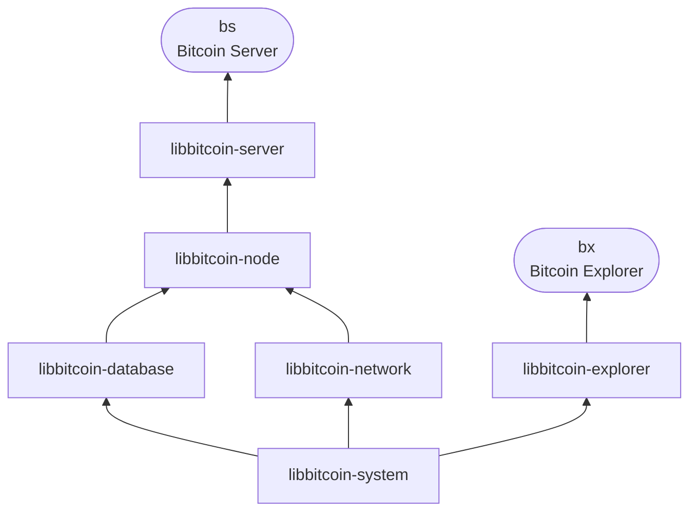

# Developers

Libbitcoin is a full stack of C++20 libraries, from Bitcoin primitives
to a complete server and client. Bitcoin Server (`bs`) is built on
libbitcoin-server, and Bitcoin Explorer (`bx`) on libbitcoin-explorer.
Each library can be used on its own, by any application. This section
documents their C++ API.

> The API reference is in progress. This page introduces the libraries
> and how to use them.

## 1. The stack

Both executables rest on libbitcoin-system: Bitcoin Server through the
node's libraries, and Bitcoin Explorer directly. The only other dependency
is Boost (headers only).



| Library | Namespace | Builds on | Provides |
| ------- | --------- | --------- | -------- |
| [libbitcoin-system](https://github.com/libbitcoin/libbitcoin-system) | `libbitcoin::system` | | Bitcoin primitives: blocks, transactions, scripts and their execution, hashes and cryptography, keys, addresses and wallets, encodings and serialization |
| [libbitcoin-database](https://github.com/libbitcoin/libbitcoin-database) | `libbitcoin::database` | system | The store: memory-mapped tables, and the queries over them |
| [libbitcoin-network](https://github.com/libbitcoin/libbitcoin-network) | `libbitcoin::network` | system | Connections and protocols: the P2P network, and HTTP, websocket, JSON-RPC, TLS and ZMQ services |
| [libbitcoin-node](https://github.com/libbitcoin/libbitcoin-node) | `libbitcoin::node` | database, network | The full node: sync, validation and confirmation, and the transaction pool |
| [libbitcoin-server](https://github.com/libbitcoin/libbitcoin-server) | `libbitcoin::server` | node | The client interfaces of Bitcoin Server, and `bs` |
| [libbitcoin-explorer](https://github.com/libbitcoin/libbitcoin-explorer) | `libbitcoin::explorer` | system | The commands of Bitcoin Explorer, and `bx` |

The node and the store are described in [Architecture](../architecture/index)
and [Database](../database/index).

## 2. Using a library

Each library has one header that includes all of it:

```cpp
#include <bitcoin/system.hpp>

using namespace libbitcoin::system;
```

| Library | Header | Package |
| ------- | ------ | ------- |
| libbitcoin-system | `<bitcoin/system.hpp>` | `libbitcoin-system` |
| libbitcoin-database | `<bitcoin/database.hpp>` | `libbitcoin-database` |
| libbitcoin-network | `<bitcoin/network.hpp>` | `libbitcoin-network` |
| libbitcoin-node | `<bitcoin/node.hpp>` | `libbitcoin-node` |
| libbitcoin-server | `<bitcoin/server.hpp>` | `libbitcoin-server` |
| libbitcoin-explorer | `<bitcoin/explorer.hpp>` | `libbitcoin-explorer` |

A library and those it depends on are found with `pkg-config`:

```
$ c++ -std=c++20 app.cpp $(pkg-config --cflags --libs libbitcoin-system)
```
