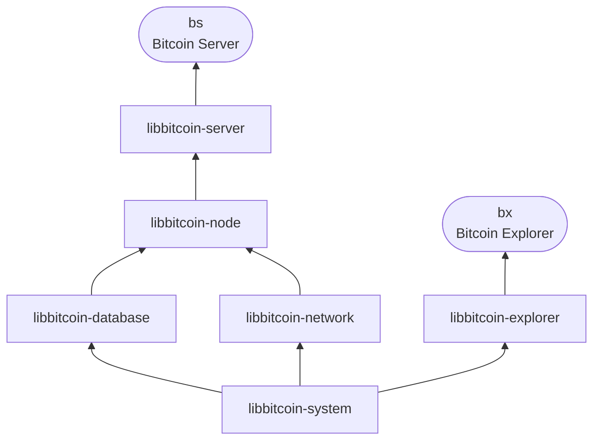

# Libraries

Libbitcoin is a full stack of C++20 libraries, from Bitcoin primitives to a
complete server and client. Each library is its own repository, can be built
and used on its own, and depends only on the libraries below it.

| Library | Provides |
| ------- | -------- |
| [libbitcoin-system](system) | Bitcoin primitives: blocks, transactions, scripts and their execution, hashes and cryptography, keys, addresses and wallets, encodings and serialization |
| [libbitcoin-database](database) | The store: memory-mapped tables, and the queries over them |
| [libbitcoin-network](network) | Connections and protocols: the P2P network, and HTTP, WebSocket, JSON-RPC, TLS and ZeroMQ services |
| [libbitcoin-node](node) | The full node: download, validation and indexing of the blockchain and unconfirmed transactions |
| [libbitcoin-server](server) | The client interfaces of Bitcoin Server, and `bs` |
| [libbitcoin-explorer](explorer) | The commands of Bitcoin Explorer, and `bx` |

All libraries are licensed as AGPL with a lesser clause: a library may be
used within a proprietary project, but the library and any changes to it
must be published. To use one in an application, see
[Using a library](../developers/index#2-using-a-library).
