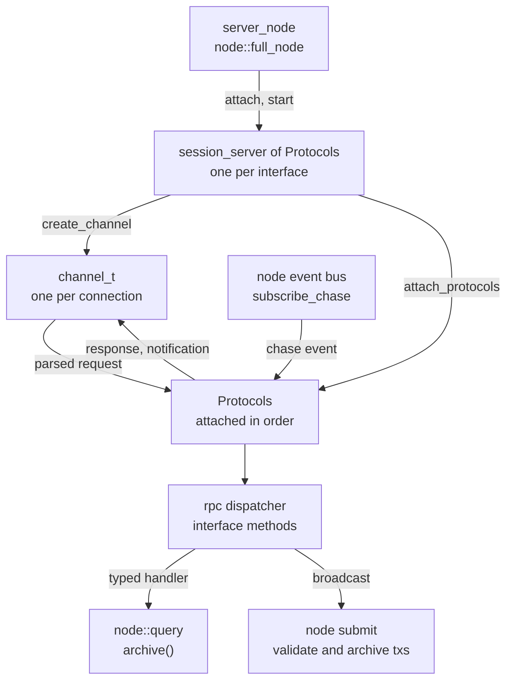

# Server Architecture

Bitcoin Server (`bs`) is a full node with client interfaces. The library
libbitcoin-server extends the libbitcoin-node full node, which owns the
store and the chasers, with one network service per client interface. Each
service is a session that accepts connections, a channel type for the
connection, and a set of protocols that dispatch requests, query the store
and push notifications from chain events. The wire API of each interface is
documented under [Interfaces](../interfaces/index); this page describes the
structure that serves them. Paths are relative to `include/bitcoin/server/`
in [libbitcoin-server](https://github.com/libbitcoin/libbitcoin-server), at
master `f97e9b10` (2026-10-27).

## 1. The server node

`server_node` derives `node::full_node` (`server_node.hpp`). It adds the
server `configuration` and overrides `do_run`, so that the client services
start only after the node is running. Each service is attached and started
in turn, each start completing into the next:

```cpp
void server_node::start_admin(const code& ec, const result_handler& handler) NOEXCEPT
{
    if (ec)
    {
        handler(ec);
        return;
    }

    attach_admin_session()->start(std::bind(&server_node::start_native, this, _1, handler));
}
```

The order is admin, native, bitcoind, btcd, electrum, sparrow, esplora,
stratum v1, stratum v2 and bitcoind ZMQ. Each `attach_*_session()` is
virtual, and constructs its session from the server configuration and the
service's own settings section (for example `config_.server.electrum`).



## 2. Sessions

### 2.1 The session template

`server::session` derives `node::session` (`sessions/session.hpp`). It
holds the server configuration and exposes, through the node, address pool
counts and dumps, channel byte totals, and the wire tx and block demand
counters.

`session_server<Protocols...>` derives `server::session` and
`network::session_server` (`sessions/session_server.hpp`). The network base
manages connections: accept, start, stop, enable, and the black and white
lists. The first protocol of the pack declares `channel_t` and `options_t`,
which fix the channel and settings types of the session, and each accepted
connection gets every protocol of the pack, attached and started in order:

```cpp
channel_ptr create_channel(const socket_ptr& socket) NOEXCEPT override
{
    return std::make_shared<channel_t>(log, socket, create_key(), node_config(), options_);
}

void attach_protocols(const channel_ptr& channel) NOEXCEPT override
{
    const auto self = shared_from_base<session_server<Protocols...>>();
    ((channel->attach<Protocols>(self, options_)->start(), void()), ...);
}
```

`session_handshake<Handshake, Protocols...>` adds one handshake protocol,
which completes before the others are attached
(`sessions/session_handshake.hpp`). A session drops inbound connections
until the confirmed chain is current if its first protocol is `delayed` and
the node's `delay_inbound` is set (`enabled()`). `server::protocol` sets
`delayed`; `protocol_admin` and `protocol_native` clear it.

### 2.2 The interfaces as sessions

All sessions are aliases (`sessions/sessions.hpp`):

| Session | Protocols | Channel | Settings |
| ------- | --------- | ------- | -------- |
| `session_admin` | `protocol_admin` | `channel_html` | `admin` |
| `session_native` | `protocol_native` | `channel_html` | `native` |
| `session_bitcoind` | `protocol_bitcoind_rest`, subgroups, `protocol_bitcoind` | `channel_bitcoind` | `bitcoind` |
| `session_btcd` | `protocol_btcd`, subgroups, `protocol_bitcoind` | `channel_btcd` | `btcd` |
| `session_electrum` | handshake `protocol_electrum_version`, `protocol_electrum` | `channel_electrum` | `electrum` |
| `session_sparrow` | handshake `protocol_electrum_version`, `protocol_sparrow` | `channel_electrum` | `sparrow` |
| `session_esplora` | `protocol_esplora` | `channel_html` | `esplora` |
| `session_stratum_v1` | `protocol_stratum_v1` | `channel_stratum_v1` | `stratum_v1` |
| `session_stratum_v2` | `protocol_stratum_v2` | `channel_stratum_v2` | `stratum_v2` |
| `session_bitcoind_zmq` | `protocol_bitcoind_zmq` | `channel_bitcoind_zmq` | `bitcoind_zmq` |

The bitcoind subgroups are blockchain, control, mining, network,
notifications, test, transaction, utility and wallet, each a protocol with
its own dispatcher (`protocol_bitcoind_dispatch<Interface>`).

## 3. Channels

A channel is one connection. Server channels derive `server::channel`,
which derives `node::channel` (`channels/channel.hpp`), and the network
channel of their transport:

| Channel | Base | Role |
| ------- | ---- | ---- |
| `channel_http` | `network::channel_http` | HTTP base; a service preselects its reader body (`default_body`) |
| `channel_html` | `channel_http` | Plain text body: admin, native, esplora |
| `channel_rpc` | `channel_http` | JSON-RPC over TCP (by downgrade), HTTP and WebSocket (by upgrade); the senders |
| `channel_bitcoind` | `channel_rpc` | bitcoind |
| `channel_btcd` | `channel_bitcoind` | Authorized in-band, so the WebSocket upgrade is open |
| `channel_electrum` | `channel_rpc` | Negotiated version and client name |
| `channel_stratum_v1` | `network::channel_rpc` | Non-HTTP JSON-RPC |
| `channel_stratum_v2` | `network::channel` | Binary |
| `channel_bitcoind_zmq` | `network::channel_rpc` | ZMTP publisher |

State of the connection is held by the channel. `channel_electrum` holds
the version that the handshake negotiates and `protocol_electrum` reads
(`at_least`), and normalizes each request's parameters for that version
before dispatch.

## 4. Protocols

### 4.1 The protocol bases

`server::protocol` derives `node::protocol` (`protocols/protocol.hpp`), from
which it inherits the store query (`archive()`), transaction submission
(`submit`) and the event subscription (`subscribe_chase`). `protocol_http`
adds WebSocket dispatch (`dispatch_websocket`). `protocol_html` adds GET
dispatch, trying an interface object, then local files, then the embedded
pages. `protocol_rpc<Interface>` adds the interface dispatcher, POST and
WebSocket dispatch, and the JSON-RPC senders. `protocol_bitcoind_dispatch`
does the same for a bitcoind subgroup.

### 4.2 Claiming and the terminal responder

All protocols attached to a channel receive each request. A latch on the
channel (`claimed()`, `set_claimed()`) gives each request to one of them.
A protocol whose interface defines the method claims and dispatches it,
and one whose interface does not defers it to `handle_unclaimed`
(`protocols/protocol_rpc.hpp`):

```cpp
if (claimed())
    return;

if (!rpc_dispatcher::contains(message.method))
{
    handle_unclaimed(message);
    return;
}

set_claimed();

if (const auto code = rpc_dispatcher_.notify(message))
    stop(code);
```

The protocol attached last is the terminal responder, overriding
`handle_unclaimed` to reply method-not-found: `protocol_bitcoind` in the
bitcoind and btcd sessions, `protocol_electrum` in the electrum session.
`protocol_sparrow` derives `protocol_electrum` and tries its own dispatcher
in `handle_unclaimed` before deferring to electrum; `protocol_btcd` adds its
dispatcher to `protocol_bitcoind` in the same way. An electrum response
that sparrow extends is overridden, not reimplemented (`add_features` for
`server.features`).

### 4.3 The interface protocols

| Interface | Protocols | API |
| --------- | --------- | --- |
| Admin | `protocol_admin` | [Admin](../interfaces/admin) |
| Native REST | `protocol_native` | [Native](../interfaces/native) |
| bitcoind JSON-RPC | subgroups, `protocol_bitcoind` | [bitcoind RPC](../interfaces/bitcoind-rpc) |
| bitcoind REST | `protocol_bitcoind_rest` | [bitcoind REST](../interfaces/bitcoind-rest) |
| bitcoind ZMQ | `protocol_bitcoind_zmq` | [ZeroMQ](../interfaces/zeromq) |
| btcd | `protocol_btcd`, bitcoind subgroups | [btcd](../interfaces/btcd) |
| Electrum | `protocol_electrum_version`, `protocol_electrum` | [Electrum](../interfaces/electrum) |
| Sparrow | `protocol_electrum_version`, `protocol_sparrow` | [Sparrow](../interfaces/sparrow) |
| Esplora | `protocol_esplora` | [Esplora](../interfaces/esplora) |
| Stratum v1 | `protocol_stratum_v1` | [Stratum v1](../interfaces/stratum-v1) |
| Stratum v2 | `protocol_stratum_v2` | [Stratum v2](../interfaces/stratum-v2) |

The stratum sessions, channels and interfaces exist, but the protocols are
not implemented: stratum v1 handlers reply `not_implemented`, and stratum v2
subscribes to no messages.

## 5. Requests

An interface is a compile-time tuple of methods, each a name with typed
parameters, constructed with the parameter names (`interfaces/`). Optional
parameters carry their defaults in the type (`optional<0.0>`,
`optional<false>`, `optional<""_t>`). The Electrum interface, condensed
(`interfaces/electrum.hpp`):

```cpp
struct electrum_methods
{
    /// Methods (electrum protocol versions 1.0-1.7).
    static constexpr std::tuple methods
    {
        method<"blockchain.numblocks.subscribe">{},
        method<"blockchain.block.header", number_t, optional<0.0>>{ "height", "cp_height" },
        method<"blockchain.block.headers", number_t, number_t, optional<0.0>>{ "start_height", "count", "cp_height" },
        method<"blockchain.headers.subscribe", optional<false>>{ "raw" },
        // ...
        method<"blockchain.scripthash.get_balance", string_t>{ "scripthash" },
        method<"blockchain.scripthash.subscribe", string_t>{ "scripthash" },
        // ...
        method<"blockchain.transaction.get", string_t, optional<false>>{ "tx_hash", "verbose" },
        // ...
        method<"server.ping", optional<0.0>, optional<""_t>>{ "pong_len", "data" },
        method<"mempool.get_fee_histogram">{},
        // ...
    };
};
```

Each method is also named as a type, which tags its handler.
The REST interfaces take the same form, their parameters parsed from the
URL, with the API version and response media leading and `nullable`
parameters for alternatives such as a block by hash or by height
(`interfaces/native.hpp`):

```cpp
struct native_methods
{
    static constexpr std::tuple methods
    {
        method<"top", uint8_t, uint8_t>{ "version", "media" },
        method<"block_header", uint8_t, uint8_t, nullable<system::hash_cptr>, nullable<uint32_t>>{ "version", "media", "hash", "height" },
        method<"tx", uint8_t, uint8_t, system::hash_cptr, optional<true>>{ "version", "media", "hash", "witness" },
        // ...
    };
};
```

A protocol holds a `network::rpc::dispatcher<Interface>` and subscribes one
handler per method when it starts (`src/protocols/electrum/protocol_electrum.cpp`):

```cpp
SUBSCRIBE_RPC(handle_blockchain_block_header, _1, _2, _3, _4);
SUBSCRIBE_RPC(handle_blockchain_scripthash_get_balance, _1, _2, _3);
```

The dispatcher converts a request's parameters to the declared types, by
name or by position, and invokes the handler with them. Each handler takes
the method's tag type and then its typed parameters
(`protocols/protocol_electrum.hpp`, `protocols/protocol_native.hpp`):

```cpp
void handle_blockchain_block_header(const code& ec,
    rpc_interface::blockchain_block_header, double height,
    double cp_height) NOEXCEPT;

void handle_blockchain_scripthash_get_balance(const code& ec,
    rpc_interface::blockchain_scripthash_get_balance,
    const std::string& scripthash) NOEXCEPT;

bool handle_get_block_header(const code& ec, interface::block_header,
    uint8_t version, uint8_t media, std::optional<system::hash_cptr> hash,
    std::optional<uint32_t> height) NOEXCEPT;
```

A request whose method is not in the interface, or whose parameters do not
convert, is answered with an error without reaching a handler. The
protocol's handlers are therefore exactly the interface's methods, each
with its declared signature, checked by the compiler.

JSON-RPC requests arrive as a request model from the channel's body
reader. The REST interfaces parse the URL into the same model
(`network::rpc::request_t`) and dispatch it the same way (`parsers/`):

| Parser | Produces |
| ------ | -------- |
| `native_target`, `native_query` | Native method and parameters from path and query; `get_media` selects the response media |
| `admin_target`, `admin_query` | Admin method and parameters |
| `bitcoind_target`, `bitcoind_query` | bitcoind REST method and parameters |
| `esplora_target` | Esplora method and parameters |
| `electrum_request` | Electrum parameters normalized for the negotiated version |
| `parse_transaction`, `expand_scan_object`, `btcd::filter_keys` | Typed values from structured bitcoind and btcd arguments |

In `protocol_native`, a target that does not parse as a method falls
through to page dispatch, as does a request for HTML media.

## 6. Responses

Response construction that is shared or substantial is factored out of the
protocols as free functions (`serializers/`): bitcoind models built from
store queries (`chain_info`, `raw_mempool`, `mempool_entry`,
`deployment_info`, `block_stats`, `scan_result`), PSBT decoding, and
context injectors (`inject_block_context`, `inject_tx_context`,
`inject_tx_prevouts`). `btcd::search_transaction` extends the bitcoind
transaction model. Helpers shared with the parsers are in `utilities/`:
address and script conversion, descriptors, PSBT combination and update,
median time, fee histogram and merkle proofs.

Each interface family has its own error codes (`error/`): `error_t` for URL
parse and general codes, and `bitcoind`, `btcd` and `electrum` codes. Node
and store codes are mapped to the interface's codes at the response (for
example `translate(ec, daemon_error)` in electrum).

## 7. Queries and notifications

### 7.1 Queries

A request handler runs on the channel strand. It validates its arguments,
moves the store query to the network threadpool (`PARALLEL`), and posts the
result back to the strand (`POST`) to send it:

```cpp
void protocol_electrum::get_balance(const hash_digest& hash) NOEXCEPT
{
    PARALLEL(do_get_balance, hash, gate());
}

void protocol_electrum::do_get_balance(const hash_digest& hash, const gate_t::ptr& gate) NOEXCEPT
{
    uint64_t confirmed{}, unconfirmed{};
    const auto ec = archive().get_balance(stopping_, confirmed, unconfirmed, hash);
    POST(complete_get_balance, ec, confirmed, unconfirmed, gate);
}
```

The query is the node's `node::query`, so a protocol reads the store
directly. A method that depends on an optional index checks it first
(`archive().address_enabled()`). A broadcast calls the node protocol's
`submit`, which validates and archives the package, or only validates it
when testing.

### 7.2 Chain events

A protocol that pushes notifications subscribes to the node event bus at
start (`subscribe_chase`) and unsubscribes when stopping. The handler runs
off the channel strand, switches on the event (`node::to_chase`), reads
only atomic subscription flags, and posts the work with the event's link
(for example `POST(do_header, top.link)` on `organized`):

| Protocol | Events |
| -------- | ------ |
| `protocol_native` | `block`, `reorganized`, `transaction` |
| `protocol_electrum` | `transaction`, `organized`, `reorganized` |
| `protocol_sparrow` | `transaction`, `organized`, then electrum's |
| `protocol_btcd` | `organized`, `reorganized`, `transaction` |
| `protocol_bitcoind_blockchain` | `organized`, `reorganized` |
| `protocol_bitcoind_zmq` | `organized`, `transaction`, `reorganized` |

`protocol_admin` subscribes to the logger instead, for its log and event
streams. Notifications require a full duplex transport (WebSocket or TCP
downgrade). The events and their payloads are described in the node
[event bus](../architecture/event-bus).

## 8. Threading

Each channel has a strand, and protocol handlers run on it (each asserts
`stranded()`). Store queries run on the network threadpool and return their
results through `POST`, so protocol state is touched only on the strand.

`protocol_electrum` and `protocol_btcd` hold a second strand on the same
threadpool (`notification_strand_`, posted with `POST_NOTIFY`). Their
address and outpoint subscription maps are protected by it, so that
notification work is serialized apart from request handling. Settings are
constant after initialization and are read from any thread.

## 9. Configuration

`server::settings` holds one section per service (`settings.hpp`). Each
section derives a network server settings type (`http_server`,
`websocket_server`, `tls_server` or `zmtp_server`), which supplies binds,
TLS, connection limits and HTTP or WebSocket options. Derived interfaces
derive their settings: `btcd_server` derives `bitcoind_server`, and
`sparrow_server` derives `electrum_server`. Service sections add interface limits (for example `maximum_history` and
`maximum_subscriptions`) and identity (for example `server_name`). The
`wallet` section holds the address prefixes used to parse and render
addresses. An `html_server` serves the pages embedded in `bs`
(`embedded_pages`), or a local directory (`path`).

`server::configuration` derives `node::configuration`, adding the server
and log settings and the command line actions (`configuration.hpp`).
`server::parser` loads command line options and configuration file
sections into `configured`, then derives unconfigured hashmap bucket counts
(`derive_buckets`) and the default port of each service bind
(`derive_ports`) (`parser.hpp`). `configuration::initialize` then reads
files and packs derived settings.

## 10. The bs executable

`bs` is the console application in `console/`. `main` builds the parser
with the embedded admin and native pages, parses and initializes the
configuration, and either runs as an operating system service or calls
`executor::dispatch` (`console/main.cpp`). `dispatch` runs one command line
action (help, backup, restore, daemon, hardware, flags, new store, buckets,
collisions, information, settings, version), or runs the node if none is
given (`console/executor_commands.cpp`).

To run, the executor opens the log and event sinks, opens or creates the
store (restoring from a snapshot after an unclean close), reports the store
and hardware, and prompts on warnings (`console/executor_runner.cpp`). It
then constructs `server_node` over the store's query and starts it; start
completes into `run`, which starts the client services
(`console/executor.cpp`). On a stop signal it closes the node, then the
store.

While running, console input is read as single-letter commands
(`console/executor_options.cpp`): `b` backup, `c` close, `e` store errors,
`g` and `h` go and hold network communication, `i` store info, `m` menu,
`w` work distribution and `z` zeroize a disk full error, plus one toggle
key per log level.

## See also

- [Interfaces](../interfaces/index) — the wire API of each interface.
- [Node architecture](../architecture/index) — the full node and chasers
  that the server extends.
- [Event bus](../architecture/event-bus) — the events that drive
  notifications.
