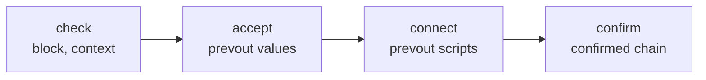

# Chain

The chain types (`chain/`) are the block, header, transaction, input,
output, script, operation and witness. Each implements the consensus rules
that apply to it, and blocks and transactions delegate to their parts.

Paths are relative to `include/bitcoin/system/` in
[libbitcoin-system](https://github.com/libbitcoin/libbitcoin-system), at
master `0cd57fcf` (2026-10-27).

## 1. Consensus rules

The consensus rules are implemented by the chain types, divided into
validation stages by what each needs:

| Stage | Requires | Examples |
| ----- | -------- | -------- |
| `check` | The block alone | Size, merkle root, coinbase position, double spends and forward references within the block |
| `check` (contextual) | Its context in the chain | Weight, coinbase height (BIP34), witness commitment, signet solution |
| `accept` | Previous output values | Coinbase value against subsidy and fees, sigop limit |
| `connect` | Previous output scripts | Script execution of each input, including signatures |
| `confirm` | The confirmed chain | Coinbase maturity, relative locktime (BIP68), spends of unconfirmed or already spent outputs |



The division lets a node run each stage as soon as what it requires
exists: check a block when it has it, accept and connect it once its
previous outputs are available, for many blocks at once, and confirm it in
chain order. The node performs the confirmation rules as store queries.
See [Node Architecture](../architecture/index).

These stages contain every consensus rule, including script evaluation,
which `connect` performs through the [machine](machine). One rule is
outside of them: chain organization, the selection among valid chains.

Competing branches, valid chains seen in isolation by different nodes, are
each perfectly valid in the scope of the node that sees it. The rule of
most cumulative proof of work applies only to break what would otherwise
be a tie between two valid chains. A node that sees two chains of the same
work generally prefers the first seen, but that choice is arbitrary, and in
some situations not applied. To compare chains, the node uses the cumulative work
of each header.

Each stage is a method of the chain type it applies to, and each lists its
consensus rules in order, one predicate per rule, each returning its own
error code. A block stage applies its block rules, then delegates to the
same stage of each transaction (`check_transactions`, and so on). The
sources below are from `src/chain/header.cpp`, `src/chain/block.cpp` and
`src/chain/transaction.cpp`.

### 1.1 Header

A header is checked alone, then accepted in its context:

```cpp
code header::check() const NOEXCEPT
{
    if (is_invalid_proof_of_work())
        return error::invalid_proof_of_work;
    if (is_futuristic_timestamp())
        return error::futuristic_timestamp;

    return error::block_success;
}

code header::accept(const context& ctx) const NOEXCEPT
{
    if (is_insufficient_version(ctx))
        return error::insufficient_block_version;
    if (is_anachronistic_timestamp(ctx))
        return error::anachronistic_timestamp;
    if (is_invalid_work(ctx))
        return error::incorrect_proof_of_work;
    if (is_early_timestamp(ctx))
        return error::early_timestamp;

    return error::block_success;
}
```

### 1.2 Check

The rules of the block alone:

```cpp
code block::check() const NOEXCEPT
{
    if (is_empty())
        return error::empty_block;
    if (is_oversized())
        return error::block_size_limit;
    if (is_first_non_coinbase())
        return error::first_not_coinbase;
    if (is_extra_coinbases())
        return error::extra_coinbases;
    if (is_forward_reference())
        return error::forward_reference;
    if (is_internal_double_spend())
        return error::block_internal_double_spend;
    if (is_invalid_merkle_root())
        return error::invalid_transaction_commitment;

    return check_transactions();
}

code transaction::check() const NOEXCEPT
{
    const auto coinbase = is_coinbase();

    if (is_empty())
        return error::empty_transaction;
    if (coinbase && is_invalid_coinbase_size())
        return error::invalid_coinbase_script_size;
    if (!coinbase && is_null_non_coinbase())
        return error::previous_output_null;

    return error::transaction_success;
}
```

### 1.3 Check in context

The rules that depend on the block's height and active forks, but not on
previous outputs:

```cpp
code block::check(const context& ctx) const NOEXCEPT
{
    const auto bip141 = ctx.is_enabled(bip141_rule);
    const auto bip34 = ctx.is_enabled(bip34_rule);
    const auto bip50 = ctx.is_enabled(bip50_rule);
    const auto signet = ctx.is_enabled(signet_rule);

    if (bip141 && is_overweight())
        return error::block_weight_limit;
    if (bip34 && is_invalid_coinbase_script(ctx))
        return error::coinbase_height_mismatch;
    if (bip50 && is_hash_limit_exceeded())
        return error::temporary_hash_limit;
    if (bip141 && is_invalid_witness_commitment())
        return error::invalid_witness_commitment;
    if (signet && is_invalid_signet_solution())
        return error::invalid_signet_solution;

    return check_transactions(ctx);
}

code transaction::check(const context& ctx) const NOEXCEPT
{
    const auto bip113 = ctx.is_enabled(bip113_rule);

    if (is_absolute_locked(ctx, bip113))
        return error::absolute_time_locked;

    return error::transaction_success;
}
```

### 1.4 Accept

The rules that require the values of previous outputs:

```cpp
code block::accept(const context& ctx) const NOEXCEPT
{
    const auto bip16 = ctx.is_enabled(bip16_rule);
    const auto bip42 = ctx.is_enabled(bip42_rule);
    const auto bip141 = ctx.is_enabled(bip141_rule);

    // prevouts required.
    if (is_overspent(ctx, bip42))
        return error::coinbase_value_limit;
    if (is_signature_operations_limited(bip16, bip141))
        return error::block_sigop_limit;

    return accept_transactions(ctx);
}

code transaction::accept(const context&) const NOEXCEPT
{
    if (is_coinbase())
        return error::transaction_success;
    if (is_missing_prevouts())
        return error::missing_previous_output;
    if (is_overspent())
        return error::spend_exceeds_value;

    return error::transaction_success;
}
```

### 1.5 Connect

Script execution of each input against its previous output, by the
[machine](machine):

```cpp
code transaction::connect(const context& ctx) const NOEXCEPT
{
    if (is_coinbase())
        return error::transaction_success;

    for (const auto& input: *inputs_)
        if (const auto ec = connect_input(ctx, input))
            return ec;

    return error::transaction_success;
}
```

`connect_input` is the glue between the chain and the machine. It selects
the interpreter's stack container for the input (see
[Rock and roll](machine#6-rock-and-roll)), and the interpreter connects the
input's scripts to those of its previous output:

```cpp
code transaction::connect_input(const context& ctx,
    const input& input) const NOEXCEPT
{
    if (!input.prevout)
        return error::missing_previous_output;

    if (input.is_roller())
        return interpreter<linked_stack>::connect(ctx, *this, input);

    return interpreter<contiguous_stack>::connect(ctx, *this, input);
}
```

### 1.6 Confirm

The rules that depend on the confirmed chain:

```cpp
code transaction::confirm(const context& ctx) const NOEXCEPT
{
    const auto bip68 = ctx.is_enabled(bip68_rule);

    if (is_coinbase())
        return error::transaction_success;
    if (bip68 && is_relative_locked(ctx))
        return error::relative_time_locked;
    // This must precede is_immature, which it subsumes.
    if (is_unconfirmed_spend(ctx))
        return error::unconfirmed_spend;
    if (is_immature(ctx))
        return error::coinbase_maturity;
    if (is_confirmed_double_spend(ctx))
        return error::confirmed_double_spend;

    return error::transaction_success;
}
```

The node does not call `confirm`, as these rules are optimized as
database queries.

### 1.7 Rules

The stages above enumerate thirty-one consensus rules, and script evaluation.
`connect` applies the script rules to each input, through the
[machine](machine), so they are not listed here.

| # | Error | Stage | Object | Rule | Fork |
| -: | ----- | ----- | ------ | ---- | ---- |
| 1 | `invalid_proof_of_work` | Header check | Header | Proof of work meets its own target, within the proof of work limit |  |
| 2 | `futuristic_timestamp` | Header check | Header | Timestamp not too far in the future |  |
| 3 | `insufficient_block_version` | Header accept | Header | Version at least the minimum required at its height | BIP34, BIP66, BIP65 |
| 4 | `anachronistic_timestamp` | Header accept | Header | Timestamp after the median time past |  |
| 5 | `incorrect_proof_of_work` | Header accept | Header | Bits equal to the work required |  |
| 6 | `early_timestamp` | Header accept | Header | At a retarget height, timestamp no earlier than the time warp allowance before its predecessor | BIP94 |
| 7 | `empty_block` | Check | Block | At least one transaction |  |
| 8 | `block_size_limit` | Check | Block | Serialized size within the limit |  |
| 9 | `first_not_coinbase` | Check | Block | First transaction is a coinbase |  |
| 10 | `extra_coinbases` | Check | Block | No other coinbase |  |
| 11 | `forward_reference` | Check | Block | No spend of a later transaction in the block |  |
| 12 | `block_internal_double_spend` | Check | Block | No output spent twice within the block |  |
| 13 | `invalid_transaction_commitment` | Check | Block | Merkle root commits to the transactions |  |
| 14 | `empty_transaction` | Check | Transaction | At least one input and one output |  |
| 15 | `invalid_coinbase_script_size` | Check | Transaction | Coinbase script size within bounds |  |
| 16 | `previous_output_null` | Check | Transaction | No null previous output outside the coinbase |  |
| 17 | `block_weight_limit` | Check in context | Block | Weight within the limit | BIP141 |
| 18 | `coinbase_height_mismatch` | Check in context | Block | Coinbase script begins with the height | BIP34 |
| 19 | `temporary_hash_limit` | Check in context | Block | Hash count within the temporary limit | BIP50 |
| 20 | `invalid_witness_commitment` | Check in context | Block | Witness commitment matches the witnesses | BIP141 |
| 21 | `invalid_signet_solution` | Check in context | Block | Signet solution satisfies the challenge | Signet |
| 22 | `absolute_time_locked` | Check in context | Transaction | Absolute locktime satisfied | BIP113 (median time past) |
| 23 | `coinbase_value_limit` | Accept | Block | Coinbase claims no more than subsidy plus fees | BIP42 (subsidy) |
| 24 | `block_sigop_limit` | Accept | Block | Signature operations within the limit | BIP16, BIP141 |
| 25 | `missing_previous_output` | Accept | Transaction | Every previous output present |  |
| 26 | `spend_exceeds_value` | Accept | Transaction | Outputs spend no more than inputs |  |
| 27 | `unspent_coinbase_collision` | Confirm | Block | Coinbase does not duplicate an unspent coinbase, except the two mainnet exception blocks | BIP30 |
| 28 | `relative_time_locked` | Confirm | Transaction | Relative locktime satisfied | BIP68 |
| 29 | `unconfirmed_spend` | Confirm | Transaction | No spend of an unconfirmed output |  |
| 30 | `coinbase_maturity` | Confirm | Transaction | Coinbase outputs spent only after maturity |  |
| 31 | `confirmed_double_spend` | Confirm | Transaction | No spend of an already spent output |  |

Chain organization, the selection among valid chains by cumulative work, is
outside the stages (see above). The node performs BIP30 (rule 27), with the
other confirmation rules, by its queries in the store.

## 2. DoS guards

The same sources contain guards. They protect against denial of service,
and are not consensus rules: the consensus rules above are complete without
them, and validation cannot assume that any guard has been called. Some may
appear to be missing from the rules above, but none is a rule.

### 2.1 Block guards

The block's `check_guard` establishes its identity: that its transactions
are those its header commits to, by the merkle root and, where active, the
witness commitment.
It is distinct from validity: a block that fails identification is not the
block its header names, such as a copy with a malleated transaction list
([merkle root weaknesses](https://lists.linuxfoundation.org/pipermail/bitcoin-dev/2018-June/016104.html)),
so the failure says nothing about the header, which remains valid for the
correct block.

Its purpose is to keep such a copy from being cached: a node that stored a
malleated copy, or stored its failure against the header, would reject or
withhold the valid block. Witness data is identified in the same way: before
BIP141 nothing commits to it, so a block that arrives with it is not the
block its header names, though the block without it may be valid.

```cpp
code block::check_guard() const NOEXCEPT
{
    if (is_malleated())
        return error::invalid_transaction_commitment;
    if (is_invalid_merkle_root())
        return error::invalid_transaction_commitment;

    return error::block_success;
}

code block::check_guard(const context& ctx) const NOEXCEPT
{
    const auto bip141 = ctx.is_enabled(bip141_rule);

    if (bip141 && is_invalid_witness_commitment())
        return error::invalid_witness_commitment;
    if (!bip141 && is_segregated())
        return error::invalid_witness_commitment;

    return error::block_success;
}
```

### 2.2 Transaction guards

A transaction received alone, for the pool, is not yet in a block, so the
block rules that would reject it have not run. The guards apply those
rules to the transaction alone, each redundant with a block rule
(`src/chain/transaction.cpp`):

```cpp
// Pools do not have coinbases.
// Redundant with block is_internal_double_spend check.
// Redundant with block max_block_size check.
code transaction::check_guard() const NOEXCEPT
{
    if (is_coinbase())
        return error::coinbase_transaction;
    if (is_internal_double_spend())
        return error::transaction_internal_double_spend;
    if (is_oversized())
        return error::transaction_size_limit;

    return error::transaction_success;
}

// Redundant with block max_block_weight accept.
code transaction::check_guard(const context& ctx) const NOEXCEPT
{
    const auto bip141 = ctx.is_enabled(flags::bip141_rule);

    if (!bip141 && is_segregated())
        return error::unexpected_witness_transaction;
    if (bip141 && is_overweight())
        return error::transaction_weight_limit;

    return error::transaction_success;
}

// Redundant with block max_block_sigops accept.
code transaction::accept_guard(const context& ctx) const NOEXCEPT
{
    const auto bip16 = ctx.is_enabled(flags::bip16_rule);
    const auto bip141 = ctx.is_enabled(flags::bip141_rule);

    if (is_missing_prevouts())
        return error::missing_previous_output;
    if (is_signature_operations_limited(bip16, bip141))
        return error::transaction_sigop_limit;

    return error::transaction_success;
}

// Redundant with block confirmation, which is by confirmed height.
code transaction::confirm_guard(const context& ctx) const NOEXCEPT
{
    const auto bip68 = ctx.is_enabled(bip68_rule);

    if (is_coinbase())
        return error::transaction_success;
    if (bip68 && is_relative_locked(ctx))
        return error::relative_time_locked;
    if (is_unconfirmed_immature(ctx))
        return error::coinbase_maturity;
    // A confirmed conflict precedes, as a spender may not evade it with one.
    if (is_confirmed_conflict())
        return error::confirmed_double_spend;
    if (is_unconfirmed_conflict())
        return error::double_spend;

    return error::transaction_success;
}
```

The node applies the transaction guards to each pool transaction: the
check guards with the checks, before it reads the store to populate the
transaction, and the accept and confirm guards after, before script
execution, the most costly stage.
A transaction in a block is under proof of work, and is not subject to
them.

## 3. Context

The context of a block (`chain/context.hpp`) is a small value: its height,
timestamp, median time past, required work, minimum block version and the
fork flags active at its height. `chain_state` computes it from the
preceding headers and the configured forks, and is the only use of the
network settings, so the chain types depend on no configuration.

Each soft or hard fork is one flag (`chain/enums/flags.hpp`), from BIP16
through BIP341 and BIP342, along with the testnet4 and signet forks. A fork
is applied where `context::is_enabled` reports its flag active, so the
forks of every height and every network are those of one code base. Every
fork can be disabled, by its member of `system::forks` (`forks.hpp`), held
by `system::settings` (`settings.hpp`). Bitcoin Server exposes these as the
[`[forks]`](../configuration/reference#5-forks) section of its
configuration.

## 4. Chain state

The context of a block is computed from values of the headers that
precede it, such as the bits, versions and timestamps of recent headers.
`chain_state` (`chain/chain_state.hpp`) holds the values that the context
requires and computes the context from them.

### 4.1 Rolling forward

A chain state is constructed from the store only once. `get_map` gives the
heights to query for a given height and network, and the queried values
construct the state:

```cpp
static map get_map(size_t height, const system::settings& settings) NOEXCEPT;
chain_state(data&& values, const system::settings& settings) NOEXCEPT;
```

Each later state is constructed from its parent and the new header,
without querying the store. The parent's windows are promoted by one
height, and the header's bits, version, timestamp and work are added:

```cpp
/// Create header state from header pool chain state of parent block.
chain_state(const chain_state& parent, const chain::header& header,
    const system::settings& settings) NOEXCEPT;
```

Sync rolls the state forward header by header in this way. The same
construction produces the state of the transaction pool from the top
block, and of a block from the pool state at its height. A state is
immutable and shared by pointer (`chain_state::cptr`), so each header and
block can keep the state of its own height.

### 4.2 Isolated context logic

Every rule that depends on a block's position in the chain is evaluated in
`chain_state`: which forks are active (`activation`), the minimum block
version, the median time past, and the work required, including retargets
and the testnet minimum difficulty. Each is a static function of the
state's values, the configured forks and the network settings. Its result
is the small `context` value that the chain types consume, so the
settings, fork activation and difficulty logic are in one place, and the
chain types depend on none of them.

This also makes the logic testable without a chain or a store: a test
constructs a state from given values and checks the context it computes
(`test/chain/chain_state.cpp`, 95 cases).

## 5. Compact number

A header's `bits` field encodes its proof of work target, a 256 bit number,
in 32 bits. The encoding is exponential in base 256: a mantissa of three
bytes and an exponent of one, the value being the mantissa shifted left by
the exponent in bytes. All but the highest 24 bits of the target are lost.

### 5.1 The radix base

The general form is a `radix` template, `base2n<Base, Precision, Span>`
(`radix/base_2n.hpp`), which compresses a value of `Span` bits to
`Precision` bits of mantissa and an exponent in `Base`. The `bits` encoding
is one instantiation of it:

```cpp
/// chain::header.bits
using base256e = base2n<256, 24, 256>;
```

`base2n` is a normal form: its `compress` produces the minimal exponent,
and its `expand` inverts it, both `constexpr`. Since the base is a power of
two, both reduce to shifts.

### 5.2 The sign artifact

The original implementation computed targets with OpenSSL's big numbers,
and derived the compact form from OpenSSL's MPI serialization: a length
followed by a big-endian magnitude, in which the high bit of the first byte
is reserved as a sign. The length became the exponent, and the first three
bytes of the magnitude the mantissa. Since a target is never negative, the
sign bit served no purpose, but it had to be avoided: where the high bit of
the magnitude was set, MPI prepended a zero byte, which shifted the
mantissa right by one byte and incremented the exponent. When OpenSSL's big
numbers were later replaced, the shift was reproduced as an explicit
adjustment, since the encoding is consensus.

The result is a hack around a sign that an unsigned value never needed.
Values whose mantissa would have its high bit set keep only 23 bits of
precision, so the encoding is not uniform, and the bit can still be set on
decoding, making a negative target that must be rejected. This alone is why
`chain::compact` exists as a wrapper over `base256e` (`chain/compact.hpp`).
It applies the hack on both sides of the `base256e` normal form
(`impl/chain/compact.ipp`). `compress` encodes in normal form, then shifts
a mantissa that would read as negative:

```cpp
constexpr compact::small_type
compact::compress(const span_type& number) NOEXCEPT
{
    auto compact = to_compact(base256e::compress(number));

    // Below exists only to work around negatives being inadvertently excluded.

    if (compact.negative)
    {
        compact.exponent++;
        compact.mantissa >>= raise(one);
        compact.negative = false;
    }

    return from_compact(compact);
}
```

`base256e::expand` accepts a non-minimal exponent, so a shifted value
decodes in normal form without adjustment. `expand` rejects a negative
mantissa, and undoes the shift only where it carried the exponent past the
range of the normal form (`e_max`):

```cpp
constexpr compact::span_type
compact::expand(small_type exponential) NOEXCEPT
{
    auto compact = to_compact(exponential);

    if (compact.negative)
        return 0;

    // This is strict validation.
    if (compact.exponent == add1(e_max) &&
        is_negated(compact.mantissa) &&
        byte_width(compact.mantissa) == sub1(m_bytes))
    {
        compact.exponent--;
        compact.mantissa <<= raise(one);
    }

    // Above exists only because negatives were inadvertently excluded.

    return base256e::expand(from_compact(compact));
}
```

Zero is the sentinel for any invalid encoding, as for a zero target. Its
validation is stricter than the original's, which also accepts exponents
that `compress` cannot produce, but it is consensus-compliant: `bits` is
generated by `compress` at each retarget and must match exactly, so no such
value can be valid (`impl/chain/compact.ipp`).

`chain_state` compresses the retargeted work into `bits`, and `header`
expands `bits` to check proof of work against the target and to compute
the header's work.

## 6. Population

`accept`, `connect` and `confirm` need data from chain history: the previous
output of each input and, for confirmation, where it was confirmed. These
are populated onto the inputs before the stage runs. Previous outputs
within the same block are populated by the block itself
(`block::populate`), and the rest by the caller, in the node from the
store. The rules themselves read only the block, its context, and its
populated inputs.

This separation has significant advantages for testing. Since the rules
read no store and no chain, each can be tested in isolation: a test
constructs a block or transaction, populates its inputs with whatever
previous outputs and confirmation state the case requires, and calls the
stage directly, with no chain to build and no store to query.
